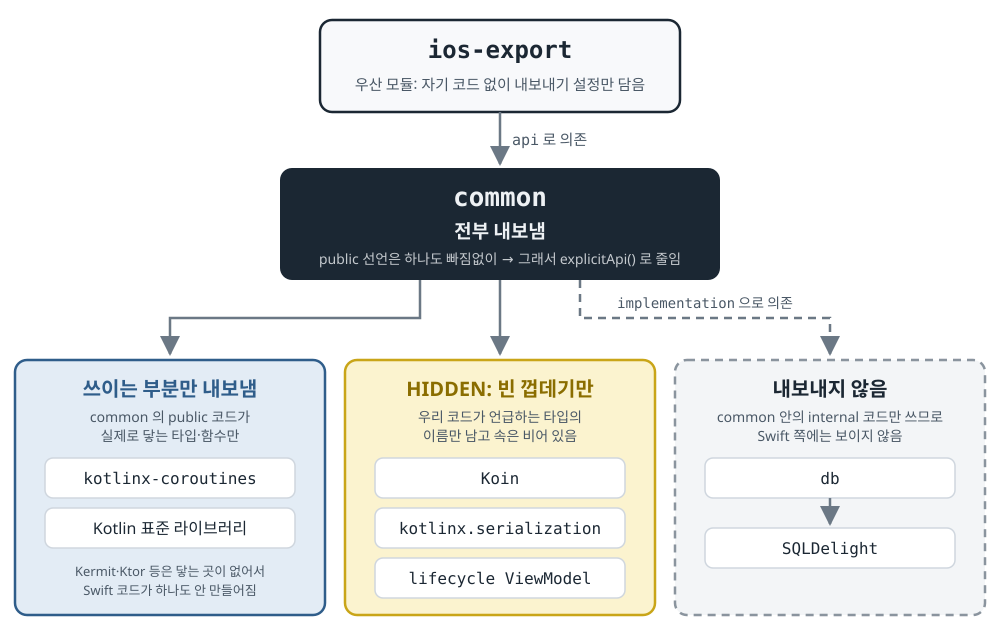

## 한 줄 요약

Android와 iOS가 Kotlin 코드를 함께 쓰는 샘플 앱 PeopleInSpace에서, iOS 앱이 Kotlin 코드를 불러 쓰는 방식을 **SKIE라는 외부 도구**에서 **Kotlin이 직접 제공하는 Swift export 기능**으로 바꾼 기록이다. 바꾸고 나니 iOS 쪽 코드는 조금만 고치면 됐다. 시간이 많이 든 일은 따로 있었다. **Kotlin 쪽에서 iOS로 넘겨주는 코드의 양을 꼭 필요한 만큼만 남기도록 줄이는 일**이었다.

> 이 글의 코드 블록은 저자의 샘플 앱 [PeopleInSpace](https://github.com/joreilly/PeopleInSpace)(Apache-2.0 라이선스 — 출처와 라이선스를 밝히면 가져다 쓸 수 있는 공개 라이선스)에서 인용했고, 블록마다 출처를 적었다. 그림은 원문 그림을 바탕으로 한국어로 다시 그렸다.

## 먼저 알아 둘 말

이 글에는 iOS 쪽 용어가 많이 나온다. 본문을 읽기 전에 한 번 훑어 두면 편하다.

- **Kotlin Multiplatform(KMP)**
  - Kotlin으로 쓴 코드 하나를 Android 앱과 iOS 앱이 **함께 쓰게 해 주는** Kotlin 기능이다.
  - 보통 화면은 각 플랫폼 방식으로 따로 만들고, 서버 통신·데이터 저장·화면 상태 계산 같은 로직만 Kotlin으로 한 번 짜서 양쪽이 나눠 쓴다.
  - 이 글의 PeopleInSpace 앱에서는 이 공용 코드가 `common` 이라는 모듈에 들어 있다.
- **Swift / SwiftUI**
  - Swift는 Apple이 만든 iOS 앱 개발 언어다. Android의 Kotlin에 해당한다.
  - SwiftUI는 Swift로 화면을 만드는 방식이다. Android의 Jetpack Compose에 해당한다.
- **Objective-C**
  - Swift 이전에 쓰던 Apple의 옛 언어다.
  - Swift는 Objective-C 코드를 그대로 불러 쓸 수 있다. 그래서 그동안 Kotlin은 iOS에 코드를 넘길 때 **Objective-C 모양으로 포장해서** 넘겼다. 아래 "서론"에서 자세히 다룬다.
- **프레임워크(framework)**
  - iOS에서 쓰는 "미리 컴파일해 둔 코드 묶음"이다. Android의 `.aar` 라이브러리 파일과 비슷하다.
  - Kotlin 공용 코드는 이 프레임워크 형태로 만들어져 iOS 앱에 들어간다.
- **바인딩(binding)**
  - 한 언어의 코드를 다른 언어에서 부를 수 있게 이어 주는 연결 코드다.
  - 이 글에서는 "Swift가 Kotlin 함수를 부를 때 거치는 다리 역할 코드"라는 뜻이다.
- **sealed class**
  - Kotlin에서 "이 타입은 정해진 몇 가지 경우 중 하나다"를 표현하는 클래스다.
  - 예를 들어 화면 상태를 `Loading`(불러오는 중) · `Success`(성공) · `Error`(실패) 셋 중 하나로 정해 두는 데 쓴다.
  - Kotlin의 `when` 은 세 경우를 다 처리했는지 컴파일러가 검사해 준다.
- **Flow / StateFlow**
  - Flow는 시간이 지나면서 값이 계속 흘러나오는 통로다. Kotlin 코루틴(비동기 작업을 쉽게 쓰게 해 주는 Kotlin 기능)에 들어 있다.
  - StateFlow는 Flow 중에서도 "지금 값"을 항상 하나 들고 있는 종류다. 화면 상태를 담아 두는 데 많이 쓴다.
- **모듈과 의존성(dependency)**
  - 모듈은 Gradle이 나눠서 빌드하는 코드 덩어리 하나다. Android 다중 모듈 앱의 `core:data`, `feature:home` 같은 단위다.
  - "A가 B에 의존한다"는 A가 B의 코드를 가져다 쓴다는 뜻이다.
  - 의존성을 걸 때 `implementation(B)` 로 걸면 B는 A 안에서만 보인다. `api(B)` 로 걸면 A를 쓰는 다른 모듈에도 B가 그대로 보인다.
- **public / internal**
  - Kotlin에서 "이 코드를 어디까지 보이게 할지" 정하는 표시다.
  - `public` 은 어디서든 보인다. 아무 표시를 안 하면 기본값이 public이다.
  - `internal` 은 같은 모듈 안에서만 보인다.
- **이 글에 나오는 라이브러리**
  - Koin: 객체를 만들어 필요한 곳에 넣어 주는 라이브러리. Android의 Hilt와 같은 역할이다.
  - Ktor: 서버 통신 라이브러리. Retrofit·OkHttp와 같은 역할이다.
  - SQLDelight: 데이터베이스 라이브러리. Room과 같은 역할이다.
  - Kermit: 로그를 남기는 라이브러리. Timber와 같은 역할이다.
  - kotlinx.serialization: JSON과 Kotlin 객체를 서로 바꿔 주는 라이브러리.

## 서론 — 이 글은 무엇을 하려는가

저자는 글 첫머리에서 상황을 이렇게 정리한다.

- PeopleInSpace의 **iOS 앱(SwiftUI로 만든 화면)** 은 지금까지 공용 Kotlin 코드를 **Objective-C 설명서가 붙은 프레임워크**로 받아서 썼다.
- 그 위에 **SKIE** 를 얹어서, sealed class나 Flow 같은 것을 Swift에서 더 편하게 쓰고 있었다.
- 그런데 Kotlin에는 **Swift export** 라는 기능도 있다(아직 알파 — 초기 시험 단계). Objective-C를 거치지 않고 **Swift용 바인딩을 바로 만들어 준다.**
- 이 글은 PeopleInSpace를 Swift export로 옮기는 데 무엇이 필요했는지 하나씩 보여 준다. 변경 내용은 [PR #524](https://github.com/joreilly/PeopleInSpace/pull/524)에 있고, 글을 쓴 시점에는 아직 작업 중(draft)이었다.
- 사용한 버전은 **Kotlin 2.5.0-Beta2 의 개발 중 빌드(`2.5.0-Beta2-58`)** 다.
  - 그보다 이전 버전에서는 이 프로젝트에 우회책이 여러 개 필요했다.
  - Beta2에는 설정 문법(DSL — Gradle 빌드 파일에 쓰는 Kotlin 문법)이 바뀐 부분이 있고, 아래 설정이 그 문법을 쓴다.

서론에 나온 "Objective-C 프레임워크"와 "SKIE"가 왜 등장했는지 알아야 이 글의 의미가 보인다. 그래서 그 배경을 조금 더 풀어 둔다.

### 배경 ① — 기본 방식은 Objective-C를 거쳐서 부른다

- Kotlin 공용 코드를 iOS용으로 빌드하면 프레임워크가 하나 만들어진다.
- 이 프레임워크 바깥에 붙는 설명서(헤더 파일)는 **Objective-C 언어로** 쓰여 있다.
  - Kotlin이 Swift보다 오래된 Objective-C 방식을 먼저 지원해 왔기 때문이다.
  - Swift 앱은 이 Objective-C 설명서를 읽어서 Kotlin 코드를 부른다.
- 그래서 흐름은 **Kotlin → Objective-C 모양으로 포장 → Swift가 그 포장을 열어서 사용**이다.

### 배경 ② — 포장 과정에서 Kotlin의 좋은 기능이 사라진다

Objective-C는 Kotlin보다 표현할 수 있는 것이 적다. 포장을 거치면 이런 일이 생긴다.

- **sealed class가 평범한 클래스 묶음이 된다.**
  - Swift에서 "Loading·Success·Error 중 무엇인지" 처리하려면 `if let x = state as? Success` 처럼 하나씩 형변환해 봐야 한다.
  - 한 경우를 빠뜨려도 컴파일러가 알려 주지 않는다.
- **Kotlin `enum` 이 Swift `enum` 이 아니라 그냥 클래스로 넘어간다.** 그래서 Swift `switch` 로 깔끔하게 나눌 수 없다.
- **Flow의 값 타입 정보가 사라진다.**
  - `Flow<List<Person>>` 이 Swift에는 "무언가가 흘러나오는 Flow"로만 보인다.
  - Swift에서 값을 꺼내 쓰려면 형변환과 연결 코드를 손으로 짜야 한다.
- **함수의 기본값 인자가 사라진다.** Kotlin에서 생략 가능하던 인자를 Swift에서는 매번 다 넣어야 한다.
- **이름이 길고 어색해진다.** 예를 들어 `Koin.kt` 파일에 있는 최상위 함수(클래스 밖에 선언한 함수)는 Swift에서 `KoinKt.함수이름()` 처럼 파일 이름 뒤에 `Kt` 가 붙어서 불린다.

### 배경 ③ — SKIE는 이 문제를 메워 주던 외부 도구다

- SKIE(Swift Kotlin Interface Enhancer, "Swift-Kotlin 연결 개선 도구")는 KMP 전문 회사 **Touchlab**이 만든 Gradle 플러그인이다.
- Objective-C 포장은 그대로 둔다. 그 위에 **Swift 코드를 추가로 생성해 얹어서** 사라진 기능을 되살린다.

| Objective-C 포장만 썼을 때 생기는 문제 | SKIE가 해 주는 일 |
|---|---|
| sealed class를 Swift에서 하나씩 형변환해 봐야 하고, 빠뜨린 경우를 컴파일러가 잡아 주지 않는다 | `onEnum(of:)` 함수가 sealed class를 Swift `enum` 으로 바꿔 준다. 그래서 `switch` 로 모든 경우를 빠짐없이 처리했는지 컴파일러가 검사해 준다 |
| Flow의 값 타입이 사라져서 Swift에서 값을 꺼내 쓰기 어렵다 | Flow를 Swift의 비동기 시퀀스(`AsyncSequence` — Swift에서 `for await` 로 값을 하나씩 받아 쓰는 통로)로 바꿔 준다. 값 타입도 그대로 유지된다 |
| SwiftUI 화면에서 StateFlow 값이 바뀔 때마다 다시 그리려면 연결 코드를 직접 짜야 한다 | `Observing` 이라는 SwiftUI 뷰(화면 조각)를 제공한다. StateFlow를 넘기면 값이 바뀔 때마다 화면이 알아서 다시 그려진다 |
| Kotlin enum이 Swift enum이 아니다 | 진짜 Swift enum으로 바꿔 준다 |

- Swift export는 중간 포장이 없으니, SKIE가 나중에 메워 주던 것들 중 상당수가 처음부터 Swift다운 모양으로 나온다. 그래서 SKIE를 걷어 낼 수 있다.

## 1. Gradle 설정 바꾸기

### ① 예전 방식에 쓰던 설정을 지운다

`common` 모듈의 빌드 파일(`common/build.gradle.kts`)에서 세 가지를 지웠다.

- **SKIE 플러그인** — 이제 Objective-C 포장을 쓰지 않으니 그 위에 얹던 도구도 필요 없다.
- **`multiplatform-swiftpackage` 플러그인**
  - 만들어진 프레임워크를 Swift 패키지(Swift 쪽 라이브러리 배포 형식, Android의 Maven 라이브러리와 비슷함)로 포장해 주던 플러그인이다.
  - 새 방식에서는 쓰지 않는다.
- **`binaries.framework` 블록** — "Objective-C 설명서가 붙은 프레임워크를 만들어라"는 설정이다.

### ② 내보내기만 담당하는 새 모듈 `ios-export` 를 만든다

- 이 모듈에는 **자기 코드가 한 줄도 없다.** `common` 에 의존하고, Swift export 설정만 담는다.
- 저자는 이것을 **"우산(umbrella) 모듈"** 이라고 부른다. 내보낼 대상을 위에서 덮어 감싸는 모듈이라는 뜻이다.
- 왜 굳이 이런 빈 모듈이 필요한지는 아래 "2. Swift로 내보내는 양 줄이기"에서 설명한다.

```kotlin
kotlin {
    iosArm64()
    iosSimulatorArm64()

    sourceSets {
        commonMain.dependencies {
            api(projects.common)
        }
    }

    export {
        swift {
            moduleName = "Shared"
            xcodeIntegration {
                configure(projects.common) {
                    moduleName = "Common"
                    rootPackage = "dev.johnoreilly.common"
                }
                configure(libs.koin.core, SwiftExportVisibility.HIDDEN)
                configure(libs.kotlinx.serialization.core, SwiftExportVisibility.HIDDEN)
                configure(libs.androidx.lifecycle.viewmodel, SwiftExportVisibility.HIDDEN)            }
        }
    }
}
```

> 출처: PeopleInSpace `ios-export/build.gradle.kts` ([PR #524](https://github.com/joreilly/PeopleInSpace/pull/524), Apache-2.0)

한 줄씩 보면 이렇다.

- **`iosArm64()` · `iosSimulatorArm64()`**
  - 이 모듈을 어떤 기기용으로 빌드할지 정한다.
  - 앞의 것은 실제 iPhone용, 뒤의 것은 Apple 칩(M1 이후) Mac에서 돌리는 iPhone 시뮬레이터(가상 iPhone)용이다.
- **`api(projects.common)`**
  - `common` 모듈에 **`api` 로** 의존한다.
  - `api` 로 걸었기 때문에 `common` 의 public 코드는 전부 Swift로 넘어간다. 이것이 이 모듈이 존재하는 이유다(아래 2장).
- **`export { swift { ... } }`**
  - Kotlin 2.5에서 새로 쓰는 Swift export 설정 블록이다. 예전의 `swiftExport { }` 블록은 이제 쓰지 말라고(deprecated) 표시됐다.
  - `moduleName = "Shared"` 는 이 우산 모듈 자체가 Swift에서 갖는 이름이다.
- **`xcodeIntegration { configure(...) }`**
  - Xcode로 iOS 앱을 빌드할 때 의존성마다 따로 옵션을 줄 수 있다.
- **`configure(projects.common) { ... }`** — `common` 에 주는 옵션 두 가지:
  - `moduleName = "Common"`: Swift 코드에서 `import Common` 으로 불러오게 된다.
  - `rootPackage = "dev.johnoreilly.common"`:
    - 이걸 안 정하면 Swift에서 함수 하나를 부를 때 Kotlin 패키지 경로 전체를 써야 한다. 예: `ExportedKotlinPackages.dev.johnoreilly.common.di.initKoin()`
    - 공용 코드의 맨 위 패키지를 알려 주면 그 앞부분이 생략된다. 예: `di.initKoin()`
- **`configure(libs.koin.core, SwiftExportVisibility.HIDDEN)` 외 두 줄**
  - `libs.koin.core` 처럼 `libs.` 로 시작하는 것은 버전 카탈로그(`libs.versions.toml` 에 라이브러리 버전을 모아 두는 Gradle 기능)에 적어 둔 라이브러리를 가리킨다.
  - Koin, kotlinx.serialization, AndroidX ViewModel 세 라이브러리를 `HIDDEN`(숨김)으로 표시했다.
  - 숨긴 라이브러리는 Swift 쪽에 거의 만들어지지 않는다. 우리 코드가 그 라이브러리의 타입을 언급하는 곳에만, 이름만 있고 속은 빈 껍데기(stub)가 생긴다.

### ③ Xcode 프로젝트 설정을 바꾼다

Xcode는 iOS 앱을 만드는 Apple 개발 도구다(Android Studio에 해당). 여기서도 세 가지를 바꿨다.

- **빌드 중에 Gradle을 부르는 명령을 바꿨다.**
  - Xcode는 iOS 앱을 빌드하는 도중에 정해 둔 스크립트를 실행하는 단계(Run Script 빌드 단계)를 둘 수 있다. 여기서 Gradle을 불러 Kotlin 코드를 먼저 빌드한다.
  - 부르는 작업 이름이 `:common:embedAndSignAppleFrameworkForXcode`(Objective-C 프레임워크 만들기)에서 `:ios-export:embedSwiftExportForXcode`(Swift export 결과 만들기)로 바뀌었다.
- **지원하는 최소 iOS 버전(deployment target)을 18로 올렸다.**
  - Swift export가 코루틴을 Swift에서 쓰게 하려고 함께 넣는 연결 코드가 Swift의 `Mutex` 를 쓴다.
  - `Mutex` 는 여러 작업이 같은 값을 동시에 건드리지 못하게 막는 잠금 장치다. iOS 18부터 들어 있다.
- **링커 옵션에 `-lsqlite3` 를 추가했다.**
  - 링커는 빌드 마지막에 코드 조각들을 하나로 이어 붙이는 도구다.
  - `-lsqlite3` 는 "iOS에 기본으로 들어 있는 SQLite 데이터베이스 라이브러리도 같이 붙여라"는 뜻이다.
  - 왜 이걸 직접 넣어야 했는지는 아래 "DB 코드를 별도 모듈로 뺐다"에서 설명한다.

## 2. Swift로 내보내는 양 줄이기

저자는 **이 작업에 가장 많은 시간이 들었다**고 말한다.

### 처음 결과: 너무 많이, 그리고 깨진 채로 나왔다

- 처음 내보냈을 때 만들어진 Swift 코드는 **약 18,000줄**이었다.
  - 저자가 직접 쓴 코드뿐 아니라 Ktor·SQLDelight·Koin·Kermit·kotlinx.serialization 같은 라이브러리 코드까지 Swift로 넘어왔다.
- 이게 문제인 이유는 세 가지다.
  - **빌드가 느려진다.** 만들어야 하는 코드가 많을수록 시간이 걸린다.
  - **대부분은 Swift가 쓰지도 않는 코드다.** iOS 화면은 화면 상태와 몇 개 함수만 쓰면 되는데, 라이브러리 내부까지 다 넘어왔다.
  - **일부는 아예 컴파일이 안 됐다.** 주로 제네릭(`List<T>` 처럼 타입을 나중에 정하는 문법) 부분에서 만들어진 Swift 코드가 깨졌다.
- 아래 작업을 거친 뒤에는 **약 2,600줄**로 줄었다.

### 내보내는 양을 정하는 규칙

라이브러리가 Swift로 얼마나 넘어가는지는, 내보내는 모듈에 그 라이브러리를 **어떻게 의존시켰는지**에 따라 정해진다.

| 의존 방식 | Swift로 넘어가는 양 | 설명 |
|---|---|---|
| 내보내는 모듈이 `api(...)` 로 의존한 라이브러리 | 전부 | 그 라이브러리의 public 코드가 하나도 빠짐없이 Swift로 만들어진다. "이 모듈을 쓰는 쪽에도 그대로 보여 줘라"는 뜻이기 때문이다 |
| 그 밖의 라이브러리 (한 다리 건너 쓰이는 것) | 쓰이는 부분만 | 내보내는 코드에서 실제로 닿는 타입과 함수만 만들어진다. 이를 "transitive(이어서 닿는 것만) 내보내기"라고 부른다 |
| `HIDDEN` 으로 표시한 라이브러리 | 빈 껍데기만 | 우리 코드가 언급하는 타입의 이름만 남고 속은 비어 있다. 예를 들어 Koin은 약 2,000줄에서 22줄이 됐다. Koin이 쓰던 Kotlin 기본 라이브러리 코드도 약 1,700줄에서 200줄 아래로 함께 줄었다 |

### 그림으로 보면

<figure>
  <a class="figure-scroll" href="../assets/748-modules.svg"></a>
  <figcaption>최종 구조에서 모듈마다 Swift로 넘어가는 양. 그림을 누르면 크게 볼 수 있다. <a href="https://johnoreilly.dev/posts/peopleinspace-swift-export/">원문 그림</a>을 바탕으로 한국어로 다시 그렸다.</figcaption>
</figure>

- 맨 위의 **`ios-export`** 는 코드가 없는 우산 모듈이다. `common` 을 `api` 로 의존한다.
- 가운데 **`common`** 은 `api` 로 연결됐으니 public 코드가 **전부** 넘어간다. 그래서 아래의 `explicitApi()` 로 public 자체를 줄였다.
- 왼쪽 파란 상자는 **쓰이는 부분만** 넘어가는 라이브러리다.
  - 코루틴(`kotlinx-coroutines`)과 Kotlin 표준 라이브러리가 여기 있다.
  - Kermit·Ktor 같은 라이브러리는 `common` 의 public 코드가 닿는 곳이 없어서 **아무것도 만들어지지 않는다.**
- 가운데 노란 상자는 `HIDDEN` 으로 숨겨서 **빈 껍데기만** 넘어가는 라이브러리다.
- 오른쪽 점선 상자는 **아예 넘어가지 않는** 부분이다. `db` 모듈은 `implementation` 으로 연결돼 있고 `common` 안의 internal 코드만 쓴다.

### 빈 우산 모듈 `ios-export` 가 필요한 이유

- 처음에는 내보내기 설정을 `common` 모듈에 바로 넣었다. 그러자 문제가 생겼다.
  - `common` 은 Koin·Kermit 같은 라이브러리를 `api(...)` 로 의존하고 있었다.
  - 위 표의 첫 줄 규칙대로 그 라이브러리들이 **전부** 넘어갔다.
  - 이 라이브러리들이 쓰는 코루틴 라이브러리(`kotlinx-coroutines-core`)까지 통째로 딸려 왔다. 이것만 약 17,000줄이었고, 만들어진 코드는 컴파일되지 않았다.
- 코루틴은 숨길(`HIDDEN`) 수도 없다. iOS 화면이 StateFlow로 화면 상태를 받아야 하기 때문이다.
- 해결책은 내보내는 주체를 바꾸는 것이었다.
  - 빈 모듈 `ios-export` 가 `common` 을 `api` 로 의존하게 한다.
  - 그러면 **`common` 자기 코드만 전부** 넘어가고, `common` 이 쓰는 라이브러리들은 **쓰이는 부분만** 넘어간다(위 표의 둘째 줄).
- 저자는 "이 라이브러리는 쓰이는 부분만 내보내라"를 설정으로 직접 지정하는 방법이 지금은 없어서, 이렇게 모듈 구조로 우회했다고 말한다.

### `common` 자체도 줄였다 — `explicitApi()` 켜기

- 우산 모듈로 라이브러리 쪽은 줄였다. 하지만 `common` 은 여전히 **public 코드 전부**가 넘어간다. Swift가 쓰든 안 쓰든, 그리고 그 코드가 언급하는 라이브러리 타입까지 함께.
- Kotlin은 아무 표시 없이 선언하면 public이다. 그래서 **"모듈 밖에서 쓸 생각이 없었는데 표시를 안 해서 public이 된" 코드**가 쌓여 있었다.
- 이를 찾으려고 `common` 에 **explicit API 모드**를 켰다.

```kotlin
kotlin {
    explicitApi()
    ...
}
```

> 출처: PeopleInSpace `common/build.gradle.kts` ([PR #524](https://github.com/joreilly/PeopleInSpace/pull/524), Apache-2.0)

- `explicitApi()` 를 켜면 Kotlin 컴파일러가 public으로 공개되는 선언마다 `public` 또는 `internal` 을 **직접 적으라고 요구**한다. 안 적은 곳이 있으면 빌드가 실패한다.
- 켜 보니 **53곳**이 걸렸다. 저자는 하나씩 보면서 정말 공개할지 정했다.
- 그 결과 다음 코드들을 `internal`(같은 모듈 안에서만 보임)로 바꿨다.
  - Repository(데이터를 가져오고 저장하는 일을 맡는 클래스)의 **구현 클래스**
  - Ktor 서버 통신 클라이언트(`HttpClient`) 설정
  - Koin 모듈(어떤 객체를 어떻게 만들지 적어 둔 설정)
  - API 클래스들의 생성자
- 대신 밖에서는 **Repository 인터페이스**(`PeopleInSpaceRepositoryInterface`)만 쓰게 했다. 나머지 필요한 객체는 Koin을 통해 받는다.

### DB 코드를 별도 모듈로 뺐다

- SQLDelight는 데이터베이스 접근 코드를 자동으로 만들어 준다. 그런데 이 자동 생성 코드는 public이다. 그래서 `common` 에 두면 Swift로 넘어간다.
- 이 코드를 새 `db` 모듈로 옮겼다.
  - `common` 은 `db` 를 `implementation(...)` 으로 의존한다. 밖에는 보이지 않는 방식이다.
  - `common` 안에서도 internal 코드에서만 `db` 를 쓴다.
  - 이제 SQLDelight는 Swift로 넘어가지 않는다.
- 그 부작용으로 링커 옵션을 직접 넣어야 했다.
  - 원래는 SQLDelight 플러그인이 iOS 빌드에 `-lsqlite3`(SQLite 라이브러리 붙이기)를 **알아서** 넣어 주고 있었다.
  - 플러그인이 이제 `db` 모듈에만 적용되면서 그 자동 설정이 `common` 에서 사라졌다.
  - 그래서 Xcode 설정에 직접 추가했다. 같은 `common` 으로 만드는 Windows용 DLL(윈도우의 라이브러리 파일)에도 똑같이 추가했다.

### 줄인 것의 부수 효과

- `internal` 은 iOS만이 아니라 **모듈 전체에 적용된다.** 그래서 같은 `common` 을 쓰는 다른 앱(Android·데스크톱·웹 등)도 이제 더 작은 공개 범위만 본다.
  - 저자는 이것을 그 자체로 좋은 일이라고 말한다. 다른 앱들이 `common` 의 어디를 써야 하는지 더 분명해지기 때문이다.
- 저자가 앞서 쓴 [iOS 빌드 시간 글](https://johnoreilly.dev/posts/kmp-ios-build-times/)에서 확인했듯이, 내보내는 양이 줄면 Swift export 빌드 시간도 크게 줄어든다.

## 3. Swift 코드 쪽 변화

### 불러오는 이름과 부르는 이름

- `import common` 이 `import Common` 이 됐다(1장에서 정한 모듈 이름).
- Kotlin 패키지가 Swift **이름공간**(namespace — 이름을 묶어 두는 상자)으로 바뀐다. 그래서 부르는 이름이 Kotlin 패키지를 따라간다.
  - `KoinKt.personListViewModel()` 은 `di.personListViewModel()` 이 됐다. `di` 는 Kotlin 패키지 이름이다.
  - `Assignment` 타입은 `remote.Assignment` 가 됐다.

### 만들어진 Swift 코드는 어떻게 생겼나

저자는 ViewModel 하나를 예로 보여 준다. 먼저 Kotlin 쪽 원본이다.

```kotlin
public class PersonListViewModel internal constructor(
    private val peopleInSpaceRepository: PeopleInSpaceRepositoryInterface
) : ViewModel() {

    public val uiState: StateFlow<PersonListUiState> = peopleInSpaceRepository.personListUiState()
        .stateIn(viewModelScope, SharingStarted.WhileSubscribed(5000), PersonListUiState.Loading)

    public fun refresh() {
        viewModelScope.launch {
            peopleInSpaceRepository.fetchAndStorePeople()
        }
    }
}
```

> 출처: PeopleInSpace `PersonListViewModel.kt` ([joreilly/PeopleInSpace](https://github.com/joreilly/PeopleInSpace), Apache-2.0)

- 클래스와 공개할 멤버에 `public` 이 직접 붙어 있다. 위의 `explicitApi()` 를 켰기 때문이다.
- **생성자는 `internal`** 이다. 그래서 Swift나 다른 모듈은 이 ViewModel을 직접 만들 수 없고, Koin이 만들어 준 것을 받아 쓴다.
- `uiState` 는 화면 상태를 담은 StateFlow다.
  - `stateIn(...)` 은 Repository가 주는 Flow를 StateFlow로 바꾼다.
  - `SharingStarted.WhileSubscribed(5000)` 은 "화면이 값을 받아 가는 동안만 Flow를 돌리고, 마지막 화면이 떠난 뒤에도 5초(5000ms)는 기다렸다가 멈춘다"는 뜻이다. 화면 회전처럼 잠깐 사라졌다 돌아오는 경우에 다시 처음부터 불러오지 않으려는 흔한 설정이다.
  - 처음 값은 `PersonListUiState.Loading`(불러오는 중)이다.
- `refresh()` 는 `viewModelScope`(ViewModel이 살아 있는 동안만 도는 코루틴 범위)에서 Repository의 `fetchAndStorePeople()` 를 불러 데이터를 새로 받아 저장한다.

이 클래스로 Swift export가 만든 Swift 코드는 다음과 같다(원문에서도 `uiState` 의 실제 몸통과 internal 생성자는 길어서 생략했다).

```swift
extension ExportedKotlinPackages.dev.johnoreilly.common.viewmodel {
    public final class PersonListViewModel: ExportedKotlinPackages.androidx.lifecycle.ViewModel {
        public var uiState: any KotlinCoroutineSupport.KotlinTypedStateFlow<ExportedKotlinPackages.dev.johnoreilly.common.viewmodel.PersonListUiState> {
            get {
                ...
            }
        }
        public func refresh() -> Swift.Void {
            return { dev_johnoreilly_common_viewmodel_PersonListViewModel_refresh(self.__externalRCRef()); return () }()
        }
    }
}
```

> 출처: 원문 글에 실린 생성 코드 `Common.swift` ([원문](https://johnoreilly.dev/posts/peopleinspace-swift-export/))

- **`extension ExportedKotlinPackages.dev.johnoreilly.common.viewmodel { ... }`**
  - Kotlin 패키지 `dev.johnoreilly.common.viewmodel` 이 Swift 이름공간이 된 모습이다.
  - 그 안에 같은 이름의 Swift 클래스가 들어간다.
  - 앞서 `rootPackage` 를 정해 두었기 때문에, Swift 코드에서 부를 때는 이 긴 경로 대신 `viewmodel.PersonListViewModel` 처럼 짧게 쓸 수 있다.
- **`public final class PersonListViewModel: ...ViewModel`**
  - Kotlin 클래스가 진짜 Swift 클래스가 됐다. 부모 클래스(AndroidX `ViewModel`)도 그대로 이어진다.
  - `final` 은 Swift에서 "이 클래스를 더는 상속할 수 없다"는 표시다.
- **`uiState` 의 타입 `KotlinTypedStateFlow<...PersonListUiState>`**
  - 값 타입(`PersonListUiState`)이 그대로 살아 있다. Objective-C 포장에서 사라지던 정보다.
- **`refresh()`**
  - 몸통은 C 언어 모양의 연결 함수(`dev_johnoreilly_common_viewmodel_PersonListViewModel_refresh`)를 부르는 한 줄이다.
  - `self.__externalRCRef()` 는 이 Swift 객체가 가리키는 **Kotlin 객체에 대한 참조**를 넘기는 부분이다. 즉 Swift 함수가 실제 일은 Kotlin 쪽에 넘긴다.

### StateFlow를 화면에 잇는 `Observing` 을 직접 만들었다

- 지금까지는 SKIE가 주는 `Observing` 이라는 SwiftUI 뷰로 ViewModel의 StateFlow를 화면에 이었다. SKIE를 걷어 냈으니 이제 쓸 수 없다.
- 위에서 봤듯이 Swift export는 StateFlow를 `KotlinTypedStateFlow<값 타입>` 으로 넘긴다. 여기에는 두 가지가 들어 있다.
  - `value`: 지금 값
  - `asAsyncSequence()`: 앞으로 바뀌는 값을 `for await` 로 하나씩 받는 통로
- 저자는 이 둘로 같은 역할의 뷰를 직접 만들었다.

```swift
struct Observing<Value, Content: View>: View {
    private let flow: any KotlinTypedStateFlow<Value>
    private let content: (Value) -> Content

    @State private var value: Value

    init(
        _ flow: any KotlinTypedStateFlow<Value>,
        @ViewBuilder content: @escaping (Value) -> Content
    ) {
        self.flow = flow
        self.content = content
        self._value = State(initialValue: flow.value)
    }

    var body: some View {
        content(value)
            .task {
                do {
                    for try await next in flow.asAsyncSequence() {
                        value = next
                    }
                } catch {}
            }
    }
}
```

> 출처: PeopleInSpace `Observing.swift` ([PR #524](https://github.com/joreilly/PeopleInSpace/pull/524), Apache-2.0)

- **`struct Observing<Value, Content: View>: View`**
  - 화면 조각(SwiftUI `View`) 하나를 정의한다.
  - `Value` 는 StateFlow 안의 값 타입, `Content` 는 그 값으로 그릴 화면의 타입이다. 둘 다 쓰는 쪽에서 정해지는 제네릭이다.
- **`flow` · `content`**
  - 지켜볼 StateFlow와, 값을 받아 화면을 그리는 함수를 보관한다.
  - Compose로 치면 `@Composable (Value) -> Unit` 람다를 받아 두는 것과 같다.
- **`@State private var value`**
  - SwiftUI의 `@State` 는 Compose의 `remember { mutableStateOf(...) }` 와 같은 역할이다. 이 값이 바뀌면 화면이 다시 그려진다.
- **`init(...)`**
  - 처음 값은 `flow.value`(StateFlow의 지금 값)로 채운다. 그래서 화면이 처음 뜰 때 빈 화면 없이 바로 그려진다.
  - `@ViewBuilder` 는 SwiftUI에서 "여러 화면 조각을 이어 쓰는 블록"을 받게 해 주는 표시다.
- **`body`**
  - 지금 값으로 `content(value)` 를 그린다.
  - `.task { ... }` 는 화면이 나타날 때 비동기 작업을 시작하고, 화면이 사라지면 자동으로 취소하는 SwiftUI 기능이다. Compose의 `LaunchedEffect` 와 같다.
  - 그 안에서 `for try await next in flow.asAsyncSequence()` 로 새 값을 하나씩 받아 `value` 에 넣는다. `value` 가 바뀌니 화면이 다시 그려진다.

### sealed class 처리

- SKIE의 `onEnum(of:)` 대신, Swift export가 sealed class마다 만들어 주는 `sealedType()` 함수를 쓴다.
- 이 함수는 Swift enum을 돌려준다. 그래서 `switch` 로 경우를 빠짐없이 나눌 수 있다.

```swift
Observing(viewModel.uiState) { uiState in
    switch uiState.sealedType() {
    case .success(let success):
        // use success.value.result
    case .error(let failure):
        // use failure.value.message
    case .loading:
        ...
    }
}
```

> 출처: PeopleInSpace `ContentView.swift` ([PR #524](https://github.com/joreilly/PeopleInSpace/pull/524), Apache-2.0)

- 위에서 만든 `Observing` 에 ViewModel의 `uiState` 를 넘기고, 값이 올 때마다 블록이 다시 실행된다.
- `uiState.sealedType()` 이 `.success` · `.error` · `.loading` 중 하나를 돌려준다.
  - `.success(let success)` 는 "성공이면 그 안의 값을 `success` 라는 이름으로 꺼내라"는 뜻이다. 실제 데이터는 `success.value.result` 에 있다.
  - 실패면 `failure.value.message` 로 오류 메시지를 꺼낸다.
- Kotlin의 `when (state) { is Success -> ... }` 와 거의 같은 모양이 됐다.

### Kotlin 인터페이스를 Swift에서 구현하기

- 이 앱에는 **국제우주정거장(ISS) 위치 화면**이 있다. Compose for iOS(iOS에서 돌아가는 Jetpack Compose)로 만든 화면인데, 그 안에 **iOS 기본 지도(SwiftUI)** 를 끼워 넣는다.
- 이를 위해 Kotlin에 `NativeViewFactory` 라는 인터페이스를 두고, Swift에서 구현한다. "지도 화면은 Swift가 만들어서 넘겨 달라"는 약속이다.
- Swift export에서 Kotlin 인터페이스는 Swift **프로토콜**(Swift의 인터페이스)로 넘어간다. 이 프로토콜을 구현하는 Swift 클래스는 **`KotlinBase` 를 상속해야 한다.** 바뀐 건 사실상 이것뿐이다.

```swift
class iOSNativeViewFactory : KotlinBase, ui.NativeViewFactory {
    static var shared = iOSNativeViewFactory()

    func createISSMapView(viewModel: viewmodel.ISSPositionViewModel) -> UIViewController {
        let mapView = NativeISSMapView(viewModel: viewModel)
        return UIHostingController(rootView: mapView)
    }
}
```

> 출처: PeopleInSpace `NativeViewFactory.swift` ([PR #524](https://github.com/joreilly/PeopleInSpace/pull/524), Apache-2.0)

- **`class iOSNativeViewFactory : KotlinBase, ui.NativeViewFactory`**
  - `KotlinBase` 를 상속하고, Kotlin 패키지 `ui` 의 `NativeViewFactory` 프로토콜을 구현한다.
- **`static var shared`** — 앱 전체에서 하나만 쓰는 객체(싱글턴)다.
- **`createISSMapView(...)`**
  - Kotlin이 "ISS 지도 화면을 만들어 달라"고 부르면, SwiftUI 지도 화면(`NativeISSMapView`)을 만든다.
  - 그것을 `UIHostingController`(SwiftUI 화면을 옛 방식인 UIKit 화면으로 감싸 주는 상자)에 넣어 돌려준다. Compose 쪽은 이 UIKit 화면을 받아 자기 화면 안에 끼워 넣는다.

### 겪은 문제 — 숨긴 타입을 돌려주는 함수는 실행하면 죽는다

- 숨긴(`HIDDEN`) 라이브러리의 타입을 **돌려주는** 함수가 있으면 문제가 생긴다.
  - Swift export는 그 함수의 Swift 쪽 몸통을 `fatalError()`(부르는 즉시 앱을 강제로 죽이는 Swift 함수)로 채운다.
  - 그런데 **빌드할 때 경고도 에러도 없다.**
- 실제로 `initKoin()` 이 Koin의 `KoinApplication` 타입을 돌려주고 있었다. Koin을 숨겨 놨으니 이 함수가 `fatalError()` 로 바뀌었고, **앱이 시작하자마자 죽었다.**
- 해결: Swift에서 부르는 쪽의 `initKoin()` 을 아무것도 돌려주지 않게(`Unit`) 바꿨다.

## 4. 저자의 정리

- Swift 쪽에서 고칠 것은 생각보다 적었다.
- 만들어진 Swift 코드도 쓰기 좋았다. 이름공간으로 묶이고, sealed class는 Swift enum으로, StateFlow는 값 타입을 유지한 채로 넘어온다.
- 시간이 든 것은 **iOS가 정말 필요한 것만 내보내도록 줄이는 일**이었다.
  - 저자는 이 작업이 Swift export를 쓰든 기존 Objective-C 방식을 쓰든 **할 가치가 있다**고 말한다.
- Swift export는 아직 알파라 Kotlin 버전마다 빠르게 바뀌고 있다. PR도 아직 작업 중이고, Kotlin `2.5.0-Beta2` 정식 배포가 나오면 그에 맞춰 고칠 계획이다.

## 코드로 보기 — Aide 구조로 옮긴 스케치

> 원문 코드가 아니다. 이 글의 "`internal` 로 숨기고 밖에는 인터페이스만 보여 준다"를 Android 다중 모듈 앱(Hilt 사용)에 옮기면 어떤 모양일지 **직접 쓴 스케치**다.

```kotlin
// core:data 모듈

// ① 밖(feature 모듈)에 보여 줄 것은 인터페이스뿐이다. 표시가 없으니 public.
interface TaskRepository {
    fun observeTasks(): Flow<List<Task>>
    suspend fun complete(id: Long)
}

// ② 실제로 일하는 구현 클래스는 internal — core:data 모듈 밖에서는 이름조차 안 보인다.
internal class DefaultTaskRepository @Inject constructor(
    private val dao: TaskDao,
) : TaskRepository { /* ... */ }

// ③ "TaskRepository 를 달라고 하면 DefaultTaskRepository 를 줘라"는 Hilt 설정도 internal.
@Module
@InstallIn(SingletonComponent::class)
internal abstract class DataModule {
    @Binds
    abstract fun bindTaskRepository(impl: DefaultTaskRepository): TaskRepository
}
```

- **①** 화면 모듈(`feature:*`)은 이 인터페이스만 안다. 원문의 `PeopleInSpaceRepositoryInterface` 와 같은 자리다.
- **②** 구현 클래스는 `internal` 이다. 그래서 화면 모듈이 `DefaultTaskRepository()` 를 직접 만들거나 부를 길이 없다. 원문에서 Repository 구현을 internal로 바꾼 것과 같다.
- **③** Hilt(Android의 객체 주입 라이브러리, 원문의 Koin과 같은 역할)는 같은 Gradle 모듈 안이라면 `internal` 클래스도 문제없이 연결해 준다. 원문에서 Koin 모듈을 internal로 바꾼 것과 같은 자리다.

## 배운 점

- **"어디까지 보여 줄까"는 iOS 기능의 문제가 아니라 모듈 설계의 문제다.**
  - Swift export는 새고 있던 공개 범위를 "Swift 코드 18,000줄"이라는 숫자로 보여 줬을 뿐이다.
  - 같은 문제는 Android 다중 모듈 앱에도 그대로 있다. 숫자로 안 보일 뿐이다.
- **Kotlin의 기본값이 public이라는 점을 의식해야 한다.**
  - 아무 표시를 안 하면 전부 공개된다.
  - `explicitApi()` 를 켜자마자 53곳이 드러났다는 것은, 평소에 그만큼 "의도하지 않은 공개"가 쌓여 있었다는 뜻이다.
- **`api(...)` 와 `implementation(...)` 의 차이가 실제 결과를 바꾼다.**
  - 무심코 `api` 로 걸어 둔 의존성 하나가 코루틴 라이브러리 전체를 끌고 왔다.
- **빌드 성공이 실행 성공은 아니다.**
  - 숨긴 타입을 돌려주는 함수는 경고 없이 실행 순간에 앱을 죽였다.
  - 새 기능, 특히 알파 기능은 꼭 실제로 돌려 봐야 한다.

## Aide에 적용하면

Aide는 iOS 앱이 없는 Android 전용 앱이다. 그래서 Swift export와 SKIE 자체는 쓸 일이 없다. 하지만 이 글의 핵심인 **"모듈 밖으로 보이는 것을 꼭 필요한 만큼으로 줄인다"** 는 Aide의 다중 모듈 구조(`app` · `feature:*` · `core:*`)에 그대로 들어맞는다.

1. **Repository 구현 클래스와 Hilt 모듈을 `internal` 로 만든다 — 가져온다.**
   - 대상: Task 5의 `DefaultEventRepository`(폰 캘린더 일정 읽기), Task 7의 `DefaultTaskRepository`(할 일 저장).
   - 처음 만들 때부터 위 스케치처럼 `internal` 로 둔다.
   - Aide는 "Repository 함수는 화면 전용이 아니라 동작 단위(만들기·지우기·완료·완료 취소)로 두고, 1-b에서 AI가 그 함수를 그대로 부른다"고 정했다. 밖에 보이는 것이 인터페이스뿐이어야 AI가 부를 수 있는 함수 목록도 인터페이스에 적힌 것만으로 깔끔하게 유지된다.
2. **Konsist 규칙으로 지킨다 — 바꿔서 가져온다.**
   - 원문은 Kotlin 컴파일러의 `explicitApi()` 로 강제했다.
   - Aide에는 이미 Konsist(코드 구조 규칙을 테스트로 검사하는 라이브러리) 테스트가 있고, CI(코드를 올리면 자동으로 빌드·테스트하는 장치)에서 실패하면 막힌다.
   - 지금 있는 `ModuleDependencyTest` 옆에 "`core.data` 패키지의 `Default...Repository` 클래스는 `internal` 이어야 한다" 같은 규칙을 하나 더하는 편이 기존 방식과 맞는다.
3. **`explicitApi()` 를 모든 모듈에 켜기 — 지금은 안 한다.**
   - 컨벤션 플러그인(모든 모듈에 같은 빌드 설정을 한 번에 적용하는 Aide의 `build-logic`)에서 켜면, 공개하는 모든 선언에 `public` 을 직접 써야 한다.
   - 1-a를 손으로 짜고 있는 지금은 그만큼 속도가 느려진다.
   - Konsist 규칙만으로 부족하다고 느껴질 때, `core:*` 라이브러리 모듈에만 켜는 것을 다시 검토한다.
4. **DB 코드 분리 — 이미 되어 있다. 연결 방식만 확인한다.**
   - 원문은 SQLDelight 자동 생성 코드를 `db` 모듈로 빼고 `implementation` 으로 연결해 숨겼다(그림의 오른쪽 점선 상자).
   - Aide는 처음부터 Room 데이터베이스를 `core:database` 에 두고, 화면이 쓰는 `core:data` 와 나눠 두었다.
   - 다만 `core:data` 가 `core:database` 를 `api(...)` 로 의존하면 화면 모듈에도 DB 코드가 보이게 된다. **`implementation(...)` 으로 걸었는지** 확인할 필요가 있다.

## 출처

- [Moving from SKIE to Swift export in a Kotlin Multiplatform project — John O'Reilly](https://johnoreilly.dev/posts/peopleinspace-swift-export/)
- [PeopleInSpace PR #524 (작업 중)](https://github.com/joreilly/PeopleInSpace/pull/524) — 인용한 코드의 출처, Apache-2.0
- [SKIE — Touchlab](https://skie.touchlab.co/)
- [Kotlin 문서: Swift export](https://kotlinlang.org/docs/native-swift-export.html)
- [iOS 빌드 시간 글 — John O'Reilly](https://johnoreilly.dev/posts/kmp-ios-build-times/)
- [Android Weekly #748](https://androidweekly.net/issues/issue-748)
