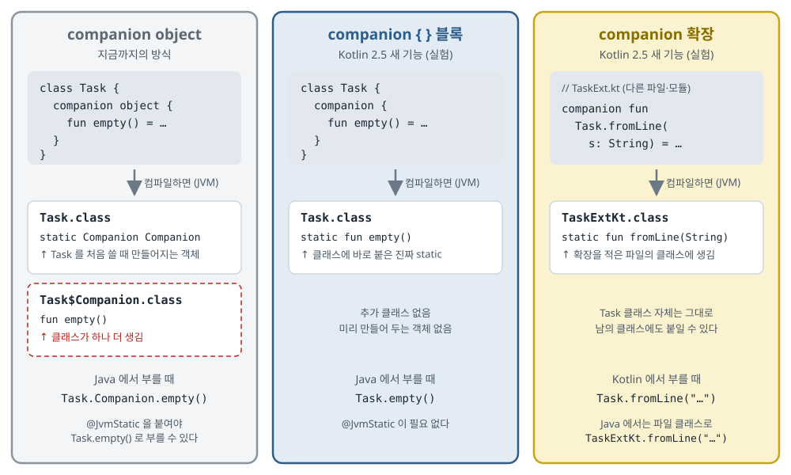

## 한 줄 요약

Kotlin에서 "클래스에 딸린 상수·함수"를 둘 때 늘 쓰던 `companion object` 는 사실 **객체 하나와 클래스 하나를 더 만드는** 방식이다. Kotlin 2.5부터 실험 기능으로 들어온 **companion 블록**은 `object` 라는 단어만 빼면 되고, 컴파일하면 Java의 `static` 처럼 **클래스에 바로 붙는다.** 함께 들어온 **companion 확장**은 내가 만들지 않은 클래스에도 바깥에서 `Task.fromLine(...)` 같은 "클래스 이름으로 부르는 함수"를 붙일 수 있게 해 준다.

> 원문(Medium 글)에는 라이선스 표시가 없어서 코드를 그대로 옮기지 않았다. 원문의 코드 예제 다섯 개를 **같은 구조로, 할 일(`Task`) 예제로 직접 다시 썼다.** 원문의 그림 두 장(AI로 만든 비교 그림)도 같은 내용을 한국어 그림으로 다시 그렸다. 공식 설명은 원문이 참고한 [JetBrains 블로그 글](https://blog.jetbrains.com/kotlin/2026/09/the-companions-to-come/)에서 함께 확인했다.

## 먼저 알아 둘 말

- **static(정적) 멤버**
  - 객체를 만들지 않고 **클래스 이름으로 바로** 쓰는 상수·함수다. 예: Java의 `Math.max(1, 2)`, `Integer.MAX_VALUE`.
  - "이 클래스의 값 하나하나"가 아니라 "이 클래스 자체"에 딸린 것이라서, 상수·도우미 함수·만들기 함수(팩토리 — 객체를 만들어 돌려주는 함수)를 두는 데 쓴다.
  - Kotlin 언어에는 `static` 이라는 단어가 없다. 그래서 그동안 아래 `companion object` 로 같은 일을 해 왔다.
- **companion object(동반 객체)**
  - 클래스 안에 `companion object { ... }` 로 적으면, 그 안의 멤버를 `Task.EMPTY` 처럼 클래스 이름으로 부를 수 있다.
  - 겉보기엔 static 같지만, 실제로는 **진짜 객체 하나**를 만들어 두고 그 객체의 멤버를 부르는 것이다.
- **싱글턴(singleton)**
  - 앱 안에 **딱 하나만 존재하는 객체**다. companion object가 바로 싱글턴이다.
- **JVM과 바이트코드**
  - JVM(Java Virtual Machine)은 Kotlin·Java 코드를 실행하는 실행기다. Android도 이 방식을 따른다.
  - 바이트코드는 Kotlin 코드를 컴파일한 결과로, JVM이 읽는 `.class` 파일 안의 명령이다.
- **디컴파일(decompile)**
  - 컴파일된 결과(`.class`)를 사람이 읽을 수 있는 Java 코드 모양으로 되돌려 보는 것이다.
  - Android Studio의 **Tools → Kotlin → Show Kotlin Bytecode → Decompile** 로 직접 볼 수 있다. "내 Kotlin 코드가 실제로 어떻게 바뀌는지" 확인하는 가장 확실한 방법이다.
- **Java 상호 운용(interop)**
  - Kotlin 코드와 Java 코드가 서로를 부르는 것이다. Android 앱에는 Java로 된 라이브러리·옛 코드가 섞여 있는 경우가 많다.
- **`@JvmStatic`**
  - companion object 멤버에 붙이는 표시다. 붙이면 Java에서도 `Task.empty()` 처럼 static으로 부를 수 있게, 컴파일러가 진짜 static 메서드를 **하나 더** 만들어 준다.
- **확장 함수(extension function)**
  - 클래스를 고치지 않고 바깥에서 함수를 붙이는 Kotlin 기능이다. 예: `fun String.isEmail(): Boolean = ...` 를 만들면 `"a@b.com".isEmail()` 로 부를 수 있다.
  - 지금까지의 확장 함수는 **이미 있는 값(객체)에 대고** 부르는 것만 가능했다.
- **컴파일러 플래그(`-X...`)**
  - 컴파일러에 넘기는 추가 옵션이다. `-X` 로 시작하는 것은 "아직 실험 중인 기능을 켜겠다"는 뜻이다.
- **pre-release(출시 전) 바이너리**
  - 실험 기능으로 컴파일했다는 표시가 붙은 결과물이다. 이런 라이브러리는 정식 컴파일러를 쓰는 다른 프로젝트가 **의존성으로 가져다 쓸 수 없다.**

## 서론 — 지금까지는 companion object를 썼다

원문은 이렇게 시작한다.

- 우리는 오랫동안 상수나 만들기 함수처럼 **클래스에 딸린 멤버**를 `companion object` 에 모아 두었다.
- 그런데 companion object는 속을 들여다보면 **진짜 싱글턴 객체**다. 그래서 두 가지 불편이 있다.
  - **메모리 부담**: 클래스가 하나 더 생기고, 그 클래스의 객체가 하나 만들어진다.
  - **Java와 함께 쓸 때의 불편**: Java에서 static처럼 부르려면 멤버마다 `@JvmStatic` 을 붙여야 한다.

원문의 첫 예제와 같은 구조로 쓰면 이렇다.

```kotlin
data class Task(val title: String, val done: Boolean) {
    companion object {
        @JvmStatic
        fun empty(): Task = Task("", false)
    }
}
```

> 직접 쓴 스케치 — 원문 서론 예제(`User.createDefault()`)와 같은 구조

- `companion object { ... }` 안의 `empty()` 는 Kotlin에서 `Task.empty()` 로 부른다.
- `@JvmStatic` 이 없으면 Java에서는 `Task.Companion.empty()` 처럼 **숨어 있던 객체 이름 `Companion` 을 거쳐서** 불러야 한다. 붙이면 Java에서도 `Task.empty()` 가 된다.

Kotlin 2.5는 이 문제를 풀려고 두 가지를 새로 들여온다.

- **companion 블록(companion blocks)**: `object` 라는 단어를 뺀 `companion { ... }`. JVM에서는 **진짜 static 멤버**로 컴파일된다.
- **companion 확장(companion extensions)**: 어떤 클래스에든 **바깥에서** static 같은 함수·속성을 붙일 수 있다. 내가 고칠 수 없는 클래스 — 외부 라이브러리의 클래스나 Java 표준 클래스 — 에도 붙일 수 있다.

## 1. companion 블록과 companion object는 무엇이 다른가

### 속 구조

- **companion object**
  - 클래스 안에 `Companion` 이라는 **클래스가 하나 더** 생긴다(파일로는 `Task$Companion.class`).
  - 바깥 클래스에는 그 클래스의 **객체 하나**를 담은 static 필드가 생긴다. 이 객체는 `Task` 클래스를 처음 쓸 때 만들어진다.
  - 우리가 부르는 `Task.empty()` 는 실제로는 "그 객체의 `empty()` 메서드"를 부르는 것이다.
- **companion 블록**
  - 추가 클래스도, 미리 만들어 두는 객체도 없다.
  - 블록 안의 멤버가 **`Task` 클래스에 바로 static 멤버로** 붙는다.

### 인터페이스는 여전히 companion object만 구현할 수 있다

- companion object는 진짜 객체라서 **인터페이스를 구현할 수 있다.** 예: `companion object : JsonParser<Task> { ... }` 처럼 "Task 클래스 자체가 파서 역할을 한다"는 구조를 만들 수 있다.
- companion 블록은 객체가 아니다. 그래서 **인터페이스를 구현할 수 없다.** 이런 경우에는 계속 companion object를 써야 한다.

### Java에서 부르는 방법

- companion 블록 멤버는 Java에서 **`Task.empty()`** 로 바로 부른다.
- companion object 멤버는 `@JvmStatic` 을 붙이지 않으면 Java에서 **`Task.Companion.empty()`** 로 불러야 한다.

### 그림으로 보면

<figure>
  <a class="figure-scroll" href="../assets/749-companion-compile.svg"></a>
  <figcaption>세 방식을 컴파일했을 때 생기는 클래스. 그림을 누르면 크게 볼 수 있다. <a href="https://proandroiddev.com/the-evolution-of-statics-say-goodbye-to-kotlin-companion-objects-dbe625b92896">원문의 비교 그림 두 장</a>의 내용을 바탕으로, 컴파일 결과까지 보이도록 한국어로 다시 그렸다.</figcaption>
</figure>

- 왼쪽(지금까지의 방식)은 클래스가 **두 개**다. 점선 상자가 companion object 때문에 추가로 생기는 클래스다.
- 가운데(companion 블록)는 `Task` 클래스 **하나**에 static 메서드가 바로 붙는다.
- 오른쪽(companion 확장)은 `Task` 클래스는 건드리지 않는다. 확장을 적은 **파일 이름의 클래스**(`TaskExt.kt` → `TaskExtKt`)에 static 메서드가 생긴다.

## 2. companion 확장과 보통 확장 함수는 무엇이 다른가

- **부르는 곳**
  - 보통 확장 함수는 **이미 있는 값에 대고** 부른다. 예: `task.isOverdue()` — `task` 라는 객체가 먼저 있어야 한다.
  - companion 확장은 **타입 이름에 대고** 부른다. 예: `Task.fromLine("...")` — 객체 없이 클래스 이름으로 부른다.
- **쓰임새**
  - 보통 확장 함수는 값 하나를 다루는 일(변환, 걸러내기, 검사)에 쓴다.
  - companion 확장은 다음에 쓴다.
    - **남의 클래스에 붙이는 만들기 함수**: 외부 라이브러리 타입을 내 방식대로 만드는 함수
    - **다른 모듈에서 붙이는 설정·초기화 함수**: 그 클래스가 있는 모듈을 고치지 않고 바깥 모듈에서 추가
    - **도메인 상수**: 내 앱에서만 의미 있는 값을 그 타입 이름 아래에 두기

## 3. 직접 써 보기 — 프로젝트 설정

companion 블록과 확장은 **Kotlin 2.5.0-Beta1부터 실험 기능**으로 들어왔다. 써 보려면 두 가지를 설정한다.

### ① 미리보기용 저장소를 추가한다 (`settings.gradle.kts`)

- 원문은 `pluginManagement { repositories { ... } }` 블록에 **JetBrains의 미리보기(bootstrap) 저장소**를 하나 추가한다. Gradle이 아직 정식 출시 전인 Kotlin 컴파일러를 내려받을 수 있게 하려는 것이다.
- 다만 원문이 적은 저장소 주소(`https://jetbrains.space`)는 그대로 따라 하기 전에 확인이 필요하다.
  - 공식 블로그 글에는 별도 저장소 이야기가 없다.
  - Kotlin의 Beta 버전은 보통 일반 저장소(Maven Central)에도 올라온다. 저장소를 추가하지 않고 버전만 바꿔서 먼저 해 보는 것이 안전하다.

### ② 컴파일러 버전과 실험 플래그를 지정한다 (`build.gradle.kts`)

```kotlin
plugins {
    kotlin("jvm") version "2.5.0-Beta1"
}

kotlin {
    jvmToolchain(21)

    compilerOptions {
        // companion 블록과 companion 확장을 모두 켠다
        freeCompilerArgs.add("-Xcompanion-blocks-and-extensions")
    }
}
```

> 직접 쓴 스케치 — 원문의 설정과 같은 내용을 공식 블로그 기준으로 정리

- **`kotlin("jvm") version "2.5.0-Beta1"`**: Kotlin 2.5 미리보기 컴파일러를 쓴다.
- **`jvmToolchain(21)`**: Java 21로 컴파일한다.
- **`freeCompilerArgs.add(...)`**: 컴파일러에 실험 플래그를 넘긴다. 플래그는 두 가지가 있다.
  - `-Xcompanion-blocks`: companion **블록만** 켠다.
  - `-Xcompanion-blocks-and-extensions`: companion 블록과 **확장을 둘 다** 켠다.
  - 원문은 두 플래그를 모두 넣었다. 공식 설명대로라면 뒤의 것 하나에 앞의 것이 포함되므로 위처럼 하나만 넣어도 된다.

## 4. 예전 방식 — companion object와 컴파일 결과

```kotlin
data class Task(val title: String, val done: Boolean) {

    companion object {
        val EMPTY = Task("", false)
        fun sample() = Task("장보기", false)
    }
}
```

> 직접 쓴 스케치 — 원문 `UserWithCompanionObj` 와 같은 구조

이걸 디컴파일하면 대략 이런 모양이다.

```java
public final class Task {
    private static final Task EMPTY = new Task("", false);
    public static final Companion Companion = new Companion(null);

    public static final class Companion {
        private Companion() {}

        public final Task getEMPTY() {
            return Task.EMPTY;
        }

        public final Task sample() {
            return new Task("장보기", false);
        }
    }
}
```

> 직접 쓴 스케치 — 원문의 디컴파일 결과를 바탕으로, 원문에서 생략된 `Companion` 필드 한 줄을 더해 정리

- **`private static final Task EMPTY`**: 값 자체는 바깥 `Task` 클래스의 static 필드에 저장된다.
- **`public static final Companion Companion = new Companion(null);`**: 이것이 **싱글턴 객체**다. `Task` 클래스를 처음 쓸 때 한 번 만들어진다. 원문의 디컴파일 결과에는 이 줄이 빠져 있지만, companion object가 "객체"라는 말은 바로 이 줄을 가리킨다.
- **`public static final class Companion`**: 추가로 생기는 클래스다.
- **`getEMPTY()` · `sample()`**: static이 아니라 **`Companion` 객체의 메서드**다. 그래서 Java에서는 `Task.Companion.getEMPTY()` 처럼 객체를 거쳐 부른다.
  - Kotlin의 `val EMPTY` 는 Java에서 `getEMPTY()` 라는 꺼내기 함수(getter)로 보인다. Kotlin 속성(property)은 이렇게 함수로 바뀐다.

## 5. 새 방식 — companion 블록과 companion 확장

```kotlin
data class Task(val title: String, val done: Boolean) {
    // JVM에서 Task 클래스의 static 멤버가 된다. 추가 객체가 없다.
    companion {
        val EMPTY = Task("", false)

        fun sample(): Task = Task("장보기", false)
    }
}

// TaskExt.kt — 다른 파일. 다른 모듈이어도 된다.
companion val Task.WELCOME: Task
    get() = Task("Aide 둘러보기", false)

companion fun Task.fromLine(line: String): Task {
    val done = line.startsWith("[x] ")
    return Task(line.removePrefix("[x] ").removePrefix("[ ] "), done)
}

fun main() {
    // 1. companion 블록 멤버
    val empty = Task.EMPTY
    val sample = Task.sample()

    // 2. companion 확장 멤버 — 클래스 안에 있는 것과 똑같이 부른다
    val welcome = Task.WELCOME
    val parsed = Task.fromLine("[x] 보고서 제출")
}
```

> 직접 쓴 스케치 — 원문 `User` 예제(`ANONYMOUS` · `createDefault()` · `SYSTEM_ADMIN` · `fromJson()`)와 같은 구조

- **`companion { ... }`**: `companion object` 에서 `object` 만 뺐다. 안에 쓰는 법은 똑같다.
- **`companion val Task.WELCOME: Task`**: `Task` 타입에 바깥에서 붙인 **static 속성**이다.
  - `get() = ...` 으로 적었기 때문에 **꺼낼 때마다 새 `Task` 가 만들어진다.** 블록 안의 `EMPTY` 처럼 한 번 만들어 저장해 두는 것과 다르다. 원문의 `SYSTEM_ADMIN` 도 같은 모양이다.
- **`companion fun Task.fromLine(line: String)`**: `Task` 타입에 바깥에서 붙인 **static 함수**다. 문자열 한 줄(`"[x] 보고서 제출"`)을 읽어 할 일 객체를 만든다.
- **`main()`**: 블록 안 멤버(`Task.EMPTY`, `Task.sample()`)와 바깥에서 붙인 확장(`Task.WELCOME`, `Task.fromLine(...)`)을 **똑같은 모양으로** 부른다. 쓰는 쪽은 어디에 정의됐는지 신경 쓸 필요가 없다.

디컴파일하면 이런 모양이 된다.

```java
// Task.java
public final class Task {
    private static final Task EMPTY = new Task("", false);

    public static final Task getEMPTY() {
        return EMPTY;
    }

    public static final Task sample() {
        return new Task("장보기", false);
    }
}

// TaskExtKt.java — 확장을 적은 파일 TaskExt.kt 의 이름을 딴 클래스
public final class TaskExtKt {
    public static final Task getWELCOME() {
        return new Task("Aide 둘러보기", false);
    }

    public static final Task fromLine(String line) {
        ...
    }
}
```

> 직접 쓴 스케치 — 원문의 디컴파일 결과(`User-decompiled.java`, `UserKt.java`)와 같은 구조로 정리

- **`Task` 클래스**: `Companion` 클래스도, `Companion` 객체 필드도 없다. `getEMPTY()` 와 `sample()` 이 **`static`** 으로 바로 붙었다. 그래서 Java에서도 `Task.sample()` 로 부른다.
- **`TaskExtKt` 클래스**: companion 확장은 `Task` 클래스 안이 아니라 **확장을 적은 파일의 클래스**에 static 메서드로 생긴다.
  - Kotlin 최상위 함수(클래스 밖에 적은 함수)가 `파일이름Kt` 클래스로 모이는 것과 같은 규칙이다.
  - Kotlin에서는 `Task.fromLine(...)` 으로 부르지만, Java에서는 이 파일 클래스 이름으로 `TaskExtKt.fromLine(...)` 처럼 부르는 모양이 된다.

## 6. 공식 블로그가 덧붙인 것

원문이 참고 자료로 단 [JetBrains 공식 글](https://blog.jetbrains.com/kotlin/2026/09/the-companions-to-come/)에는 원문에 없는 중요한 내용이 있다.

- **companion 확장을 켜면 결과물이 pre-release(출시 전) 표시가 붙는다.**
  - 그래서 companion 확장을 쓴 **라이브러리**는 이 기능이 정식이 될 때까지 다른 프로젝트가 의존성으로 가져다 쓸 수 없다.
  - companion 블록만 쓰는 것은 이 제한이 없다. 다만 그 블록을 쓰는 쪽도 블록 기능을 켜야 한다.
- **어떤 클래스·인터페이스에도 companion 확장을 붙일 수 있다.** 내가 만든 것이든 아니든, Kotlin이든 Java든, companion object가 있든 없든 상관없다.
- **Kotlin Multiplatform에도 쓸모가 있다.**
  - KMP에서는 공용 코드에 "이런 것이 있을 것이다(`expect`)"라고 적고 플랫폼별로 "실제는 이것이다(`actual`)"를 채운다.
  - companion 블록 멤버는 JVM에서 진짜 static이 되므로, `expect` 로 적은 companion 블록 멤버를 **Java 클래스의 static 멤버로 채울 수 있다.**
- **companion object를 옮길 필요는 없다.**
  - companion object는 계속 Kotlin의 정식 기능으로 지원된다.
  - 새 코드라면 대부분 companion 블록이 더 낫다. 하지만 인터페이스를 구현해야 하는 경우처럼 companion object만 할 수 있는 일도 남아 있다.
  - 옮기고 싶다면 대개 `object` 단어를 지우면 된다. 다만 그 프로젝트와 그 코드를 쓰는 다른 코드를 **모두 다시 컴파일**해야 한다.
  - **다른 개발 도구가 아직 준비되지 않았을 수 있다**고 공식 글이 직접 말한다. 코드를 읽어 무언가를 만들어 내는 도구(Android의 KSP·Hilt·Room 같은 것)가 새 문법을 이해하는지 확인이 필요하다.

## 원문을 읽을 때 주의할 점

- **원문의 `fromJson` 예제는 Kotlin 코드와 디컴파일 결과가 서로 맞지 않는다.**
  - Kotlin 쪽은 JSON을 읽어 놓고 그 결과를 쓰지 않은 채 `User("Parsed User", 25)` 를 돌려준다.
  - 디컴파일 쪽은 읽은 결과를 출력하고 그대로 돌려준다.
  - 예제를 고치는 중에 한쪽만 바뀐 것으로 보인다. 디컴파일 결과의 구조(파일 클래스에 static 메서드가 생긴다)를 보는 데는 문제가 없다.
- **디컴파일 결과의 `User` 에는 `@Serializable` 이 붙어 있지만, Kotlin 코드에는 없다.** JSON 변환(kotlinx.serialization)을 쓰려면 Kotlin 클래스에 `@Serializable` 을 붙여야 한다.
- **저장소 주소와 플래그 두 개**는 위 3장에서 적은 대로 공식 글과 비교해서 쓴다.

## 배운 점

- **`companion object` 는 static이 아니라 "객체 하나 + 클래스 하나"였다.**
  - 매일 쓰면서도 디컴파일해 보기 전에는 잘 보이지 않는다. Android Studio의 Decompile로 한 번 직접 보면 오래 기억에 남는다.
- **새 기능의 이름이 "대체"처럼 들려도 공식 입장은 "옮길 필요 없다"이다.**
  - 원문 제목은 "companion object여 안녕?"이지만, JetBrains는 companion object를 계속 지원하고 인터페이스 구현처럼 대체 불가능한 쓰임도 있다고 말한다.
  - 제목에 물음표가 붙은 이유다. 2차 자료(원문)를 읽을 때는 1차 자료(공식 글)를 함께 보는 습관이 필요하다.
- **성능 차이는 작다. 진짜 이점은 "읽기"와 "Java에서 부르기"다.**
  - 객체 하나, 클래스 하나가 앱 전체에서 큰 메모리를 쓰지는 않는다.
  - 오히려 `@JvmStatic` 을 잊는 실수가 없어지고, 남의 타입에 `LocalTime.BRIEFING` 처럼 **이름을 붙여 읽기 좋게 만들 수 있다**는 점이 더 크다.

## Aide에 적용하면

Aide는 지금 **Kotlin 2.2.10**을 쓰고 있고, 아직 `companion object` 를 쓰는 코드가 하나도 없다. 그래서 "지금 바꿀 것"보다 "앞으로 짤 코드에서 무엇을 쓸지"의 문제다.

1. **companion 블록·확장 도입 — 지금은 안 한다.**
   - Kotlin 2.5.0-Beta1 이상이 필요하고, 아직 실험 기능이다. 쓰려면 모든 모듈에 실험 플래그를 넣어야 한다.
   - Aide는 KSP로 코드를 만들어 내는 Hilt·Room을 쓴다. 공식 글이 "다른 도구가 아직 준비되지 않았을 수 있다"고 하니, 이 도구들이 새 문법을 지원한다고 확인되기 전에는 위험하다.
   - 1-a를 직접 손으로 짜며 배우는 지금, 실험 컴파일러에서 생기는 문제까지 겹치면 원인을 찾기 어려워진다.
2. **상수는 companion object 대신 최상위에 둔다 — 지금 방식으로 바꿔서 가져온다.**
   - 1-a 계획에는 상수가 필요한 곳이 여럿 있다. 예: DataStore(설정을 저장하는 Android 라이브러리)의 키(Task 5의 `VisibleCalendarStore`, Task 9의 `SettingsRepository`), 알림 채널 이름(Task 12).
   - 습관처럼 `companion object { const val KEY = ... }` 를 쓰기보다, 파일 최상위의 `private const val` 이나 `internal object` 로 둔다.
     - 최상위 `const val` 은 컴파일하면 이미 static이라 추가 객체가 없다.
     - Aide에는 Java 코드가 없어서 `@JvmStatic` 이 필요한 경우도 없다.
   - companion object는 "인터페이스를 구현해야 할 때"처럼 정말 필요할 때만 쓴다. 나중에 companion 블록으로 옮길 때도 옮길 곳이 적어진다.
3. **`LocalTime.BRIEFING` 같은 companion 확장 — Kotlin 2.5가 정식이 되면 가져온다.**
   - Aide에는 "08:30에 숫자 알림을 띄우고 브리핑을 만든다"는 결정이 있다. 이 시각은 지금이라면 `val BRIEFING_TIME = LocalTime.of(8, 30)` 같은 최상위 값이 된다.
   - companion 확장을 쓰면 Java 표준 클래스인 `LocalTime` 에 바로 붙여 `LocalTime.BRIEFING` 으로 읽을 수 있다. "브리핑 시각"이 시간 타입 아래에 있어 찾기 쉽다.
   - 리마인더 간격(30·10·5분 전)도 `Duration.REMIND_30` 처럼 같은 방식을 검토할 수 있다.
   - 조건: Kotlin 2.5 정식 출시, 그리고 Hilt·Room·KSP가 새 문법을 지원한다고 확인된 뒤.

## 출처

- [The Evolution of Statics: Say Goodbye to Kotlin Companion Objects? — Nav Singh (ProAndroidDev)](https://proandroiddev.com/the-evolution-of-statics-say-goodbye-to-kotlin-companion-objects-dbe625b92896)
- [The Companions to Come — Alejandro Serrano Mena (JetBrains 블로그)](https://blog.jetbrains.com/kotlin/2026/09/the-companions-to-come/)
- [Android Weekly #749](https://androidweekly.net/issues/issue-749)
