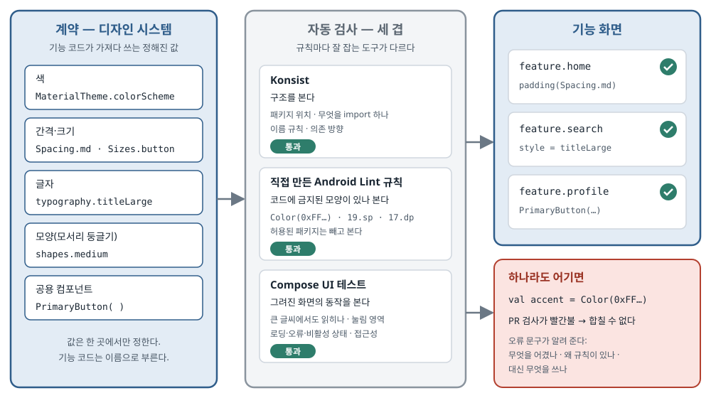

## 한 줄 요약

디자인 시스템(앱 전체가 함께 쓰는 색·글자·간격·버튼 같은 정해진 값과 부품)은 문서로 남겨 두고 리뷰에서 지켜 달라고 부탁하는 것만으로는 몇 달 안에 무너진다. 이 글의 주장은 **디자인 시스템을 "개발 계약"으로 보고, 계약을 어기는 코드가 PR 검사에서 자동으로 빨간불이 되게 만들라는 것**이다. 규칙의 종류에 따라 맞는 도구가 다르다. 구조(무엇이 무엇을 import 하나)는 **Konsist**, 코드에 금지된 모양이 있는지(기능 코드의 `Color(0xFF…)` 등)는 **직접 만든 Android Lint 규칙**, 실제로 그려진 화면의 동작은 **Compose UI 테스트**가 맡는다. 저자는 하드코딩된 색을 잡는 Lint 규칙 하나를 처음부터 끝까지(검사기·등록·모듈 설정·테스트) 만들어 보인다.

> 원문은 Medium(ProAndroidDev)에 실렸고 별도 라이선스 표시가 없으며, 코드를 담은 공개 저장소도 없다. 그래서 **이 글의 코드는 원문 코드를 옮긴 것이 아니라, 원문이 설명하는 구조를 따라 예시 이름과 값을 바꿔 직접 쓴 스케치다.** 예시 앱은 원문의 쇼핑 앱(`com.acme`) 대신 메모 앱(`com.example.memo`)으로 바꿨다. 원문 그림 두 장 중 표지 그림은 한국어로 다시 그렸고, 규칙과 도구를 짝지은 표 그림은 본문의 표로 옮겼다. 원문 주소의 이름(`konsist-design-system-validator-…`)과 지금 제목이 다른데, 저자가 글을 올린 뒤 제목을 바꾼 것으로 보인다.

## 먼저 알아 둘 말

- **디자인 시스템(design system)**
  - 앱 전체가 함께 쓰는 **색, 글자 크기와 굵기, 간격, 모서리 둥글기, 공용 부품(버튼·카드 등)** 의 모음이다.
  - "제목은 22sp 굵게, 화면 좌우 여백은 16dp" 같은 결정을 한 곳에 모아 두고, 화면을 만드는 사람은 그 이름을 가져다 쓴다.
- **토큰(token)**
  - 디자인 시스템이 정한 값 하나하나에 붙인 **이름**이다. 예: `Spacing.md` = 16dp, `typography.titleLarge` = 22sp 굵게.
  - 기능 코드는 숫자가 아니라 이름을 쓴다. 그러면 값을 바꿀 때 한 곳만 고치면 된다.
- **의미 이름(semantic name)**
  - 값의 모양이 아니라 **쓰임새**로 지은 이름이다. `Blue500` 은 모양 이름이고, `primary`(주 색)·`error`(오류 색)는 의미 이름이다.
  - 의미 이름을 쓰면 다크 모드나 브랜드 색 변경 때 기능 코드가 바뀌지 않는다.
- **Material 3 의 `MaterialTheme`**
  - Google의 Compose 디자인 라이브러리(Material 3)가 제공하는 기본 디자인 시스템 틀이다.
  - `MaterialTheme.colorScheme.primary`(색 역할), `MaterialTheme.typography.titleLarge`(글자 역할), `MaterialTheme.shapes.medium`(모양 역할)처럼 **역할 이름이 이미 정해져 있다.** 앱은 각 역할에 자기 값을 채워 넣는다.
- **`dp` 와 `sp`**
  - `dp` 는 화면 밀도와 상관없이 같은 크기로 보이게 하는 길이 단위다. 간격·크기에 쓴다.
  - `sp` 는 `dp` 와 같지만 **사용자가 설정한 글씨 크기 배율**을 함께 따른다. 글자 크기에 쓴다.
- **Konsist**
  - Kotlin 코드의 **구조를 검사하는 테스트 라이브러리**다. "이 패키지의 파일은 저 패키지를 import 하면 안 된다", "`ViewModel` 으로 끝나는 클래스는 이 패키지에 있어야 한다" 같은 규칙을 **단위 테스트처럼** 쓴다.
  - 규칙을 어기는 코드가 있으면 테스트가 실패한다. Java 세계의 ArchUnit과 같은 역할이다.
- **Android Lint 와 직접 만든 Lint 규칙(custom lint check)**
  - Android Lint는 Android Studio와 Gradle의 `lint` 작업이 돌리는 **정적 분석 도구**(앱을 실행하지 않고 소스 코드만 읽어 문제를 찾는 도구)다. "권한 없이 이 API를 부른다" 같은 경고가 여기서 나온다.
  - 팀이 **자기 규칙을 직접 만들어 끼워 넣을 수 있다.** 규칙 하나는 아래 세 가지로 이루어진다:
    - **Detector(검사기)**: 코드를 훑으며 금지된 모양을 찾는 클래스.
    - **Issue(문제 정의)**: 규칙의 ID·설명·심각도. 위반이 보고될 때 이 정보가 함께 나온다.
    - **IssueRegistry(등록표)**: "이 모듈에는 이런 Issue들이 있다"고 Lint에게 알려 주는 목록.
- **UAST**
  - Lint가 Kotlin과 Java 코드를 **같은 모양의 나무 구조**로 바꿔 읽는 방식이다. 검사기는 이 나무에서 "함수 호출", "숫자 글자(literal)" 같은 마디를 찾는다.
- **severity(심각도)**
  - Lint가 문제를 얼마나 무겁게 보고하는지다. `WARNING`(경고)과 `ERROR`(오류) 등이 있다. 오류여도 실제로 빌드를 멈추는지는 Lint를 돌리는 방식과 설정에 달려 있다.
- **허용 목록(allowlist)**
  - "여기서는 해도 된다"고 정해 둔 예외 목록이다. 원문에서는 색을 직접 정의해도 되는 디자인 시스템 패키지가 여기 들어간다.
- **service loader(서비스 로더)와 `META-INF/services`**
  - Java가 "이 인터페이스의 구현 클래스는 이것"을 **파일 하나로 알려 주는** 방식이다. `META-INF/services/<인터페이스 이름>` 파일 안에 구현 클래스 이름을 적으면, 실행할 때 그 클래스를 찾아서 쓴다. Lint는 이 방법으로 직접 만든 등록표를 찾는다.
- **`lintChecks`**
  - 앱 모듈의 Gradle 의존 종류 중 하나다. `lintChecks(project(":xxx-lint"))` 라고 적으면 "Lint를 돌릴 때 이 모듈의 규칙도 함께 써라"는 뜻이다. 앱 안에 코드로 들어가지는 않는다.
- **오탐(false positive)**
  - 실제로는 문제가 아닌데 규칙이 문제라고 잡는 것이다. 오탐이 많으면 사람들이 규칙을 끄거나 무시하게 된다.
- **억제(suppression)**
  - 특정 위치에서 Lint 규칙을 일부러 끄는 것이다. 예: `@Suppress("규칙ID")`. 필요한 예외에는 쓰되, CI를 초록불로 만들려고 마구 쓰면 규칙이 의미를 잃는다.

## 서론 — 디자인 시스템이 조금씩 무너지는 이유

<figure><a class="figure-scroll" href="../assets/749-design-contract.svg"></a><figcaption>디자인 시스템이라는 계약과 그것을 지키게 하는 세 겹의 검사. 원문 표지 그림을 바탕으로 다시 그림 (<a href="https://ravirawal13.medium.com/konsist-design-system-validator-jetpack-compose-d5c3814fe462">원문</a>)</figcaption></figure>

- **대부분의 Android 팀에는 디자인 시스템이 이미 있다.**
  - 글자 스타일, 색, 간격, 모양, 크기, 재사용 Compose 컴포넌트를 정해 두고, 사용 지침을 문서로 쓰고, 컴포넌트 라이브러리를 배포한다.
- **그런데 개발이 몇 달 지나면 같은 문제가 반복해서 나타난다.** 원문이 드는 예:
  - 한 화면은 좌우 여백이 `16.dp`, 다른 화면은 `18.dp` 다.
  - 누군가 기존 글자 스타일이 "조금 안 맞는다"며 자기 `TextStyle` 을 새로 만든다.
  - 어떤 기능은 16진수 색 값을 코드에 바로 적는다.
  - 버튼 하나만 모서리 둥글기가 다른 버튼들과 다르다.
  - 기존 카드 컴포넌트가 쓰기 불편해 보여서 카드를 하나 더 만든다.
- **하나씩 보면 위험해 보이지 않는다. 모이면 디자인 시스템이 주려던 일관성이 무너진다.**
- **코드 리뷰로는 믿을 만하게 막을 수 없다.**
  - 리뷰어의 시간은 한정되어 있고, 규칙은 놓치기 쉽고, 같은 지적이 PR마다 되풀이된다.
- **저자의 제안: 디자인 시스템을 "개발 계약"으로 보고, 자동 검사로 계약을 지키게 한다.**
  - Jetpack Compose를 쓰는 팀이라면 도구 세 가지가 문제의 다른 부분을 맡는다:
    - **Konsist** — 구조와 아키텍처 규칙.
    - **Android Lint** — 소스 코드의 금지된 모양.
    - **Compose UI 테스트** — 실행했을 때 화면이 어떻게 동작하는지.
  - 셋을 함께 쓰면 디자인 시스템 규칙이 **문서에서 실행되는 규칙으로** 바뀐다.

## 1. 계약이 무엇인지부터 정한다

**검사 코드를 쓰기 전에 "모든 기능이 지켜야 할 규칙"을 먼저 목록으로 만든다. 그리고 규칙마다 어떤 도구로 지킬지 고른다.**

- **규칙은 종류가 다르다.**
  - 어떤 규칙은 모듈 경계에 관한 것이고, 어떤 규칙은 소스 코드 한 줄의 모양에 관한 것이고, 어떤 규칙은 실제로 그려진 화면에 관한 것이다.
- **원문은 규칙과 알맞은 도구를 표로 짝지었다** (원문의 표 그림을 옮김):

| 디자인 시스템 규칙 | 알맞은 검사 도구 |
|---|---|
| 기능 모듈은 디자인 시스템의 내부 패키지에 의존하면 안 된다. | Konsist로 검사한다. |
| 기능 코드는 숫자로 색을 직접 정의하면 안 된다. | 직접 만든 Android Lint 규칙으로 검사한다. |
| 기능 화면은 정해진 글자 토큰을 써야 한다. | 직접 만든 Android Lint 규칙으로 검사한다. |
| 컴포넌트는 정해진 간격과 크기를 써야 한다. | 직접 만든 Android Lint 규칙으로 검사한다. |
| 기능은 정해진 버튼과 카드 컴포넌트를 써야 한다. | 직접 만든 Android Lint 규칙으로 검사하고, 필요하면 구조 검사를 더한다. |
| 디자인 시스템의 내부 구현은 기능에서 닿을 수 없어야 한다. | 모듈 공개 범위(Kotlin `internal` 등), Gradle 의존 설정, Konsist로 막는다. |
| 글씨를 크게 키워도 글자가 읽혀야 한다. | Compose UI 테스트로 확인한다. |
| 컴포넌트는 접근성 정보(화면 읽기 프로그램이 읽을 설명)를 내보내야 한다. | Compose UI 테스트로 확인한다. |
| 컴포넌트는 로딩·오류·비활성 상태에서 올바르게 동작해야 한다. | Compose UI 테스트로 확인한다. |

- **왜 나누는가: 어떤 도구도 모든 종류의 규칙을 똑같이 잘 잡지 못한다.**
  - Konsist는 구조 제약에 강하다. Lint는 금지된 코드 모양을 찾는 데 맞다. 실행했을 때의 동작은 소스만 읽어서는 알 수 없으니 실행해 보는 테스트가 필요하다.
- **목표는 검사를 늘리는 것이 아니라, 규칙마다 믿을 만하게 잡을 수 있는 자리에 두는 것이다.**

## 2. 토큰으로 디자인 시스템의 기준을 세운다

**지키게 하려면 먼저 "무엇이 정답인지" 한 곳에 있어야 한다.**

- **문제의 모양** — 원문은 간격이 들쭉날쭉한 상품 상세 화면을 예로 든다. 여백 `17.dp`, 제목 `22.sp`, 간격 `13.dp`, 버튼 높이 `47.dp` 가 화면 코드에 바로 적혀 있다. 아래는 같은 모양을 메모 앱으로 바꿔 직접 쓴 스케치다.

```kotlin
// 직접 쓴 스케치 — 화면 코드가 디자인 결정을 스스로 내리고 있다
@Composable
fun NoteDetailScreen() {
    Column(modifier = Modifier.padding(15.dp)) {
        Text(text = "메모 상세", fontSize = 21.sp)
        Spacer(modifier = Modifier.height(11.dp))
        Button(onClick = {}, modifier = Modifier.height(45.dp)) {
            Text("저장")
        }
    }
}
```

- **숫자 자체가 틀린 것은 아니다.** 문제는 기능 코드가 디자인 시스템의 정해진 값을 쓰지 않고 **각자 디자인 결정을 내리고 있다**는 것이다.
- **그래서 토큰부터 정의한다.**

### ① 간격과 크기

```kotlin
// 직접 쓴 스케치 — com.example.memo.designsystem.tokens
object Spacing {
    val xs = 4.dp
    val sm = 8.dp
    val md = 16.dp
    val lg = 24.dp
    val xl = 32.dp
}

object Sizes {
    val button = 48.dp
    val iconS = 16.dp
    val iconM = 24.dp
    val iconL = 32.dp
}

// 기능 코드는 이제 숫자 대신 뜻을 말한다
Column(modifier = Modifier.padding(Spacing.md)) { /* 화면 내용 */ }
```

- 원문의 간격 단계(`xs` 4 · `sm` 8 · `md` 16 · `lg` 24 · `xl` 32dp)와 크기 값(버튼 높이 48dp, 아이콘 16·24·32dp)을 그대로 따랐다. 이름만 바꿨다.
- **토큰 이름이 디자인 결정을 말하고, 실제 값은 한 곳에서 관리된다.**
- 디자인 시스템이 "중간 간격"을 16dp에서 다른 값으로 바꾸면, 기능 모듈 여기저기를 찾아다니지 않고 **한 곳만** 고치면 된다.

### ② 글자

- **Material 3의 `Typography` 가 글자 역할(제목·본문·라벨 등)의 좋은 바탕이 된다.**

```kotlin
// 직접 쓴 스케치 — 글자 역할에 값을 채운다
val MemoTypography = Typography(
    titleLarge = TextStyle(fontWeight = FontWeight.SemiBold, fontSize = 22.sp, lineHeight = 28.sp),
    bodyLarge = TextStyle(fontWeight = FontWeight.Normal, fontSize = 16.sp, lineHeight = 24.sp),
)

// 기능 코드는 역할 이름으로 쓴다
Text(text = "메모 상세", style = MaterialTheme.typography.titleLarge)
```

- 원문 값(제목 22sp·줄 높이 28sp·SemiBold, 본문 16sp·줄 높이 24sp·Normal)을 따랐다.
- 저자는 **이 값들이 설명용**이라고 밝힌다. 실제 디자인 시스템은 디자인 명세에서 글꼴·굵기·줄 높이·자간·지원하는 변형까지 정해야 한다.
- 핵심 원칙: **기능 코드는 글자 스타일을 만들지 말고 역할 이름을 쓴다.**

### ③ 색과 모양

- **색도 같은 원칙이다.** 맞는 곳에는 Material 3의 색 역할을 쓴다.

```kotlin
// 직접 쓴 스케치
Text(text = "동기화됨", color = MaterialTheme.colorScheme.primary)
```

- Material 3에 없는 **브랜드 고유 색**은 디자인 시스템이 가진 패키지에 정의하고, 쓰는 쪽에는 의미 이름만 보여 준다.
- **모양(모서리 둥글기)** 도 기능마다 고르게 두지 말고 가운데서 정한다.
- 저자의 정리: **토큰은 계약서의 단어를 만들고, 자동 검사는 그 단어를 피해 가기 어렵게 만든다.**

## 3. Konsist로 구조의 경계를 지킨다

**Konsist는 패키지 구조·의존·이름 규칙 같은 "소스 수준의 아키텍처 규칙"을 테스트로 쓰게 해 준다. 디자인 시스템을 공개 API와 내부 구현으로 나눴을 때 특히 쓸모 있다.**

- **원문의 패키지 구조 예** (이름만 바꿈):

```text
com.example.memo
├── feature
│   ├── home
│   └── note
└── designsystem
    ├── components     ← 기능이 써도 되는 공개 컴포넌트
    ├── tokens         ← 기능이 써도 되는 공개 토큰
    └── internal
        └── palette    ← 디자인 시스템 안에서만 쓰는 원재료 색
```

- **기능 모듈은 공개 컴포넌트와 토큰만 써야 한다.** `designsystem.internal` 아래 구현에 직접 기대면 안 된다.
- **이 경계를 Konsist 테스트로 적는다.** 원문은 Konsist의 아키텍처 검사 API(`assertArchitecture` 안에서 `Layer` 를 정의하고 `doesNotDependOn` 으로 금지)를 쓴다.

```kotlin
// 직접 쓴 스케치 — 원문과 같은 Konsist 아키텍처 API를 쓰되 이름을 바꿨다
class DesignSystemBoundaryTest {

    @Test
    fun `기능 코드는 디자인 시스템 내부를 쓰지 않는다`() {
        Konsist.scopeFromProject()
            .assertArchitecture {
                val features = Layer("기능", "com.example.memo.feature..")
                val dsInternal = Layer("디자인 시스템 내부", "com.example.memo.designsystem.internal..")
                features.doesNotDependOn(dsInternal)
            }
    }
}
```

- 패키지 이름 뒤의 `..` 는 "이 패키지와 그 아래 모든 하위 패키지"라는 뜻이다.
- 저자가 붙인 주의:
  - 패키지 패턴은 **실제 저장소의 패키지 구조와 맞아야** 한다.
  - 테스트는 의도한 범위의 파일을 보고 있어야 한다.
  - Konsist 버전을 고정하고, 쓰는 API가 그 버전에 있는지 확인해야 한다.
- **결과: 아키텍처 결정이 실행되는 규칙이 된다.** 기능이 내부 팔레트를 import 하기 시작하면 합치기 전에 테스트가 실패한다.

## 4. Konsist로 더 지킬 수 있는 것, 그리고 한계

- **같은 방식으로 이름과 패키지 규칙도 지킬 수 있다.** 원문이 드는 예:
  - 공개 디자인 시스템 컴포넌트는 `designsystem.components` 아래에 둔다.
  - 토큰 정의는 토큰 패키지 밖으로 나가지 않는다.
  - 특정 기능에서만 쓰는 UI 컴포넌트는 그 기능 안에 둔다.
  - 내부 구현 타입은 합의한 이름 규칙을 따른다.
  - 아키텍처 계층의 의존 방향을 지킨다.
- 이런 검사는 **구조가 조금씩 어긋나는 것(drift)** 을 막는다.
- **중요한 한계: 패키지 아키텍처 테스트는 컴포저블 안에서 값을 어떻게 쓰는지까지 막지 못한다.**
  - 기능이 허용된 패키지에만 의존하면서도, 코드 안에서 `Color(0xFF…)` 로 색을 직접 만들 수 있다. import 규칙만으로는 이것이 보이지 않는다.
- **여기서 Android Lint가 쓸모 있어진다.**

## 5. 직접 만든 Lint 규칙으로 디자인 시스템 위반을 잡는다

**Android Lint는 소스를 분석해 문제를 보고하고, 팀이 검사기를 직접 만들어 넣을 수 있는 API를 준다. 디자인 시스템에서는 팀 규칙에 어긋나는 코드 모양을 찾게 할 수 있다.**

- 원문이 드는 Lint 규칙 후보:
  - 기능 코드에서 숫자 글자로 색 만들기.
  - 정해진 글자 역할 대신 `sp` 값을 직접 쓰기.
  - 토큰이 정해진 곳에서 간격을 `dp` 값으로 직접 쓰기.
  - 더 이상 쓰지 말라고 표시된(deprecated) 디자인 시스템 API 부르기.
  - 허용되지 않은 컴포넌트 구현 쓰기.
  - 기능 패키지에서 디자인 시스템 내부 기호 참조하기.
- **규칙마다 범위를 좁게 정하고, 실패 문구를 분명하게 쓴다.**
  - 정당한 예외까지 잡는 넓은 규칙은 소음이 되고, 결국 개발자들이 검사를 끄게 만든다.
- 원문은 이 중 하나를 끝까지 구현한다: **Compose `Color` 를 숫자 글자로 만드는 코드를 잡는 규칙.**

## 6. 기능 코드에서 숫자로 색 만들기를 막는다

**`val accent = Color(0xFF…)` 한 줄은 지금 브랜드 색과 같은 값일 수도 있다. 그래도 문제다. 디자인 시스템이 가져야 할 결정을 기능이 갖게 되기 때문이다.**

- 저자는 이것을 **허용된 패키지 밖에서만** 잡는 검사기를 만든다.
- 저자 스스로 "**좁게 겨눈 첫 규칙**이지 모든 하드코딩 색을 잡는 완전한 검사기가 아니다"라고 밝힌다.
- 아래는 원문 검사기의 구조를 따라 이름과 패키지를 바꿔 직접 쓴 스케치다. (원문의 방식에는 실제 Compose 코드에서 문제가 될 수 있는 부분이 있다. 아래 "원문을 읽을 때 주의할 점"에 따로 적었다.)

```kotlin
// 직접 쓴 스케치 — 원문 검사기의 구조를 따랐다
class RawColorDetector : Detector(), SourceCodeScanner {

    // ① Compose Color 를 만드는 호출만 보겠다고 Lint 에게 알린다
    override fun getApplicableConstructorTypes() = listOf("androidx.compose.ui.graphics.Color")

    override fun visitConstructor(context: JavaContext, node: UCallExpression, constructor: PsiMethod) {
        // ② 색을 정의해도 되는 패키지라면 넘어간다
        val pkg = context.uastFile?.packageName.orEmpty()
        if (ALLOWED.any { pkg == it || pkg.startsWith("$it.") }) return

        // ③ 인자 중에 숫자 글자가 있을 때만 보고한다
        val hasNumber = node.valueArguments.any { it is ULiteralExpression && it.value is Number }
        if (!hasNumber) return

        context.report(
            ISSUE, node, context.getLocation(node),
            "디자인 시스템 색이나 MaterialTheme.colorScheme 의 역할 색을 쓰세요. 숫자로 Color 를 만들지 마세요.",
        )
    }

    companion object {
        private val ALLOWED = setOf(
            "com.example.memo.designsystem.tokens",
            "com.example.memo.designsystem.internal.palette",
        )

        @JvmField
        val ISSUE = Issue.create(
            id = "RawDesignColor",
            briefDescription = "숫자로 만든 디자인 색",
            explanation = "기능 코드는 디자인 시스템 색이나 MaterialTheme 의 역할 색을 써야 한다. " +
                "숫자 색 정의는 디자인 시스템 패키지에만 둔다.",
            category = Category.CORRECTNESS,
            priority = 8,
            severity = Severity.ERROR,
            implementation = Implementation(RawColorDetector::class.java, Scope.JAVA_FILE_SCOPE),
        )
    }
}
```

- 저자가 짚는 세 가지:
  - **①** `getApplicableConstructorTypes()` 는 검사기가 볼 호출을 **Compose `Color` 타입의 생성자 호출로 좁힌다.** 프로젝트의 모든 호출을 다 볼 필요가 없어진다.
  - **②·③** `visitConstructor()` 는 인자에 숫자 글자가 있는지 보고, **색을 정의해도 되는 패키지는 건너뛴다.**
  - **심각도가 `Severity.ERROR`** 라서 위반은 Lint에서 오류로 보고된다. 다만 **그 오류가 특정 CI 작업을 실제로 멈추는지는** 그 작업이 Lint를 어떻게 돌리고 설정하는지에 달려 있다.
- **허용 목록은 일부러 둔 것이다.**
  - 디자인 시스템은 자기 팔레트를 정의할 수 있어야 한다. 규칙은 기능이 제멋대로 색을 정의하는 것만 막고, 가운데의 토큰 구현이 제 일을 하는 것은 막지 않는다.
- **검사기 API는 프로젝트가 쓰는 Lint 버전에서 확인해야 한다.**
  - 직접 만든 Lint 규칙은 버전에 민감하다. `lint-api` 와 `lint-tests` 의 버전을 프로젝트의 Android Gradle Plugin(AGP)과 맞는 것으로 함께 맞춘다.

## 7. 문제 정의를 등록한다

**Lint가 직접 만든 Issue를 찾으려면 등록표(`IssueRegistry`)가 필요하다.**

```kotlin
// 직접 쓴 스케치
class MemoIssueRegistry : IssueRegistry() {
    override val issues = listOf(RawColorDetector.ISSUE)
    override val api: Int = CURRENT_API   // 지금 컴파일에 쓴 Lint API 버전
    override val minApi: Int = 8          // 이 규칙이 돌 수 있는 가장 낮은 Lint API 버전
    override val vendor = Vendor(
        vendorName = "Memo 앱 팀",
        feedbackUrl = "https://example.com/memo/issues",
        contact = "android@example.com",
    )
}
```

- `vendor` 는 Lint 결과에 "이 규칙은 누가 만들었고 어디로 문의하면 되는지"를 함께 보여 주는 정보다. 원문도 예시 값을 넣어 두고 **자기 조직 정보로 바꾸라고** 한다.
- **service loader로 등록표를 알린다.** Lint 규칙 모듈에 아래 파일을 만든다.

```text
memo-lint/
└── src/main/resources/
    └── META-INF/services/
        └── com.android.tools.lint.client.api.IssueRegistry
```

- 파일 안에는 등록표 클래스의 **전체 이름 한 줄**만 적는다. 예: `com.example.memo.lint.MemoIssueRegistry`
- 이렇게 해 두면 Lint가 규칙 모듈을 불러올 때 이 Issue를 찾아낸다.

## 8. 규칙 모듈을 설정한다

**흔한 형태는 JVM(Android가 아닌 순수 Kotlin/Java) 모듈 하나에 Lint 규칙을 모으는 것이다. 컴파일에는 Lint API가, 단위 테스트에는 Lint 테스트 도구가 필요하다.**

```kotlin
// 직접 쓴 스케치 — memo-lint/build.gradle.kts
plugins { kotlin("jvm") }

dependencies {
    compileOnly("com.android.tools.lint:lint-api:$lintVersion")
    testImplementation("com.android.tools.lint:lint-tests:$lintVersion")
    testImplementation("junit:junit:4.13.2")
}
```

- `compileOnly` 인 이유: Lint API는 Lint가 돌 때 Lint 자신이 이미 가지고 있으므로, 규칙 모듈에는 **컴파일할 때만** 필요하다.
- **`lintVersion` 은 따로 고르지 않는다.** 프로젝트의 Android Gradle Plugin·Lint 환경과 맞는 버전이어야 한다고 저자는 강조한다.
- **앱 모듈은 `lintChecks` 로 규칙을 받는다.**

```kotlin
// 직접 쓴 스케치 — app/build.gradle.kts
dependencies {
    lintChecks(project(":memo-lint"))
}
```

- 모듈이 빌드에 포함되면 Lint가 앱을 분석할 때 등록된 검사기를 함께 불러온다.

## 9. 강제하기 전에 규칙부터 테스트한다

**테스트 없는 검사기는 "어느 날 조용히 일을 안 하게 되는 코드"가 하나 더 생긴 것뿐이다.**

- **Lint 테스트 도구는 소스 조각을 넣고, 어떤 문제가 보고되는지 확인하게 해 준다.**

```kotlin
// 직접 쓴 스케치 — 원문 테스트의 구조를 따랐다
class RawColorDetectorTest : LintDetectorTest() {

    override fun getDetector() = RawColorDetector()
    override fun getIssues() = listOf(RawColorDetector.ISSUE)

    // 테스트 환경에는 Compose 가 없으니, 아주 작은 가짜 Color 를 넣어 준다
    private val colorStub = kotlin(
        """
        package androidx.compose.ui.graphics
        class Color(val value: Long) { constructor(value: Int) : this(value.toLong()) }
        """,
    ).indented()

    @Test
    fun `기능 코드의 숫자 색은 오류`() {
        lint().files(
            colorStub,
            kotlin(
                """
                package com.example.memo.feature.home
                import androidx.compose.ui.graphics.Color
                val tag = Color(0xFF2B7A4BL)
                """,
            ).indented(),
        ).run()
            .expectErrorCount(1)
            .expectContains("[RawDesignColor]")
    }

    @Test
    fun `토큰 패키지의 숫자 색은 허용`() {
        lint().files(
            colorStub,
            kotlin(
                """
                package com.example.memo.designsystem.tokens
                import androidx.compose.ui.graphics.Color
                val brand = Color(0xFF2B7A4BL)
                """,
            ).indented(),
        ).run()
            .expectClean()
    }
}
```

- **첫 테스트**는 기능 패키지에서 숫자로 만든 색이 오류 하나를 내는지 본다.
- **둘째 테스트**는 같은 코드가 허용된 토큰 패키지에서는 깨끗하게 통과하는지 본다.
- **가짜 `Color`(stub)** 는 테스트 환경에 Compose가 없어서 넣는 최소한의 타입이다. 저자는 "실제 검사기는 프로젝트의 Lint 버전과 실제 소스 설정에서 따로 돌려 봐야 한다"고 덧붙인다.
- 저자가 강조하는 원칙: **위반과 정당한 예외를 둘 다 테스트한다.** 위반만 테스트하면, 규칙이 잘 동작하는 것처럼 보이면서 지켜야 할 코드(토큰 정의)를 깨뜨리고 있어도 모른다.

## 10. 검사기의 한계를 안다

**이 첫 검사기는 색이 디자인 시스템을 우회하는 모든 길을 막지 못한다.** 원문이 드는 빈틈:

- `Color.Red` 처럼 미리 정해진 색 상수를 쓰는 경우.
- 상수에 담아 둔 색, 도우미 함수가 돌려주는 색, 리소스에서 불러온 색, 다른 이름(alias)으로 넘겨받은 색.
- 이름 있는 토큰을 썼더라도, **그 토큰이 이 컴포넌트에 의미상 맞는지**는 알 수 없다.

- **실제로 쓸 검사기는 더 많은 것을 봐야 할 수 있다.**
  - 호출이 실제로 어떤 기호(symbol)를 가리키는지 확인하기, 다른 생성 방식, 속성 접근, 그 밖의 식.
  - 조직이 막고 싶은 **정확한 모양마다 테스트**를 둔다.
- **올바른 방법은 실제 위반 사례와 계약을 근거로 검사기를 조금씩 넓히는 것이다.** 문법 검사 하나로 색 관리가 완벽해진다고 주장하지 않는다.

## 11. 같은 방법을 글자·간격·모양·이름으로 넓힌다

**첫 규칙이 잘 돌면 다른 규칙도 더할 수 있다. 다만 모든 규칙을 거대한 검사기 하나에 넣지 말고, 규칙마다 목적·범위·테스트를 따로 둔다.**

### ① 글자

- 기능 코드에서 `fontSize = 19.sp` 처럼 **글자 크기를 직접 정하는 것**을 잡고, `style = MaterialTheme.typography.titleLarge` 같은 역할 이름을 쓰게 한다.
- **무엇을 막는지 정확해야 한다.**
  - 모든 `TextStyle` 과 `fontSize` 를 막으면 정당한 경우까지 잡는다. 예: 직접 그리는 화면(custom drawing), 특별한 편집용 화면, 디자인 시스템 내부 구현.
  - 계약이 "직접 글자 크기 정하기를 전부 금지"하는지, "정해진 기능 패키지에서 특정 모양만 금지"하는지 먼저 정한다.

### ② 간격과 크기

- `Modifier.padding(17.dp)` 같은 숫자를 잡아 `Modifier.padding(Spacing.md)` 로 유도할 수 있다.
- **하지만 모든 `dp` 값이 간격은 아니다.** 최소 터치 영역, 테두리 두께, 아이콘 크기, 특별한 레이아웃 제약일 수 있다.
- 간격 토큰을 강제하고 싶다면 **알려진 간격 API(`padding` 등) 주변으로 좁힌 규칙**이, 모든 `dp` 글자를 잡는 규칙보다 쓸모 있다.

### ③ 모양

- 카드와 버튼용 모양이 정해져 있다면, 기능 코드에서 **모양 객체를 직접 만드는 것**(예: `RoundedCornerShape(10.dp)`)을 잡고 이름 있는 디자인 시스템 모양을 쓰게 할 수 있다.
- 정확한 검사기는 앱이 모양을 어떻게 다루는지, 어떤 API를 허용하는지에 따라 다르다. **정당한 맞춤 모양과 실수로 만든 중복을 구분**해야 한다.

### ④ 이름 규칙

- 패키지와 클래스 구조에 관한 이름 규칙은 **Konsist로 지키는 편이 쉬운 경우가 많다.**
  - 예: 디자인 시스템 컴포저블은 일정한 이름 규칙을 따른다, 구현 클래스는 내부 패키지에만 둔다.
- 저자의 경고: 규칙은 **팀이 실제로 정한 관례**를 반영해야 한다. 자동화하기 쉽다는 이유로 이름 제한을 만들지 않는다.

## 12. 토큰만이 아니라 컴포넌트 재사용도 계약에 넣는다

**토큰을 가운데서 관리하면 값 하나하나가 흩어지는 것은 막는다. 하지만 컴포넌트의 동작까지 같게 만들지는 못한다.**

- 원문의 예: 두 기능이 같은 간격·색 토큰을 쓰면서 **각자 버튼을 만든다.**
  - 하나는 로딩 상태를 제대로 다루고, 다른 하나는 연타를 허용한다.
  - 하나는 기대한 최소 높이가 있고, 다른 하나는 없다.
  - 하나는 알맞은 접근성 정보를 내보내고, 다른 하나는 아니다.
  - **둘 다 토큰 검사는 통과하지만, 사용자는 서로 다른 경험을 한다.**
- **그래서 컴포넌트 관례도 계약의 일부여야 한다.**

```kotlin
// 직접 쓴 스케치 — 디자인 시스템이 제공하는 공용 버튼
@Composable
fun PrimaryButton(text: String, onClick: () -> Unit, enabled: Boolean = true) {
    Button(onClick = onClick, enabled = enabled, modifier = Modifier.height(Sizes.button)) {
        Text(text = text, style = MaterialTheme.typography.labelLarge)
    }
}
```

- 원문의 버튼도 이만큼 **일부러 작게** 썼다. 실제 컴포넌트는 로딩 동작, 아이콘, 안쪽 여백, 접근성 정보, 분석 이벤트 연결까지 정할 수 있다.
- **핵심은 기능이 같은 동작을 각자 다시 만들지 않고 공개 컴포넌트를 쓰는 것이다.**
  - Lint 규칙으로 "이 감싼 컴포넌트를 써야 하는 곳에서 아래 단계 컴포넌트(`Button`)를 바로 쓰는 것"을 잡을 수 있다.
  - Konsist로 그 컴포넌트들을 둘러싼 패키지와 모듈 경계를 지킬 수 있다.
- **전역 금지는 조심한다.** 가끔은 기능에 정말 특별한 컨트롤이 필요하다. 그럴 때는 검토를 거친 API나 **좁게 정한 억제**로 예외를 허용하고, 예외가 눈에 보이게 남긴다.

## 13. 실행해야 알 수 있는 것은 Compose UI 테스트로

**정적 분석은 소스 모양을 찾을 수 있지만, 그려진 화면의 모든 성질을 증명하지는 못한다.**

- 예: Lint는 기능이 `MaterialTheme.typography.bodyLarge` 를 썼는지는 확인한다. 하지만 **큰 글씨 배율에서도 화면이 읽히는지, 부모 레이아웃에 글자가 잘리지 않는지**는 그것만으로 알 수 없다.
- 원문이 드는 Compose UI 테스트 대상:
  - 접근성 정보와 의미 있는 설명(label).
  - 지원하는 글씨 크기 배율에서의 레이아웃.
  - 사용 가능·비활성·로딩·오류 상태.
  - 최소 터치 영역 요구.
  - 넘치는 내용과 사용자가 입력한 긴 글.
  - 상호작용 동작과 상태 변화.
- **세 겹이 각자 계약의 다른 부분을 지킨다.** Konsist는 구조 경계, Lint는 금지된 소스 모양, Compose UI 테스트는 그려진 동작.

## 14. 위반을 CI에서 보이게 한다

**규칙은 늘 같은 방식으로 돌아야 효과가 있다.** 구조 테스트와 Lint 검사를 평소 검증 단계에 넣는다.

- 원문이 드는 Gradle 명령 예 (실제 작업 경로는 모듈 이름과 설정에 따라 다르다):
  - `./gradlew :design-system-lint:test` — 규칙 모듈의 테스트.
  - `./gradlew :app:lint` — 규칙을 실제 앱 코드에 돌리기.
  - Konsist 테스트는 프로젝트의 단위 테스트나 검증 작업에 함께 넣는다.
- **바라는 결과는 단순하다.** 금지된 디자인 시스템 모양을 넣은 PR이 알맞은 검사에서 실패하고, **고치는 방법까지 알려 준다.**
- **좋은 오류 문구는 세 질문에 답한다.**
  - 어떤 규칙을 어겼나?
  - 그 규칙은 왜 있나?
  - 대신 무엇을 써야 하나?
  - 예: "하드코딩된 디자인 색이 있습니다. 디자인 시스템 색이나 MaterialTheme의 역할 색을 쓰세요." — "잘못된 색 사용" 같은 뭉뚱그린 문구보다 훨씬 쓸모 있다.

## 15. 개발을 멈추지 않고 규칙을 들여온다

**몇 년 치 들쭉날쭉한 UI 코드가 있는 프로젝트에서 첫날부터 모든 규칙을 막는 오류로 켜면, 실패가 쏟아진다.**

- 먼저 기존 코드에 검사를 돌려 **위반이 어떤 모양인지 파악하고**, 가치가 큰 것부터 고친 뒤 단계적으로 들인다.
- 원문의 현실적인 순서:
  1. 토큰과 컴포넌트 API를 세운다.
  2. 구조 경계 테스트를 더한다.
  3. 직접 만든 Lint 규칙 **하나**를 구현하고 테스트한다.
  4. 기존 기능 모듈에 돌려 보고 오탐을 평가한다.
  5. 위반을 고치거나, 정당한 예외는 기록으로 남긴다.
  6. **새로 들어오는 변경**에 대해 그 규칙을 막는 규칙으로 바꾼다.
  7. 디자인 시스템이 자라면서 규칙을 더한다.
- **CI를 초록불로 만들려고 위반을 넓게 억제하지 않는다.** 예외는 구체적이고, 이유가 있고, 검토할 수 있어야 한다.
- **신호를 모은다.** 위반이 몇 건 나오는지, 규칙이 얼마나 자주 억제되는지, 어떤 규칙이 오탐을 내는지 추적하면 "쓸모 있는 계약"과 "시끄러운 검사 묶음"을 가려낼 수 있다.

## 16. 저자의 정리 — 디자인 시스템이 개발 흐름의 일부가 된다

- **이 방법의 진짜 가치는 규칙의 개수가 아니라 책임이 옮겨 가는 것이다.**
  - 자동 검사가 없으면 화면의 일관성은 **개발자 각자가 규칙을 기억하고 리뷰어가 어긋남을 알아채는 것**에 크게 기댄다. 팀·모듈·화면이 늘수록 점점 어려워진다.
  - 실행되는 규칙이 있으면 **저장소 자체가** "어떤 결정은 디자인 시스템의 것이고 어떤 결정은 기능이 내려도 되는지"를 알려 준다.
- 개발자는 여전히 새 화면을 만들 수 있다. 다만 그 화면은 같은 구조 경계를 지키고, 정해진 토큰을 쓰고, 조직이 정한 컴포넌트 관례를 따라야 한다.
- 이 방법은 **큰 Android 코드베이스**에서 특히 쓸모 있다. 독립된 기능 팀들 사이에서 어긋남이 조금씩 쌓이기 때문이다. 색 하나·간격 하나를 고치는 비용은 작지만, **조금씩 다른 구현 수백 개를 유지하는 비용**은 작지 않다.
- **Konsist와 Android Lint는 디자인 리뷰, UX 판단, 접근성 테스트를 대신하지 않는다.** 반복되는 기계적인 확인을 덜어 주어 리뷰어가 사람의 판단이 필요한 일에 시간을 더 쓰게 한다.
- 더 넓은 원칙(Compose에만 해당하지 않는다): **문서로 남길 만큼 중요하고 말로 정확히 설명할 수 있는 규칙이라면, 자동으로 지키게 할 만큼 중요할 수 있다.**
- 디자인 시스템은 모두가 계약을 기억하는 것에 기대면 안 된다. **올바른 길을 따라가기 쉽게 만들고, 실수로 어긴 것은 출시 전에 보이게** 해야 한다.
- 원문은 마지막에 "예제 코드는 출발점이니, 프로젝트가 고정한 Konsist·Lint 버전에서 API를 확인하고 검사기 테스트와 Gradle 검사를 돌려 본 뒤 CI에 들이라"고 다시 한번 당부한다.

## 원문을 읽을 때 주의할 점

- **원문의 색 검사기는 실제 Compose 코드의 `Color(0xFF…)` 를 못 잡을 가능성이 높다.**
  - 원문은 `getApplicableConstructorTypes()` 로 **`Color` 의 생성자 호출**을 기다린다.
  - 그런데 실제 Compose에서 `Color(0xFF1769E0L)` 이 부르는 것은 생성자가 아니라 **`Color.kt` 파일에 있는 최상위 함수 `fun Color(color: Long): Color`** 다. `Color` 자체는 값 하나를 감싼 value class라서 진짜 생성자는 `ULong` 을 받는다. (ui-graphics 1.6.7의 클래스 파일에서 `ColorKt.Color(long)` 이 정적 함수인 것을 확인했다.)
  - 원문 테스트는 통과한다. **테스트 속 가짜 `Color` 를 생성자가 있는 보통 클래스로 만들었기 때문**이다. 진짜 Compose와 모양이 다른 가짜로 테스트하면, 테스트는 초록불인데 실제 코드에서는 아무것도 잡지 못할 수 있다.
  - 고치는 방향(직접 쓴 스케치): 함수 호출을 보는 쪽으로 바꾼다.

    ```kotlin
    override fun getApplicableMethodNames() = listOf("Color")

    override fun visitMethodCall(context: JavaContext, node: UCallExpression, method: PsiMethod) {
        if (method.containingClass?.qualifiedName != "androidx.compose.ui.graphics.ColorKt") return
        // 이하 허용 패키지 검사와 숫자 글자 검사는 원문과 같다
    }
    ```

    가짜 `Color` 도 진짜와 같은 모양(value class + 최상위 함수 `Color(Long)`)으로 만들어야 이 차이를 테스트가 잡는다.
- **원문의 Konsist 테스트는 JUnit 4(`org.junit.Test`)를 쓴다.** JUnit 5로 테스트를 돌리는 프로젝트라면 `org.junit.jupiter.api.Test` 로 바꾼다. 반대로 Lint 테스트 도구(`LintDetectorTest`)는 JUnit 4 방식이라, JUnit 5만 켜 둔 모듈에서는 JUnit 4 테스트를 돌려 주는 vintage 엔진을 함께 넣어야 한다.
- **"오류 심각도 = CI가 멈춘다"가 아니다.** 원문도 짚듯이 `Severity.ERROR` 는 보고 수준일 뿐이다. Gradle의 `lint` 작업은 기본으로 오류가 있으면 실패하지만(`abortOnError` 기본값이 켜져 있음), 프로젝트가 이 값을 끄거나 기준선(baseline) 파일로 기존 위반을 덮어 두었다면 멈추지 않는다.

## 코드로 보기 — Aide 구조로 옮긴 스케치

> 원문 코드가 아니다. Aide에는 이미 Konsist 테스트를 모아 둔 `coding-convention` 모듈(Konsist 0.18.1, JUnit 5)이 있고, CI가 PR마다 `./gradlew assembleDebug test lint` 를 돌린다. 원문의 "숫자로 색 만들기 금지"를 **새 Lint 모듈 없이** 이 Konsist 모듈에 먼저 넣으면 어떤 모양일지 **직접 쓴 스케치**다. `hasTextMatching` 과 `assertFalse(additionalMessage = …)` 는 Konsist 0.18.1에 있는 것을 확인했지만, 이 테스트 자체를 돌려 보지는 않았다.

```kotlin
// coding-convention/src/test/kotlin/com/giwon/aide/konsist/DesignTokenTest.kt

class DesignTokenTest {

    // ① 기능 화면 코드만 본다. 테스트 소스와 디자인 시스템은 뺀다.
    private val featureMainFiles = Konsist.scopeFromProject()
        .files
        .filter { it.packagee?.name?.startsWith("com.giwon.aide.feature.") == true }
        .filter { it.sourceSetName == "main" }

    @Test
    fun `feature 는 숫자로 Compose 색을 만들지 않는다`() {
        featureMainFiles.assertFalse(
            // ② 원문의 "세 질문"에 답하는 문구 — 무엇을 어겼나 · 왜 · 대신 무엇을
            additionalMessage = "기능 코드에서 Color(0x…) 로 색을 만들었습니다. 색은 core:designsystem 이 정합니다. " +
                "MaterialTheme.colorScheme 의 역할 색이나 AideColors 의 이름을 쓰세요.",
        ) { file -> file.hasTextMatching(Regex("""\bColor\(\s*0x""")) }
    }

    @Test
    fun `feature 는 글자 크기를 직접 정하지 않는다`() {
        featureMainFiles.assertFalse(
            additionalMessage = "fontSize = …sp 대신 MaterialTheme.typography 의 역할을 쓰세요.",
        ) { file -> file.hasTextMatching(Regex("""fontSize\s*=\s*\d""")) }
    }
}
```

- **①** 지금 `ModuleDependencyTest` 와 같은 방식(패키지 이름으로 feature 파일 고르기)을 그대로 따랐다. 테스트 코드 속 예시 색까지 잡지 않도록 `main` 소스만 본다.
- **②** Konsist의 기본 실패 메시지는 "어느 테스트·어느 파일"까지만 말한다. `additionalMessage` 로 원문이 말한 "무엇을 · 왜 · 대신 무엇을"을 붙인다. Task 3에서 넣은 `exceptionFormat = FULL` 덕분에 이 문구와 파일 위치가 CI 로그에 바로 찍힌다.
- **글자를 맞춰 보는 것(text matching)이라 Lint보다 거칠다.**
  - 주석 속 `Color(0x` 도 잡고, `val c = 0xFF…; Color(c)` 처럼 우회한 것은 못 잡는다.
  - 대신 **새 모듈·새 의존·버전 맞추기가 없고**, 원문 검사기의 "생성자냐 함수냐" 함정도 없다. Aide처럼 혼자 만드는 작은 앱에서는 이 정도가 비용 대비 맞다고 본다.

## 배운 점

- **규칙은 도구가 아니라 종류로 나눈다.** 구조는 Konsist, 코드 모양은 Lint, 그려진 동작은 UI 테스트. 한 도구로 다 하려 하면 잡지 못하는 구멍이 생기거나 오탐이 쏟아진다.
- **토큰이 먼저다.** 지킬 정답이 한 곳에 없으면 검사는 "무엇과 비교할지"부터 모른다.
- **허용 목록은 규칙의 일부다.** 디자인 시스템은 자기 팔레트를 정의해야 한다. 예외를 테스트하지 않은 규칙은 지켜야 할 코드를 깨뜨린다.
- **테스트의 가짜 객체가 진짜와 모양이 다르면, 테스트는 거짓 초록불을 낸다.** 원문의 `Color` 가짜 객체가 그 예다. 검사기를 실제 코드 한 줄에도 돌려 봐야 한다.
- **좋은 오류 문구는 "무엇을 · 왜 · 대신 무엇을"에 답한다.** 규칙이 있다는 것만큼, 어겼을 때 무엇을 해야 하는지 알려 주는 것이 중요하다.
- **처음부터 깨끗한 프로젝트는 첫날부터 막을 수 있다.** 원문의 단계적 도입은 오래된 코드베이스를 위한 것이다. 새 프로젝트는 위반이 0일 때 규칙을 켜는 것이 가장 싸다.

## Aide에 적용하면

Aide는 아직 화면 코드가 거의 없고, `core:designsystem` 모듈은 빈 껍데기이며, `coding-convention` 모듈에 Konsist 규칙 5개가 이미 있다. **위반이 0인 지금이 규칙을 켜기 가장 싼 때다.**

1. **토큰을 `core:designsystem` 한 곳에 모은다 — 가져온다. 시점은 Task 4와 Task 6이다.**
   - Task 4에서 `AideTheme` 를 만들 때 색은 `MaterialTheme.colorScheme` 역할에, 글자는 `Typography` 역할에 채운다. 간격은 `AideSpacing` 같은 이름 하나에 모은다.
   - Task 6에서 Note-Android의 `Gray`·`Orange`·`White`·`Font` 를 `core:designsystem` 으로 옮길 때, 계획대로 **실제 쓰는 것만** 가져오고 이름은 그대로 둔다(Task 6 원칙 "UI 코드는 고치지 않는다").
2. **디자인 시스템 내부 숨기기 — 바꿔서 가져온다. Konsist 테스트가 필요 없다.**
   - 원문은 같은 모듈 안의 `designsystem.internal` 패키지를 Konsist로 막는다. Aide의 디자인 시스템은 **따로 떨어진 Gradle 모듈**(`core:designsystem`)이다.
   - 그래서 숨길 것에 Kotlin의 `internal` 을 붙이면 **다른 모듈에서는 컴파일부터 안 된다.** 원문의 표에서도 이 규칙의 첫 도구는 "모듈 공개 범위"였다. Konsist 테스트보다 더 일찍, 더 확실하게 막힌다.
3. **기능 코드의 `Color(0x…)`·`fontSize = 숫자` 금지 — 바꿔서 가져온다. Lint 모듈 대신 Konsist 글자 검사로 시작한다.**
   - 위 스케치처럼 이미 있는 `coding-convention` 에 테스트 두 개를 더한다. 새 모듈도, CI 수정도 필요 없다. CI의 `test` 가 이미 `:coding-convention:test` 를 포함한다.
   - 시점은 **첫 Compose 화면 코드가 생기는 Task 8**(첫 화면 대시보드) 직전이다. 계획서의 TDD 방식대로 "일부러 `Color(0xFF…)` 를 넣어 빨간불 확인 → 지워서 초록불"로 확인한다.
   - **충돌하는 결정이 있다.** Task 6은 Note-Android 캘린더 UI를 `feature:calendar` 로 **고치지 않고** 옮긴다고 정했다. 그 코드에 색이나 글자 크기가 직접 적혀 있으면 이 규칙에 걸린다. 두 가지 중 하나를 정해야 한다.
     - 이식한 캘린더 패키지만 규칙에서 빼고, 빼는 이유를 테스트 코드에 주석으로 남긴다.
     - 이식하면서 그 값들만 `core:designsystem` 으로 옮긴다. 다만 이는 "UI 코드는 고치지 않는다"를 조금 넓히는 것이다.
     - Task 6 이식이 끝난 뒤 실제 위반 개수를 보고 정하기를 추천한다.
   - 이식한 캘린더는 XML 레이아웃과 커스텀 View를 쓰므로, `res/values/colors.xml` 이나 `android.graphics.Color` 는 이 검사에 걸리지 않는다. 이 규칙은 **새로 쓰는 Compose 코드**를 지키는 것이다.
4. **직접 만든 Android Lint 모듈 — 지금은 안 한다.**
   - 할 일이 많다. 새 JVM 모듈을 만들어야 하고, `lint-api`·`lint-tests` 버전을 AGP에 맞춰야 한다(Aide의 AGP 9.2.1이면 Lint는 32.2.1이다. Google 저장소에 있는 것을 확인했다). 또 Lint 테스트는 JUnit 4라서, JUnit 5로 맞춘 `aide.jvm.library` 에 vintage 엔진을 더해야 한다.
   - 3번의 Konsist 글자 검사가 **오탐(주석·문자열)이나 우회로 실제로 불편해질 때** 다시 꺼낸다. 그때는 위 "주의할 점"대로 생성자가 아니라 `ColorKt.Color` 함수 호출을 보게 만든다.
   - 만들게 되면 CI는 고칠 필요가 없다. 앱 모듈에 `lintChecks(project(":aide-lint"))` 만 넣으면 지금 CI의 `lint` 가 함께 돌린다.
5. **`dp` 간격 숫자 금지 — 지금은 안 한다.**
   - 원문도 말하듯 모든 `dp` 가 간격은 아니다. 아이콘·테두리·터치 영역까지 잡는 오탐이 많을 것이다. 간격 토큰을 먼저 써 보고, 같은 숫자가 여러 화면에서 반복되는 게 보일 때 `padding(` 주변으로 좁힌 규칙을 생각한다.
6. **공용 컴포넌트를 디자인 시스템에 둔다 — 가져온다. 이미 계획에 있다.**
   - 1-a 계획의 Task 15는 "권한이 필요해요 [설정 열기]"를 `core:designsystem` 의 공용 컴포넌트(`PermissionNeeded`)로 만든다고 적어 두었다. 원문 12장과 같은 생각이다.
   - 같은 버튼·카드가 두 기능에서 처음 반복될 때, 기능 안에 복사하지 말고 `core:designsystem` 으로 올린다.
7. **Compose UI 테스트 — 1-a에서는 안 한다. 큰 글씨 확인만 실기기에서 한다.**
   - 1-a 계획은 화면을 실기기 확인으로 검증한다. Task 18(1주 실사용) 확인 목록에 **"폰 글씨 크기를 가장 크게 하고 첫 화면·캘린더·설정을 본다"** 한 줄을 더하는 것을 추천한다. 원문 13장의 "큰 글씨 배율"을 손으로 대신하는 셈이다.
8. **오류 문구에 "무엇을 · 왜 · 대신 무엇을" — 가져온다.**
   - 지금 Konsist 테스트 5개는 테스트 이름이 한국어 문장이라 "무엇을 어겼나"는 이미 보인다. 새 규칙부터 `additionalMessage` 로 "왜 · 대신 무엇을"을 붙인다. 기존 5개에도 붙일지는 사용자가 정한다.

## 출처

- [Your Design System Is a Contract. Enforce It with Konsist and Android Lint — Ravi Rawal (Medium · ProAndroidDev)](https://ravirawal13.medium.com/konsist-design-system-validator-jetpack-compose-d5c3814fe462)
- [Konsist 문서](https://docs.konsist.lemonappdev.com/)
- [Android 개발자 문서: Lint로 코드 개선하기](https://developer.android.com/studio/write/lint)
- [Android Lint: 직접 만든 Lint 규칙 작성 안내 (API Guide)](https://googlesamples.github.io/android-custom-lint-rules/api-guide.html)
- [Android 개발자 문서: Compose의 Material 3 테마](https://developer.android.com/develop/ui/compose/designsystems/material3)
- [Android Weekly #749](https://androidweekly.net/issues/issue-749)
