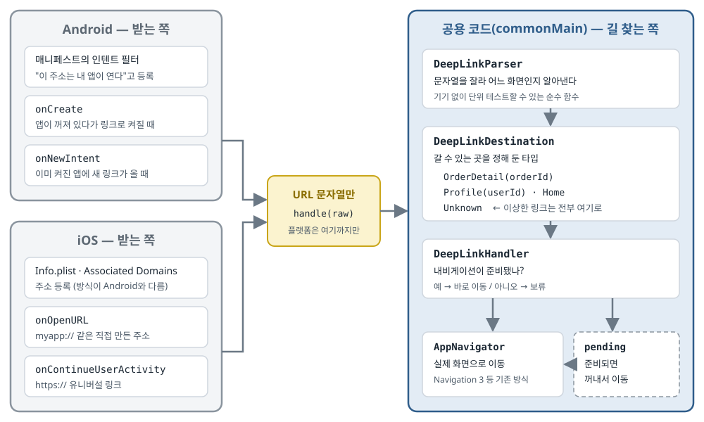

## 한 줄 요약

딥 링크(알림·메일·공유 주소를 눌렀을 때 첫 화면이 아니라 앱 안의 특정 화면을 바로 여는 링크)를 Android와 iOS가 화면 이동 코드를 함께 쓰는 Kotlin Multiplatform 앱에서 어떻게 나눌지 정리한 글이다. 저자의 답은 하나다. **플랫폼은 URL을 문자열로 받아서 넘기기만 하고, 그 문자열을 읽어 어느 화면으로 갈지 정하는 일은 전부 공용 코드가 한다.** 그 위에 앱이 꺼져 있을 때와 켜져 있을 때를 둘 다 받기, 내비게이션이 준비되기 전에 온 링크를 잠시 보류하기, 이상한 링크를 안전하게 버리기 같은 실전 함정을 짚는다.

> 원문(저자 사이트 [kmpbits.com](https://www.kmpbits.com/posts/deep-links-kmp)에 먼저 실림)은 "All Rights Reserved"(모든 권리 보유)로 표시되어 있고, 같은 코드를 담은 공개 라이선스 저장소도 찾지 못했다. 그래서 **이 글의 코드는 원문 코드를 옮긴 것이 아니라, 원문이 설명하는 구조를 따라 이름과 예시를 바꿔 직접 쓴 스케치다.** 예시 앱은 "할 일 앱"(`todoapp://task/42`)으로 바꿨다. 원문 표지는 경주용 차 사진이라 옮기지 않았고, 대신 본문 구조를 그림으로 새로 그렸다.

## 먼저 알아 둘 말

- **딥 링크(deep link)**
  - 앱 바깥의 무언가(알림, 메일, 메신저로 공유된 주소 등)를 눌렀을 때, 앱의 첫 화면이 아니라 **앱 안의 특정 화면으로 바로 들어가게** 하는 링크다.
  - 예: 주문 알림을 누르면 바로 그 주문의 상세 화면이 열린다.
- **Kotlin Multiplatform(KMP)과 `commonMain`**
  - KMP는 Kotlin 코드 하나를 Android 앱과 iOS 앱이 함께 쓰게 해 주는 Kotlin 기능이다.
  - `commonMain` 은 그중 **모든 플랫폼이 함께 쓰는 코드**를 두는 폴더다. 여기에는 Android 전용 API(`Intent` 등)도 iOS 전용 API도 쓸 수 없다.
- **URL의 부분 이름**
  - `https://example.com/task/42?from=mail` 을 예로 들면:
    - **scheme(스킴)**: `https` — 주소의 종류. 맨 앞 `://` 앞부분이다.
    - **host(호스트)**: `example.com` — 어느 사이트인지.
    - **path(경로)와 segment(조각)**: `/task/42` — `/` 로 나눈 조각 하나하나(`task`, `42`)를 segment라고 한다.
    - **query(쿼리)**: `?from=mail` — 덧붙이는 값.
- **커스텀 스킴(custom scheme)**
  - `https` 대신 앱이 직접 정한 이름으로 시작하는 주소다. 예: `todoapp://task/42`.
  - 등록만 하면 바로 쓸 수 있어 간단하다. 대신 **아무 앱이나 같은 스킴을 등록할 수 있어서** "이 주소는 정말 내 앱 것"이라는 보장이 없다.
- **App Links(Android) / Universal Links(iOS)**
  - `https://` 주소를 앱이 여는 방식이다. 웹 사이트에 "이 주소들은 이 앱이 열어도 된다"는 확인 파일을 올려 두고, 폰이 그 파일을 확인한 뒤에만 앱으로 연다.
  - 사이트 주인만 그 파일을 올릴 수 있으니 **커스텀 스킴보다 믿을 수 있다.** 앱이 없으면 그냥 웹 페이지가 열린다는 장점도 있다.
- **인텐트 필터(intent filter)**
  - Android에서 "이런 주소(또는 이런 요청)가 오면 이 Activity가 받겠다"고 `AndroidManifest.xml` 에 적는 등록표다.
- **콜드 스타트(cold start) / 웜 스타트(warm start)**
  - 콜드 스타트: 앱이 완전히 꺼져 있다가 **링크를 누른 것 때문에 처음부터 켜지는** 경우.
  - 웜 스타트: 앱이 이미 켜져 있거나 뒤로 숨어 있는 상태에서 **새 링크가 들어오는** 경우.
  - Android에서는 앞의 경우 `onCreate`, 뒤의 경우 `onNewIntent` 로 링크가 들어온다. 이 글의 가장 중요한 함정이다.
- **`launchMode="singleTask"`**
  - Android에서 "이 Activity는 한 개만 있게 하라"는 설정이다. 이미 떠 있으면 새로 만들지 않고 **떠 있는 것에 새 요청을 전달**한다(`onNewIntent`).
- **뒤로 가기 목록(back stack)**
  - 화면을 이동할 때마다 쌓이는 목록이다. 뒤로 가기를 누르면 맨 위 화면이 빠지고 그 아래 화면이 보인다.
  - **Navigation 3** 는 Google의 새 Compose 화면 이동 라이브러리다. 뒤로 가기 목록을 개발자가 직접 들고 있는 **보통의 리스트**로 다루는 것이 특징이다.
- **sealed interface**
  - "이 타입은 정해진 몇 가지 경우 중 하나다"를 표현하는 Kotlin 문법이다. `when` 으로 처리할 때 모든 경우를 다 다뤘는지 컴파일러가 검사해 준다.
- **Ktor의 `Url`**
  - Ktor는 KMP에서 많이 쓰는 서버 통신 라이브러리다(Android의 Retrofit·OkHttp와 같은 역할). 그 안의 `Url` 클래스는 주소 문자열을 scheme·host·segment로 나눠 준다. KMP 공용 코드에서도 쓸 수 있다.
- **서명 인증서 지문(SHA-256 fingerprint)**
  - 앱 설치 파일에 서명한 인증서를 짧은 문자열로 줄인 값이다. App Links 확인 파일에 이 값을 적어 "이 인증서로 서명된 앱만 내 주소를 열 수 있다"고 밝힌다.

## 서론 — "박스, 박스"

- 자동차 경주에서 엔지니어가 무전으로 **"박스, 박스(Box, box)"** 라고 두 마디만 하면, 드라이버는 한 바퀴 더 돌며 고민하지 않는다. 다음 피트 입구가 보이면 곧장 자기 정비 구역(박스)으로 들어간다.
- 딥 링크가 앱에게 바로 그 무전이다.
  - 앱 바깥의 알림·메일·공유 주소가 "여기로 가"라고 말하면, 사용자는 첫 화면부터 순서대로 거치지 않고 **바로 그 화면에 도착**한다.
- 저자가 이 문제를 만난 상황:
  - Android와 iOS가 **화면 이동 코드 하나를 함께 쓰는** KMP 앱에 푸시 알림을 붙이고 있었다.
  - 알림 내용(payload)에는 주문 번호가 들어 있고, 누르면 그 주문의 상세 화면이 열려야 했다.
  - Android에는 인텐트 필터가, iOS에는 Universal Links와 URL 스킴이 있었다. **플랫폼마다 링크를 받는 방법이 두 갈래**였다.
  - 그런데 `commonMain` 의 화면 이동 코드는 이런 것이 있는 줄도 몰랐다.
- 저자가 정해야 했던 것: **"플랫폼이 URL을 받는 일"과 "공용 코드가 그 URL로 무엇을 할지 정하는 일"의 경계를 어디에 그을까.**
- 저자의 답: **플랫폼은 문자열 하나를 받는다. 플랫폼이 하는 일은 그게 전부다.** 그다음은 전부 공용 코드가 한다.

## 1. 딥 링크의 두 반쪽

**딥 링크는 "받는 반쪽"과 "길 찾는 반쪽"으로 나뉘고, 둘은 다른 곳에 있어야 한다.**

- **받는 반쪽 — 플랫폼의 일이다.**
  - Android와 iOS는 "어떤 주소를 내 앱이 여는지" 등록하는 방법도, 사용자가 링크를 눌렀을 때 앱에 전달하는 방법도 서로 다르다.
  - 이것을 하나로 감싸는 공용 추상화(여러 구현을 같은 모양으로 보이게 하는 껍데기)를 억지로 만들면, 보통 **얻는 것보다 드는 비용이 더 크다**고 저자는 본다.
- **길 찾는 반쪽 — 순수한 로직이다.**
  - `todoapp://task/42` 같은 주소를 받아 경로와 값을 꺼내고, 화면 이동 코드가 알아듣는 무언가로 바꾼다.
  - **문자열이 들어가고 목적지가 나오는 함수**일 뿐이다. 플랫폼 API도, 화면 프레임워크도 쓰지 않는다.
  - 그래서 JVM·Android·iOS 어디서든 똑같이 돈다. 그러니 `commonMain` 에 둬야 하고, **기기 없이 단위 테스트**할 수 있다.
- **전체 모양**
  1. 각 플랫폼이 URL 문자열을 잡아서 공용 코드에 넘긴다.
  2. 공용 코드가 그 문자열을 **타입이 정해진 목적지**로 바꾼다.
  3. 화면 이동 계층이 그 목적지에 맞춰 움직인다.
  - 플랫폼 쪽 연결 코드는 **일부러 얇게** 둔다.

<figure>
  <a class="figure-scroll" href="../assets/749-deeplink-flow.svg"></a>
  <figcaption>원문 본문이 설명하는 구조를 한국어로 새로 그림(원문에는 이 그림이 없다). 원문: <a href="https://medium.com/@kmpbits/box-box-deep-links-in-kotlin-multiplatform-kmp-bits-23eea749127d">KMP Bits, Medium</a></figcaption>
</figure>

## 2. 공용 라우터 — 문자열을 목적지로 바꾼다

### ① 갈 수 있는 곳을 타입으로 정해 둔다

**링크로 열 수 있는 화면을 `commonMain` 에 sealed interface로 정해 둔다.**

- 원문의 목적지는 `Home`(첫 화면), `OrderDetail(orderId)`(주문 상세), `Profile(userId)`(프로필), 그리고 **`Unknown`(알 수 없음)** 네 가지다.
- 아래 스케치는 같은 구조를 할 일 앱으로 바꿔 썼다.

```kotlin
// commonMain — 직접 쓴 스케치 (원문 구조를 따라 이름을 바꿈)
sealed interface LinkTarget {
    data object Home : LinkTarget
    data class TaskDetail(val taskId: String) : LinkTarget
    data class Project(val projectId: String) : LinkTarget
    data object Invalid : LinkTarget   // 원문의 Unknown 자리
}
```

- **왜 타입으로 정하나** — 화면 이동 코드는 주소 문자열을 몰라도 된다. `TaskDetail("42")` 라는 "뜻"만 받는다. 주소 모양이 바뀌어도 파서 한 곳만 고치면 된다.

### ② 파서 — 주소를 잘라 목적지를 고른다

**원문은 주소를 나누는 데 Ktor의 `Url` 을 쓴다.** 이미 KMP를 지원하고, 정규식(글자 패턴을 기호로 적는 방법)을 직접 짜다가 나중에 후회할 일을 줄여 주기 때문이다.

여기서 원문이 짚은 **함정**이 하나 있다.

- `https://example.com/task/42` 를 나누면 host는 `example.com`, segment는 `["task", "42"]` 다. 기대한 그대로다.
- 그런데 커스텀 스킴 `todoapp://task/42` 를 나누면, **`task` 가 첫 번째 경로 조각이 아니라 host로 읽힌다.** segment에는 `["42"]` 만 남는다.
- 이 차이를 처리하지 않으면, **https 링크는 잘 되는데 커스텀 스킴 링크만 전부 `Unknown` 으로 빠진다.**
- 그래서 원문은 scheme이 `http`/`https` 가 아니면 **host를 경로 맨 앞에 붙여서** 두 모양을 똑같이 맞춘다.

```kotlin
// commonMain — 직접 쓴 스케치
import io.ktor.http.Url

object LinkParser {
    fun parse(raw: String): LinkTarget {
        val url = runCatching { Url(raw) }.getOrNull() ?: return LinkTarget.Invalid

        // todoapp://task/42 는 "task" 가 host 로 읽힌다 → https 모양과 맞추려고 앞에 붙인다
        val parts = buildList {
            if (url.protocol.name !in setOf("http", "https")) add(url.host)
            addAll(url.segments)
        }.filter { it.isNotBlank() }

        val id = parts.getOrNull(1)
        return when (parts.firstOrNull()) {
            null -> LinkTarget.Home
            "task" -> id?.let(LinkTarget::TaskDetail) ?: LinkTarget.Invalid
            "project" -> id?.let(LinkTarget::Project) ?: LinkTarget.Invalid
            else -> LinkTarget.Invalid
        }
    }
}
```

- **`runCatching { Url(raw) }`** — 주소 모양이 아예 깨져서 `Url` 이 예외를 던지면, 앱을 죽이지 않고 `Invalid` 를 돌려준다.
- **`buildList { ... }`** — 커스텀 스킴이면 host(`task`)를 맨 앞에 넣고, 이어서 경로 조각을 붙인다. 결과적으로 두 주소 모두 `["task", "42"]` 가 된다.
- **`filter { it.isNotBlank() }`** — `todoapp://task/` 처럼 끝에 `/` 가 붙어 생기는 빈 조각을 버린다.
- **`when (parts.firstOrNull())`**
  - 조각이 하나도 없으면(`https://example.com/`) 첫 화면으로 보낸다.
  - `task` 인데 번호가 없으면(`todoapp://task/`) 첫 화면이 아니라 `Invalid` 로 보낸다. 링크가 무언가를 열려고 했는데 실패했다는 사실을 숨기지 않기 위해서다.
  - 모르는 이름이면 `Invalid` 다.

### ③ 두 모양을 함께 테스트한다

**원문은 커스텀 스킴과 https 주소가 같은 목적지로 가는지 하나의 테스트로 확인한다.** 위의 함정을 다시 밟지 않게 묶어 두는 것이다.

```kotlin
// commonTest — 직접 쓴 스케치
class LinkParserTest {
    @Test
    fun 커스텀_스킴과_https가_같은_화면으로_간다() {
        val expected = LinkTarget.TaskDetail("42")
        assertEquals(expected, LinkParser.parse("todoapp://task/42"))
        assertEquals(expected, LinkParser.parse("https://example.com/task/42"))
    }
}
```

### ④ `Unknown` 이 보기보다 중요한 이유

- 딥 링크는 **누구나 두드릴 수 있는 열린 문**이다. 누가 두드릴지 내가 정할 수 없다.
- 언젠가는 반드시 들어온다:
  - 모양이 깨진 주소
  - 세 번 전 버전에서 이름을 바꾼 옛 경로
  - 누군가 손으로 고친 값
- 파서가 말이 되는 목적지를 못 만들면, **앱을 죽이거나 대충 짐작하지 말고 "모르겠다"고 분명히 말해야 한다.**
- 저자는 `Unknown` 을 대체 화면으로 보낸다. 보통은 첫 화면이고, 가끔은 "이 링크는 올바르지 않아요"라는 작은 안내 화면이다.

### ⑤ 핸들러 — 플랫폼이 부르는 단 하나의 입구

**파싱과 화면 이동을 잇는 입구를 하나만 두고, 두 플랫폼이 모두 이것만 부른다.**

```kotlin
// commonMain — 직접 쓴 스케치
class LinkHandler(private val navigator: AppNavigator) {
    fun handle(raw: String) {
        when (val target = LinkParser.parse(raw)) {
            is LinkTarget.TaskDetail -> navigator.openTask(target.taskId)
            is LinkTarget.Project -> navigator.openProject(target.projectId)
            LinkTarget.Home, LinkTarget.Invalid -> navigator.openHome()
        }
    }
}
```

- **`AppNavigator`** 는 이미 쓰고 있는 화면 이동 방식을 감싼 것이면 무엇이든 된다.
  - Navigation 3를 쓰면 뒤로 가기 목록을 감싸고, 직접 만든 방식이면 그것을 감싼다.
- 핵심은 **핸들러는 화면 이동 방식을 신경 쓰지 않는다**는 것이다. 핸들러는 "목적지"의 말을 하고, 내비게이터는 "화면"의 말을 한다.
- `when` 에 `else` 없이 모든 경우를 적었다. 나중에 목적지를 하나 더 만들면 **컴파일러가 "이 경우를 안 다뤘다"고 알려 준다.**

## 3. Android — URL 받기

### ① 매니페스트에 "이 주소는 내 앱이 연다"고 등록한다

**원문은 같은 Activity에 커스텀 스킴과 https App Link를 함께 등록한다.**

```xml
<!-- AndroidManifest.xml — 직접 쓴 스케치 -->
<activity
    android:name=".MainActivity"
    android:exported="true"
    android:launchMode="singleTask">

    <!-- todoapp://task/42 -->
    <intent-filter>
        <action android:name="android.intent.action.VIEW" />
        <category android:name="android.intent.category.DEFAULT" />
        <category android:name="android.intent.category.BROWSABLE" />
        <data android:scheme="todoapp" />
    </intent-filter>

    <!-- https://example.com/task/42 — 확인 파일로 검증받는 App Link -->
    <intent-filter android:autoVerify="true">
        <action android:name="android.intent.action.VIEW" />
        <category android:name="android.intent.category.DEFAULT" />
        <category android:name="android.intent.category.BROWSABLE" />
        <data android:scheme="https" android:host="example.com" />
    </intent-filter>
</activity>
```

- **`action.VIEW`** — "이것을 보여 달라"는 요청을 받겠다는 뜻이다. 링크를 누르면 이 요청이 온다.
- **`category.BROWSABLE`** — 브라우저나 메신저 안의 링크에서도 이 Activity를 열 수 있게 한다. 빠지면 웹 링크로는 열리지 않는다.
- **`<data android:scheme="todoapp" />`** — `todoapp://` 로 시작하는 주소를 받는다.
- **`android:autoVerify="true"`** — 앱을 설치할 때 Android가 `example.com` 의 확인 파일을 가져와서, 정말 이 앱이 열어도 되는 주소인지 확인한다.
- **`launchMode="singleTask"` — 원문이 "사람들이 놓치는 부분"이라고 강조한 줄이다.**
  - 이게 없으면, 앱이 이미 켜져 있을 때 링크를 누르면 **Activity가 하나 더 생길 수 있다.** 그러면 뒤로 가기 목록이 두 개가 되어 서로 엉킨다.
  - 이게 있으면, 이미 떠 있는 Activity가 새 요청을 `onNewIntent` 로 받는다.

### ② 링크를 두 곳에서 읽는다 — `onCreate` 와 `onNewIntent`

```kotlin
// Android — 직접 쓴 스케치
class MainActivity : ComponentActivity() {

    override fun onCreate(savedInstanceState: Bundle?) {
        super.onCreate(savedInstanceState)
        // 콜드 스타트: 링크가 앱을 켰다.
        // 화면 회전처럼 Activity가 다시 만들어질 때도 같은 intent가 붙어 있으므로,
        // 처음 만들어질 때(savedInstanceState == null)만 처리한다.
        if (savedInstanceState == null) {
            intent?.data?.toString()?.let(linkHandler::handle)
        }
        setContent { App() }
    }

    override fun onNewIntent(intent: Intent) {
        super.onNewIntent(intent)
        // 웜 스타트: 이미 켜진 앱에 새 링크가 왔다.
        intent.data?.toString()?.let(linkHandler::handle)
    }
}
```

- **`onCreate`** — 링크를 누른 것이 앱 프로세스를 처음 띄운 경우다.
  - `savedInstanceState == null` 검사가 중요하다. 화면을 돌리면 Activity가 다시 만들어지는데, 그때도 **처음의 intent가 그대로 붙어 있다.** 검사가 없으면 회전할 때마다 그 화면으로 또 이동한다.
- **`onNewIntent`** — 앱이 이미 살아 있을 때 새 링크가 온 경우다.
- **둘 중 하나만 처리하면** 링크의 절반이 **아무 말 없이** 아무 일도 하지 않는다. 그리고 그 절반은 하필 내 폰으로 시험해 보지 않은 쪽이라고 저자는 경고한다.
- **`intent.data`** — 링크 주소가 들어 있는 곳이다. 이것을 문자열로 바꿔 핸들러에 넘기는 것이 Android 쪽 일의 전부다.

### ③ App Link 확인 파일 — `assetlinks.json`

**https 링크를 "앱으로 열까요, 브라우저로 열까요?" 고르는 창 없이 바로 앱으로 열려면, 웹 사이트에 확인 파일을 올려야 한다.**

- 위치: `https://example.com/.well-known/assetlinks.json`
- `autoVerify="true"` 가 있으면 Android가 이 파일을 가져와서, **앱 서명 인증서의 지문이 목록에 있는지** 확인한다.

```json
[
  {
    "relation": ["delegate_permission/common.handle_all_urls"],
    "target": {
      "namespace": "android_app",
      "package_name": "com.example.todoapp",
      "sha256_cert_fingerprints": ["AA:BB:…(실제 서명 인증서의 SHA-256 지문)"]
    }
  }
]
```

- **`relation`** — "이 사이트의 모든 주소를 이 앱이 열어도 된다"는 허락이다.
- **`package_name`** — 앱의 패키지 이름이다. 한 글자라도 다르면 확인이 **조용히** 실패한다.
- **`sha256_cert_fingerprints`** — 원문이 특히 주의하라고 한 칸이다.
  - **사용자가 실제로 설치하는 빌드에 서명한 인증서**의 지문이어야 한다.
  - Play App Signing(Google Play가 최종 서명을 대신해 주는 방식)을 쓰면, 내가 올릴 때 쓰는 업로드 키가 아니라 **Play Console의 "앱 무결성" 메뉴에 나오는 앱 서명 키**의 지문을 적어야 한다.
  - 내 컴퓨터에서 만든 디버그 빌드의 지문은 `./gradlew signingReport` 로 볼 수 있다. 목록에는 지문을 여러 개 적을 수 있다.

## 4. iOS — 같은 문자열, 다른 문

**iOS도 링크를 받는 방법이 둘이다.**

- **URL 스킴**(`todoapp://`) — 오래되고 간단한 방식이다. `Info.plist`(iOS 앱의 설정 파일, Android의 매니페스트와 비슷하다)의 `CFBundleURLTypes` 항목에 등록한다.
- **Universal Links**(`https://`) — 새 방식이고, 웹 주소와 짝을 이루는 콘텐츠라면 Apple이 사실상 이것만 쓰기를 바란다.
  - Xcode에서 **Associated Domains** 기능을 켜고 `applinks:example.com` 을 적는다.
  - 웹 사이트에 확인 파일 `apple-app-site-association` 을 올린다. 위치는 `https://example.com/.well-known/apple-app-site-association` 이고, **확장자가 없고, `application/json` 형식이며, 다른 주소로 넘겨주기(redirect) 없이** 바로 응답해야 한다.

```json
{
  "applinks": {
    "details": [
      {
        "appIDs": ["TEAMID1234.com.example.todoapp"],
        "components": [
          { "/": "/task/*" },
          { "/": "/project/*" }
        ]
      }
    ]
  }
}
```

- **`appIDs`** — 앞부분은 Apple 개발자 팀 ID, 뒷부분은 앱의 번들 ID(Android의 패키지 이름에 해당)다. 둘 다 실제 값과 정확히 같아야 한다.
- **`components`** — 앱이 열 경로 목록이다. **여기 없는 경로는 앱이 아니라 Safari에서 열린다.**
  - 그래서 원문은 **파서에 새 목적지를 추가하면 여기에도 그 경로를 추가하라**고 한다. 파서와 확인 파일이 같은 경로 목록을 따로 들고 있으니, 둘이 어긋나지 않게 챙겨야 한다.

링크를 받는 코드는 앱의 시작점에 따라 다르다. KMP 화면을 SwiftUI 껍데기 안에 띄우는 경우, 원문은 SwiftUI의 생명주기 수정자(modifier)를 쓴다.

```swift
// iOS — 직접 쓴 스케치
import SwiftUI
import shared // KMP 공용 코드 프레임워크

@main
struct TodoApp: App {
    var body: some Scene {
        WindowGroup {
            ComposeRootView()
                // todoapp://task/42
                .onOpenURL { url in
                    LinkBridge.shared.handle(raw: url.absoluteString)
                }
                // https://example.com/task/42
                .onContinueUserActivity(NSUserActivityTypeBrowsingWeb) { activity in
                    if let url = activity.webpageURL {
                        LinkBridge.shared.handle(raw: url.absoluteString)
                    }
                }
        }
    }
}
```

- **`onOpenURL`** — 커스텀 스킴 주소가 들어올 때 불린다.
- **`onContinueUserActivity(NSUserActivityTypeBrowsingWeb)`** — Universal Link가 들어올 때 불린다. iOS는 이것을 "웹에서 하던 일을 앱에서 이어서 하기"로 취급해서 이름이 이렇다.
- **`LinkBridge`** — `commonMain` 에서 내보낸 작은 객체로, Compose 화면이 쓰는 **바로 그 `LinkHandler` 인스턴스**를 들고 있다.
- **두 플랫폼이 대칭이다.**
  - 양쪽 다 "앱이 꺼져 있을 때"와 "켜져 있을 때"의 길이 있다.
  - 양쪽 다 결국 같은 `handle(raw)` 하나를 부른다.
  - 양쪽 다 **주문 번호(할 일 번호)가 뭔지 모른다.** 길을 정하는 결정은 하나도 하지 않는다.

## 5. 화면 이동에 연결하기 — 너무 일찍 온 링크

**놓치기 쉬운 타이밍 문제가 있다. 콜드 스타트로 들어온 링크는 화면 이동 구조가 만들어지기 전에 도착한다.**

- Android에서 `onCreate` 는 `setContent` 보다 먼저다. 그런데 뒤로 가기 목록은 첫 Compose 화면 그리기(composition)가 끝나야 생긴다.
- 그래서 `onCreate` 에서 바로 `navigator.openTask(...)` 를 부르면 **허공에 대고 이동하는 셈**이 된다. 아무 일도 일어나지 않는다.

**원문의 해결: 보류 칸(pending) 하나를 둔다.**

```kotlin
// commonMain — 직접 쓴 스케치
class LinkHandler(private val navigator: AppNavigator) {
    private var pending: LinkTarget? = null

    fun handle(raw: String) {
        val target = LinkParser.parse(raw)
        if (navigator.isReady) go(target) else pending = target
    }

    fun onNavigatorReady() {
        pending?.let(::go)
        pending = null
    }

    private fun go(target: LinkTarget) = when (target) {
        is LinkTarget.TaskDetail -> navigator.openTask(target.taskId)
        is LinkTarget.Project -> navigator.openProject(target.projectId)
        LinkTarget.Home, LinkTarget.Invalid -> navigator.openHome()
    }
}
```

- **`handle`** — 내비게이션이 준비됐으면 바로 이동하고, 아니면 목적지를 `pending` 에 넣어 둔다.
- **`onNavigatorReady`** — 루트 Compose 화면이 준비되면 `LaunchedEffect`(Compose 화면이 처음 그려질 때 한 번 실행되는 블록)에서 이것을 부른다. 보류해 둔 목적지가 있으면 그때 이동하고 비운다.
- 원문은 이것을 "작은 장부 정리"라고 부른다. 하지만 이것이 **"늘 동작하는 딥 링크"와 "앱이 이미 켜져 있을 때만 동작하는 딥 링크"의 차이**라고 말한다.

## 6. 브라우저 없이 테스트하기

**링크를 담은 웹 페이지가 없어도 된다. 두 플랫폼 모두 명령줄에서 앱에 주소를 쏠 수 있다.** 콜드·웜 두 경우를 확인하는 가장 빠른 방법이기도 하다.

Android(기기나 에뮬레이터를 연결한 상태):

```bash
adb shell am start -a android.intent.action.VIEW -d "todoapp://task/42" com.example.todoapp
```

- `adb` 는 컴퓨터에서 연결된 Android 기기에 명령을 보내는 도구다. 위 명령은 "이 주소를 보여 달라(`VIEW`)"는 요청을 그 앱에 직접 보낸다.

iOS 시뮬레이터:

```bash
xcrun simctl openurl booted "todoapp://task/42"
```

- `booted` 는 "지금 켜져 있는 시뮬레이터"라는 뜻이다.

어떻게 확인하나:

- **콜드 경로** — 앱을 먼저 완전히 끈다(Android는 `adb shell am force-stop com.example.todoapp`, 아니면 최근 앱 목록에서 밀어서 닫기). 그다음 명령을 보낸다.
- **웜 경로** — 앱을 켜 두거나 뒤로 숨겨 둔 채 다시 명령을 보낸다.
- **커스텀 스킴은 이 명령으로 바로 된다.** https 주소는 확인 파일이 웹 사이트에 실제로 올라가 있고 서명 설정과 맞아야 앱으로 열린다. 그래서 저자는 **길 찾기는 커스텀 스킴으로 먼저 시험하고, 검증된 https 링크는 맨 마지막에** 시험한다.
- **깨진 입력도 넣어 본다.** `todoapp://task/`, `todoapp://nope`, 경로가 빈 주소. 모두 앱이 죽지 않고 `Unknown`(스케치에서는 `Invalid`) 대체 화면에 도착해야 한다.

## 7. 내보내기 전에 꼭 확인할 것

- **콜드 스타트와 웜 스타트**
  - 위에서 말했지만 다시 말한다고 저자는 쓴다. "내 폰에서는 되는데요" 류 딥 링크 버그의 **1번 원인**이다.
  - 두 플랫폼에서 두 상태를 모두 시험한다. 앱을 강제로 끄고 링크를 누르고, 앱을 뒤로 숨겨 둔 채로 다시 누른다.
- **딥 링크로 들어온 뒤의 뒤로 가기**
  - 알림에서 주문 상세로 바로 들어온 사용자가 뒤로 가기를 누르면 어디로 가야 할까?
  - 평소 흐름이라면 주문 목록으로 돌아간다. 하지만 딥 링크로 왔으면 **뒤에 목록이 없다.**
  - **일부러 정해야 한다.** 그럴듯한 뒤로 가기 목록을 만들어 넣거나(첫 화면 → 주문 상세 순서로 쌓아서, 뒤로 가면 첫 화면), 뒤로 가면 앱이 닫히게 하거나. 기본 동작에 맡기면 대개 틀린다.
- **믿을 수 없는 값**
  - 그 주문 번호는 **앱 바깥에서 왔다.** 그 번호로 무언가를 가져오기 전에 먼저 검증한다.
- **확인 파일은 코드가 아니라 배포 대상이다**
  - `assetlinks.json` 과 `apple-app-site-association` 은 앱 안이 아니라 **웹 서버에** 있다.
  - 링크가 앱 대신 브라우저로 열리면, 원인은 거의 항상 그 파일이 없거나, 모양이 틀렸거나, 캐시(예전 내용을 잠시 저장해 둔 것)에 옛 버전이 남은 것이다. 코드를 의심하기 전에 이것부터 본다.

## 8. 저자의 정리

- 이 구조에서 플랫폼 전용 코드는 **아주 적다.**
  - 파서, 목적지 타입, 핸들러, 보류 처리는 모두 `commonMain` 에 있고 어디서나 똑같이 돈다.
  - Android와 iOS 코드는 각자 한 가지 일만 한다. **문자열을 잡아서 넘긴다.**
- 겉보기에는 플랫폼에 깊이 묶인 문제에 KMP의 장점을 그대로 적용한 셈이라고 저자는 말한다.
- 다시 경주 비유로 끝맺는다. "박스, 박스"라는 무전은 어느 서킷에서나 같다. 박스가 실제로 어디 있는지는 서킷마다 다르지만 괜찮다. 드라이버가 거기 도착할 때쯤에는 무엇을 해야 할지 이미 알고 있기 때문이다.
- 저자의 조언: 이미 있는 화면 이동 구조에 이것을 붙이려면 **파서부터 짜라.** 문자열 → 목적지를 정확히 만들고 단위 테스트까지 해 두면, 플랫폼 연결 코드는 그 뒤에 거의 지루할 만큼 쉽다.

## 원문을 읽을 때 주의할 점

- **보류 칸 버전에서는 `when` 에 `else` 가 들어간다.**
  - 원문의 첫 핸들러는 네 경우를 모두 적었는데, 보류 칸을 넣은 두 번째 버전은 `else -> navigator.toHome()` 으로 나머지를 묶었다.
  - 이러면 나중에 목적지를 하나 더 만들고 핸들러에 추가하는 것을 잊어도 **컴파일러가 알려 주지 않고, 그 링크는 조용히 첫 화면으로 간다.** 위 스케치에서는 `else` 없이 모든 경우를 적었다.
- **보류 칸은 한 칸이고, 앱이 죽으면 사라진다.**
  - 준비 전에 링크가 두 번 오면 마지막 것만 남는다. 대부분은 이게 맞는 동작이지만, 의도한 것인지는 알고 써야 한다.
  - 여러 스레드에서 동시에 부르는 경우의 보호도 없다. 원문의 상황(메인 스레드에서만 부름)에서는 문제가 없다.
- **Android 12부터는 확인에 실패한 https 링크가 "고르는 창"이 아니라 브라우저로 바로 열린다.**
  - 원문은 확인에 실패하면 "Android가 고르는 창으로 돌아간다"고 쓴다. Android 11 이하에서는 맞는 설명이다.
  - Android 12(API 31)부터는 확인되지 않은 웹 링크는 기본적으로 **기본 브라우저에서** 열린다. 그래서 "앱이 아예 안 뜬다"로 보일 수 있다. 원문의 "링크가 브라우저로 열리면 확인 파일부터 보라"는 조언은 그대로 맞다.
- **Navigation 3에서는 보류 칸이 필요 없을 수도 있다.**
  - 원문은 "내비게이션이 준비되기 전"을 걱정하지만, Navigation 3는 뒤로 가기 목록을 개발자가 들고 있는 리스트로 다룬다.
  - 그래서 콜드 스타트라면 **링크로 처음 뒤로 가기 목록 자체를 만들어서** 넘기는 방법도 있다(이 부분은 원문이 아니라 정리하며 덧붙인 생각이다).

## 코드로 보기 — Aide 구조로 옮긴 스케치

> 원문 코드가 아니다. Aide는 KMP가 아니라 Android 전용 앱이고, 1-b에서 **알림을 누르면 Aide 안의 특정 화면**(예: 완료 확인할 할 일 카드)을 여는 일이 생긴다. 이 글의 구조를 Aide의 `app` 모듈(단일 Activity + Navigation 3)에 옮기면 어떤 모양일지 **직접 쓴 스케치**다. Navigation 3의 실제 API 이름은 Task 4에서 공식 문서로 확정한다.

```kotlin
// app/.../navigation/AideLink.kt

// ① 알림이 Intent 에 실어 보내는 주소: aide://todo/12 · aide://home
//    파서는 순수 Kotlin 이라 JVM 단위 테스트로 검사한다.
object AideLinkParser {
    fun parse(raw: String?): List<NavKey> {
        val uri = raw?.let { runCatching { java.net.URI(it) }.getOrNull() }
            ?: return listOf(HomeKey)
        if (uri.scheme != "aide") return listOf(HomeKey)
        val id = uri.path.trim('/').toLongOrNull()
        return when (uri.host) {
            // ② 뒤로 가기 목록을 함께 만든다 — 뒤로 가면 첫 화면
            "todo" -> if (id != null) listOf(HomeKey, TodoKey(id)) else listOf(HomeKey)
            else -> listOf(HomeKey)
        }
    }
}

// ③ MainActivity — 콜드는 처음 뒤로 가기 목록으로, 웜은 지금 목록을 바꿔서
class MainActivity : ComponentActivity() {
    private val incoming = MutableStateFlow<List<NavKey>?>(null)

    override fun onCreate(savedInstanceState: Bundle?) {
        super.onCreate(savedInstanceState)
        val start = if (savedInstanceState == null) AideLinkParser.parse(intent?.dataString) else null
        setContent { AideApp(initialBackStack = start ?: listOf(HomeKey), incomingLink = incoming) }
    }

    override fun onNewIntent(intent: Intent) {
        super.onNewIntent(intent)
        incoming.value = AideLinkParser.parse(intent.dataString)
    }
}
```

- **①** 원문의 "문자열 → 목적지" 파서다. 결과를 목적지 하나가 아니라 **Navigation 3의 뒤로 가기 목록(`List<NavKey>`)** 으로 돌려준다는 점만 다르다. 주소가 이상하면 원문의 `Unknown` 처럼 첫 화면으로 보낸다.
- **②** 원문 7장의 "딥 링크 뒤의 뒤로 가기를 일부러 정하라"를 바로 반영했다. 알림에서 할 일 카드로 오면 목록이 `[첫 화면, 할 일]` 이라 뒤로 가기를 누르면 첫 화면이 나온다.
- **③** 원문의 `onCreate` + `onNewIntent` + `savedInstanceState` 검사를 그대로 따랐다.
  - 콜드 스타트는 링크로 **처음 목록 자체를 만들어** `setContent` 에 넘기므로 원문의 보류 칸이 필요 없다.
  - 웜 스타트는 `incoming` 에 새 목록을 넣고, `AideApp` 안의 `LaunchedEffect` 가 그것을 받아 지금 목록을 바꾼다.
  - 매니페스트의 `MainActivity` 에는 `launchMode="singleTask"` 를 함께 넣는다.

## 배운 점

- **딥 링크는 "받기"와 "길 찾기"로 나눠야 테스트할 수 있다.**
  - 받기는 플랫폼에 묶여 있어 기기가 있어야 시험할 수 있지만, 길 찾기는 문자열 → 목적지의 순수 함수라 단위 테스트로 끝난다. 나누지 않으면 둘 다 기기에서만 시험하게 된다.
- **링크가 들어오는 문은 둘이다. `onCreate` 와 `onNewIntent`.**
  - 하나만 받으면 절반이 조용히 실패하고, 그 절반은 내가 시험하지 않은 쪽이다.
- **딥 링크로 들어온 화면의 "뒤로 가기"는 기본값에 맡기면 틀린다.** 어떤 목록을 쌓을지 일부러 정한다.
- **밖에서 온 값은 믿지 않는다.** 깨진 주소, 옛 경로, 손으로 고친 값이 반드시 온다. "모르겠다"를 나타내는 타입(`Unknown`)을 따로 두고, 앱을 죽이지 않고 안전한 화면으로 보낸다.
- **`when` 의 `else` 는 미래의 실수를 숨긴다.** 목적지 타입을 sealed로 만든 의미를 살리려면 경우를 모두 적는다.

## Aide에 적용하면

Aide는 웹 사이트도 공유 링크도 없는 Android 전용 앱이다. 그래서 https App Links는 쓸 일이 없다. 하지만 **"알림을 누르면 앱 안의 특정 화면으로 간다"** 는 딥 링크의 받는 쪽·길 찾는 쪽 문제를 그대로 가지고 있다.

1. **알림이 여는 화면을 주소 하나로 받는다 — 가져온다.**
   - 1-b의 "완료 확인" 알림처럼 Aide 안의 화면을 여는 알림은, `PendingIntent`(알림을 눌렀을 때 실행할 동작을 미리 담아 두는 Android 객체)의 Intent에 `aide://todo/12` 같은 주소를 넣어 `MainActivity` 로 보낸다.
   - 화면마다 Intent에 다른 값(extra)을 넣고 Activity에서 하나하나 꺼내는 대신, 위 스케치처럼 **파서 하나·목적지 타입·처리하는 곳 하나**로 모은다.
   - Aide 1-a 계획(Task 12)도 이미 "알람마다 `PendingIntent` 가 겹치지 않게 Intent의 data URI에 key를 넣는다"고 적어 두었다. 같은 생각을 화면 이동에도 쓰는 셈이다.
2. **`singleTask` 와 `onCreate`·`onNewIntent` 둘 다 받기 — 가져온다. 시점은 Task 4다.**
   - 지금 Aide의 `MainActivity` 매니페스트에는 `launchMode` 가 없다.
   - Task 4(앱 셸 — 단일 Activity + Navigation 3)를 만들 때 처음부터 `singleTask` 와 `onNewIntent` 를 넣어 두면, 1-b에서 알림을 붙일 때 고칠 곳이 없다.
3. **보류 칸 — 바꿔서 가져온다.**
   - Navigation 3는 뒤로 가기 목록을 우리가 들고 있는 리스트로 다룬다. 그래서 콜드 스타트는 원문의 보류 칸 대신 **링크로 처음 목록을 만들어 넘긴다**(스케치 ③).
   - Task 4에서 Navigation 3의 실제 API(`rememberNavBackStack` 등)가 처음 목록을 받는 방식을 확인하고 정한다. 처음 목록을 넘기기 어렵다면 원문 방식의 보류 칸으로 돌아간다.
4. **뒤로 가기 목록을 일부러 만든다 — 가져온다.**
   - 알림에서 할 일 카드로 왔을 때 뒤로 가기 → **첫 화면**이 자연스럽다. Aide의 첫 화면은 아바타가 있는 "앱의 얼굴"이라 돌아갈 곳으로도 맞다.
5. **이상한 링크와 이미 사라진 대상 — 가져온다.**
   - 알림을 받은 뒤 사용자가 그 할 일을 이미 지웠을 수 있다. 할 일 화면은 번호로 찾지 못하면 앱을 죽이지 말고 **첫 화면으로 돌아가며 짧게 알려 준다.**
   - Aide 리마인더가 이미 따르는 원칙("울리기 전에 그 일정이 아직 있는지 한 번 더 확인하고, 없으면 조용히 넘어간다")과 같은 방향이다.
6. **1-a의 리마인더 알림 — 해당 없다.**
   - 리마인더 알림은 이미 "누르면 폰 기본 캘린더 앱에서 그 일정을 연다"로 정했다. Aide 안의 화면으로 오지 않으니 이 구조가 필요 없다.
7. **08:30 숫자 알림을 누르면 어디로 가는지 — 아직 정해지지 않았다. 정해야 한다.**
   - 1-a 설계(4.5절)와 Task 14에는 알림을 띄우는 것까지만 있고, **누르면 어떤 화면이 열리는지**가 없다.
   - 자연스러운 답은 Aide 첫 화면(`aide://home`)이다. 1-b에서는 그 순간 미리 만들어 둔 AI 브리핑을 아바타가 바로 말하게 된다. Task 14를 할 때 이 한 줄을 정한다.
8. **https App Links와 확인 파일 — 지금은 안 한다.**
   - Aide에는 웹 사이트나 남에게 보내는 공유 링크가 없다. 알림은 앱 스스로 만드는 것이라 검증이 필요 없다.
   - **2차의 GitHub 로그인**을 브라우저 방식으로 만든다면, 로그인이 끝난 뒤 브라우저가 앱으로 돌아오는 주소(예: `aide://oauth/github?code=…&state=…`)가 바로 커스텀 스킴 딥 링크다. 그때는 원문의 "밖에서 온 값은 믿지 않는다"에 따라 `state` 값(로그인을 시작할 때 앱이 만든 임의 값)이 내가 보낸 것과 같은지 꼭 검사한다. 커스텀 스킴은 다른 앱도 등록할 수 있기 때문이다.

## 출처

- [Box, Box: Deep Links in Kotlin Multiplatform — KMP Bits (Medium)](https://medium.com/@kmpbits/box-box-deep-links-in-kotlin-multiplatform-kmp-bits-23eea749127d)
- [같은 글 — KMP Bits 사이트(원 게재처)](https://www.kmpbits.com/posts/deep-links-kmp)
- [Android 개발자 문서: App Links 확인](https://developer.android.com/training/app-links/verify-android-applinks)
- [Apple 개발자 문서: Universal Links 지원](https://developer.apple.com/documentation/xcode/supporting-universal-links-in-your-app)
- [Android Weekly #749](https://androidweekly.net/issues/issue-749)
