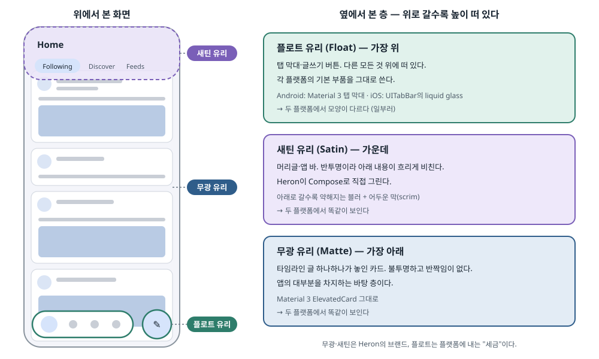
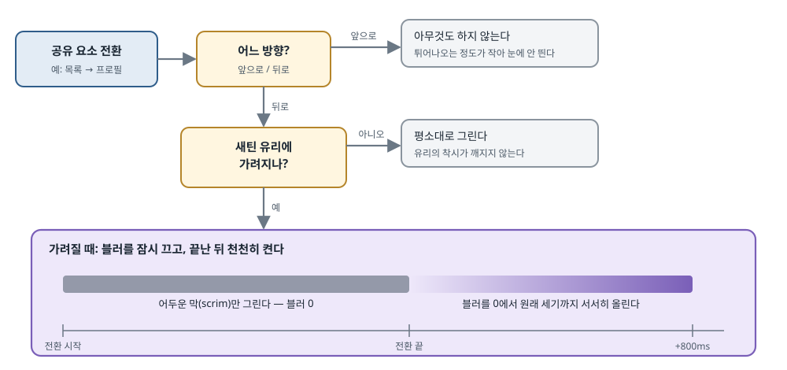

## 한 줄 요약

Bluesky 앱 Heron을 혼자 만드는 저자는 앱 전체를 **"유리"라는 재질 하나로 비유**하고, 높이에 따라 세 가지 유리를 정했다. 바닥의 **무광 유리**(타임라인 카드), 가운데의 **새틴 유리**(반투명 머리글), 맨 위의 **플로트 유리**(떠 있는 탭 막대와 버튼)다. 무광과 새틴은 Heron이 Compose로 직접 그려 **Android와 iOS에서 똑같이** 보이게 하고, 플로트는 일부러 **각 플랫폼의 기본 부품**을 그대로 쓴다. 앱 대부분은 자기 브랜드로 지키고, 가장 자주 만지는 탐색 막대 하나만 플랫폼에 맡기는 셈이다. 글의 뒷부분은 이 디자인을 실제로 그리면서 부딪힌 문제, 특히 **화면 전환 애니메이션(공유 요소 전환)과 블러가 충돌하는 문제**를 어떻게 숨겼는지를 다룬다.

> 원문은 저자의 개인 블로그에 실렸고 글 자체에는 라이선스 표시가 없다. 그래서 원문의 그림(경쟁 앱 화면 3장, 뼈대 그림 4장, 실제 화면 4장)과 영상 5개는 복사하지 않았다. 세 가지 유리를 보여 주는 뼈대 그림과, 화면 전환 중 블러를 다루는 순서는 **한국어 그림으로 다시 그렸다.** 나머지 화면과 영상은 본문에서 무엇이 보이는지 말로 옮겼다. 원문에는 코드가 없다. 대신 원문이 링크한 Heron 저장소는 **Apache-2.0** 라이선스라서, 원문이 설명한 부분의 실제 코드를 인용하고 출처를 붙였다(2026-10-22 기준 `main` 커밋 `dca308b`).

## 먼저 알아 둘 말

- **Heron**
  - 저자가 혼자 만드는 **Bluesky(AT Protocol) 클라이언트 앱**이다. Android와 iOS 앱이 있다.
  - 저자는 좋아하는 자연 사진 작가들을 따라가려고 이 앱을 쓴다고 한다.
- **AT Protocol 과 Bluesky**
  - AT Protocol은 트위터 같은 짧은 글 서비스를 여러 회사·개인이 나눠 운영할 수 있게 만든 공개 규약이다. Bluesky는 그 규약 위의 대표 서비스다.
  - 공개 규약이라 Heron 같은 **제3자 앱**이 공식 앱과 같은 글을 보여 줄 수 있다.
- **Compose Multiplatform (CMP)**
  - JetBrains가 만든, **Jetpack Compose 코드를 iOS·데스크톱에서도 돌리는 도구**다. Heron은 화면 코드 대부분을 한 번 써서 Android와 iOS에 같이 쓴다.
  - iOS에서는 Android의 그리기 엔진 대신 **Skia**(Chrome·Flutter도 쓰는 2D 그리기 라이브러리)로 그린다. 그래서 Android 전용 그리기 기능은 iOS용으로 따로 옮겨야 한다.
- **Material Design (머티리얼 디자인)**
  - Google의 디자인 체계다. 이름 자체가 "재질"이라는 뜻이고, 처음부터 **"화면 요소를 종이 같은 실제 재질로 생각하라"**는 비유에서 출발했다. 카드, 그림자, 높이(elevation)가 그 비유에서 나왔다.
  - 원문 제목 "Material is the metaphor(재질이 곧 비유다)"는 Material Design 첫 지침의 문구를 빌린 것이다.
- **Material Study (머티리얼 스터디)**
  - Material Design 2 시절 Google이 만든 **가상의 예시 앱들**이다. 같은 Material 규칙으로도 앱마다 전혀 다른 개성을 낼 수 있음을 보여 주려 했다. Crane은 그중 여행 예약 앱이다.
- **UI 크롬(chrome)**
  - 내용 자체가 아니라 **내용을 둘러싼 틀**을 말한다. 앱 바, 머리글, 탭 막대, 떠 있는 버튼이 여기에 든다. 브라우저의 주소창·탭 줄을 "크롬"이라 부르는 것과 같은 말이다.
- **블러(blur) 와 점진적 블러(progressive blur)**
  - 블러는 그림을 흐리게 만드는 효과다. 반투명 유리 뒤의 물체가 흐리게 보이는 것을 흉내 낸다.
  - 점진적 블러는 **위치에 따라 흐림 세기가 달라지는 블러**다. 예: 화면 맨 위는 많이 흐리고, 아래로 갈수록 점점 선명해진다. 머리글 경계가 칼로 자른 듯 끊기지 않고 부드럽게 녹아든다.
- **스크림(scrim)**
  - 내용 위에 깔아 내용을 어둡게(또는 밝게) 만드는 **반투명한 막**이다. 대화 상자 뒤 화면이 어두워지는 것이 스크림이다.
- **공유 요소 전환 (shared element transition)**
  - 화면이 바뀔 때 **양쪽 화면에 같이 있는 요소가 제자리에서 이동·변형하며 이어지는 애니메이션**이다. 예: 목록의 작은 프로필 사진이 커지면서 프로필 화면의 큰 사진이 된다.
  - Compose의 `SharedTransitionLayout`·`Modifier.sharedElement` 가 이 기능이다. Android View 시절의 `ActivityOptions.makeSceneTransitionAnimation` 과 같은 역할이다.
  - Compose는 전환 중인 요소를 **모든 내용 위의 별도 층(오버레이)** 에 그린다. 이 사실이 글 후반부의 핵심 문제가 된다.
- **Liquid glass (리퀴드 글래스)**
  - Apple이 iOS 26에서 들여온 새 시각 언어다. 탭 막대·버튼이 뒤의 내용을 굴절시키며 비치는 **물방울 같은 유리**로 그려진다.
  - 이 효과는 Apple이 시스템 안에서 그린다. 앱이 똑같이 흉내 내기 어렵고, 사용자는 설정에서 투명도를 조절할 수 있다.
- **UIKit 와 `UITabBar`**
  - UIKit은 iOS의 기존 화면 프레임워크다(Android의 View 시스템에 해당). `UITabBar` 는 UIKit의 하단 탭 막대 부품이다.
- **상호운용(interop) 뷰**
  - 한 화면 프레임워크 안에 **다른 프레임워크의 부품을 끼워 넣는 것**이다. Android Compose의 `AndroidView`(Compose 안에 기존 View 넣기)와 같고, CMP에서는 `UIKitView` 로 Compose 안에 UIKit 부품을 넣는다.
- **`PolygonShape`**
  - Compose foundation 1.13.0-beta01에 새로 들어간 **다각형 모양** 기본 부품이다. 모서리를 둥글린 다각형을 만들고, 두 모양 사이를 부드럽게 변형(morph)할 수 있다.
  - 전에는 별도 라이브러리 `androidx.graphics:graphics-shapes` 로 모양을 만든 뒤 Compose의 `Shape` 로 바꿔야 했다.
- **스냅샷 상태를 읽는 람다**
  - Compose에서 값 대신 **`() -> Dp` 같은 함수**를 넘기면, 그 함수가 그리기 단계에서만 불린다. 스크롤처럼 매 프레임 바뀌는 값을 읽어도 **화면 전체를 다시 구성(recomposition)하지 않고 다시 그리기만** 한다. 매끄러운 스크롤 효과의 기본 기법이다.

## 서론 — 플랫폼을 따를 것인가, 브랜드를 지킬 것인가

- **플랫폼에 맞춰 디자인하는 것은 줄타기다.**
  - Android와 iOS는 각자 고유한 생김새와 시각 신호가 있다. 기본 부품만 그대로 쓰면 앱이 **찍어 낸 듯 평범해진다.** 폰 안의 다른 앱들 사이에 묻혀 기억에 남지 않는다.
  - 반대로 좋은 브랜드는 어디에 놓여도 한눈에 알아볼 수 있어야 한다.
- **Heron은 Material Design 앱으로 시작했다.**
  - 처음에는 Material Design 2의 예시 앱 **Crane**에서 영감을 받은, 완전한 Material 앱이었다.
  - 시간이 지나며 저자가 앱 구조와 디자인을 실험하는 창작 놀이터가 되었고, 그 과정에서 오픈소스 라이브러리 몇 개와 "쓰기 즐거운 앱이란 무엇인가"에 대한 생각이 쌓였다.
- **이 글은 Material을 Android·iOS 공통 디자인 시스템의 바탕으로 삼은 결정과, 그 과정의 기술 문제를 다룬다.**
  - 저자는 이 주제가 지금 특히 중요하다고 본다. Shopify가 최근 발표했듯, **AI 에이전트가 같은 앱을 각 플랫폼의 기본 도구로 두 번 만들어 내는 것**이 충분히 가능해진 시대이기 때문이다. 그런데도 한 벌의 Compose 코드로 두 플랫폼을 맞추는 것이 왜 여전히 의미 있는지가 글 끝의 결론과 이어진다.

## 1. 수렴한 디자인 — 짧은 글 앱들은 모두 같은 모습이 되었다

- **저자는 디자인을 "제약이 더 재미있는 시스템 공학"이라고 본다.**
  - 예산을 돈이 아니라 **초당 프레임 수**로 잰다. 앱 성능이 나쁘면 매출이 준다는 지표도 있지만, 취미로 만드는 앱에서는 관심사가 아니다.
- **Twitter(X), Bluesky, Threads 세 앱의 화면은 거의 같다.**
  - 원문은 세 앱의 타임라인 화면을 나란히 보여 준다. 세 화면 모두 **위에 앱 바, 그 아래 줄 없이 이어지는 납작한 글 목록, 글마다 왼쪽에 둥근 프로필 사진과 그 오른쪽으로 들여 쓴 본문, 아래에 하단 탭 막대**로 되어 있다. 아이콘 모양까지 비슷하다.
  - 저자는 이를 "짧은 글 앱의 표준 디자인"이라 부른다. 좋게 말하면 표준이고, 나쁘게 말하면 **개성이 없다.**
  - 그래서 요즘 유행하는 말투를 빌려 "짧은 글 앱 디자인은 다 풀린 문제인 것 같다"고 비꼰다. Heron은 이 수렴에서 벗어나려 한다.

## 2. 재질이 곧 비유다 — 세 가지 유리

- **혼자 만드는 앱이라 더 과감할 수 있었다.**
  - 말리는 UX 연구자나 디자이너가 없으니, 저자는 위험을 조금 더 감수하기로 했다.
- **먼저 앱에서 느껴지길 바라는 형용사를 정했다: 우아하다(graceful), 매끄럽다(smooth), 품위 있다(elegant).**
  - 이 세 단어가 Heron 전체를 꿰는 주제가 되었다. 저자는 이것이 **오래 버티면서도 상황에 맞게 휘어지는** 기준이었다고 평가한다.
- **그 주제를 Material의 틀 안에서 표현할 재질로 "유리"를 골랐다.**
  - 요즘 플랫폼들의 디자인에는 모두 어느 정도 유리 느낌이 있기 때문이다(iOS의 liquid glass, Android의 반투명 시스템 막대 등).
  - Compose Multiplatform이라는 제약 안에서 융통성을 가지려고, **앱의 세 층마다 다른 유리**를 정했다.
- **무광 유리(Matte glass) — 가장 아래 층**
  - 불투명하고 반짝임이 없는, 표면을 갈아 낸 유리다. 앱의 표면과 내용 대부분이 이 위에 놓인다.
- **새틴 유리(Satin glass) — 가운데 층**
  - 반쯤 비치는 유리다. 앱 바·머리글 같은 UI 크롬에 쓰고, **두 플랫폼에서 똑같이 동작**한다.
- **플로트 유리(Float glass) — 가장 위 층**
  - **플랫폼마다 다른** 유리다. 탐색 UI(하단 탭 막대)와 떠 있는 버튼(FAB)이 여기에 든다. 앱에서 가장 높은 층이다.
  - 이름에 말장난이 있다. "플로트 유리"는 실제로 판유리를 만드는 공법 이름이고, 투명하지 않아도 되며, 무엇보다 **다른 요소 위에 떠(float) 있다**는 뜻과 겹친다.
- **원문의 뼈대 그림 네 장(Android·iOS × 라이트·다크)이 이 세 층을 보여 준다.**
  - 무광 유리 카드가 화면을 가득 채우고, 위쪽의 새틴 유리 카테고리 탭 머리글이 그 내용 일부를 흐리게 가리며, 맨 아래에 탭 막대가 모든 것 위에 떠 있다.
  - Android와 iOS 그림은 **카드와 머리글은 같고, 아래 탭 막대만 다르다.** Android는 Material 3 모양, iOS는 liquid glass 모양이다.

<figure><a class="figure-scroll" href="../assets/749-heron-glass-layers.svg"></a><figcaption>Heron의 세 가지 유리 층. 원문의 뼈대 그림(Android 라이트 모드)을 바탕으로 다시 그리고, 층의 설명을 더함 (<a href="https://www.tunjid.com/articles/material-is-the-metaphor-pushing-the-limits-of-building-with-material-design-cross-platform-with-jetpack-compose-6acf75b3c23999c5f99f8d5b#material-is-the-metaphor">원문</a>)</figcaption></figure>

## 3. 타임라인의 무광 유리

- **타임라인 글 하나하나는 무광 유리 조각 위에 놓인다. 구현은 그냥 Material 카드다.**
  - Material의 카드가 원하는 무광 유리의 모습을 처음부터 거의 그대로 내 주기 때문이다.
- **다른 앱들이 납작한 목록을 쓰는 것과 일부러 다르게 갔다.**
  - 납작한 목록은 타임라인을 **정말 "목록"으로만** 묶어 둔다. 화면이 넓어 격자로 보여 줄 수 있는 기기(태블릿·폴더블)에서는 목록 모양이 스스로 만든 족쇄가 된다.
  - Heron은 **적응형(adaptive, 화면 크기에 맞춰 배치가 바뀌는) 디자인이 먼저**인 앱이다. 글마다 카드로 떨어져 있으면 목록으로도, 격자로도 자연스럽게 놓인다. 무광 유리는 **모양과 기능을 동시에** 준다.
- **프로필 사진에는 "중력으로 휘는 타임라인" 비유를 썼다.**
  - 답글이 이어질 때 글과 글을 잇는 세로 선이 있는데, 이 선이 **질량을 가진 것처럼** 프로필 사진을 자기 쪽으로 끌어당겨 찌그러뜨린다. 저자는 이를 물리학의 "시간 지연(time dilation)"에 빗대 "타임라인 지연(timeline dilation)"이라 부른다.
  - 덕분에 세 앱이 모두 쓰는 "프로필 사진 폭만큼 본문을 들여 쓰기"에서 벗어났다. Heron에서는 **본문 일부가 프로필 사진 아래까지** 흐른다.
- **원문의 실제 화면 두 장**: iPhone 18(라이트 모드)과 Pixel 10 Pro Fold(다크 모드)의 타임라인이다. 폴더블의 넓은 화면에서는 카드가 **두 열 격자**로 놓이고, 사진이 큰 글과 짧은 글이 카드 단위로 섞여 있다. 이 넓은 화면에서는 탐색도 하단 탭 막대가 아니라 **왼쪽의 세로 탐색 막대**(navigation rail)로 바뀐다.

## 4. 머리글과 앱 바의 새틴 유리

- **한 층 위로 올라가면, 일반 UI 크롬으로 쓰는 첫 유리인 새틴이 있다.**
  - 머리글과 앱 바에 쓰고, 무광 유리 내용을 비롯한 거의 모든 것이 **그 아래로 스크롤되어 지나간다.**
- **새틴은 가장 그리기 어려운 환경에 놓인다.**
  - Heron은 머리글·앱 바에 여러 스크롤 동작을 지원한다. 예를 들어 **퀵 리턴**(아래로 스크롤하면 앱 바가 숨고, 조금만 위로 올려도 바로 다시 나타나는 동작)과 **접히는 머리글**(스크롤하면 큰 머리글이 작게 줄어드는 동작)이다.
  - 그래서 새틴 유리는 **전부 Heron이 Compose로 직접** 그린다. 저자 표현으로 "꽤 많은 꾀를 써서". 그 대가로 두 플랫폼에서의 모습을 온전히 Heron이 정할 수 있다.
- **원문의 실제 화면 두 장**: iPhone 18의 프로필 사진 모음 화면과 Pixel 10의 사진 위주 피드 화면이다. 두 화면 모두 위쪽 머리글 뒤로 사진들이 **흐릿하게 비치며** 지나가고, 머리글 아래 경계는 선 없이 부드럽게 녹아든다.

## 5. 탐색에는 플로트 유리

- **탐색은 앱에서 가장 중요한 기능 중 하나다.**
  - Android와 iOS 모두 탐색 요소는 내용 위에 떠 있고 다른 것을 거의 방해하지 않는다. 그래서 구현 방법을 고를 여지가 가장 크다.
- **동시에, 플랫폼이 "생김새"에 가장 고집이 센 곳이기도 하다.**
  - 그래서 저자는 Heron만의 재질을 정하지 않고, **각 플랫폼의 기본 부품을 그대로 쓴다.** 그러면 앱이 그 플랫폼의 앱처럼 느껴지고, 나머지 부분은 Heron다움을 지킨다.
- **Heron이 "자기 플랫폼 앱처럼" 느껴지는지는 전부 이 결정에 달려 있다.**
  - iOS 사용자가 설정에서 liquid glass의 투명도를 바꾸면 Heron도 그대로 따라간다. 원문의 영상이 이 장면을 보여 준다(iOS 설정에서 투명도를 바꾸자 Heron의 탭 막대도 바뀐다).
  - Material Design이 다음 판에서 하단 탐색 막대를 새로 디자인해도, 이전 판 때처럼 Heron 위에 문제없이 떠 있을 것이다.
- **저자는 이것을 "플랫폼에 내는 세금"이라 부른다.**
  - 앱에서 **가장 자주 쓰는 UI 요소 하나의 디자인을 플랫폼에 넘겨주는 대신**, 나머지 브랜드 전부를 온전히 지킨다.

## 6. 재질 만들기 — 각 유리를 실제로 그린 방법

앞 장들이 "어떤 재질인가"였다면, 여기부터는 "어떻게 그렸나"다. 저자는 "가지고 있던 UI 꾀 보따리를 다 털었다"고 말한다. 원문은 유리마다 구현 방법을 먼저 쓰고, 이어서 **같은 제목의 "공유 요소 전환의 별난 점"** 절을 붙인다. 그 순서를 그대로 따른다.

### ① 타임라인 지연 — 휘는 프로필 사진

- **무광 유리 자체는 Compose Material 3의 `ElevatedCard`(그림자가 있는 카드)다.** 진짜 재미는 찌그러진 프로필 사진 모양에 있었다.
- **지난주까지는 `androidx.graphics:graphics-shapes` 라이브러리를 썼다.**
  - 이 라이브러리로 사진 테두리 모양을 그린 뒤, Compose의 `Shape` 로 바꿔 썼다. (Google의 Chet Haase가 이 라이브러리를 소개한 글을 원문이 추천한다.)
- **Compose foundation 1.13.0-beta01에서 `PolygonShape` 가 기본 부품으로 들어왔다.**
  - 그래서 직접 짠 모양 변형 코드를 지우고 기본 부품으로 옮기는 일을 **PR 하나**(Heron #1704)로 끝냈다. 이 PR은 파일 50여 개를 고쳤지만, 모양을 만드는 코드는 이제 `Shapes.kt` 한 파일에 모여 있다.

Heron의 모양 파일에서, 모양이 바뀔 때 이전 모양에서 새 모양으로 부드럽게 변형하는 부분이다.

```kotlin
@Composable
fun PolygonShape.animate(
    animationSpec: FiniteAnimationSpec<Float> = spring(),
): Shape {
    val updatedAnimationSpec by rememberUpdatedState(animationSpec)
    val progress = remember {
        mutableFloatStateOf(1f)
    }
    var previousShape by remember {
        mutableStateOf(this)
    }

    val currentShape = remember {
        mutableStateOf(this)
    }.apply {
        if (value != this@animate) {
            // TODO capture morphs that have not completed
            previousShape = value
            // Reset the progress
            progress.floatValue = 0f
        }
        value = this@animate
    }.value

    LaunchedEffect(currentShape) {
        animate(
            initialValue = 0f,
            targetValue = 1f,
            animationSpec = updatedAnimationSpec,
            block = { value, _ ->
                progress.floatValue = value
            },
        )
    }

    return remember(
        previousShape,
        currentShape,
    ) {
        EmptySizeSafeShape(
            delegate = MorphPolygonShape(
                start = previousShape,
                end = currentShape,
                progress = progress::floatValue,
            ),
        )
    }
}
```

> 출처: `ui/core/.../ui/shapes/Shapes.kt` ([tunjid/heron@dca308b](https://github.com/tunjid/heron/blob/dca308b00e0845f6d7cba9028643a4549a83e90d/ui/core/src/commonMain/kotlin/com/tunjid/heron/ui/shapes/Shapes.kt), Apache-2.0)

- `PolygonShape.animate()` 는 "지금 그려야 할 모양"을 받아, 화면에 쓸 `Shape` 를 돌려주는 확장 함수다.
- `progress` 는 변형이 얼마나 진행됐는지(0 = 이전 모양, 1 = 새 모양)를 담는다. 처음에는 1, 즉 변형이 끝난 상태다.
- `previousShape` 와 `currentShape` 는 직전 모양과 지금 모양을 기억한다.
- `.apply { if (value != this@animate) … }` 는 **새 모양이 들어왔을 때만** 직전 모양을 `previousShape` 로 밀어 두고 `progress` 를 0으로 되돌린다. `TODO` 주석은 "변형이 다 끝나기 전에 또 바뀌면 중간 모양을 잡지 못한다"는 저자의 메모다.
- `LaunchedEffect(currentShape)` 는 모양이 바뀔 때마다 `progress` 를 0에서 1까지 스프링 애니메이션으로 올린다.
- 마지막 `remember` 는 `MorphPolygonShape`(1.13의 새 기본 부품)로 두 모양 사이를 잇는 모양을 만든다. `progress` 를 **값이 아니라 함수(`progress::floatValue`)로** 넘기므로, 애니메이션 중에 화면을 다시 구성하지 않고 다시 그리기만 한다. `EmptySizeSafeShape` 는 크기가 0인 순간에 모양 계산이 실패하지 않게 감싸는 Heron의 작은 보호막이다.

### ② 공유 요소 전환의 별난 점 — 사진이 원으로 펴진다

- **이 모양들은 상태를 가진다.**
  - 타임라인에서 프로필 화면으로 넘어갈 때, 공유 요소 전환 동안 사진이 **찌그러진 모양에서 둥근 원으로** 변형된다. 원문의 영상이 이 장면을 보여 준다. 위의 `animate()` 가 바로 이 일을 한다.

### ③ 새틴에 깃털 달기 — 머리글 블러

- **새틴 유리는 단연 가장 어려웠다.**
  - 목표는 "아래 내용 위에 놓인 유리 머리글"이었다. Chris Banes(Haze 라이브러리 저자)의 글이, 이것이 **Android에서만도 왜 그렇게 어려운지** 설명한다. iOS로 옮기는 것은 더 어렵다.
- **저자는 "디자인은 시스템 공학"이라는 원칙대로, 새틴 유리가 할 수 있는 일을 Compose API의 한계 안으로 좁혔다.**
  - 새틴 유리는 **머리글에만** 쓴다. 반드시 **내용의 맨 위에서 시작해** 정해진 높이와 블러 세기까지만 간다.
  - 이렇게 좁힌 이유는 구현의 정체 때문이다. 새틴 유리는 사실 **유리를 그리는 것이 아니라, 아래 내용 자체를 흐리게 만드는 것**이다.
    - Android에서는 Compose의 **점진적 블러 API**를, iOS에서는 그 블러를 **Skia로 옮긴 Heron의 구현**(#1710)을 쓴다.
    - 여기에 머리글이 덮을 스크롤 내용 위로 **어두운 스크림**을 깐다.
    - 블러의 세기와 높이는 **스냅샷 상태를 읽는 람다**로 넘긴다. 그래서 블러가 **스크롤 위치에 따라** 매 프레임 바뀌고, 마치 머리글이 그 아래 내용을 흐리게 하는 것처럼 보인다.

아래는 머리글 블러의 핵심이다. 세기를 정하는 지점(stop)을 세 개 찍는다.

```kotlin
fun Modifier.headerBlur(
    state: PaneHeaderState,
): Modifier = verticalProgressiveBlur { size ->
    val height = state.height(this)
    val currentRadius = state.currentRadius
    val fadeEnd =
        if (size.height <= 0f) 0f
        else (height / size.height).coerceIn(0f, 1f)
    val bandEnd =
        if (size.height <= 0f) 0f
        else ((height - state.fade.toPx()) / size.height).coerceIn(0f, fadeEnd)
    stop(
        fraction = 0f,
        radius = currentRadius,
    )
    stop(
        fraction = bandEnd,
        radius = currentRadius,
    )
    stop(
        fraction = fadeEnd,
        radius = 0.dp,
    )
}
```

> 출처: `ui/scaffold/.../scaffold/PaneHeaderBlur.kt` ([tunjid/heron@dca308b](https://github.com/tunjid/heron/blob/dca308b00e0845f6d7cba9028643a4549a83e90d/ui/scaffold/src/commonMain/kotlin/com/tunjid/heron/ui/scaffold/scaffold/PaneHeaderBlur.kt), Apache-2.0)

- `headerBlur` 는 **머리글이 아니라 머리글 아래를 지나가는 내용**에 붙이는 수식어(Modifier)다. 위에서 말한 "유리가 아니라 내용을 흐리게 만든다"가 이 뜻이다.
- `verticalProgressiveBlur { size -> … }` 는 Heron이 만든 함수로, 블록 안에서 `stop(위치, 세기)` 를 찍으면 그 사이를 이어 **세로 방향으로 세기가 변하는 블러**를 만든다. 위치는 내용 전체 높이에 대한 비율(0~1)이다.
- 이 블록은 그리기 단계에서 매번 불린다. 그래서 `state.height(this)` 와 `state.currentRadius` 가 **스크롤에 따라 바뀐 최신 값**을 읽는다.
  - `height` 는 머리글 뒤에 깔린 내용 띠의 높이, `currentRadius` 는 지금의 블러 세기다. 같은 파일에서 세기는 "사용자가 블러를 켰으면 16dp × 설정한 강도, 아니면 0"이고, 여기에 머리글이 얼마나 내용을 덮었는지(0~1)를 곱한다.
- `fadeEnd` 는 머리글이 끝나는 위치, `bandEnd` 는 그보다 `fade`(24dp)만큼 위다.
- 세 `stop` 의 뜻은 이렇다.
  - **맨 위(0)부터 `bandEnd` 까지**는 같은 세기로 흐리다.
  - **`bandEnd` 부터 `fadeEnd` 까지 24dp 동안** 세기가 0으로 줄어든다. 머리글 아래 경계가 깃털처럼 부드럽게 녹아드는 부분이고, 절 제목 "깃털 달기(feathering)"가 이것이다.
  - `fadeEnd` 아래는 블러가 없다.

이 블러를 Android에서 실제로 만드는 부분은 짧다. 공통 코드가 `expect` 로 선언하고, Android 쪽 `actual` 이 Compose의 그라디언트 블러 API에 넘긴다.

```kotlin
internal actual fun verticalProgressiveBlurEffect(
    fractions: FloatArray,
    radiiPx: FloatArray,
    count: Int,
    lineStartY: Float,
    lineEndY: Float,
    size: Size,
    density: Density,
    edgeTreatment: TileMode,
): RenderEffect? = with(density) {
    BlurRadiusSpec.linearGradient(
        start = DpOffset(
            x = 0.dp,
            y = lineStartY.toDp(),
        ),
        end = DpOffset(
            x = 0.dp,
            y = lineEndY.toDp(),
        ),
        // Allocates whenever the stops change.
        stops = List(count) { index ->
            BlurStop(
                fraction = fractions[index],
                radius = radiiPx[index].toDp(),
            )
        },
    )
}
    .createRenderEffect(
        size = size,
        density = density,
        edgeTreatment = edgeTreatment,
    )
    .takeIf(RenderEffect::isSupported)
```

> 출처: `ui/core/.../ui/modifiers/Blur.android.kt` ([tunjid/heron@dca308b](https://github.com/tunjid/heron/blob/dca308b00e0845f6d7cba9028643a4549a83e90d/ui/core/src/androidMain/kotlin/com/tunjid/heron/ui/modifiers/Blur.android.kt), Apache-2.0)

- `expect`/`actual` 은 Kotlin Multiplatform의 문법이다. 공통 코드에 "이런 함수가 있다"(`expect`)고만 적고, 플랫폼마다 실제 내용(`actual`)을 따로 쓴다. iOS 쪽 `actual` 이 #1710에서 Skia로 옮긴 구현이다.
- `BlurRadiusSpec.linearGradient(start, end, stops)` 는 **`start` 에서 `end` 까지의 직선을 따라 블러 세기가 `stops` 대로 변하는** 블러 명세를 만든다. 여기서는 x를 0으로 고정하고 y만 움직이므로 세로 방향 그라디언트가 된다.
- `BlurStop(fraction, radius)` 하나가 앞의 `stop(…)` 하나에 해당한다. 주석 "stop이 바뀔 때마다 새로 할당한다"는 스크롤 중 메모리 할당을 걱정한 저자의 메모다. 공통 코드 쪽에서 값이 같으면 결과를 재사용(캐시)한다.
- `.createRenderEffect(…)` 로 실제 그리기 효과(`RenderEffect`)를 만든다.
- `.takeIf(RenderEffect::isSupported)` 는 **이 기기가 블러를 지원할 때만** 효과를 돌려주고, 아니면 `null` 을 돌려준다. Android의 `RenderEffect` 블러는 Android 12(API 31)부터라서, 그보다 낮은 기기에서는 블러 없이 스크림만 남는다.

### ④ 공유 요소 전환의 별난 점 — 블러가 "툭" 튀어나온다

- **"이 고생을 왜 하나, 그냥 Haze를 쓰면 되지 않나?"**
  - Haze는 바로 이 문제를 풀려고 만든, 잘 검증된 라이브러리다. 저자가 직접 만든 이유는 이번에도 **Compose 공유 요소 전환의 동작 방식** 때문이다.
- **전환 중인 공유 요소는 모든 내용 위의 오버레이에 그려진다.**
  - 그러면 Haze든 저자의 구현이든, 전환하는 동안에는 **흐리게 만들 내용이 머리글 아래에 없다.** 요소가 오버레이로 빠져나가 있기 때문이다.
  - 전환이 끝나 요소가 원래 자리(유리 아래)로 돌아오는 순간, 흐려진 모습이 **갑자기 튀어나온다(pop).**
  - 저자는 이것을 **풀 방법은 없고 가릴 수만 있다**고 말한다.
- **그래서 이렇게 가린다.**
  - **앞으로 가는 전환**에서는 아무것도 하지 않는다. 튀어나오는 정도가 무시할 만하다.
  - **뒤로 가는 전환**에서는 두 경우로 나눈다.
    - 공유 요소가 새틴 유리에 **가려지면**: 전환 동안에는 **스크림만** 그리고, 전환이 끝난 뒤 블러를 **800밀리초에 걸쳐 서서히** 켠다. 튀어나옴이 눈에 거슬리지 않게 된다.
    - 가려지지 않으면: 평소대로 둔다. 유리의 착시가 깨지지 않기 때문이다.
  - 원문의 영상은 Android에서 이 처리가 들어간 전환을 보여 준다. 앞의 `PaneHeaderState` 에 `top`(머리글 뒤 띠가 시작하는 위치)을 따로 두고 "공유 요소가 머리글에 가려지는지 확인하는 데 쓴다"고 주석을 단 것이 이 판단을 위한 것이다.

<figure><a class="figure-scroll" href="../assets/749-heron-satin-transition.svg"></a><figcaption>공유 요소 전환 중 새틴 유리를 다루는 순서. 원문의 설명을 바탕으로 그림 (<a href="https://www.tunjid.com/articles/material-is-the-metaphor-pushing-the-limits-of-building-with-material-design-cross-platform-with-jetpack-compose-6acf75b3c23999c5f99f8d5b#feathering-satin">원문</a>)</figcaption></figure>

- **아직 못 푼 것이 하나 있다: iOS에서 영상 위의 새틴 효과.**
  - iOS의 영상은 Compose가 들여다볼 수 없는 **플랫폼 오버레이**에 그려진다. 그래서 Compose의 블러가 영상을 흐리게 할 수 없다.
  - 저자는 이미 요소의 위치·크기를 추적하고 있으니, 가려지는 부분만 영상을 따로 흐리게 할 수는 있다고 본다. 다만 아직 손대지 못했다.

### ⑤ 덮어씌우기 — 탐색 막대의 플로트 유리

> 원문의 장 제목은 "Frosting Over"이고 본문에서도 "frost glass"라고 쓰지만, 앞에서 정한 이름은 "float glass"다. 같은 것을 가리키는 것으로 보고 이 글에서는 "플로트 유리"로 통일했다.

- **Android 쪽은 쉬웠다.** Compose Material 3의 기본 부품을 쓰면 끝이다.
- **iOS 쪽은 다시 꾀 보따리가 필요했다.**
  - liquid glass는 **플랫폼이 그리는, 안을 들여다볼 수 없는 부품**이다.
  - JetBrains의 공식 안내는, 할 수 있다면 탐색 자체를 **SwiftUI의 기본 탐색에 넘기라**고 권한다.
  - 하지만 Heron에서 탐색은 너무 중요해서 넘길 수 없었다. 그래서 같은 안내에 있는 다른 방법, **기본 부품을 상호운용 뷰로 끼워 넣는 방법**을 골랐다.
- **Heron의 iOS 앱은 `UITabBar` 를 Compose 안에 넣고, `UIKitInteropProperties` 의 `placedAsOverlay` 를 `true` 로 둔다**(#1666).
  - 이렇게 하면 탭 막대가 Compose 내용 **위의 별도 층**에 놓인다. 플랫폼이 그 아래의 Compose 내용을 읽어 들여, **진짜 liquid glass**를 그 위에 직접 그린다.

```kotlin
UIKitView(
    factory = {
        GlassTabBarView(
            onSelect = { index ->
                onSelect(index)
            },
            onCollapseSettled = { settled ->
                settledCollapse = settled
            },
        )
    },
    modifier = Modifier
        .fillMaxHeight()
        .width(interopWidth),
    update = { view ->
        view.configure(
            items = navItems,
            collapse = collapse,
            fullWidth = fullWidth,
            enabled = identityState.isStable,
            selectedColor = selectedColor,
            unselectedColor = unselectedColor,
        )
    },
    properties = UIKitInteropProperties(
        interactionMode = UIKitInteropInteractionMode.Cooperative(),
        isNativeAccessibilityEnabled = false,
        placedAsOverlay = true,
    ),
)
```

> 출처: `ui/scaffold/.../scaffold/PlatformNavigationBar.ios.kt` ([tunjid/heron@dca308b](https://github.com/tunjid/heron/blob/dca308b00e0845f6d7cba9028643a4549a83e90d/ui/scaffold/src/iosMain/kotlin/com/tunjid/heron/ui/scaffold/scaffold/PlatformNavigationBar.ios.kt), Apache-2.0)

- `UIKitView` 는 Compose 화면 안에 UIKit 부품을 넣는 CMP의 함수다. Android Compose의 `AndroidView` 와 모양이 같다.
- `factory` 는 부품을 **처음 한 번** 만든다. `GlassTabBarView` 는 안에 `UITabBar` 를 가진 Heron의 `UIView` 다. 탭을 누르면 `onSelect` 로 Compose 쪽에 알린다.
- `update` 는 Compose 상태가 바뀔 때마다 불려, 탭 목록·선택 색·접힘 상태 같은 최신 값을 UIKit 부품에 넘긴다.
- `properties` 의 세 값은 이렇다.
  - `interactionMode = Cooperative()`: 손가락 동작을 Compose와 UIKit이 **나눠 받는다.** 탭 막대 위를 눌러도 Compose 쪽 스크롤 같은 동작이 막히지 않는다.
  - `isNativeAccessibilityEnabled = false`: 이 부품의 접근성 정보를 UIKit 쪽에서 따로 내보내지 않는다.
  - `placedAsOverlay = true`: 이 글의 핵심이다. 부품을 Compose 그림 **위의 층**에 올려, iOS가 아래 Compose 내용을 비춰 liquid glass를 그릴 수 있게 한다.

### ⑥ 공유 요소 전환의 별난 점 — 고장이 곧 기능이 되다

- **문제는 이번에도 iOS다.**
  - 탭 막대는 UIKit 부품이고 플랫폼 오버레이에 있으므로, **Compose의 애니메이션·전환 체계가 손댈 수 없다.** Compose의 그리기 층(graphics layer)을 아예 무시한다.
- **그런데 이 "고장"이 Compose 세계에서는 오히려 기능이었다.**
  - "전환 중에 오버레이에 있다"는 것은 **Compose가 공유 요소를 다루는 방식과 똑같다.** 공유 요소도 전환 중에는 오버레이로 올라가기 때문이다.
  - 그래서 공유 요소 API로 두 화면 사이의 탭 막대 위치·크기만 맞춰 주면, 탭 막대는 **늘 플랫폼 오버레이에 있으니** 추가 작업 없이 그냥 동작했다. 원문의 영상이 iOS에서 liquid glass 탭 막대가 화면 전환을 따라 움직이는 모습을 보여 준다.
  - Heron 코드에는 이를 위한 작은 처리가 하나 있다. 탭 막대에 `sharedElement` 를 붙이되, "Compose 그리기 층과 공유 요소 오버레이 규칙이 UIKit 오버레이에는 먹히지 않으니 **두 번 그려지지 않게**" 전환 중 한쪽을 숨긴다는 주석과 함께 `visible(isActive || !isTransitionActive)` 를 둔다.

## 7. 정리 — Material은 여전히 버틴다

- **Material Design은 생명력이 길다.**
  - 처음의 카드와 그림자에서, 오늘날의 유리·블러·디더링(dithering, 작은 점을 흩뿌려 색 띠를 부드럽게 보이게 하는 기법)까지 잘 적응해 왔다.
  - 저자 같은 **취미 디자이너도** Compose 하나로, Android와 iOS 어디에서도 크게 어색하지 않은 고유한 디자인 시스템을 만들 수 있었다.
- **AI 에이전트로 iOS 앱을 SwiftUI로 다시 만들 생각은 아직 없다.**
  - 개인 프로젝트로서 지금 결과에 충분히 만족한다. 애니메이션·전환 같은 **세밀한 부분이 너무 많아서**, 그것을 일일이 프롬프트로 설명해 가며 만들고 싶지 않다.
  - 언젠가는 **충분히 꼼꼼한 모션 디자인 명세**가 있으면 에이전트도 거기까지 갈 것이라고 본다. 그때까지는 Material과 Jetpack Compose가 "유리 천장을 깨 주기에 충분하다"는 말장난으로 글을 맺는다.
- Heron은 [Google Play](https://play.google.com/store/apps/details?id=com.tunjid.heron)와 [App Store](https://apps.apple.com/us/app/heron-for-bluesky/id6762231274)에 있다.

## 원문을 읽을 때 주의할 점

- **"Frost glass"와 "Float glass"가 섞여 있다.** 2장에서 정의한 이름은 Float glass인데, 6장의 "Frosting Over" 절은 같은 탐색 막대를 frost glass라고 부른다. 같은 것을 가리키는 것으로 읽으면 된다.
- **"Shared element quirks" 라는 같은 제목이 세 번 나온다.** 각각 바로 앞 절(휘는 사진 · 새틴 블러 · iOS 탭 막대)에 딸린 이야기다. 이 글에서는 ②④⑥으로 번호를 붙여 구분했다.
- **API 버전이 아주 최신이다.** `PolygonShape` 는 Compose foundation 1.13.0-beta01부터 있고, Heron은 Compose Multiplatform **1.13.0-alpha02**와 Kotlin 2.4.20을 쓴다(`libs.versions.toml` 확인). 점진적 블러를 만드는 `BlurRadiusSpec` 도 Heron이 이 버전에서 쓰는 API다. 안정판 Compose만 쓰는 프로젝트라면 지금 바로 같은 코드를 쓸 수 없을 수 있다.
- **블러는 Android 12(API 31) 이상에서만 보인다.** 원문은 이 점을 말하지 않지만, Heron 코드의 `takeIf(RenderEffect::isSupported)` 가 낮은 버전에서는 블러를 빼고 스크림만 남긴다. minSdk가 그보다 낮은 앱은 "블러가 없는 새틴 유리"가 어떻게 보일지도 디자인해야 한다.

## 코드로 보기 — Aide 구조로 옮긴 스케치

Aide는 Android 전용이고 화면이 아직 거의 없다. Heron에서 바로 가져올 만한 것은 블러 코드가 아니라 **"층마다 역할 이름을 붙이고, 탐색 막대는 플랫폼 기본 부품을 쓴다"** 는 생각이다. 아래는 Task 4에서 만들 `AideTheme` 옆에 층 역할을 두는 **직접 쓴 스케치**다. 이름과 값은 예시이고, 실제 코드는 사용자가 쓴다.

```kotlin
// core/designsystem/.../theme/AideLayers.kt — 직접 쓴 스케치
package com.giwon.aide.core.designsystem.theme

import androidx.compose.material3.MaterialTheme
import androidx.compose.runtime.Composable
import androidx.compose.runtime.ReadOnlyComposable
import androidx.compose.ui.graphics.Color

/**
 * Aide 화면의 세 층. 기능 코드는 색을 직접 고르지 않고 "이 요소는 어느 층인가"만 고른다.
 * - content: 할 일·일정·AI 질문 카드가 놓이는 바탕 층 (Heron의 무광 유리)
 * - header: 아바타 영역 위쪽처럼 내용이 그 아래로 스크롤되는 머리글 (Heron의 새틴 유리, 블러 없이 시작)
 * - navigation: 하단 탭 막대. Material 3 NavigationBar를 그대로 쓴다 (Heron의 플로트 유리)
 */
object AideLayers {
    val content: Color
        @Composable @ReadOnlyComposable
        get() = MaterialTheme.colorScheme.surfaceContainerLow

    val header: Color
        @Composable @ReadOnlyComposable
        get() = MaterialTheme.colorScheme.surface.copy(alpha = 0.92f)

    val navigation: Color
        @Composable @ReadOnlyComposable
        get() = MaterialTheme.colorScheme.surfaceContainer
}
```

- `AideLayers` 는 색을 새로 정하지 않는다. Material 3의 `colorScheme` 역할(`surfaceContainerLow` 등)에 **층 이름**을 한 겹 붙인 것이다. 그래서 다크 모드와 동적 색(Android 12 이상의 배경화면 색)이 그대로 따라온다.
- `header` 는 블러 없이 **약간 비치는 단색**으로 시작한다. Heron 코드가 블러를 못 쓰는 기기에서 스크림만 남기는 것과 같은 모습이다. 나중에 블러를 더해도 기능 코드는 `AideLayers.header` 만 쓰고 있으니 고칠 필요가 없다.
- `navigation` 은 사실상 `NavigationBar` 의 기본값이다. 일부러 이름을 둔 것은 "탐색 막대는 꾸미지 않는다"는 결정을 코드에 남기기 위해서다.
- 지난 글([디자인 시스템은 계약이다](749-design-system-contract.html))의 Konsist 검사를 함께 쓰면, 기능 코드가 `Color(0x…)` 대신 이 층 이름을 쓰도록 지킬 수 있다.

## 배운 점

- **디자인의 출발점은 형용사 몇 개다.** "우아하다·매끄럽다·품위 있다"가 정해지자, 재질(유리) → 층(세 가지 유리) → 구현 판단이 차례로 따라 나왔다. 화면부터 그리는 것보다 기준이 오래 버틴다.
- **재질을 층(높이)으로 나누면 결정이 쉬워진다.** 어떤 요소를 새로 만들 때 "어느 층인가"만 정하면 모양과 동작이 정해진다.
- **브랜드를 지킬 곳과 플랫폼에 넘길 곳을 나눈다.** 가장 자주 만지는 탐색 막대는 플랫폼 기본 부품에 맡겼다. 그래서 OS가 바뀌어도 자연스럽게 따라가고, 나머지는 온전히 앱의 것이 된다. 저자의 "플랫폼 세금"이라는 표현이 이 균형을 잘 요약한다.
- **기능을 API의 한계 안으로 좁히는 것도 디자인이다.** 새틴 유리를 "머리글에만, 위에서부터"로 한정하자 구현이 가능해졌다.
- **못 푸는 문제는 가린다.** 공유 요소 전환 중 블러가 튀어나오는 문제는 근본 해결이 없지만, 전환 방향과 가림 여부로 나눠 800ms 페이드로 숨겼다.
- **한 시스템의 제약이 다른 시스템에서 기능이 될 수 있다.** iOS 탭 막대가 Compose 애니메이션을 무시한다는 약점이, Compose 공유 요소도 오버레이에 있다는 사실과 맞물려 공짜로 동작했다.

## Aide에 적용하면

Aide는 Android 전용 앱이라 이 글의 절반(iOS liquid glass, Skia 블러 이식)은 해당이 없다. 가져올 것은 **디자인을 정하는 방법**과 **탐색 막대에 대한 태도**다. 이미 정한 결정 「첫 화면은 AI이고 캘린더가 아니다」, 「관습적인 todo 앱 UI를 만들지 않는다 — AI가 묻고 카드로 보여 준다」, 「탭 아이콘은 Vector Asset 3개만 `core:designsystem` 에」와 맞춰 썼다.

1. **Aide의 형용사 세 개를 먼저 정한다 — 가져온다. 시점은 Task 4(`AideTheme` 만들기) 전이다.**
   - Heron처럼 "이 앱에서 느껴지길 바라는 말"을 먼저 정하면, 이후 색·모양·애니메이션 결정이 거기서 나온다.
   - 결정 기록에 이미 단서가 있다. 사용자는 구체(orb)가 "인간적이지 않고 차갑다"며 아바타를 골랐다. 그러니 "따뜻하다"는 들어갈 가능성이 높다. 나머지 둘은 **사용자가 정한다.** 정하면 `decisions.md` 에 남긴다.
2. **화면을 세 층으로 나눠 이름을 붙인다 — 바꿔서 가져온다. 시점은 Task 4와 Task 8이다.**
   - 위 스케치처럼 `AideLayers`(바탕 카드 · 머리글 · 탐색)를 `core:designsystem` 에 두고, 값은 Material 3 `colorScheme` 역할을 그대로 쓴다. 새 색을 만들지 않는다.
   - Task 8의 첫 화면 대시보드는 "AI가 묻는 질문을 예쁜 카드로 보여 준다"는 결정이 있다. 그 카드가 Heron의 무광 유리와 같은 **바탕 층**이다. Heron이 납작한 목록 대신 카드를 고른 이유(넓은 화면에서 격자로 바꿀 수 있다)도 Aide의 "관습적 todo 목록을 만들지 않는다"와 맞는다.
3. **하단 탭 막대는 Material 3 `NavigationBar` 기본 부품을 그대로 쓴다 — 가져온다. 이미 Task 4 계획과 같다.**
   - Heron의 "플랫폼 세금"과 같은 판단이다. 탭 막대를 꾸미지 않으면 Material이 다음 판에서 탐색 막대를 바꿔도 BOM만 올리면 따라간다.
   - 브랜드는 첫 화면의 아바타와 카드에 쓴다. 탭 막대에 쓰지 않는다.
4. **머리글 블러(새틴 유리) — 지금은 안 한다.**
   - Aide의 minSdk는 26이다. 블러는 Android 12(API 31) 이상에서만 보이므로, 블러 없는 모습을 어차피 따로 디자인해야 한다.
   - Heron이 쓰는 점진적 블러 API는 Compose 1.13 알파 계열에 있다. Aide는 Compose BOM `2026.02.01`과 Kotlin 2.2.10에 머물기로 했고(2026-10-20 결정: 최신화는 Task 4 뒤 별도 PR), 이 버전에 같은 API가 있는지는 **확인하지 않았다.**
   - 1-a에는 접히는 머리글이나 퀵 리턴 앱 바가 계획되어 있지 않다. 블러가 필요해질 화면이 생기면, 그때 Compose 최신화 PR이 끝났는지와 함께 다시 본다. 그 전까지는 스케치의 "약간 비치는 단색 머리글"로 충분하다.
5. **모양 변형(`PolygonShape`)으로 아바타 테두리 꾸미기 — 지금은 안 한다.**
   - Heron의 휘는 프로필 사진은 재미있지만, Aide 아바타는 「AI 이미지 + Rive 상태 머신」으로 정했다. 모양 변화는 Rive 애니메이션이 맡는다. `PolygonShape` 도 foundation 1.13.0-beta01부터라 지금 BOM에는 없다(위 4번과 같은 이유).
6. **공유 요소 전환 — 지금은 안 한다. 쓸 때는 Heron의 교훈을 기억한다.**
   - 1-a의 화면 이동은 탭 3개와 일정 추가 화면 정도라 공유 요소 전환이 필요 없다.
   - 나중에 "카드를 누르면 커지며 상세 화면이 되는" 전환을 넣을 때, **전환 중인 요소는 오버레이에 그려져 뒤의 효과(블러·스크림)에서 빠진다**는 점을 미리 알아 둔다.

## 출처

- [Material is the metaphor: Pushing the limits of building with Material design cross platform with Jetpack Compose — Adetunji (TJ) Dahunsi](https://www.tunjid.com/articles/material-is-the-metaphor-pushing-the-limits-of-building-with-material-design-cross-platform-with-jetpack-compose-6acf75b3c23999c5f99f8d5b)
- [Heron 저장소 (tunjid/heron, Apache-2.0)](https://github.com/tunjid/heron) — 원문이 링크한 PR: [#1704 PolygonShape로 옮기기](https://github.com/tunjid/heron/pull/1704) · [#1710 Skia용 점진적 블러](https://github.com/tunjid/heron/pull/1710) · [#1666 iOS liquid glass 탭 막대](https://github.com/tunjid/heron/pull/1666)
- [Chris Banes: Compose의 점진적 블러](https://chrisbanes.me/posts/compose-progressive-blur/) · [Haze](https://github.com/chrisbanes/haze)
- [Kotlin 문서: iOS liquid glass와 Compose Multiplatform](https://kotlinlang.org/docs/multiplatform/ios-liquid-glass.html)
- [Chet Haase: The Shape of Things to Come (graphics-shapes 소개)](https://medium.com/androiddevelopers/the-shape-of-things-to-come-1c7663d9dbc0)
- [Material Design 2: Crane 스터디](https://m2.material.io/design/material-studies/crane.html#about-crane)
- [Shopify Engineering: Back to native](https://shopify.engineering/back-to-native)
- [Android Weekly #749](https://androidweekly.net/issues/issue-749)
