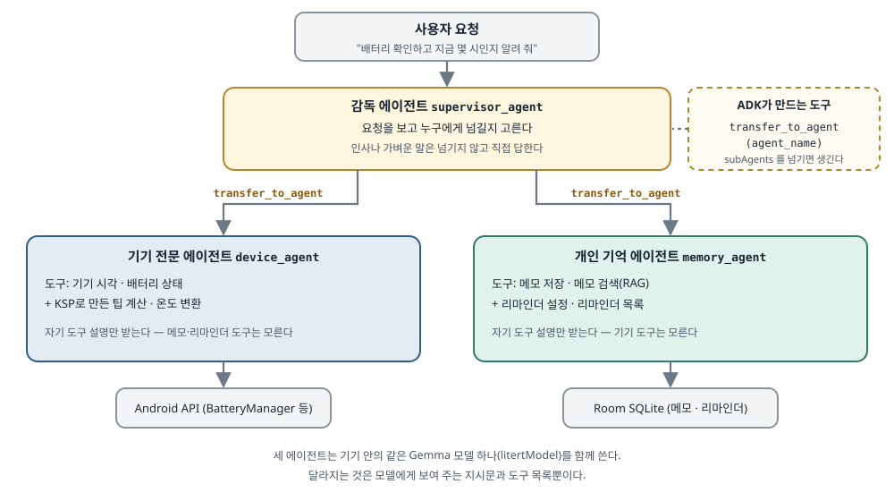
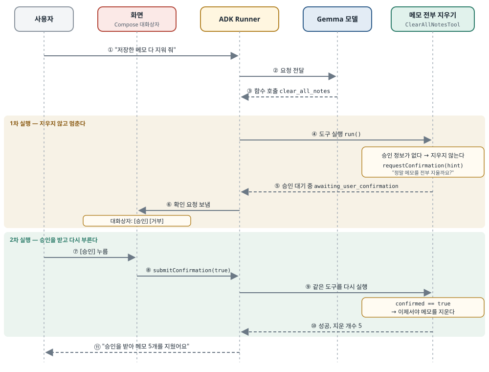

## 한 줄 요약

Google의 에이전트 개발 도구 **ADK(Agent Development Kit) for Kotlin**으로 폰 안에서 Gemma 모델을 돌리는 AI 에이전트를 만드는 6편짜리 연재의 마지막 편이다. 에이전트 하나에 도구를 계속 붙이면 생기는 두 문제를 푼다. 첫째, 작은 기기 안 모델은 도구가 15~20개만 되어도 지시를 잘 못 따르고 느려지므로, **감독 에이전트 하나가 요청을 보고 전문 에이전트에게 넘기는 팀 구조**로 나눈다. ADK에서는 `subAgents` 목록만 넘기면 "다른 에이전트에게 넘기기" 도구가 저절로 생긴다. 둘째, 에이전트가 데이터를 지우는 일을 혼자 하지 못하도록, **도구가 처음 불릴 때는 멈춰서 사용자에게 묻고, 승인을 받은 뒤 다시 불릴 때만 실행하는 승인 게이트**를 둔다.

> 원문은 Medium의 Google Developer Experts 출판물에 실렸고, 이 글은 그 RSS 피드에 실린 전문을 읽고 썼다. 원문 코드가 들어 있는 저장소 [raipankaj/Sample-ADK-Agents-](https://github.com/raipankaj/Sample-ADK-Agents-)에는 **라이선스 파일이 없다**(라이선스가 없으면 저작자 외에는 가져다 쓸 권리가 없다). 그래서 **이 글의 코드는 원문 코드를 옮긴 것이 아니라, 원문이 설명하는 구조를 따라 이름과 예시를 바꿔 직접 쓴 스케치다.** 예시는 원문의 "기기 정보·메모" 대신 "일정·할 일" 비서로 바꿨다. 원문 표지 그림은 원문 서버 주소를 걸어 보여 주고, 원문에 Mermaid(글로 쓰면 그림으로 그려 주는 도식 문법)로 들어 있던 도식 두 개는 한국어 그림으로 다시 그렸다.

## 먼저 알아 둘 말

- **에이전트(agent)**
  - 질문에 한 번 답하고 끝나는 것이 아니라, 필요하면 도구를 부르고 그 결과를 보고 다음 행동을 고르며 **여러 단계를 스스로 이어 가는 AI**다.
- **도구(tool) / 함수 호출(function calling)**
  - 앱이 모델에게 "너는 이런 함수들을 부를 수 있다"고 이름·설명·인자를 알려 주면, 모델이 답 대신 "이 함수를 이 인자로 불러 달라"고 돌려준다. 실제 실행은 앱 코드가 하고, 결과를 다시 모델에게 준다.
  - 원문은 ADK의 `BaseTool`(도구 하나를 클래스로 직접 쓰는 방식)과 `@Tool` 어노테이션 + KSP(Kotlin 컴파일러 플러그인으로, 컴파일할 때 코드를 만들어 주는 도구. Hilt가 쓰는 kapt의 Kotlin판)로 도구 선언을 자동으로 만드는 방식을 함께 쓴다.
- **ADK(Agent Development Kit) for Kotlin**
  - Google이 만든 에이전트 개발 도구 모음이다. 에이전트(`LlmAgent`), 실행기(`Runner`), 도구(`BaseTool`), 대화 저장(세션 서비스) 같은 부품을 준다.
  - 원문 예제는 **1.1.0**을 쓴다. 2026-10-28에 Maven Central을 보니 최신은 **1.4.0**이다.
- **LiteRT-LM / Gemma**
  - **LiteRT**는 Google의 기기 안 머신러닝 실행 도구(예전 이름 TensorFlow Lite)이고, **LiteRT-LM**은 그 위에서 언어 모델을 돌리는 부분이다. 원문 예제는 0.13.1을 쓴다.
  - **Gemma**는 Google이 공개한 가벼운 언어 모델이다. 원문 예제의 README는 `gemma-4-E2B-it.litertlm` 같은 모델 파일을 앱의 `assets` 에 넣으라고 안내한다. 인터넷 없이 폰 CPU·GPU로 답을 만든다.
- **지시문(instruction) / 시스템 프롬프트**
  - 에이전트에게 "너는 누구이고 어떻게 행동하라"를 알려 주는 글이다. 모델은 매번 이 글과 **도구 설명 전체**를 먼저 읽고 나서 답한다.
- **프리필(prefill) 지연**
  - 모델이 답의 첫 글자를 내기 전에 **입력 전체(지시문 + 도구 설명 + 대화)를 읽어 들이는 시간**이다. 도구가 많을수록 읽을 글이 길어져, 폰 CPU에서는 이 시간이 눈에 띄게 늘어난다.
- **도구 환각(tool hallucination)**
  - 모델이 없는 도구를 지어내 부르거나, 엉뚱한 도구를 고르거나, 인자를 잘못 채우는 것이다. 작은 모델일수록, 도구가 많을수록 잦아진다.
- **감독 에이전트(supervisor) / 하위 에이전트(sub-agent)**
  - 감독은 요청을 받아 "이건 누구 일인가"만 판단하고, 실제 일은 자기 도구만 가진 전문 에이전트(하위 에이전트)에게 넘긴다. 회사로 치면 접수 창구와 담당 부서다.
- **`transfer_to_agent`**
  - ADK가 감독에게 자동으로 붙여 주는 도구다. 인자로 넘겨받을 에이전트 이름(`agent_name`)을 받고, 불리면 대화의 주인이 그 에이전트로 바뀐다.
- **HITL(Human-in-the-Loop, 사람이 고리 안에 있음)**
  - AI가 일하는 흐름 중간에 **사람의 판단을 끼워 넣는 것**이다. 이 글에서는 "지우기 전에 사람이 승인 버튼을 눌러야 한다"는 뜻으로 쓴다.
- **`Runner` / 세션(session)**
  - `Runner`는 에이전트에게 메시지를 넣고, 도구 호출을 처리하고, 결과 이벤트를 흘려보내는 실행기다.
  - 세션은 한 대화의 기록이다. 원문은 `RoomSessionService`(대화 기록을 Room 데이터베이스에 저장하는 세션 서비스, 4편에서 다룸)를 써서 앱을 껐다 켜도 대화가 남게 한다.
- **RAG(Retrieval-Augmented Generation, 검색해서 붙여 답하기)**
  - 모델이 답하기 전에 저장된 자료(여기서는 Room에 저장한 메모)를 검색해 관련 내용을 함께 넣어 주는 방식이다. 4편에서 다뤘다.
- **SSE 스트리밍**
  - 답을 한 번에 다 만든 뒤 주지 않고, 만들어지는 대로 조금씩 흘려보내는 방식이다. 5편에서 앱이 멈춘 것처럼 보이는 문제를 이걸로 풀었다.

## 서론 — 지금까지 만든 것

<figure class="media"><figcaption>원문 표지 그림. 가운데 감독 로봇이 요청을 나눠 주고, 색이 다른 전문 로봇들이 각자 기기 정보·메모·일정·보안 일을 맡는다. 오른쪽 아래의 사람은 위험한 일(휴지통·경고)을 승인하거나 거부하는 카드를 누르고 있다 — 이 글의 두 주제를 한 장에 담았다. 원문 이미지, 원문 서버에서 불러옴 (<a href="https://medium.com/google-developer-experts/building-on-device-ai-agents-on-android-with-google-adk-part-6-advanced-agent-architectures-b4b2bffbf1ba">원문</a>)</figcaption></figure>

저자는 이 연재에서 폰 안에서만 도는 AI 에이전트를 한 편씩 키워 왔다.

- **1편**: LiteRT-LM으로 Gemma 모델을 Android에서 띄웠다.
- **2편**: 에이전트에게 도구를 쥐여 줬다. `BaseTool` 로 직접 쓴 도구와, `@Tool` + KSP로 컴파일할 때 선언을 만드는 도구를 비교했다.
- **3편**: 도구가 실행될 때 받는 `ToolContext`(지금 세션·사용자·저장 공간 같은 실행 정보를 담은 객체)와 세션 산출물(artifact, 대화 중에 만들어 저장해 두는 파일·메모)을 다뤘다.
- **4편**: Room SQLite로 기기 안 RAG를 만들었다.
- **5편**: SSE 스트리밍으로 답이 실시간으로 흐르게 하고, 에이전트가 무엇을 했는지 보여 주는 관찰용 서랍(Agent Inspector)을 만들었다.

## 1. 에이전트 하나로 버티면 부딪히는 두 벽

앱이 커지면 에이전트 하나에 모든 일을 맡기는 설계(원문의 표현으로 "monolithic", 한 덩어리 설계)가 두 군데에서 막힌다.

- **첫째 벽: 도구가 너무 많아지면 모델이 감당하지 못한다.**
  - 무엇이 문제인가: 도구가 15~20개가 되면 지시문이 도구 설명으로 가득 찬다.
  - 왜 폰에서 특히 심한가: 매개변수 10억~20억 개(1B~2B) 정도의 작은 모바일 모델은 이 긴 설명 속에서 **지시를 덜 따르고**, **도구를 지어내거나 잘못 고르며**, 모델이 입력 전체를 읽는 **프리필 시간이 크게 늘어난다.**
- **둘째 벽: 스스로 움직이는 에이전트를 막을 장치가 없다.**
  - 무엇이 문제인가: 에이전트가 데이터베이스 전체 지우기, 사용자 데이터 삭제, 결제 같은 **되돌리기 어려운 일**을 사용자의 명시적인 확인 없이 해 버릴 수 있다.
  - 원칙: 이런 일은 **절대로** 확인 없이 하면 안 된다.

저자는 이 두 벽을 ADK의 두 기능으로 넘는다.

- **계층형 다중 에이전트 팀**: 한 덩어리 에이전트를 감독 에이전트와 전문 하위 에이전트들로 쪼개고, ADK에 원래 들어 있는 `transfer_to_agent` 로 일을 넘긴다.
- **사람 승인 게이트(HITL)**: 위험한 코드를 실행하기 직전에 에이전트를 멈추고, Compose 대화상자로 사용자에게 승인을 받는다.

## 2. 첫 번째 구조: 계층형 다중 에이전트 팀

**모든 것을 아는 만능 에이전트 하나 대신, 한 가지 일만 아는 전문가들을 두고 감독이 그들을 지휘한다.**

<figure><a class="figure-scroll" href="../assets/750-adk-supervisor.svg"></a><figcaption>감독이 요청을 나누는 구조. 원문의 Mermaid 도식을 바탕으로 한국어로 다시 그림 (<a href="https://medium.com/google-developer-experts/building-on-device-ai-agents-on-android-with-google-adk-part-6-advanced-agent-architectures-b4b2bffbf1ba">원문</a>)</figcaption></figure>

원문의 팀은 셋이다.

- **감독 에이전트(`supervisor_agent`)**: 요청을 분류하고 넘긴다.
- **기기 전문 에이전트(`device_agent`)**: 배터리, 시각, 그리고 2편에서 KSP로 만든 계산 도구(팁 계산, 온도 변환)를 맡는다. Android API를 부른다.
- **개인 기억 에이전트(`memory_agent`)**: 4편에서 만든 Room SQLite 메모, RAG 검색, 리마인더를 맡는다.

### ADK는 일 넘기기를 어떻게 처리하나

**라우팅(요청을 어디로 보낼지 정하는 일) 코드를 따로 짤 필요가 없다. `LlmAgent` 에 `subAgents` 목록을 넘기면 끝이다.** 원문은 이 한 줄에 "여기서 마법이 일어난다"는 주석을 달았다.

그 한 줄 뒤에서 ADK 안의 `AgentTransferProcessor` 가 네 가지 일을 한다.

1. **계층을 훑는다.** 하위 에이전트, 부모 에이전트, 같은 층의 형제 에이전트를 모두 찾는다.
2. **도구를 하나 만들어 붙인다.** `transfer_to_agent(agent_name: String)` 이라는 도구를 합성해 감독에게 준다.
3. **지시문을 덧붙인다.** 감독의 시스템 지시문에 "어떤 경우에 어느 하위 에이전트에게 어떻게 넘기라"는 설명을 끼워 넣는다. 이때 각 하위 에이전트의 `description`(한 줄 소개)이 쓰인다.
4. **실행 흐름을 바꾼다.** 감독이 `transfer_to_agent` 를 부르면, 그다음부터는 넘겨받은 에이전트가 자기 지시문과 자기 도구로 대화를 이어 간다.

### 다중 에이전트 서비스 만들기 — `MultiAgentService.kt`

원문은 예제 앱의 `MultiAgentService` 클래스 전체를 보여 준다. 흐름은 이렇다.

- **모델을 한 번만 띄운다.** `ModelEngineHelper.createModel(modelFile, "multi-agent")` 로 LiteRT-LM 모델을 만들고, 세 에이전트가 **같은 모델 객체를 함께** 쓴다. 에이전트마다 모델을 따로 띄우지 않는다(폰 메모리에 모델 셋을 올릴 수는 없다).
- **하위 에이전트 1 — 기기 전문.** 이름 `device_agent`, "기기 하드웨어 상태와 계산 도구 전문"이라는 `description`, "시각·배터리 질문에는 이 도구, 계산에는 저 도구를 쓰라"는 `instruction`, 그리고 도구 목록(직접 쓴 `DeviceTimeTool`·`BatteryStatusTool` 에 KSP가 만든 계산 도구 목록을 더함)을 준다.
- **하위 에이전트 2 — 개인 기억.** 이름 `memory_agent`, 메모 저장·검색과 리마인더 관리 전문이라는 소개, 그리고 Room DAO(Data Access Object, 데이터베이스를 읽고 쓰는 함수 묶음)를 받는 도구 넷(`SaveNoteTool`·`SearchNotesTool`·`SetReminderTool`·`ListRemindersTool`)을 준다.
- **뿌리 — 감독.** 이름 `supervisor_agent`. 지시문에 규칙 세 줄을 번호로 적는다. ① 시각·배터리·팁·온도 이야기면 `device_agent` 로 넘긴다 ② 메모·저장한 기억 검색·리마인더 이야기면 `memory_agent` 로 넘긴다 ③ 인사나 잡담은 직접 답해도 된다. 그리고 `subAgents = listOf(deviceAgent, memoryAgent)`. **감독에게는 도구를 하나도 주지 않는다.**
- **세션과 실행기.** `RoomSessionService.fromContext(...)` 로 `adk_multi_agent_sessions.db` 라는 별도 데이터베이스에 대화를 저장하고, `InMemoryRunner` 에 감독 에이전트를 뿌리로 넘긴다.

아래는 같은 구조를 "일정·할 일 비서"로 바꿔 **직접 쓴 스케치**다. API 이름은 원문(ADK 1.1.0)에 나온 것을 따랐고, 컴파일해 보지는 않았다.

```kotlin
// AssistantTeam.kt — 직접 쓴 스케치 (원문 구조를 따름, ADK 1.1.0 기준 이름)
class AssistantTeam(private val model: LiteRtLmModel, calendar: CalendarGateway, todos: TodoDao) {

    private val calendarAgent = LlmAgent(
        name = "calendar_agent",
        model = model,
        description = "일정을 찾고 만드는 담당. 날짜·시간이 나오는 요청을 맡는다.",
        instruction = Instruction("너는 일정 담당이다. 일정 조회는 find_events, 새 일정은 create_event 로 처리한다."),
        tools = listOf(FindEventsTool(calendar), CreateEventTool(calendar)),
    )

    private val todoAgent = LlmAgent(
        name = "todo_agent",
        model = model,
        description = "할 일을 제안하고 완료 여부를 묻는 담당.",
        instruction = Instruction("너는 할 일 담당이다. 새 할 일은 propose_task 로 제안만 하고, 완료는 ask_completion 으로 묻는다."),
        tools = listOf(ProposeTaskTool(todos), AskCompletionTool(todos)),
    )

    val root = LlmAgent(
        name = "front_desk",
        model = model,                       // 세 에이전트가 모델 하나를 함께 쓴다
        description = "요청을 받아 담당에게 넘긴다.",
        instruction = Instruction(
            "일정 이야기는 calendar_agent 에게, 할 일 이야기는 todo_agent 에게 넘긴다. 인사는 직접 답한다."
        ),
        subAgents = listOf(calendarAgent, todoAgent), // 이 한 줄로 transfer_to_agent 도구가 생긴다
    )
}
```

- `description` 은 사람이 읽는 주석이 아니다. **ADK가 감독의 지시문에 끼워 넣는 재료**라서, 감독이 이걸 읽고 누구에게 넘길지 고른다. 담당끼리 설명이 겹치면 감독이 헷갈린다.
- 감독의 `instruction` 에도 넘기는 규칙을 다시 적는다. 원문도 `description` 과 감독 지시문 양쪽에 같은 경계를 적었다. 작은 모델에게는 한 번 더 말해 주는 편이 안전하다.

### 실제로 넘기는 모습

원문은 앱에서 "배터리 확인하고 지금 시각도 알려 줘"라고 물었을 때 5편의 관찰 서랍(Visual Agent Inspector)에 찍힌 기록을 보여 준다. 차례대로 옮기면 이렇다.

1. **사용자 입력**: "Check my device battery and tell me the current time."
2. **감독의 도구 호출**: `transfer_to_agent` 를 인자 `{"agent_name": "device_agent"}` 로 부른다.
3. **기기 전문 에이전트의 도구 호출**: `get_battery_status` → 결과 `{"battery_percentage": 88, "is_charging": false}` (배터리 88%, 충전 중 아님).
4. **기기 전문 에이전트의 도구 호출**: `get_device_time` → 결과 `{"current_time": "14:25:10 UTC"}`.
5. **기기 전문 에이전트의 답**: "배터리는 88%이고, 지금 기기 시각은 오후 2시 25분입니다."

감독은 의도만 판단해 넘겼고, 그 뒤로는 `device_agent` 가 **자기 도구를 직접 부르고 사용자에게 직접 답했다.** 감독을 다시 거쳐 돌아오지 않는다.

## 3. 두 번째 구조: 사람 승인 게이트(HITL)

**`clear_all_notes`(메모 전부 지우기) 같은 도구를 생각해 보자. 에이전트가 말을 잘못 알아듣고 혼자 사용자의 데이터베이스를 지워 버리면, 사용자의 신뢰는 끝난다.** ADK는 이를 막는 사람 확인 장치를 기본으로 준다.

<figure><a class="figure-scroll" href="../assets/750-adk-hitl-sequence.svg"></a><figcaption>같은 도구가 두 번 불린다. 첫 번째는 묻기만 하고, 두 번째에야 지운다. 원문의 Mermaid 순서도를 바탕으로 한국어로 다시 그림 (<a href="https://medium.com/google-developer-experts/building-on-device-ai-agents-on-android-with-google-adk-part-6-advanced-agent-architectures-b4b2bffbf1ba">원문</a>)</figcaption></figure>

### 1단계: 승인이 있어야 움직이는 도구 — `HitlTools.kt` 의 `ClearAllNotesTool`

원문의 도구는 `BaseTool` 을 이어받고, 이름 `clear_all_notes` 와 "저장한 메모를 영구히 지운다. 되돌릴 수 없으니 사람의 명시적 확인이 필요하다"는 설명을 단다. `declaration()` 은 이 이름과 설명으로 함수 선언을 만든다(인자는 없다). 핵심은 `run()` 이다.

- **1차 실행 — `context.toolConfirmation` 이 `null` 이다.**
  - 아직 아무도 승인하지 않았다는 뜻이다.
  - 도구는 지우지 않고 `context.requestConfirmation(hint = …, payload = …)` 를 부른다. `hint` 는 사용자에게 보여 줄 질문("Room 데이터베이스의 메모를 정말 전부 영구히 지울까요?"), `payload` 는 어떤 동작인지 표시하는 값(`"action" to "clear_all_notes"`)이다.
  - 그리고 "승인 대기 중"(`status = awaiting_user_confirmation`)이라는 결과를 돌려주고 끝난다.
- **2차 실행 — 승인 정보가 들어 있다.**
  - `confirmation.confirmed` 가 참이면 그제서야 `noteDao.clearAllNotes()` 를 부르고, 지운 개수(`deleted_count`)와 함께 성공을 돌려준다.
  - 거짓이면 아무것도 지우지 않고 "사용자가 취소했다"(`status = cancelled`)를 돌려준다.
- **`close()` 는 비워 둔다.** 이 도구는 붙잡고 있는 자원이 없다.

아래는 같은 두 번 실행 구조를 "일정 지우기"로 바꿔 **직접 쓴 스케치**다(ADK 1.1.0 기준 이름, 컴파일 확인 안 함).

```kotlin
// DeleteEventTool.kt — 직접 쓴 스케치
class DeleteEventTool(private val calendar: CalendarGateway) : BaseTool(
    name = "delete_event",
    description = "일정 하나를 폰 캘린더에서 지운다. 동기화된 계정에서도 사라지므로 사용자 승인이 있어야 실행된다.",
) {
    override fun declaration() = FunctionDeclaration(name = name, description = description /* 인자: event_id */)

    override suspend fun run(context: ToolContext, args: Map<String, Any?>): Any {
        val eventId = args["event_id"] as? String ?: return mapOf("status" to "error", "message" to "event_id 가 없다")
        val decision = context.toolConfirmation
            ?: run {
                val title = calendar.titleOf(eventId) ?: return mapOf("status" to "error", "message" to "그런 일정이 없다")
                context.requestConfirmation(hint = "'$title' 일정을 지울까요?", payload = mapOf("event_id" to eventId))
                return mapOf("status" to "waiting_for_user")       // 1차: 여기서 멈춘다. 아무것도 지우지 않았다
            }
        if (!decision.confirmed) return mapOf("status" to "cancelled") // 2차: 거부
        calendar.delete(eventId)                                       // 2차: 승인 — 이때만 지운다
        return mapOf("status" to "deleted", "event_id" to eventId)
    }

    override fun close() {}
}
```

### 문이 닫히는 원리

- **처음 불릴 때는 `context.toolConfirmation` 이 `null` 이다.** 도구가 `requestConfirmation` 을 부르면, ADK 안의 `RequestConfirmationProcessor` 가 **이번 차례(turn)를 멈추고** "화면에서 확인을 받아 달라"는 이벤트를 내보낸다.
- **사용자가 승인하거나 거부하면, ADK가 같은 도구를 다시 부른다.** 이번에는 `context.toolConfirmation` 이 채워져 있다.
- **도구는 `confirmed` 값을 보고 실행하거나 그만둔다.**

중요한 점은 **문이 도구 코드 안에 있다**는 것이다. 지시문에 "지우기 전에 꼭 물어봐"라고 적는 것과 다르다. 모델이 지시를 잊거나 잘못 알아들어도, 승인 정보 없이 `run()` 이 불리면 도구 스스로 지우기를 거부한다.

### 2단계: 사용자의 결정을 돌려보내기 — `HitlAgentService.kt` 의 `submitConfirmation`

사용자가 대화상자에서 고르면, 앱은 그 결정을 ADK가 알아듣는 **가짜 함수 응답 메시지**로 포장해 다시 `Runner` 에 넣는다.

- **역할은 `user`**, 내용은 `FunctionResponse` 하나다.
- **함수 이름은 `FunctionCall.REQUEST_CONFIRMATION_FUNCTION_CALL_NAME`**, 실제 값은 `"adk_request_confirmation"` 이다. 앞에서 도구가 확인을 요청할 때 ADK가 이 이름으로 함수 호출을 하나 만들어 두었다고 보면 된다.
- **`id` 는 그 확인 요청의 호출 id(`callId`)** 를 그대로 넣는다. 어느 질문에 대한 답인지 짝을 맞추는 값이다.
- **응답 본문은 `ToolConfirmation.CONFIRMED_KEY`(`"confirmed"`) 에 참·거짓.**
- 이 메시지를 원문의 공용 함수 `runWithContent(...)` 로 같은 세션(`hitl_session_1`)에 흘려보낸다. 관찰 서랍에는 "User Decision Submitted"(사용자 결정 제출)와 "승인함/거부함"이 찍힌다. 반환값은 이어지는 응답 이벤트의 `Flow`(코루틴으로 값을 차례로 흘려보내는 흐름)다.

### 3단계: Compose 승인 대화상자 — `ChatScreen.kt`

화면 상태(`uiState`)의 `pendingConfirmation` 이 비어 있지 않으면, 채팅 화면 위로 대화상자가 끼어든다.

- **아이콘**: 경고 아이콘(`Icons.Default.Warning`)을 테마의 오류 색(`colorScheme.error`)으로 32dp 크기로 그린다.
- **제목**: "Human Approval Required"(사람의 승인이 필요합니다).
- **본문**: 도구가 보낸 `hint` 를 보여 주고, 없으면 "이 동작은 진행 전에 확인이 필요합니다"라는 기본 문구를 쓴다.
- **승인 버튼**: 오류 색으로 칠한 `Button` 에 "Approve Action". 누르면 `viewModel.confirmHitlAction(true)`.
- **거부 버튼**: 테두리만 있는 `OutlinedButton` 에 "Deny / Cancel". 누르면 `confirmHitlAction(false)`.
- **대화상자 바깥을 누르거나 뒤로 가기로 닫으면(`onDismissRequest`) 거부로 처리한다.** 애매하면 지우지 않는 쪽이 기본값이다.

승인 버튼을 위험 색으로 칠한 것도 의도다. "이 버튼은 되돌릴 수 없는 일을 시작한다"는 것을 색으로도 알린다.

## 4. 세 가지 구조를 바꿔 가며 보는 전환기

예제 앱에는 개발자가 세 구조를 그 자리에서 바꿔 볼 수 있는 선택기가 있다. 원문은 `enum class AgentArchitectureMode` 에 세 값을 둔다.

| 값 | 화면에 보이는 이름 | 설명 |
|---|---|---|
| `SINGLE_AGENT` | Single Agent | 에이전트 하나가 Room DB, RAG, KSP 도구를 모두 가진다. 1~5편의 구조다. |
| `MULTI_AGENT` | Multi-Agent Team | 감독과 전문 하위 에이전트들로 나눈다. 이 글의 2장이다. |
| `HITL_GUARDIAN` | Human-in-the-Loop | 보호된 동작과 승인 게이트를 둔다. 이 글의 3장이다. |

`ChatScreen.kt` 위쪽 막대에 `AgentModeSelectorRow` 를 두고, 현재 모드와 모드 변경 함수(`viewModel::setAgentMode`)를 넘긴다. **답을 만드는 중(`isGenerating`)에는 선택기를 막아** 도중에 구조가 바뀌지 않게 한다. 같은 질문을 세 구조에 차례로 던져 어떻게 다르게 움직이는지 비교하려는 장치다.

## 5. 연재 정리

저자는 여섯 편을 이렇게 묶는다.

- **1편(엔진)**: Gemma를 기기 안에서 띄우고, 모델 파일을 압축하지 말라는 Gradle 설정(`noCompress`)을 익히고, ADK의 기본 부품을 세웠다.
- **2편(도구)**: 하드웨어에 접근하는 `BaseTool` 과, 컴파일할 때 만들어지는 `@Tool` KSP 도구를 비교했다.
- **3편(ToolContext)**: 실행 중의 연결 고리를 살피고, 세션 정보를 들여다보고, ADK 산출물로 메모장을 만들었다.
- **4편(기기 안 RAG)**: 대화 기록(`RoomSessionService`)과 도메인 지식(메모)을 구분하고, Room SQLite 검색 도구를 만들었다.
- **5편(관찰)**: `StreamingMode.SSE` 로 앱이 멈춰 보이는 문제를 없애고, Compose로 에이전트 관찰 서랍을 만들었다.
- **6편(고급 구조)**: 에이전트 하나를 계층형 팀으로 키우고, 되돌릴 수 없는 동작을 사람 승인 게이트로 막았다.

저자의 결론은 이렇다. 기기 안 AI는 "프롬프트를 넣고 대화하는 껍데기"라는 신기한 장난감 단계에서, **튼튼하고 개인정보가 기기 밖으로 나가지 않으며 스스로 행동하는 에이전트 시스템**으로 빠르게 옮겨 가고 있다. ADK for Kotlin은 Android 개발자가 그런 에이전트를 폰 위에서 바로 만들 수 있는 1급 도구라는 것이다. 전체 코드(여섯 편의 구조, 도구, Compose 화면, Gemma 설정 예시)는 저자의 GitHub 저장소에 있다.

## 원문을 읽을 때 주의할 점

- **버전이 빠르게 바뀌고 있다.** 원문 예제는 ADK 1.1.0, LiteRT-LM 0.13.1, AGP 9.5.0-alpha05(아직 정식이 아닌 미리보기판)를 쓴다. 2026-10-28 기준 Maven Central의 ADK for Kotlin 최신은 1.4.0이라, `requestConfirmation`·`toolConfirmation` 같은 이름이 그대로인지 직접 확인해야 한다.
- **원문 저장소에는 라이선스가 없다.** 읽고 배우는 것은 괜찮지만, 코드를 그대로 가져다 쓸 수는 없다. 이 글의 코드가 모두 직접 쓴 스케치인 이유다.
- **팀 구조가 공짜는 아니다.** 원문은 도구가 많을 때의 프리필 지연을 나누는 이유로 들었지만, 나눈 뒤에는 **넘길 때마다 모델이 한 번 더 돈다**(감독이 판단하는 호출 + 담당이 일하는 호출). 원문은 나누기 전후의 응답 시간을 재서 보여 주지 않았다.
- **넘긴 뒤 다음 질문은 누가 받는지 원문은 말하지 않는다.** 관찰 기록에서는 `device_agent` 가 직접 답하고 끝난다. 그다음 사용자가 메모 이야기를 꺼내면 감독에게 돌아가는지는 ADK 문서에서 따로 확인해야 한다.
- **`callId` 를 어디서 얻는지는 원문 코드 조각에 없다.** `submitConfirmation` 은 `callId` 를 받지만, 확인 요청 이벤트에서 그 값을 꺼내 화면 상태(`pendingConfirmation`)에 담는 부분은 ViewModel 쪽에 있고 원문에는 나오지 않는다.

## 코드로 보기 — Aide 구조로 옮긴 스케치

Aide 1-b는 기기 안 모델이 아니라 **사용자가 고른 제공자를 사용자 키로 부른다**(decisions.md 「LLM은 사용자가 고른 제공자를 사용자 키로 앱에서 직접 부른다」). 그리고 ADK를 쓸지도 아직 정하지 않았다. 그래서 여기서는 프레임워크와 상관없이 가져올 수 있는 한 가지, **"승인이 필요한 도구는 도구 코드 안에서 멈춘다"** 만 Aide 모양으로 옮긴다. 모두 직접 쓴 스케치이고, Aide 코드는 고치지 않았다.

Aide는 이미 AI 함수를 두 종류로 나누기로 했다(decisions.md 「시킨 일은 AI가 바로 하고 되돌릴 수 있게, 시키지 않은 일은 묻는다」).

- 사용자가 시킨 일 → 바로 실행하고 되돌리기를 준다 (`create_event`)
- AI가 스스로 떠올린 일 → 제안만 한다 (`propose_event`·`propose_task`·`ask_completion`)

원문의 승인 게이트는 두 번째 종류와 정확히 맞는다. 다만 Aide는 같은 도구를 두 번 부르는 대신, **제안 도구는 아예 쓰기 권한을 갖지 않고, 쓰기는 사용자가 누른 버튼의 처리 코드에서만 일어나게** 나눈다.

```kotlin
// core/ai/.../tool/ToolOutcome.kt (직접 쓴 스케치)
sealed interface ToolOutcome {
    /** 사용자가 시킨 일. 이미 실행했고, 되돌릴 수 있다 */
    data class Done(val message: String, val undo: UndoAction?) : ToolOutcome

    /** AI가 떠올린 일. 아무것도 쓰지 않았다. 아바타가 묻는다 */
    data class AskUser(val question: String, val proposal: Proposal) : ToolOutcome
}

sealed interface Proposal {
    data class NewTask(val title: String, val due: LocalDate?) : Proposal
    data class NewEvent(val draft: EventDraft) : Proposal
}
```

```kotlin
// core/ai/.../tool/ProposeTaskTool.kt (직접 쓴 스케치)
class ProposeTaskTool : AideTool {                      // 생성자에 Repository가 없다 = 쓸 수 없다
    override val name = "propose_task"

    override suspend fun run(args: JsonObject): ToolOutcome {
        val title = args.string("title")
        return ToolOutcome.AskUser(
            question = "'$title' 할 일로 등록할까요?",
            proposal = Proposal.NewTask(title, args.dateOrNull("due")),
        )
    }
}
```

```kotlin
// feature/home/.../HomeViewModel.kt 일부 (직접 쓴 스케치)
fun onToolOutcome(outcome: ToolOutcome) = when (outcome) {
    is ToolOutcome.Done -> setEffect { HomeContract.Effect.ShowUndo(outcome.message, outcome.undo) }
    is ToolOutcome.AskUser -> setState { copy(avatar = AvatarActivity.ASKING, pendingProposal = outcome) } // 묻는 모습 + 카드
}

fun onProposalAnswered(accepted: Boolean) {
    val proposal = state.value.pendingProposal?.proposal ?: return
    setState { copy(avatar = AvatarActivity.IDLE, pendingProposal = null) }
    if (!accepted) return                                    // 거부하거나 카드를 닫으면 아무것도 쓰지 않는다
    viewModelScope.launch {
        when (proposal) {
            is Proposal.NewTask -> todoRepository.add(proposal.title, proposal.due)   // 쓰기는 여기서만
            is Proposal.NewEvent -> eventRepository.create(proposal.draft)
        }
    }
}
```

- **원문과 같은 점**: 모델이 무엇을 부르든, 사용자가 누르기 전에는 아무것도 쓰이지 않는다. 문이 지시문이 아니라 코드에 있다.
- **원문과 다른 점**: 원문은 도구가 저장소(DAO)를 쥐고 있다가 두 번째 실행에서 쓴다. 위 스케치는 **제안 도구에게 저장소를 아예 주지 않는다.** 그래서 "승인 확인 `if` 문을 깜빡한 도구"가 생길 수 없다. 이 규칙은 Konsist로 "`propose_` 도구의 생성자에는 Repository 타입이 없다"고 검사할 수도 있다.
- **대화상자 대신 아바타가 묻는다.** Aide는 "관습적인 UI 대신 AI가 묻고 사용자가 답한다"고 정했으므로, `AlertDialog` 를 띄우지 않고 아바타가 **묻는 모습**(`activity` 입력값 "묻는 중")으로 바뀌고 그 아래에 제안 카드가 뜬다. 카드를 그냥 지나치면 원문의 `onDismissRequest` 처럼 거부로 본다.

TDD로 짠다면 먼저 실패시킬 테스트는 이 두 개다(1-b에서 사용자가 직접 짠다).

| # | 무엇을 확인하나 | 왜 |
|---|---|---|
| 1 | `ProposeTaskTool.run()` 을 불러도 가짜 할 일 저장소에 아무것도 추가되지 않고, 결과는 `AskUser` 다. | 제안 도구가 혼자 쓰지 못한다는 것이 이 구조의 핵심이기 때문이다. |
| 2 | `onProposalAnswered(false)` 와 제안 카드 닫기는 저장소를 부르지 않고, `onProposalAnswered(true)` 만 정확히 한 번 부른다. | 거부와 무시가 "아무 일도 없음"으로 끝나야 하기 때문이다. |

## 배운 점

- **위험한 일을 막는 문은 프롬프트가 아니라 코드에 둔다.** "지우기 전에 물어봐"라는 지시는 모델이 잊을 수 있다. 도구가 승인 정보 없이는 실행을 거부하게 만들면, 모델이 무엇을 착각하든 데이터는 안전하다.
- **애매하면 거부가 기본값이다.** 대화상자 바깥을 눌러 닫는 것도 거부로 처리하는 작은 결정이, "사용자가 실수로 지나쳤는데 지워졌다"는 사고를 막는다.
- **다중 에이전트의 진짜 이유는 "모델이 읽는 도구 목록을 줄이는 것"이다.** 팀으로 나누면 각 에이전트는 자기 도구 서너 개만 읽는다. 대신 넘길 때마다 모델 호출이 하나 더 생긴다. 작은 기기 안 모델에게는 이 거래가 이득이지만, 큰 클라우드 모델에서는 계산이 달라진다.
- **ADK의 `description` 은 문서가 아니라 라우팅 데이터다.** 감독이 넘길 곳을 고르는 근거가 되므로, 담당 사이의 경계를 분명하게 적어야 한다.
- **ADK for Kotlin은 기기 안 모델 전용이 아니다.** 2026-10-28에 Maven Central을 보니 ADK for Kotlin에는 LiteRT-LM 말고도 OpenAI·Anthropic 연동 모듈, Firebase(Android) 모듈, ML Kit 모듈이 함께 올라와 있다.

## Aide에 적용하면

Aide의 AI는 1-b 단계이고, 지금(1-a)은 캘린더·리마인더 같은 기본 기능을 짜는 중이다. 아래는 1-b를 시작할 때 볼 항목이다.

1. **승인 게이트 — 바꿔서 가져온다.**
   - Aide는 이미 "AI가 스스로 떠올린 일은 묻는다"고 정했다(`propose_event`·`propose_task`·`ask_completion`). 원문의 게이트가 바로 이 자리에 들어간다.
   - 바꾸는 점 ①: 같은 도구를 두 번 부르는 대신, **제안 도구에게는 저장소를 주지 않고** 쓰기는 사용자가 누른 처리 코드에서만 한다(위 스케치). 승인 확인을 깜빡할 여지가 구조로 사라진다.
   - 바꾸는 점 ②: `AlertDialog` 대신 **아바타의 "묻는 중" 모습 + 제안 카드**로 묻는다. "관습적인 UI를 만들지 않는다"는 결정과 맞추기 위해서다.
   - 원문처럼 **카드를 닫거나 지나치면 거부**로 본다.
2. **사용자가 시킨 일은 묻지 않고 되돌리기를 준다 — 원문과 다른 선택이고, 그대로 둔다.**
   - 원문은 위험한 일을 "실행 전 승인"으로 막는다. Aide는 시킨 일을 "실행 후 되돌리기"로 막기로 했다. 다시 묻으면 비서가 아니라 입력 폼이 되기 때문이다.
   - 🔶 **결정이 필요한 곳**: 되돌리기가 진짜 되돌리기가 아닌 일이 생기면 이 원칙이 흔들린다. 예를 들어 AI에게 **일정 지우기** 함수를 열면, 지운 일정은 구글 계정 동기화로 서버에서도 사라지고, 다시 만들면 다른 일정 id가 되어 Aide가 붙여 둔 리마인더와의 연결이 끊긴다. 이런 함수만은 **시킨 일이라도 원문처럼 먼저 묻게 할지**, 아니면 AI에게 아예 열지 않을지를 1-b 함수 목록을 정할 때 사용자가 정해야 한다. 지금 decisions.md에 적힌 1-b 함수(`create_event`·`propose_*`·`ask_completion`)에는 지우기가 없다.
3. **다중 에이전트 팀 — 지금은 하지 않는다.**
   - 이유 ①: 1-b의 AI 함수는 네다섯 개다. 원문이 문제로 든 "도구 15~20개"와 거리가 멀다.
   - 이유 ②: Aide는 큰 클라우드 모델을 부르므로 작은 기기 안 모델만큼 도구 수에 약하지 않다.
   - 이유 ③: 넘길 때마다 모델 호출이 하나 더 생기고, 그 요금은 **사용자 키**로 나간다. 응답도 그만큼 늦어진다.
   - 다시 볼 때: 2차 이후 작업 기록 조회, 회사 티켓 제안 등으로 함수가 10개를 넘으면 다시 본다. 그때도 먼저 **앱이 요청 종류를 보고 보낼 함수 묶음만 고르는 방식**(모델 호출이 늘지 않는다)과 비교한다.
4. **ADK for Kotlin 자체 — 1-b 착수 전 확인 목록에 Koog 옆 후보로 올린다.**
   - decisions.md는 여러 제공자를 같은 방식으로 부르는 데 Koog를 검토하되, Android 앱 안에서 도는지 착수 전에 확인한다고 적었다.
   - ADK for Kotlin에는 OpenAI·Anthropic 연동 모듈과 Firebase(Android) 모듈이 있어 같은 역할을 할 수 있는 후보다. 다만 **OpenAI 모듈에는 Android판(`-android`)이 따로 있지만 Anthropic 모듈에는 보이지 않는다.** Android 앱에서 Anthropic을 부를 수 있는지는 확인 전이다(미확인).
   - 확인할 것: 사용자 키를 넣어 제공자를 바꿀 수 있는가, 승인 요청(`requestConfirmation`)이 클라우드 모델에서도 같게 동작하는가, 앱 크기가 얼마나 느는가.
5. **기기 안 Gemma — 지금은 하지 않는다.**
   - decisions.md는 기기 안 모델(Gemini Nano) 단독을 지원 기기 제한 때문에 기각했고, "나중에 보조로 추가할 수 있다"고만 남겼다. Gemma + LiteRT-LM도 같은 자리다.
   - 원문 예제 README는 Gemma 모델 파일을 앱 `assets` 에 넣으라고 하는데, 이런 모델 파일은 앱 크기를 크게 키운다. 스토어 첫 출시에 맞지 않는다.
   - 기록해 둘 충돌: 기기 안 모델은 **키 없이도 AI가 돌게** 만들 수 있다. 이는 「키가 없으면 AI 기능은 꺼지고 아바타는 잠든다」 결정과 부딪힌다. 나중에 보조로 넣을 때 이 결정을 다시 봐야 한다.
6. **구조 전환기와 관찰 서랍 — 지금은 하지 않는다.**
   - 전환기는 여러 구조를 비교하는 데모용이라 Aide에는 필요 없다.
   - 관찰 서랍이 하는 일(AI가 지금 무엇을 했는지 보여 주기)은 #749 「AI 에이전트는 일하기 전에 계획부터 보여줘야 한다」 글에서 정리한 **아바타 아래 작업 기록 칩**으로 대신한다.

## 출처

- [Building On-Device AI Agents on Android with Google ADK — Part 6: Advanced Agent Architectures — Pankaj Rai, Google Developer Experts (Medium)](https://medium.com/google-developer-experts/building-on-device-ai-agents-on-android-with-google-adk-part-6-advanced-agent-architectures-b4b2bffbf1ba)
- [raipankaj/Sample-ADK-Agents- (GitHub, 라이선스 표시 없음)](https://github.com/raipankaj/Sample-ADK-Agents-)
- [Maven Central: com.google.adk (ADK for Kotlin 모듈 목록)](https://repo1.maven.org/maven2/com/google/adk/)
- [Android Weekly #750](https://androidweekly.net/issues/issue-750)
