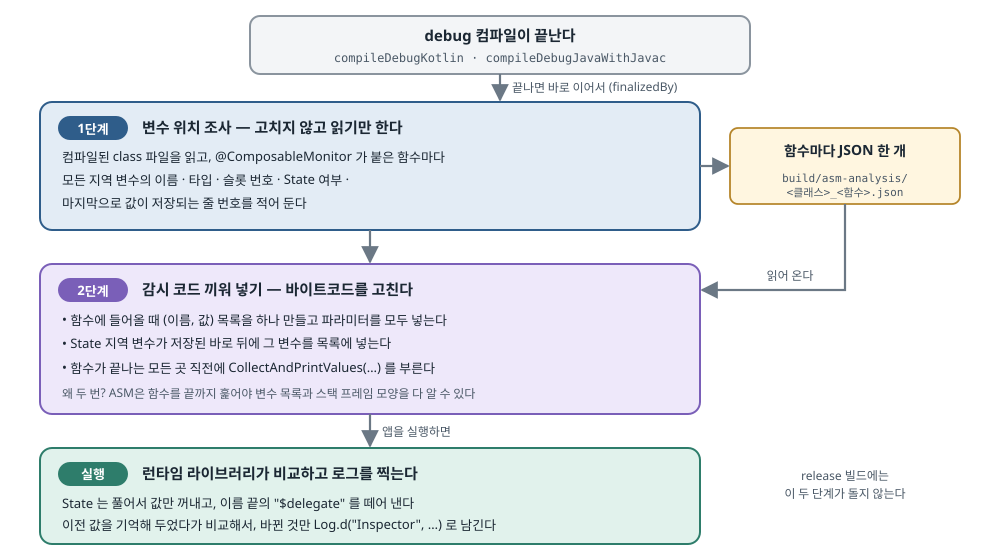

## 한 줄 요약

Compose 화면이 버벅일 때 가장 흔한 원인은 **상태가 너무 자주 바뀌어 화면 일부가 불필요하게 다시 그려지는 것(재구성, recomposition)** 이다. 그래서 "이 함수가 **왜** 다시 그려졌는가 — 어떤 파라미터나 상태가 무엇에서 무엇으로 바뀌었는가"를 알면 원인을 바로 찾을 수 있다. 이 일을 해 주는 라이브러리 Rebugger는 감시 코드를 **손으로** 함수마다 넣어야 한다. 저자는 함수에 `@ComposableMonitor` 어노테이션 하나만 붙이면 **컴파일할 때 감시 코드가 자동으로 들어가는** 도구를 만들었다. 첫 판은 Android 바이트코드를 ASM으로 고치는 방식이었다. 그러나 Compose 컴파일러가 바뀔 때마다 깨질 수 있고 Android에서만 돌았다. 그래서 둘째 판은 **Kotlin 컴파일러 플러그인**으로 다시 만들었다. 컴파일러가 코드를 각 플랫폼용으로 바꾸기 전 단계(IR)에서 고치니, Android·iOS·데스크톱·웹에서 모두 돈다. 그 결과물이 Android Weekly #750 라이브러리 목록에도 실린 **ComposeStateMonitor**다.

> 원문은 Medium에 실렸고 자동 접근이 막혀 있어(403), 저자의 RSS 피드에 실린 전문을 읽고 정리했다. 원문 글 자체에는 라이선스 표시가 없다. 그래서 원문의 그림 6장(IDE 화면 3장, Rebugger 예시 2장, KMP 컴파일 흐름도 1장)은 **복사하지 않고 원문 서버(Medium 이미지 서버) 주소를 걸어** 보여 주고, 그림마다 무엇이 보이는지 글로도 적었다. 원문의 글자 도식 3개 중 ASM 두 단계 도식은 **한국어 그림으로 다시 그렸다.** 나머지 두 도식은 저자의 저장소 [hellsong/ComposeStateMonitor](https://github.com/hellsong/ComposeStateMonitor)에 같은 내용이 있다. 이 저장소는 **Apache-2.0** 라이선스라서 그 문서와 코드를 인용하고 출처를 붙였다(2026-10-26 기준 커밋 `f167a53`).

## 먼저 알아 둘 말

- **재구성 (recomposition)**
  - Compose에서 상태가 바뀌면, 그 상태를 읽은 `@Composable` 함수를 **다시 실행해서** 화면을 새로 만드는 일이다. View 시스템에서 `invalidate()`로 `onDraw()`가 다시 불리는 것과 비슷하지만, Compose는 그리기 전에 **함수 자체를 다시 돌린다.**
  - 필요한 만큼만 일어나면 정상이다. 문제는 **바뀌지 않아도 될 부분까지 자주** 다시 실행될 때다. 한 프레임(약 16ms) 안에 일이 다 끝나지 않으면 화면이 버벅인다.
- **건너뛰기 (skipping)**
  - 재구성 중에 어떤 함수의 파라미터가 지난번과 같으면, Compose는 그 함수를 **다시 실행하지 않고 건너뛴다.** 버벅임을 줄이는 핵심 장치다.
- **안정성 (stability)**
  - Compose 컴파일러가 "이 타입은 값이 바뀌면 반드시 Compose가 알아챌 수 있다"고 판단하는 성질이다. `String`, `Int`, `val`만 가진 data class는 **안정(stable)** 이다. `var` 필드가 있거나, 컴파일러가 속을 들여다볼 수 없는 타입은 **불안정(unstable)** 이다.
  - 안정한 파라미터는 "값이 같으면 건너뛴다"가 확실하게 동작한다. 불안정한 파라미터는 건너뛰기가 덜 일어날 수 있다.
- **ANR (Application Not Responding)**
  - 메인 스레드가 약 5초 이상 막히면 Android가 띄우는 "앱이 응답하지 않습니다" 오류다. 보고서에 그 순간의 **스택 트레이스**(함수 호출 순서 기록)가 남는다.
- **바이트코드 (bytecode) 와 ASM**
  - Kotlin·Java 코드를 컴파일하면 JVM이 읽는 `.class` 파일, 곧 바이트코드가 나온다. Android는 이것을 다시 `.dex`로 바꿔 기기에서 돌린다.
  - **ASM**은 이 `.class` 파일을 읽고 고치는 Java 라이브러리다. 소스 코드를 건드리지 않고 **컴파일된 결과물에 코드를 끼워 넣을 수 있다.** Hilt·Firebase Performance 같은 도구도 빌드 중에 비슷한 일을 한다.
- **지역 변수 슬롯 (slot) 과 스택 프레임 (stack frame)**
  - JVM은 함수의 지역 변수를 이름이 아니라 **번호가 붙은 칸(슬롯)** 에 넣는다. 함수 하나가 실행되는 동안 쓰는 칸들과 계산용 공간을 묶어 스택 프레임이라고 한다.
  - 바이트코드에 코드를 끼워 넣을 때 칸 번호를 잘못 건드리면 **다른 변수의 값을 덮어쓰거나 검증 오류로 앱이 죽는다.**
- **Kotlin 컴파일러의 프런트엔드 · IR · 백엔드**
  - **프런트엔드**: 소스를 읽어 문법과 타입을 검사한다. Kotlin 2.0부터 쓰는 새 프런트엔드를 **K2**, 그 내부 표현을 **FIR**이라 부른다.
  - **IR (Intermediate Representation, 중간 표현)**: 프런트엔드가 만든, **플랫폼과 상관없는** 코드의 나무 구조다.
  - **백엔드**: IR을 각 플랫폼용 결과물로 바꾼다. JVM 바이트코드(Android·데스크톱), Kotlin/Native 기계어(iOS), JavaScript·Wasm(웹)이 여기서 나온다.
  - 그래서 **IR 단계에서 코드를 고치면 모든 플랫폼에 한 번에 적용된다.**
- **컴파일러 플러그인**
  - Kotlin 컴파일러 안에 끼어 들어가 IR 같은 중간 결과를 고치는 확장이다. Compose 자체가 컴파일러 플러그인이다. `@Composable` 함수에 `$composer`, `$changed` 같은 숨은 파라미터를 더하는 것이 이 플러그인의 일이다.
- **`$composer` · `$changed` · `$dirty`**
  - Compose 컴파일러가 `@Composable` 함수마다 몰래 더하는 파라미터와 지역 변수다. `$changed`·`$dirty`는 "어떤 파라미터가 바뀌었는가"를 **비트(0과 1)로 적어 둔 숫자**다. 이 숫자를 보고 건너뛸지 정한다.
- **Kotlin Multiplatform (KMP) · Compose Multiplatform (CMP)**
  - KMP는 Kotlin 코드 하나를 Android·iOS·데스크톱·웹에서 함께 쓰는 기술이다. CMP는 그 위에서 **Compose 화면 코드까지** 함께 쓰게 해 주는 JetBrains의 도구다.
- **Rebugger**
  - theapache64가 만든 오픈소스 라이브러리(Apache-2.0)다. 추적할 값들을 넘기면 "어떤 값이 무엇에서 무엇으로 바뀌어 다시 그려졌다"를 Logcat에 찍어 준다. 이 글의 도구는 이 라이브러리의 생각과 비교 코드를 가져와 자동화한 것이다.
- **Feature Flag (기능 스위치)**
  - 코드를 고치지 않고 설정 값 하나로 기능을 켜고 끄는 장치다. 이 글에서는 "감시 코드를 넣을지 말지"를 Gradle 설정으로 켜고 끈다는 뜻으로 쓰였다.

## 서론 — View 시대의 진단 방법이 Compose에서는 잘 통하지 않는다

- **Android 화면 개발이 View 시스템에서 Jetpack Compose로 옮겨 가면서, 성능 문제를 찾는 방법도 달라졌다.**
  - 두 방식은 개발 경험뿐 아니라 **도구와 성능 추적 흐름**도 많이 다르다.
- **View 시대에는 프레임 수 감시와 함께 ANR 보고서의 스택 트레이스로 문제 코드를 찾았다.**
  - 메인 스레드가 어디서 막혔는지가 스택에 그대로 남으니, 그 줄을 고치면 됐다.
- **Compose에서는 그 스택 트레이스가 범인을 가리키지 않을 수 있다.**
  - Compose는 **데이터가 바뀌면 그에 반응해** 화면을 다시 만든다. 그래서 스택에는 "Compose 런타임이 재구성을 돌리던 중"만 보이고, **어떤 상태 변화가 이 많은 재구성을 일으켰는지는 보이지 않는다.**
  - 결과: 원인을 찾으려면 "무엇이 바뀌어서 다시 그려졌는가"를 따로 봐야 한다. 이 글은 그 도구를 만드는 이야기다.

## 1. Compose 화면 성능에 영향을 주는 것

- **Compose는 화면 상태를 메모리에 들고 있다가, 상태가 바뀌면 그 상태를 쓰는 부분만 다시 그린다.** 이때 성능을 좌우하는 것은 세 가지다.
  - **재구성이 얼마나 자주 일어나는가.** 스크롤 위치처럼 매 프레임 바뀌는 값을 상위 함수가 읽으면, 그 아래 전체가 매 프레임 다시 돈다.
  - **함수의 파라미터가 안정한가.** 안정한 파라미터는 값이 같을 때 건너뛸 수 있다.
  - **상태 변화가 화면 계층의 어디에서 일어나는가.** 위쪽(부모)에서 바뀔수록 다시 도는 범위가 넓다.
- **안정성은 Compose가 "이번 재구성을 건너뛰어도 되는가"를 정하는 기준 중 하나다.**
  - 평소에는 **바뀌지 않는 값을 `var`가 아니라 `val`로 선언하는 습관**만으로도 불필요한 상태 변경과 재구성을 줄일 수 있다.
  - 오픈소스 IDE 플러그인 [Compose Stability Analyzer](https://skydoves.github.io/compose-stability-analyzer/)를 쓰면 `@Composable` 함수의 파라미터가 안정한지를 **편집기에서 바로** 볼 수 있다.

<figure class="media"><figcaption>Compose Stability Analyzer가 켜진 편집기. <code>MainScreen(text: String)</code>의 파라미터 옆에 초록색 <code>stable</code> 표시가 붙고(빨간 화살표), 줄 번호 옆에도 초록 칸이 보인다. 함수 안에는 <code>text2</code>와 <code>clicks</code> 두 상태가 있고, 글자를 누르면 둘 다 바뀐다. 원문 이미지, 원문 서버에서 불러옴 (<a href="https://medium.com/@ruyouwei/improving-the-smoothness-of-android-compose-screens-47607da631c8">원문</a>)</figcaption></figure>

- **그래도 가장 흔한 원인은 "상태가 너무 자주 바뀌는 것"이다.**
  - 안정성을 다 맞춰도, 어떤 상태가 쉴 새 없이 바뀌면 재구성은 계속 일어난다.
  - 그래서 **자주 바뀌는 상태가 무엇인지 찾아내는 것**이 근본 원인을 찾는 열쇠다.

## 2. Compose가 일으키는 화면 갱신을 감시하기

- **방법은 단순하다. 함수가 다시 실행될 때마다 상태와 파라미터를 모두 모아 지난번 값과 비교하고, 달라진 것을 Logcat에 찍는다.**
- **[Rebugger](https://github.com/theapache64/rebugger)가 이미 이 일을 한다.** IDE 플러그인으로 감시 코드를 넣는 것도 도와준다.

<figure class="media"><figcaption>Rebugger 사용 예. <code>VehicleUi(car, bike)</code> 함수 안에서 <code>Rebugger(trackMap = mapOf("car" to car, "bike" to bike, "human" to human))</code>를 부른다. 추적할 값의 이름과 값을 <strong>손으로</strong> 하나씩 적어 넘긴다. Rebugger README의 그림, 원문 서버에서 불러옴 (<a href="https://medium.com/@ruyouwei/improving-the-smoothness-of-android-compose-screens-47607da631c8">원문</a>)</figcaption></figure>

<figure class="media"><figcaption>Rebugger의 Logcat 출력. 처음에는 <code>Rebugger activated on `VehicleUi`</code>가 찍히고, 다음 줄에 <code>VehicleUi recomposed because `car` changed from `Car(name=Audi)` to `Car(name=Audi - 1670844528602)`</code>가 찍혔다(빨간 테두리). 어떤 값이 무엇에서 무엇으로 바뀌어 다시 그려졌는지가 한 줄에 나온다. 원문 이미지(2022년 화면), 원문 서버에서 불러옴 (<a href="https://medium.com/@ruyouwei/improving-the-smoothness-of-android-compose-screens-47607da631c8">원문</a>)</figcaption></figure>

## 3. 감시 코드를 자동으로 넣어 원본 코드를 깨끗하게 두기

- **평소 개발할 때는 상태 변화를 감시할 필요가 거의 없다. 성능 문제가 생겼을 때만 필요하다.**
  - 그런데 Rebugger 방식은 감시 코드를 **소스에 직접** 넣는다. 필요 없을 때 그 코드가 남아 있으면 코드가 지저분해진다.
- **넣고 빼는 수고만 있는 것이 아니다.**
  - 기능이 바뀌면 `@Composable` 함수의 상태와 파라미터가 늘거나 준다. 그때마다 `trackMap`도 **손으로 맞춰야** 한다. 빠뜨리면 그 값은 감시되지 않는다.
- **저자의 질문: 감시 코드를 컴파일할 때 자동으로 넣고, release 빌드에서는 빼고, Feature Flag를 켰을 때만 넣을 수는 없을까?**
- **Android 빌드 과정에서는 [ASM](https://asm.ow2.io/) 계열 도구로 컴파일된 바이트코드에 감시 코드를 넣을 수 있다.** 저자의 첫 판 구조는 아래와 같다.

<figure><a class="figure-scroll" href="../assets/750-asm-two-pass.svg"></a><figcaption>ASM으로 감시 코드를 넣는 두 단계. 원문의 글자 도식을 바탕으로 한국어로 다시 그림 (<a href="https://medium.com/@ruyouwei/improving-the-smoothness-of-android-compose-screens-47607da631c8">원문</a>)</figcaption></figure>

- **쓰는 쪽은 어노테이션 하나만 붙인다.**
  - 상태 변화를 보고 싶은 `@Composable` 함수에 `@ComposableMonitor`를 붙이면 된다. 감시 코드를 넣는 플러그인은 **설정으로 언제든 켜고 끌 수 있다.**

<figure class="media"><figcaption>감시하고 싶은 함수에 <code>@ComposableMonitor</code>만 붙인다(빨간 화살표). 함수 안의 <code>text2</code>, <code>count</code> 상태나 <code>text</code> 파라미터를 따로 적지 않는다. 원문 이미지, 원문 서버에서 불러옴 (<a href="https://medium.com/@ruyouwei/improving-the-smoothness-of-android-compose-screens-47607da631c8">원문</a>)</figcaption></figure>

- **컴파일할 때 바이트코드를 두 번 훑는다.**
  - **1단계**: 상태 변수가 어느 칸(슬롯)에 있는지 찾아 적어 둔다.
  - **2단계**: 그 기록을 보고 감시 코드를 넣는다.
  - **왜 두 번인가**: ASM은 함수를 **끝까지 다 훑어야** 지역 변수 목록 전체와 스택 프레임 모양을 알 수 있다. 훑으면서 동시에 고치면, 아직 모르는 변수를 건드리게 된다.
- **끼워 넣은 코드가 하는 일은 두 가지다.**
  - 상태와 함수 파라미터를 **모두 모은다.**
  - 함수가 다시 실행될 때마다 **옛 값과 새 값을 비교해** 어떤 상태나 파라미터가 바뀌었는지 알아낸다.
- **가장 어려운 점: Compose 컴파일러를 거친 바이트코드는 원래 소스와 많이 다르다.**
  - Compose 컴파일러는 "바뀌었는가" 검사(dirty check) 같은 코드를 잔뜩 더한다. 감시 코드는 이 사이에서 **올바른 자리**를 찾아 들어가야 하고, 그러면서 스택 프레임의 변수 칸 번호를 **망가뜨리면 안 된다.**

<figure class="media"><figcaption>Compose 컴파일러를 거친 <code>MainScreen</code>을 Java로 디컴파일한 모습. 소스에는 없던 <code>Composer $composer</code>, <code>int $changed</code> 파라미터가 생겼다. <code>startRestartGroup(…)</code>을 부르고, <code>$dirty</code> 비트를 계산하고, <code>($dirty &amp; 11) == 2 &amp;&amp; $composer.getSkipping()</code>이면 <code>skipToGroupEnd()</code>로 건너뛴다. 감시 코드는 이 구조 사이에 들어가야 한다. 원문 이미지, 원문 서버에서 불러옴 (<a href="https://medium.com/@ruyouwei/improving-the-smoothness-of-android-compose-screens-47607da631c8">원문</a>)</figcaption></figure>

## 4. 더 나은 방법 — Compose Multiplatform까지 생각해 컴파일러 단계에서 넣기

- **ASM 방식은 동작하지만 두 가지 한계가 있다.**
  - **Compose 컴파일러가 바뀌면 깨질 수 있다.** 이 방식은 Compose 컴파일러가 만드는 바이트코드에 **늘 같은 모양**이 있다고 믿고 그 모양을 찾는다. Compose 컴파일러는 버전마다 최적화가 바뀌니, 언젠가 그 모양이 달라지면 감시 코드가 엉뚱한 곳에 들어간다.
  - **Android에서만 된다.** `.class` 파일을 고치는 방식이라 iOS(기계어)나 웹(JavaScript·Wasm)에는 쓸 수 없다. 이제 Compose Multiplatform을 쓰는 프로젝트가 많아 **여러 플랫폼 지원**이 필요하다.
  - 결과: 다른 방식의 코드 삽입이 필요해졌다.
- **KMP의 컴파일 원리를 이용한다.**
  - KMP의 핵심은 "한 번 쓰고 어디서나 돌린다"이다. 다만 Flutter(Skia·Impeller 엔진)나 React Native(JavaScript 다리)처럼 **가상 머신을 한 겹 씌우는 것이 아니라**, 각 플랫폼에서 **네이티브로** 돈다.
  - 방법: **공통 프런트엔드**가 코드를 분석하고, **플랫폼마다 다른 백엔드**가 같은 Kotlin 소스를 각 플랫폼용 기계어나 바이트코드로 바꾼다.

<figure class="media"><figcaption>KMP 컴파일 흐름. 공통 코드(<code>commonMain</code>, <code>expect</code>)와 플랫폼 코드(<code>androidMain</code>, <code>iosMain</code>, <code>actual</code>)가 <strong>K2 프런트엔드</strong>(문법 분석, 타입 검사, expect/actual 연결)를 거쳐 <strong>Kotlin IR</strong>이 된다. IR은 세 백엔드로 갈라진다. Kotlin/JVM은 Android용 <code>.class → D8/R8 → .dex</code>(ART에서 실행)를, Kotlin/Native는 iOS용 Mach-O·XCFramework와 Windows용 <code>.exe</code>·<code>.dll</code>을, Kotlin/JS·Wasm은 웹용 <code>.js</code>·<code>.wasm</code>을 만든다. 원문 이미지, 원문 서버에서 불러옴 (<a href="https://medium.com/@ruyouwei/improving-the-smoothness-of-android-compose-screens-47607da631c8">원문</a>)</figcaption></figure>

- **그러니 프런트엔드가 만든 IR을 고치면, 모든 플랫폼에 한 번에 감시 코드가 들어간다.** 새 구조는 아래와 같다.

```
Kotlin source ──► FIR (frontend) ──► IR
                                      │
                                      ▼
               ┌──────────────────────────────────────┐
               │ composemonitor IR extension          │  inserts plain @Composable calls
               │ (MonitorFunctionTransformer)         │  before every exit
               └──────────────────────────────────────┘
                                      │   -Xcompiler-plugin-order
                                      ▼
               ┌──────────────────────────────────────┐
               │ Compose compiler IR extension        │  adds $composer/$changed, groups,
               │                                      │  skipping, to user code AND ours
               └──────────────────────────────────────┘
                                      │
                                      ▼
           JVM / Android bytecode, Kotlin/Native, wasm, js backends
```

> 출처: `docs/implementation.md` ([hellsong/ComposeStateMonitor@f167a53](https://github.com/hellsong/ComposeStateMonitor/blob/f167a537d2c3c159ee089b2822968d045e0240ca/docs/implementation.md), Apache-2.0). 원문 본문에도 같은 도식이 있다

- **첫 칸**: 소스가 FIR(K2 프런트엔드의 내부 표현)을 거쳐 IR이 된다.
- **둘째 칸 — 이 도구의 IR 확장**: `MonitorFunctionTransformer`가 함수의 **모든 끝나는 곳 앞에** 평범한 `@Composable` 함수 호출을 끼워 넣는다.
- **화살표의 `-Xcompiler-plugin-order`**: 이 도구가 **Compose 컴파일러보다 먼저** 돌도록 순서를 정하는 컴파일러 옵션이다.
- **셋째 칸 — Compose 컴파일러**: 사용자 코드와 **이 도구가 넣은 코드 둘 다에** `$composer`, `$changed`, 그룹, 건너뛰기 코드를 더한다.
  - 이것이 ASM 방식과의 결정적 차이다. 감시 코드가 Compose 컴파일러 **앞에서** 들어가니, Compose가 만드는 복잡한 구조를 **알 필요가 없다.** Compose 컴파일러가 감시 코드도 일반 코드처럼 알아서 처리한다.
- **마지막 줄**: 그 뒤에 JVM·Android, Kotlin/Native, Wasm, JS 백엔드가 각자 결과물을 만든다.

### Kotlin 버전마다 따로 만든 컴파일러 플러그인

- **IR 컴파일러 플러그인을 만들 때 가장 어려운 점: IR을 고치는 API가 Kotlin 버전마다 다르다.**
  - 이 API는 공식적으로 **안정 버전이 아니다.** 예전 버전에서도 여러 번 바뀌었다.
  - 그런데 이 도구는 여러 Kotlin 버전을 쓰는 프로젝트에서 모두 돌아야 한다. 그래서 **Kotlin 2.0 이상의 대부분 버전**에 맞춰 따로 만들었다.
- **원문의 세 번째 도식은 "프로젝트의 Kotlin 버전을 읽어 맞는 빌드를 고르는" 흐름이다.** 내용을 한국어로 옮기면 아래와 같다.
  - 사용자가 Gradle 플러그인 `io.github.hellsong.composemonitor`를 적용한다.
  - 플러그인이 프로젝트의 Kotlin 버전을 읽는다(예: 2.2.10).
  - `KotlinVersionSupport.lineFor("2.2.10")`가 그 버전에 맞는 줄(line)인 **k22**를 고른다.
  - Kotlin Gradle 플러그인이 `composemonitor-compiler-k22`를 받아 온다. 이 빌드는 **공통 코드 + 버전별 호환 코드**를 Kotlin 2.2.0에 맞춰 컴파일한 것이다.
  - 그 빌드가 kotlinc 2.2.10 안에서 돌며, **Compose보다 먼저** IR을 고친다.
- **버전을 고르는 실제 코드는 짧다.**

```java
/** The newest line not newer than {@code kotlinVersion}, or null if it is older than every line. */
static CompilerLine lineFor(String kotlinVersion) {
    CompilerLine result = null;
    for (CompilerLine line : LINES) {
        if (compare(kotlinVersion, line.minKotlin) >= 0) result = line;
    }
    return result;
}
```

> 출처: `plugin/src/main/java/.../gradle/KotlinVersionSupport.java` ([hellsong/ComposeStateMonitor@f167a53](https://github.com/hellsong/ComposeStateMonitor/blob/f167a537d2c3c159ee089b2822968d045e0240ca/plugin/src/main/java/io/github/hellsong/composemonitor/gradle/KotlinVersionSupport.java), Apache-2.0)

- `LINES`는 지원하는 줄 목록이고, **최소 Kotlin 버전이 낮은 것부터** 들어 있다.
- 반복문은 "프로젝트 버전이 그 줄의 최소 버전 이상이면" `result`를 계속 덮어쓴다. 그래서 끝나면 **조건을 만족하는 가장 새 줄**이 남는다.
- 모든 줄보다 낮은 버전(예: Kotlin 1.9)이면 한 번도 덮어쓰지 않아 `null`이 된다. 플러그인은 이때 적용을 거부한다.

저장소 문서에 정리된 줄 목록은 아래와 같다.

| 빌드 이름 | 맡는 Kotlin 버전 | 무엇이 다른가 |
|---|---|---|
| `composemonitor-compiler-k20` | 2.0.x를 맡는다. | Compose 컴파일러가 옛 방식(`ComponentRegistrar`)으로 등록되므로, 이 빌드도 옛 방식으로 등록하며 "가장 먼저" 순서를 요청한다. |
| `composemonitor-compiler-k21` | 2.1.0부터 2.1.10까지 맡는다. | 확장들이 한 목록에 등록되므로, 목록의 맨 앞(0번)에 끼어들어 Compose보다 먼저 돈다. |
| `composemonitor-compiler-k2120` | 2.1.20부터 2.1.x까지 맡는다. | 2.1.20이 내부 인터페이스를 다르게 컴파일해서, 2.1.0용 빌드를 그대로 쓰면 없는 클래스를 부르다 죽는다. 그래서 따로 만든다. |
| `composemonitor-compiler-k22` | 2.2.x를 맡는다. | 파라미터를 다루는 API가 새 방식(`parameters`, `arguments`)으로 바뀌었다. |
| `composemonitor-compiler-k23` | 2.3.x를 맡는다. | `-Xcompiler-plugin-order` 옵션이 생겨, 플러그인 순서를 공식 옵션으로 정한다. |
| `composemonitor-compiler-k24` | 2.4.x와 그 이후를 맡는다. | 심볼(클래스·함수)을 찾는 API가 새 방식(`finderForSource`)으로 바뀌었다. |

- **목록보다 새 Kotlin을 쓰면** 가장 새 줄을 쓰되 경고를 띄운다. 그 빌드가 새 컴파일러와 맞지 않으면 **빌드를 실패시키지 않고 감시 코드만 넣지 않는다.** 감시 도구 때문에 앱 빌드가 깨지는 일은 없게 한 것이다.
- 저자는 이 도구를 Gradle 플러그인으로 공개했다: [hellsong/ComposeStateMonitor](https://github.com/hellsong/ComposeStateMonitor).

### 저장소 코드로 보기 ① — 쓰는 법

원문은 저장소 링크로 끝나므로, 쓰는 법은 저장소 README에서 가져왔다.

```kotlin
// build.gradle.kts of your app / shared module
plugins {
    id("org.jetbrains.kotlin.plugin.compose")
    id("io.github.hellsong.composemonitor") version "0.2.0"
}

composeStateMonitor {
    // Only instrument composables under these packages. Empty (default) = every @ComposableMonitor function.
    includeClassPackage = listOf("com.example.app")
}
```

> 출처: `README.md` ([hellsong/ComposeStateMonitor@f167a53](https://github.com/hellsong/ComposeStateMonitor/blob/f167a537d2c3c159ee089b2822968d045e0240ca/README.md), Apache-2.0)

- `plugins` 블록: Compose 컴파일러 Gradle 플러그인과 함께 이 도구의 Gradle 플러그인(0.2.0)을 적용한다. 플러그인은 Maven Central에 있다.
- `includeClassPackage`: 감시 코드를 넣을 패키지를 좁힌다. 비워 두면 `@ComposableMonitor`가 붙은 함수 전부에 넣는다.
- 이 밖에 런타임 라이브러리 `io.github.hellsong:composemonitorhelper:0.2.0`을 의존성에 더해야 한다. `@ComposableMonitor` 어노테이션이 거기 들어 있다.
- 로그 태그는 `ComposeMonitorInspector`다. Android에서는 `adb logcat -s ComposeMonitorInspector`로 본다.
- **release 빌드에서 빼는 설정**: `androidBuildTypes` 기본값이 `setOf("debug")`라서 Android release 빌드에는 감시 코드가 들어가지 않는다. 데스크톱·iOS·웹은 debug/release 구분이 없으니, README는 `-PcomposeMonitor=true` 같은 Gradle 속성으로 켤 때만 넣으라고 안내한다. 원문이 말한 "Feature Flag를 켰을 때만"이 이것이다.

### 저장소 코드로 보기 ② — 감시 코드가 실제로 하는 일

IR 변환기가 함수의 끝마다 넣는 코드는 클래스 주석에 그대로 적혀 있다.

````kotlin
/**
 * Rewrites one `@ComposableMonitor` function so that every exit first calls
 *
 * ```
 * val values = monitorNewList()
 * monitorAdd(values, "param", param)          // each regular/context parameter
 * monitorAdd(values, "state", state)          // each State local declared so far
 * CollectAndPrintValues("FunctionName", values)
 * ```
 *
 * Runs before the Compose compiler, which then lowers the injected call like any other.
 */
````

> 출처: `plugin/compiler/shared/.../compiler/MonitorFunctionTransformer.kt` ([hellsong/ComposeStateMonitor@f167a53](https://github.com/hellsong/ComposeStateMonitor/blob/f167a537d2c3c159ee089b2822968d045e0240ca/plugin/compiler/shared/src/main/kotlin/io/github/hellsong/composemonitor/compiler/MonitorFunctionTransformer.kt), Apache-2.0)

- `monitorNewList()`로 빈 목록을 만든다.
- `monitorAdd`로 **파라미터 전부**와 **그 지점까지 선언된 `State` 지역 변수 전부**를 (이름, 값) 쌍으로 넣는다. `var x by remember { mutableStateOf(0) }`처럼 위임으로 만든 상태는 컴파일러 안에서 `x$delegate`라는 이름이 되는데, 로그에는 `x`로 나오도록 뒤에서 이름을 다듬는다.
- `CollectAndPrintValues`에 함수 이름과 목록을 넘긴다. 이 호출도 `@Composable`이라 Compose 컴파일러가 뒤이어 일반 호출처럼 처리한다.
- ASM 판과 달리 **슬롯 번호를 따로 적어 둘 필요가 없다.** IR에는 변수가 이름과 타입을 가진 나무 마디로 남아 있으니, 한 번 훑으면서 바로 넣을 수 있다.

비교와 로그는 런타임 라이브러리가 맡는다.

```kotlin
@Composable
@NonSkippableComposable
fun ComposeMonitorInspector(
    trackMap: Map<String, Any?>,
    logger: (tag: String, message: String) -> Unit = { tag, message ->
        ComposeMonitorInspectorConfig.logger.invoke(
            tag,
            message
        )
    },
    composableName: String? = null
) {
    val previous = remember { Ref<Map<String, Any?>?>(null) }
    val message = describeRecomposition(composableName, previous.value, trackMap)
    SideEffect {
        previous.value = trackMap
        logger(ComposeMonitorInspectorConfig.tag, message)
    }
}
```

> 출처: `composemonitorhelper/src/commonMain/.../helper/ComposeMonitorInspector.kt` ([hellsong/ComposeStateMonitor@f167a53](https://github.com/hellsong/ComposeStateMonitor/blob/f167a537d2c3c159ee089b2822968d045e0240ca/composemonitorhelper/src/commonMain/kotlin/io/github/hellsong/composemonitor/helper/ComposeMonitorInspector.kt), Apache-2.0)

- `@NonSkippableComposable`: 이 함수는 **절대 건너뛰지 않는다.** 감시 대상 함수가 다시 돌 때마다 이 함수도 반드시 돌아야 비교를 할 수 있기 때문이다.
- `remember { Ref(null) }`: 호출 자리마다 **지난번 값 묶음**을 기억해 두는 상자다. `Ref`는 `var value` 하나짜리 평범한 클래스다. 상태(`mutableStateOf`)가 아니라서, 값을 바꿔도 재구성을 일으키지 않는다. 감시 도구가 스스로 재구성을 만들면 안 되기 때문이다.
- `describeRecomposition(...)`: 지난번 값과 이번 값을 비교해 로그 문장을 만든다. 지난번 값이 `null`이면(처음 화면에 들어올 때) "activated on `함수이름`"을 쓴다.
- `SideEffect { ... }`: **재구성이 실제로 화면에 반영된 뒤에만** 실행된다. 그 안에서 지난번 값을 갱신하고 로그를 찍는다. 그래서 Compose가 도중에 버린 재구성은 기록도, 로그도 남기지 않는다.

비교 규칙은 `describeRecomposition` 안에 있다.

```kotlin
val reason = when {
    key !in old -> "`$key` added: `$newValue`"
    oldValue != newValue -> "`$key` changed from `$oldValue` to `$newValue`, "
    // Boxed primitives and strings can be new instances of an unchanged value; Compose compares them by
    // equality, so a new instance never causes a recomposition.
    oldValue !== newValue && !oldValue.isValueLike() ->
        "`$key` instance changed, but content remains the same -> `$oldValue`"

    else -> null
}
```

> 출처: 같은 파일 `ComposeMonitorInspector.kt` ([hellsong/ComposeStateMonitor@f167a53](https://github.com/hellsong/ComposeStateMonitor/blob/f167a537d2c3c159ee089b2822968d045e0240ca/composemonitorhelper/src/commonMain/kotlin/io/github/hellsong/composemonitor/helper/ComposeMonitorInspector.kt#L37-L51), Apache-2.0)

- **새로 생긴 값**이면 "added"로 적는다.
- **값이 달라졌으면**(`!=`, equals 비교) "무엇에서 무엇으로 바뀌었다"를 적는다. 원문 Logcat 그림과 같은 형태의 줄이다.
- **값은 같은데 객체가 새로 만들어졌으면**(`!==`, 같은 객체인지 비교) "내용은 같은데 인스턴스가 바뀌었다"를 적는다. 이 줄이 실전에서 특히 쓸모 있다. 매번 새 `List`나 새 data class를 만들어 넘기는 코드는 이 메시지로 드러난다. 다만 숫자·문자열·enum처럼 Compose가 equals로 비교하는 값은 새 인스턴스여도 재구성 원인이 아니므로 빼고 적는다(`isValueLike()`).
- 아무것도 바뀌지 않았는데 다시 그려졌으면 "reason is unknown"을 적는다. 추적하지 않는 상태를 읽었거나, `CompositionLocal`이 바뀌었거나, 건너뛸 수 없는 호출이 원인일 수 있다는 안내가 붙는다.

## 원문을 읽을 때 주의할 점

- **원문의 ASM 판 코드는 공개 저장소에 없다.** 저장소에는 IR 컴파일러 플러그인 판만 있다(커밋이 `init commit` 하나다). 구현 문서도 "이전 판은 ASM으로 JVM 바이트코드를 고쳐 Android만 닿을 수 있었다"고 한 줄로만 언급한다. 그래서 3장의 두 단계 구조는 **원문의 설명으로만** 확인할 수 있다.
- **원문 그림과 지금 도구의 로그 태그가 다르다.** 3번 그림(Logcat)은 2022년 Rebugger 화면이라 태그가 `Rebugger`이고, 원문 ASM 도식에는 `Log.d("Inspector", …)`라고 적혀 있다. 지금 공개된 도구의 태그는 `ComposeMonitorInspector`다(README 기준).
- **"안정성이 건너뛰기를 정한다"는 설명은 지금은 반만 맞다.** 원문은 말하지 않지만, Kotlin 2.0.20부터 Compose 컴파일러는 **강한 건너뛰기(strong skipping) 모드**가 기본으로 켜져 있다. 이 모드에서는 불안정한 파라미터도 건너뛸 수 있고, 대신 **같은 객체인지(`===`)** 로 비교한다. 그래서 요즘은 "불안정한 타입이냐"보다 "**매번 새 객체를 만들어 넘기느냐**"가 더 직접적인 원인이 되는 경우가 많다. 위 비교 규칙의 "instance changed" 메시지가 바로 그 상황을 잡는다.
- **아주 새 도구다.** Maven Central의 0.2.0이 2026-10-15에 올라왔고, 저장소는 2026-10-26 기준 별 2개다. 원문이 말한 "Kotlin 2.0 이상 대부분"은 README의 지원 목록(2.0·2.1·2.1.20·2.2·2.3·2.4 줄)과 맞는다.
- **감시 코드를 넣으면 화면 구조 검사 도구에 노드가 늘어난다.** 저장소 문서의 "Limitations"에 따르면, 끼워 넣은 호출이 Compose 내부 기록(slot table)에 그룹을 더해 Layout Inspector에 **추가 노드**가 보인다. 람다 안, `try` 블록 안의 return, 중첩 블록 안에서 선언한 `State`, inline 함수는 감시하지 않는다.

## 코드로 보기 — Aide 구조로 옮긴 스케치

Aide는 Android 전용이고 Kotlin 2.2.10을 쓴다. 이 도구를 쓴다면 **k22** 빌드가 골라진다. 그러나 화면이 아직 빈 껍데기라 지금 넣을 이유는 없다(아래 "Aide에 적용하면" 1번). 그보다 이 글을 읽고 바로 확인할 것은 **안정성**이다. Aide의 `core:model`은 Compose 컴파일러를 거치지 않는 **순수 Kotlin 모듈**(`aide.jvm.library`)이다. Compose 컴파일러는 자기가 컴파일하지 않은 모듈의 클래스를, 속이 `val`뿐이어도 **불안정**으로 본다. Task 7·8에서 `Task`, `Event` 같은 모델이 그대로 화면 파라미터가 되므로 이 점이 바로 걸린다.

아래는 `aide.android.compose` 플러그인에 **안정성 설정 파일**과 **필요할 때만 켜는 컴파일러 보고서**를 더하는 **직접 쓴 스케치**다. 실제 코드는 사용자가 쓰고, `stabilityConfigurationFiles` 이름은 Kotlin 2.2.10의 Compose Gradle 플러그인에서 **확인하지 않았다.**

```kotlin
// build-logic/.../AndroidComposeConventionPlugin.kt — 직접 쓴 스케치
import org.jetbrains.kotlin.compose.compiler.gradle.ComposeCompilerGradlePluginExtension

class AndroidComposeConventionPlugin : Plugin<Project> {
    override fun apply(target: Project) {
        with(target) {
            pluginManager.apply("org.jetbrains.kotlin.plugin.compose")

            extensions.configure<CommonExtension> {
                buildFeatures.compose = true
            }

            extensions.configure<ComposeCompilerGradlePluginExtension> {
                // core:model 은 Compose 컴파일러를 거치지 않으니, 그 모델들을 "안정"이라고 직접 알려 준다
                stabilityConfigurationFiles.add(
                    rootProject.layout.projectDirectory.file("compose-stability.conf"),
                )
                // ./gradlew assembleDebug -PcomposeReports=true 로 빌드할 때만 보고서를 만든다
                if (providers.gradleProperty("composeReports").orNull == "true") {
                    reportsDestination.set(layout.buildDirectory.dir("compose-reports"))
                    metricsDestination.set(layout.buildDirectory.dir("compose-metrics"))
                }
            }

            dependencies { /* 지금과 같다 */ }
        }
    }
}
```

```
// compose-stability.conf — 직접 쓴 스케치
// core:model 의 모든 클래스는 val 만 가진 불변 data class 로 만든다는 약속
com.giwon.aide.core.model.*
```

- `stabilityConfigurationFiles`: "이 패키지의 클래스는 안정하다고 믿어라"라는 목록 파일을 Compose 컴파일러에 넘긴다. 이 파일은 **약속**이다. `core:model`에 `var` 필드나 `MutableList`를 넣는 순간 거짓이 되어, 바뀐 값이 화면에 안 보이는 버그가 생긴다. 그래서 지난 글([디자인 시스템은 계약이다](749-design-system-contract.html))의 Konsist로 "`core:model`의 클래스는 `var` 프로퍼티가 없다"를 함께 검사하는 편이 안전하다.
- `reportsDestination`·`metricsDestination`: Compose 컴파일러가 함수마다 "건너뛸 수 있는가, 파라미터가 안정한가"를 적은 보고서를 만든다. 원문의 Compose Stability Analyzer가 편집기에서 보여 주는 내용을 **파일로** 받는 셈이다. 평소에는 빌드가 느려지지 않도록 `-PcomposeReports=true`일 때만 켠다. 원문의 "Feature Flag를 켰을 때만"과 같은 생각이다.
- ComposeStateMonitor를 넣게 되면 같은 자리에 `composeStateMonitor { androidBuildTypes = setOf("debug") }`를 두고, 로그를 Aide가 이미 쓰는 Timber로 보내면 된다(`ComposeMonitorInspectorConfig.init(logger = { tag, msg -> Timber.tag(tag).d(msg) })`). 이것은 **지금 하지 않는다.**

## 배운 점

- **Compose의 버벅임은 "무엇이 오래 걸렸나"보다 "무엇이 너무 자주 바뀌었나"의 문제인 경우가 많다.** 그래서 스택 트레이스보다 "왜 다시 그려졌나"의 기록이 더 쓸모 있다.
- **진단 코드는 소스에 두지 않는 편이 낫다.** 필요할 때만 켜고, 함수가 바뀌어도 손으로 맞출 필요가 없어야 계속 쓴다. 어노테이션 하나 + 컴파일 시 삽입은 그 조건을 채운다.
- **코드를 고칠 때는 "어느 단계에서 고치는가"가 수명을 정한다.** Compose 컴파일러가 만든 결과물(바이트코드)을 고치면 Compose가 바뀔 때마다 깨진다. Compose **앞에서**(IR) 고치면 Compose가 알아서 뒤처리를 해 주고, 플랫폼도 한 번에 다 된다.
- **불안정한 API에 기대는 도구는 버전별 빌드를 따로 내는 수밖에 없다.** 이 저장소는 Kotlin 줄마다 빌드를 내고, 공통 코드는 "모든 버전에서 서명이 같은 API만" 쓰고, 다른 부분은 호환 코드로 뺐다. 그리고 맞지 않으면 **빌드를 깨지 않고 감시만 포기한다.** 진단 도구가 본업(앱 빌드)을 망치지 않게 하는 좋은 기본값이다.
- **같은 값의 새 객체도 재구성을 일으킨다.** 강한 건너뛰기 모드에서는 불안정한 파라미터를 `===`로 비교하므로, 매번 새 리스트를 만들어 넘기면 건너뛰지 못한다. 이 도구의 "instance changed" 메시지는 이 함정을 바로 보여 준다.

## Aide에 적용하면

Aide는 Android 전용이고, 화면은 Task 4의 빈 탭 3개뿐이다. 첫 실제 화면은 Task 8(첫 화면 대시보드)이다. 이미 정한 결정 「쓰지 않는 의존을 미리 넣지 않는다」(2026-10-20, Task 4), 「Kotlin·SDK 최신화는 Task 4 뒤 별도 PR」(2026-10-20), 「모든 변경은 브랜치 → PR → CI 초록 → 머지」(2026-10-15)와 맞춰 썼다.

1. **ComposeStateMonitor를 지금 넣는 것 — 지금은 안 한다.**
   - 감시할 화면이 없다. 「쓰지 않는 의존을 미리 넣지 않는다」 결정과도 맞지 않는다.
   - 제3자 **컴파일러 플러그인**은 일반 라이브러리보다 위험이 크다. 컴파일러 안에서 돌고, 0.2.0이 나온 지 열흘 남짓이다. 또 Aide는 AGP 9의 **내장 Kotlin**을 쓰는데(2026-10-14 결정 기록, `aide.jvm.library` 항목), 이 도구가 그 구성에서 도는지는 **확인하지 않았다.**
   - 다시 볼 때: Task 8 이후 실기기에서 버벅임이 보이고, 아래 2번의 앞 단계로 원인이 안 잡힐 때. 그때도 main에 넣기 전에 따로 브랜치에서 시험한다. Kotlin 최신화 PR이 끝났다면 k22가 아니라 그 버전에 맞는 줄이 골라지는지도 본다.
2. **버벅임을 진단하는 순서를 정해 둔다 — 가져온다.**
   - 원문의 핵심인 "자주 바뀌는 상태를 찾는다"를 Aide의 순서로 옮긴다.
   - ① Android Studio **Layout Inspector의 재구성 횟수**로 어느 함수가 많이 도는지 본다. 도구를 따로 넣을 필요가 없다.
   - ② 위 스케치의 **컴파일러 보고서**(`-PcomposeReports=true`)로 그 함수의 파라미터가 안정한지, 건너뛸 수 있는지 본다.
   - ③ 그래도 이유를 모르면 그 함수에 Rebugger나 ComposeStateMonitor를 **임시로** 붙여 "무엇이 무엇으로 바뀌었나"를 본다.
   - 이 순서는 `decisions.md`에 남길지 **사용자가 정한다.**
3. **`core:model`의 모델이 Compose에 "불안정"으로 보이는 문제 — 바꿔서 가져온다. 시점은 Task 7(모델) 뒤, Task 8(화면) 전이다.**
   - 원문은 "안정성이 건너뛰기를 정한다"까지만 말한다. Aide에서는 이것이 **모듈 구조** 때문에 바로 걸린다. `core:model`은 Compose 컴파일러가 없는 순수 Kotlin 모듈이라, `Task`·`Event`가 `val`만 가진 data class여도 불안정으로 보인다.
   - 강한 건너뛰기가 기본이라(Kotlin 2.2.10이므로 켜져 있다) **같은 객체를 넘기면** 그래도 건너뛴다. 문제는 `HomeUiState`가 바뀔 때마다 `sortOpenTasks`가 **새 리스트**를 만든다는 점이다. 할 일 하나를 완료하면 리스트 전체가 새 객체가 되어, 바뀌지 않은 행까지 다시 그려질 수 있다.
   - 할 일: 위 스케치의 **안정성 설정 파일**(`com.giwon.aide.core.model.*`)을 둘지 정하고, 둔다면 Konsist로 "`core:model`에 `var` 프로퍼티 없음"을 같이 검사한다. 할 일 목록은 `LazyColumn`의 `key = { it.id }`를 꼭 준다. 그러면 리스트가 새 객체여도 각 행은 자기 `Task`만 비교한다.
   - 이것이 실제로 문제가 되는지는 Task 8 화면이 생긴 뒤 2번의 ②(컴파일러 보고서)로 **확인한다.** 지금은 확인하지 않았다.
4. **진단용 설정을 Gradle 속성으로만 켜는 방식 — 가져온다.**
   - 원문의 "release에서 빼고, 스위치를 켰을 때만"과 같다. 컴파일러 보고서든 감시 플러그인이든 `-P` 속성이 있을 때만 켜면, 평소 빌드와 CI(`./gradlew assembleDebug test lint`)는 느려지지 않는다.

## 출처

- [Improving the Smoothness of Android Compose Screens — rayford](https://medium.com/@ruyouwei/improving-the-smoothness-of-android-compose-screens-47607da631c8) (2026-10-22, 저자 RSS 피드로 읽음)
- [ComposeStateMonitor 저장소 (hellsong/ComposeStateMonitor, Apache-2.0)](https://github.com/hellsong/ComposeStateMonitor) · [구현 문서 docs/implementation.md](https://github.com/hellsong/ComposeStateMonitor/blob/f167a537d2c3c159ee089b2822968d045e0240ca/docs/implementation.md)
- [Rebugger (theapache64/rebugger, Apache-2.0)](https://github.com/theapache64/rebugger)
- [Compose Stability Analyzer](https://skydoves.github.io/compose-stability-analyzer/)
- [ASM](https://asm.ow2.io/)
- [Android Weekly #750](https://androidweekly.net/issues/issue-750)
