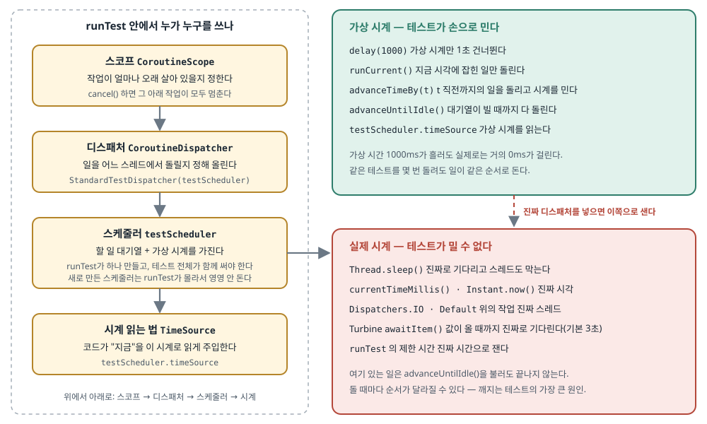
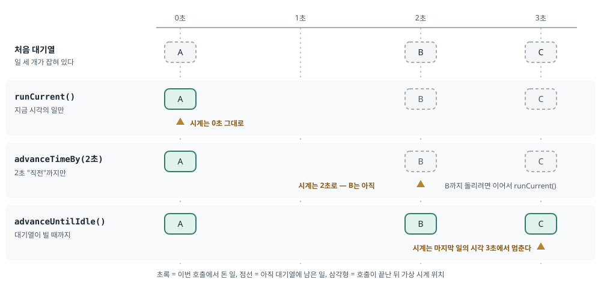

## 한 줄 요약

코루틴 테스트가 "가끔" 깨지는 이유는 거의 언제나 **테스트가 손으로 미는 가상 시계 바깥에서 일이 돌기 때문**이다. 진짜 스레드(`Dispatchers.IO` 등), 진짜 시각(`System.currentTimeMillis()`), 테스트끼리 함께 쓰는 `Dispatchers.Main` 이 그 바깥이다. 그래서 **디스패처는 주입하고, 스케줄러는 `runTest` 가 만든 `testScheduler` 하나만 쓰고, 시각도 그 스케줄러의 시계로 읽게 하라**는 것이 이 글의 뼈대다. Touchlab의 Kevin Schildhorn이 일부러 깨지게 만든 테스트 100여 개를 100~600번씩 돌려 본 수치가 근거로 붙어 있다. 4편짜리 연재의 첫 편이다.

> 원문 블로그는 "All Rights Reserved"(모든 권리 보유)이고 실험 코드 저장소도 공개되어 있지 않다. 그래서 원문 코드는 그대로 옮기지 않고 **하는 일을 글로 풀어 쓴 뒤 직접 쓴 스케치**를 붙였다. 표지 사진은 원문 서버 주소를 걸어 보여 주고, 원문에 없는 그림 두 장은 이해를 돕기 위해 새로 그렸다.

## 먼저 알아 둘 말

- **깨지는 테스트(flaky test)**: 코드를 하나도 안 바꿨는데 돌릴 때마다 통과했다 실패했다 하는 테스트. "가끔 빨간불"이라 원인을 찾기 어렵고, CI를 믿을 수 없게 만든다.
- **`runTest`**: `kotlinx-coroutines-test` 가 주는 테스트 시작 함수. 안에서 `suspend` 함수를 부를 수 있게 해 주고, 테스트 전용 스케줄러와 가상 시계를 만든다. `delay()` 를 만나면 기다리지 않고 시계를 건너뛴다.
- **`TestScope`**: `runTest { }` 의 중괄호 안에서 `this` 가 가리키는 스코프. `testScheduler`, `backgroundScope`, `advanceUntilIdle()` 같은 것을 여기서 꺼내 쓴다.
- **스코프(`CoroutineScope`)**: 코루틴 작업이 **얼마나 오래 살아 있을지** 정하는 울타리. 스코프를 `cancel()` 하면 그 안에서 띄운 작업이 모두 멈춘다. Android의 `viewModelScope` 가 대표적이다(ViewModel이 사라질 때 함께 취소된다).
- **디스패처(`CoroutineDispatcher`)**: 코루틴을 **어느 스레드에서 돌릴지** 정하는 것. `Dispatchers.Main`(화면 스레드), `Dispatchers.IO`(파일·DB·네트워크용 스레드 묶음), `Dispatchers.Default`(계산용 스레드 묶음)가 있다.
- **스케줄러(`TestCoroutineScheduler`)**: 테스트 디스패처들이 일을 올려 두는 **대기열 + 가상 시계**. `runTest` 가 하나 만들어 `testScheduler` 라는 이름으로 준다.
- **가상 시계와 실제 시계**: 가상 시계는 스케줄러가 들고 있는 가짜 시계로, 테스트가 손으로 민다. 실제 시계는 벽시계처럼 그냥 흐른다. `delay(1000)` 은 가상 시계를 1초 밀 뿐 실제로는 거의 0초가 걸리지만, `Thread.sleep(1000)` 은 진짜 1초를 기다린다.
- **`StandardTestDispatcher`**: 일을 받으면 바로 돌리지 않고 스케줄러 대기열에 넣어 두는 테스트 디스패처. 테스트가 스케줄러를 밀어야(`runCurrent()` 등) 비로소 돈다. 순서가 늘 같다.
- **`UnconfinedTestDispatcher`**: 일을 받자마자 그 자리에서 곧장 돌리는 테스트 디스패처. 편하지만 순서를 테스트가 정하지 못한다.
- **Unconfined(제한 없음)**: 코루틴이 특정 스레드에 묶이지 않는다는 뜻. 시작한 스레드에서 바로 돌고, 멈췄다가 다시 이어질 때는 이어 준 스레드에서 돈다.
- **`runCurrent()` · `advanceTimeBy()` · `advanceUntilIdle()`**: 스케줄러를 미는 세 함수. 본문 1장에서 그림과 함께 풀어 쓴다.
- **`TimeSource`**: Kotlin 표준 라이브러리의 "시간을 재는 방법" 인터페이스. `markNow()` 로 지금을 찍고 `elapsedNow()` 로 얼마나 지났는지 읽는다. `testScheduler.timeSource` 는 가상 시계로 잰다. **경과 시간만 재고, 오늘이 며칠인지 같은 달력 시각은 주지 않는다.**
- **`Dispatchers.setMain()` / `resetMain()`**: 테스트에서 `Dispatchers.Main` 을 테스트 디스패처로 바꿔 끼우고, 끝나면 되돌리는 함수. JVM 단위 테스트에는 Android 화면 스레드가 없어서, `viewModelScope` 를 쓰는 ViewModel을 테스트하려면 이게 필요하다.
- **`backgroundScope`**: `TestScope` 가 주는 "배경 작업용" 스코프. 테스트가 끝나면 알아서 취소되고, 여기서 난 실패가 테스트 본문을 바로 멈추지 않는다(테스트 끝에 보고된다).
- **`SupervisorJob`**: 스코프에 넣으면 자식 작업 하나가 실패해도 형제 작업과 스코프 전체가 함께 취소되지 않게 하는 장치.
- **`CoroutineExceptionHandler`**: 스코프에서 잡히지 않은 예외를 받아 처리하는 함수. 테스트에서는 실패를 목록에 모아 두고 확인하는 데 쓴다.
- **Turbine**: Cash App이 만든 Flow 테스트 라이브러리. `flow.test { awaitItem() }` 처럼 값을 하나씩 기다려 확인한다. `awaitItem()` 은 **실제 시간**으로 기다리고 기본 3초가 지나면 실패한다. 원문 실험은 Turbine 1.2.0을 썼다.
- **Koin**: Kotlin용 의존성 주입 라이브러리. Android의 Hilt와 같은 역할을 한다.
- **`UncompletedCoroutinesError`**: `runTest` 가 끝날 때 아직 안 끝난 자식 코루틴이 남아 있으면 내는 오류. 영원히 도는 수집기를 테스트 스코프에 띄우면 이 오류가 난다.

## 서론 — 연재 계획과 100개 넘는 실험

<figure class="media"><figcaption>원문 표지. 흑백으로 찍은 제트 엔진의 팬 날개 사진으로, 본문 내용과 직접 관련은 없다(Unsplash 사진). 원문 이미지, 원문 서버에서 불러옴 (<a href="https://touchlab.co/flake-free-flow-tests-pt1-coroutines">원문</a>)</figcaption></figure>

- **여러 곳에서 값이 들어오는 Flow는 테스트하기가 헷갈린다.**
  - 데이터 출처가 여럿이고 값이 여러 군데서 나오면, 테스트가 언제 무엇을 받을지 예측하기 어려워진다.
- **그래서 저자는 4편짜리 연재를 계획했다.**
  - 1편(이 글): Kotlin이 코루틴 테스트를 어떻게 다루는지 — 시계·디스패처·스케줄러.
  - 2편: [Turbine](https://github.com/cashapp/turbine)이 Flow 종류마다 어떻게 동작하는지.
  - 3편: KMP(Kotlin Multiplatform)에서 코루틴 테스트가 어떻게 달라지는지.
  - 4편: 이 내용을 AI가 테스트를 짤 때 쓰는 스킬로 만드는 방법.
- **모든 주장은 일부러 깨지게 만든 실험 100여 개에서 나왔다.**
  - Turbine 1.2.0, kotlinx-coroutines 1.10.1을 썼다.
  - 대상: `StateFlow`, `SharedFlow`, 차가운 Flow(cold flow, 누가 모으기 시작해야 값을 만드는 Flow), `Channel`, `callbackFlow`, 그리고 LiveData와 RxJava 일부.
  - 연산자 `stateIn`, `combine` 과 여러 디스패처·시계도 다뤘다.
  - 대부분은 100~600번 반복해서 돌렸고, 일부는 CPU를 일부러 바쁘게 만든 상태에서 돌렸다.

## 1. 시간은 어떻게 흐르나 — 테스트 안의 두 시계

- **테스트에는 시계가 두 개 있다.**
  - **가상 시계**: `delay()` 는 이 시계만 건너뛴다. 실제 시간은 그대로다.
  - **실제 시계**: `Thread.sleep()` 은 진짜로 기다리고, 그동안 스레드도 막는다. `currentTimeMillis()` 도 진짜 시각을 읽는다.

원문은 1초 뒤에 메시지를 내보내는 ViewModel과 그 테스트로 설명한다. 하는 일은 이렇다.

- ViewModel은 생성자에서 디스패처를 받고(기본값 `Dispatchers.Default`), 그것으로 자기 스코프를 만든다.
- `doThing(message)` 를 부르면 그 스코프에서 코루틴을 띄워 `delay(1000)` 뒤에 `MutableSharedFlow` 로 메시지를 내보낸다.
- 테스트는 `runTest` 안에서 `StandardTestDispatcher(testScheduler)` 를 만들어 ViewModel에 넣고, Turbine으로 `state` 를 모으면서 `doThing("hello")` 를 부른 뒤 `awaitItem()` 이 `"hello"` 인지 확인한다.

같은 구조를 직접 쓴 스케치로 옮기면 이렇다.

```kotlin
// 직접 쓴 스케치 — 원문 예제와 같은 구조
class GreetingViewModel(dispatcher: CoroutineDispatcher = Dispatchers.Default) {
    private val scope = CoroutineScope(dispatcher)
    private val _greeting = MutableSharedFlow<String>()
    val greeting: SharedFlow<String> = _greeting

    fun greetLater(name: String) {
        scope.launch {
            delay(1_000)
            _greeting.emit("안녕, $name")
        }
    }

    fun close() = scope.cancel()
}

@Test
fun `1초 뒤에 인사가 나온다`() = runTest {
    val viewModel = GreetingViewModel(StandardTestDispatcher(testScheduler))

    viewModel.greeting.test {
        viewModel.greetLater("Ada")
        assertEquals("안녕, Ada", awaitItem())
    }
    viewModel.close()
}
```

이 테스트가 도는 동안 안에서 일어나는 일을 차례로 보면 이렇다.

- **① `runTest` 가 `testScheduler` 를 만든다.**
  - 이 스케줄러가 가상 시계를 들고 있고, 그 시각에 맞춰 일을 줄 세운다.
- **② 디스패처를 만들어 ViewModel에 넣는다.**
  - 디스패처는 일을 스케줄러에 올리는 역할이다. `Dispatchers.IO` 도 디스패처의 한 종류다.
- **③ ViewModel은 그 디스패처로 스코프를 만든다.**
  - 스코프는 작업이 얼마나 오래 살아 있을지를 정한다.
- **④ 스케줄러에는 `TimeSource` 도 붙어 있다.**
  - 코드가 시계를 어떻게 읽을지 알려 주는 것이다.
- **⑤ `greetLater` 가 부르면 일은 가상 시간에서 돈다.**
  - Turbine의 `awaitItem()` 은 값이 올 때까지 **실제 시간으로** 멈춰 기다린다(시간이 다 되면 실패).
  - 테스트 본문이 그렇게 멈춰 있는 동안 `runTest` 가 대기열의 일을 돌리고 가상 시계를 앞으로 민다. 그래서 여기서는 `advanceUntilIdle()` 을 따로 부를 필요가 없다.
  - 값이 나올 때 가상 시간은 1000ms가 지났고, 실제 시간은 거의 0ms가 지났다.
- **⑥ 다만 `runTest` 의 제한 시간은 실제 시간으로 잰다.**

소유 관계는 **스코프 → 디스패처 → 스케줄러 → TimeSource** 순서다. 그림으로 보면 이렇다.

<figure><a class="figure-scroll" href="../assets/750-flow-test-clocks.svg"></a><figcaption>테스트 안의 두 시계. 원문 본문 설명("Order of ownership")을 바탕으로 새로 그림 (<a href="https://touchlab.co/flake-free-flow-tests-pt1-coroutines">원문</a>)</figcaption></figure>

- **스케줄러를 미는 함수는 세 개다.**
  - **`advanceUntilIdle()`**: 대기열이 빌 때까지 스케줄러의 다른 코루틴을 전부 돌린다.
  - **`advanceTimeBy(t)`**: 가상 시계를 `t` 만큼 밀면서, **`t` 보다 엄격하게 앞선** 시각에 잡힌 일만 돌린다. 2초에 잡힌 일이 있는데 정확히 2초를 밀면 그 일은 돌지 않는다.
  - **`runCurrent()`**: 지금 가상 시각에 잡힌 일만 돌린다.

<figure><a class="figure-scroll" href="../assets/750-flow-test-advance.svg"></a><figcaption>세 함수가 각각 무엇을 돌리는지. 원문의 설명을 바탕으로 새로 그림 (<a href="https://touchlab.co/flake-free-flow-tests-pt1-coroutines">원문</a>)</figcaption></figure>

- **진짜 스레드는 코루틴 테스트가 깨지는 가장 큰 원인 중 하나다.**
  - 저자 실험에서 서로 다른 진짜 스레드에서 갱신되는 두 Flow를 `combine` 으로 합쳤더니, 300번 돌려 **49가지 서로 다른 값 순서**가 나왔다.
  - `testScheduler` 와 `StandardTestDispatcher` 는 가상 시간을 쓰도록 만들어졌다. 그런데 ViewModel에 진짜 디스패처가 들어가면 그 일은 실제 시간에서 돈다.
  - 위 예제처럼 값 하나를 Turbine으로 기다리는 단순한 테스트는 그래도 통과할 수 있다. 하지만 조금만 복잡해지면 문제가 생긴다.

## 2. 디스패처 — 네 가지 권고

디스패처는 코루틴이 돌 스레드를 정한다. 한 스레드에 묶을 수도, 스레드 묶음(pool)에 보낼 수도, 아무 데도 묶지 않을(unconfined) 수도 있다.

### 권고 1. `StandardTestDispatcher` 를 쓴다

- **무엇을**: 테스트에서는 `StandardTestDispatcher` 를 기본으로 쓴다.
- **왜**: 테스트가 `runCurrent()` · `advanceUntilIdle()` 로 스케줄러를 밀기 전에는 아무것도 돌지 않으니 **언제 무엇이 도는지가 정해진다.** 값이 나오는 순서도 매번 같다.
  - 이게 특히 중요한 이유는 **Turbine이 unconfined로 모으기** 때문이다. 수집기는 값을 내보낸 스레드에서 곧장 돈다. 그러니 내보내는 쪽의 순서를 디스패처와 스케줄러가 쥐고 있어야 한다.
- **결과**: 저자 실험에서 `StandardTestDispatcher` 위의 ViewModel은 **500번 중 500번** 같은 순서를 냈고, CPU를 바쁘게 만든 상태에서 200번 더 돌려도 같았다.

### 권고 2. `testScheduler` 를 넘긴다

- **무엇을**: `runTest` 안에서 `StandardTestDispatcher(testScheduler)` 처럼 **`TestScope` 의 `testScheduler` 를 꼭 넘긴다.**
- **왜**: 스케줄러를 안 넘기면 그 디스패처는 테스트의 스케줄러를 함께 쓰지 않는다.
  - 넘기지 않으면 디스패처는 `Dispatchers.Main` 에서 스케줄러를 찾는다(`setMain` 으로 테스트 디스패처를 끼워 둔 경우). 그것도 없으면 **완전히 새 스케줄러**를 만든다.
  - 새 스케줄러는 `runTest` 가 모르는 것이라, `advanceUntilIdle()` 을 불러도 거기 올린 일은 돌지 않고 테스트는 제한 시간에 걸려 실패한다. 저자가 그렇게 만든 ViewModel은 **아예 한 번도 돌지 않았다.**
- **결과**: 스케줄러 하나를 함께 쓰면 모든 일이 **하나의 가상 시계 위에서 하나의 정해진 순서로** 돈다.

### 권고 3. 디스패처를 주입한다

- **무엇을**: 클래스 안에서 `Dispatchers.IO` 를 직접 쓰지 말고, 생성자로 받아서 기본값만 `Dispatchers.IO` 로 둔다. 테스트에서는 `StandardTestDispatcher(testScheduler)` 를 넣는다.

원문 예제가 하는 일은 이렇다. 저장소(Repository)가 `io` 디스패처를 생성자로 받아 `withContext(io)` 안에서 데이터를 읽는다. 테스트는 같은 테스트 디스패처를 저장소에 넣고, 그 저장소를 ViewModel에 넣은 뒤, `search("x")` → `advanceUntilIdle()` → 상태가 `Success("Ada")` 인지 확인한다.

```kotlin
// 직접 쓴 스케치 — 원문 권고 3과 같은 구조
class ProfileRepository(
    private val api: ProfileApi,
    private val io: CoroutineDispatcher = Dispatchers.IO,
) {
    suspend fun load(id: String): Profile = withContext(io) { api.fetch(id) }
}

@Test
fun `검색하면 성공 상태가 된다`() = runTest {
    val io = StandardTestDispatcher(testScheduler)
    val viewModel = ProfileViewModel(ProfileRepository(FakeProfileApi(), io), io)

    viewModel.search("ada")
    advanceUntilIdle()

    assertEquals(UiState.Success("Ada"), viewModel.state.value)
}
```

- **왜**: 그래야 시간을 진짜 스레드와 스케줄러가 아니라 **테스트가** 쥔다.
- **결과**:
  - 주입하지 않은 같은 테스트는 `advanceUntilIdle()` 뒤에도 상태가 `Loading` 에 머물렀다. **300번 중 300번**이다. 스케줄러는 진짜 디스패처의 일을 기다려 줄 수 없기 때문이다.
  - 주입한 테스트는 **스레드 8개에서 동시에 각각 300번** 돌려도 실패가 0번이었다.
- **의존성 주입 도구로도 할 수 있다.** 원문은 Koin 예제를 든다.
  - 앱 모듈은 `named("io")` 라는 이름표로 `Dispatchers.IO` 를 등록하고, ViewModel은 그 이름표로 디스패처를 받는다.
  - 테스트는 같은 이름표로 `StandardTestDispatcher(testScheduler)` 를 등록한 테스트 모듈을 앱 모듈 뒤에 얹어 덮어쓴다.
  - `try` 안에서 ViewModel을 꺼내 테스트하고, `finally` 에서 `stopKoin()` 을 부른다.
  - Hilt라면 `@IoDispatcher` 같은 한정자(qualifier, 같은 타입을 이름으로 구분하는 표시)를 만들고, 테스트에서 그 모듈을 바꿔 끼우는 것과 같다.

### 권고 4. 병렬 테스트에서는 `Dispatchers.setMain` 을 쓰지 않는다

- **무엇을**: 코드가 `Dispatchers.Main` 을 쓴다고 `@BeforeTest` 에 `setMain` 을 넣고 끝내는 방식은, **테스트를 병렬로 돌릴 생각이라면** 피한다.
- **왜**: `Dispatchers.Main` 은 **프로세스 하나에 하나뿐인 전역 값**이다. 병렬로 도는 테스트들이 서로의 Main을 덮어쓰고, 남이 쓰는 중에 되돌려 버린다.
  - 저자가 `setMain` 을 쓰는 테스트 두 개를 병렬로 돌렸더니, 한 번은 **600번 중 241번**, 다른 번은 **600번 중 598번** 실패했다.
  - 망가진 Main은 그 JVM이 끝날 때까지 남아서, 뒤에 도는 **상관없는 테스트까지** 실패시킬 수 있다.
  - 병렬이 아니어도 `resetMain` 을 잊으면 문제다. 다음 `runTest` 가 낡은 스케줄러를 조용히 다시 쓰고, 대기열에 남은 일이 **엉뚱한 테스트 안에서** 돈다.
- **꼭 써야 한다면**: 테스트가 끝난 뒤 반드시 `Dispatchers.resetMain()` 을 부르고, 그런 테스트는 병렬로 돌리지 않는다. 원문 예제는 `UnconfinedTestDispatcher(testScheduler)` 를 `setMain` 에 넣고, `try` 로 테스트를 돌린 뒤 `finally` 에서 `resetMain()` 을 부른다.

## 3. 시간을 다루는 고급 기법

대부분의 코루틴 테스트는 "띄우고 결과 확인"으로 끝난다. 그보다 까다로운 시간 문제를 위한 도구가 셋 있다.

### TimeSource — 시계를 읽는 코드

- **무엇을**: 캐시 만료나 토큰 만료처럼 **시간이 흘러야** 결과가 바뀌는 코드는 스케줄러의 `TimeSource` 를 주입받게 하고, 테스트에서 `advanceTimeBy` 로 시계를 민다.

원문 예제는 유효 시간(TTL, Time To Live)이 있는 캐시다. `put` 할 때 `timeSource.markNow()` 로 시각을 찍어 두고, `get` 할 때 `elapsedNow()` 가 TTL보다 짧을 때만 값을 돌려준다. 테스트는 TTL 5분짜리 캐시에 `testScheduler.timeSource` 를 넣고, 값을 넣은 뒤 4분을 밀어 값이 남아 있는지, 다시 2분을 밀어 사라졌는지 확인한다.

```kotlin
// 직접 쓴 스케치 — 원문 TimeSource 예제와 같은 구조
class TokenCache(private val timeSource: TimeSource, private val ttl: Duration) {
    private var token: String? = null
    private var savedAt = timeSource.markNow()

    fun save(value: String) { token = value; savedAt = timeSource.markNow() }
    fun current(): String? = token?.takeIf { savedAt.elapsedNow() < ttl }
}

@Test
fun `토큰은 30분이 지나면 사라진다`() = runTest {
    val cache = TokenCache(testScheduler.timeSource, 30.minutes)
    cache.save("abc")

    advanceTimeBy(29.minutes)
    assertEquals("abc", cache.current())

    advanceTimeBy(2.minutes)
    assertNull(cache.current())
}
```

- **왜**: 실제 시간이 하나도 흐르지 않으니, CI 기계가 느리거나 바빠도 이 테스트는 깨지지 않는다.
- **언제 필요한가**: 코드가 **시계를 읽을 때**(`markNow()`, `System.currentTimeMillis()`, `Instant.now()`)다. 가상 시간은 실제 시계를 움직이지 않기 때문이다. 코드가 `delay` 만 쓰고 시계를 읽지 않는다면 `advanceTimeBy` 만으로 충분하다.

### backgroundScope — 테스트 내내 도는 Flow

- **무엇을**: 연결 상태처럼 테스트 대상은 아니지만 **테스트 내내 돌아야 하는** Flow는 `backgroundScope` 에서 돌린다. 직접 `backgroundScope.launch` 해도 되고, 그 스코프를 대상 클래스에 넘겨도 된다.
- **왜**: 테스트가 끝나면 자동으로 취소되고, 거기서 난 실패가 테스트 본문을 끊지 않는다(끝에 보고된다). 같은 수집기를 그냥 테스트 스코프의 자식으로 띄우면 영원히 끝나지 않아 `runTest` 가 `UncompletedCoroutinesError` 로 실패한다.

원문 예제는 두 가지다.

- 첫째, `backgroundScope.launch` 로 이벤트를 모으기 시작하고, **값을 내보내기 전에 `runCurrent()` 로 수집기를 먼저 출발시킨 뒤** 이벤트를 내보낸다.
- 둘째, 채팅 저장소가 생성자로 스코프를 받아 `stateIn(scope, SharingStarted.Eagerly, "")` 로 메시지를 `StateFlow` 로 만든다. 테스트는 그 스코프로 `backgroundScope` 를 넘긴다. `Eagerly`(바로 시작)여도 `runCurrent()` 를 불러야 실제로 모으기 시작한다는 주석이 붙어 있다.

- **주의**: 테스트가 결과를 **기다려야 하는** 일에는 `backgroundScope` 를 쓰지 않는다. 그런 일은 보통 자식으로 띄우거나 `await` 한다. 원문에 따르면 `advanceUntilIdle()` 은 `backgroundScope` 일을 끝까지 돌려 주지 않으므로, 배경 일을 진행시키려면 `runCurrent()` 나 `advanceTimeBy()` 를 쓴다.

### 앱 전체 스코프 — 던지고 잊는 작업

- **무엇을**: 동기화처럼 **앱 전체 스코프가 맡는 "던지고 잊는(fire-and-forget)" 작업**은 테스트가 쥔 스코프를 받게 한다. 안 그러면 그 안에 박힌 진짜 디스패처가 테스트와 경주를 벌인다.
- **두 가지 방법**: 위의 `backgroundScope` 를 넘기거나, `SupervisorJob()` 으로 직접 만든 스코프를 넘긴다. `SupervisorJob` 이 있으면 자식 하나가 실패해도 형제와 스코프 전체가 취소되지 않는다.

원문 예제가 하는 일은 이렇다. 스레드 안전한 목록을 만들고, `SupervisorJob() + 테스트 디스패처 + 예외를 그 목록에 담는 CoroutineExceptionHandler` 로 스코프를 만든다. 첫 작업에서 일부러 오류를 내고 `advanceUntilIdle()` 한 뒤, 두 번째 작업이 상태를 1로 바꾸는지 본다. 앞 작업이 실패했어도 두 번째는 여전히 돈다. 마지막에 스코프를 취소한다.

- **어느 쪽을 고르나**:
  - 끝이 있는 일이고 `advanceUntilIdle()` 로 끝까지 돌리고 싶으면 → `SupervisorJob` 스코프.
  - 끝없이 지켜보는 일이거나 자동 정리를 원하면 → `backgroundScope`, 그리고 `runCurrent()` · `advanceTimeBy()` 로 진행시킨다.
  - `SupervisorJob` 스코프를 골랐다면 **테스트가 끝난 뒤 직접 취소해야 한다.**

## 4. 진짜 스레드를 꼭 써야 할 때

라이브러리가 자기 스레드를 따로 가지고 있거나, 경쟁 상태(race condition, 두 스레드의 실행 순서에 따라 결과가 달라지는 버그)를 재현해야 할 때는 진짜 스레드를 피할 수 없다. 이때는 시간을 가상으로 쥘 수 없으니, **테스트가 시간에 기대지 않도록** 짜야 한다.

- **가능한 한 가상으로 남긴다.**
  - 먼저 정말 진짜 스레드가 필요한지 다시 생각한다. 필요하더라도 나머지는 `StandardTestDispatcher(testScheduler)` 에 두고, **꼭 필요한 부분만** 진짜 디스패처를 쓴다.
- **진짜 스레드 테스트는 적게, 따로 둔다.**
  - 별도 Gradle 작업으로 떼어 돌리는 것을 고려한다. `Dispatchers.setMain` 을 쓰는 테스트와 섞지 않는다.
- **고정된 기다림(`delay`·`sleep`)으로 맞추지 않는다.**
  - 고정 시간 기다리기는 찍기다. 진짜로 3ms 걸리는 일을 3ms 기다렸더니 **200번 중 4~14번** 틀렸다. `join()` 으로 기다린 쪽은 한 번도 실패하지 않았다.
  - 대신 신호를 기다린다: `join()`, `CompletableDeferred`(값이 채워질 때까지 기다릴 수 있는 빈 상자), Turbine의 `awaitItem()`.
- **제한 시간을 넉넉히 준다.**
  - 가상 시계에서는 제한 시간이 거의 의미가 없지만, 진짜 스레드에서는 Turbine과 `runTest` 모두에 큰 제한 시간을 준다. CI에서 돌릴 거라면 더더욱 그렇다.
  - 원문 예는 `runTest(timeout = 30.seconds)` 안에서 `test(timeout = 20.seconds)` 를 쓴다. **Turbine의 기본 제한 시간은 3초다.**
- **직접 만든 진짜 스코프는 전부 취소한다.**
  - 새어 나간 스코프는 테스트가 끝난 뒤에도 돌면서 다른 테스트가 쓰는 상태를 건드린다. `try { … } finally { scope.cancel() }` 로 감싼다.
- **진짜 일을 기다리는 데 `advanceUntilIdle()` 을 쓰지 않는다.**
  - 가상 시계만 밀 뿐 진짜 일은 기다리지 않는다. `Dispatchers.Default` 위의 저장소로 해 보니 **300번 중 300번** 상태가 아직 `Loading` 이었다.
  - Turbine의 `expectNoEvents()` 와 `expectMostRecentItem()` 도 기다리지 않는다. 그래서 틀린 채로 통과하거나 낡은 값을 돌려준다. 바로 뒤에 이벤트가 왔는데도 `expectNoEvents()` 는 **300번 중 300번** 통과했고, `expectMostRecentItem()` 은 **300번 중 299번** 낡은 값을 돌려줬다.
  - 먼저 `awaitItem()` 이나 `join()` 처럼 **"왔다"는 신호**를 기다린다.
- **`currentTimeMillis` 에 기대지 않는다.**
  - 실제 시계를 읽으니 가상 시간이 움직이지 않는다. 진짜 타임스탬프를 상태에 넣었더니 같음 비교가 **20만 번 중 4번** 깨졌다. 대신 `TimeSource` 를 주입한다(3장).
- **마지막으로, 정확한 순서 대신 최종 값과 규칙을 확인한다.**
  - 진짜 스레드에서는 모든 값이 같은 순서로 나온다고 믿을 수 없다. 대신 최종 값이 맞는지, 그리고 중간 값들이 **몇 개가 오든 매번 지켜지는 규칙**을 만족하는지 본다. 예: "`Loading` 뒤에 더 오래된 상태가 오지 않는다", "`Success` 가 `Idle` 로 되돌아가지 않는다".
  - 진짜 스레드 두 개를 `combine` 했더니 300번 동안 값이 3~6개씩, **49가지 순서**로 나왔다. 그래도 "어느 값도 뒤로 가지 않는다"는 규칙과 최종 값은 **200번 모두** 지켜졌다.
  - 서로 다른 진짜 스레드에서 갱신되는 Flow 여러 개를 합치는 것도 깨지는 원인이 된다.

## 5. 테스트가 끝난 뒤나 테스트 밖에서 터지는 실패

- **문제**: `CoroutineScope(Dispatchers.Default)` 처럼 **테스트와 끊긴 스코프**에서 띄운 일은 테스트의 자식이 아니다. 그래서 실패를 놓칠 수 있다.
  - 예외가 `runTest` 가 도는 중에 나면 테스트가 실패한다.
  - 하지만 테스트가 끝난 **뒤에** 나면 사라진다. 그러면 틀렸는데 통과하는 "거짓 통과"가 된다. 저자 실험에서 **20번 중 20번** 통과했다.
  - 전체 테스트를 한꺼번에 돌릴 때는 늦게 도착한 예외가 **상관없는 다른 테스트**를 실패시키기도 한다.
- **해결**:
  - 스코프와 디스패처를 주입해서 일이 테스트 스케줄러 위에서 돌게 한다.
  - 테스트 안에서 끝까지 돌린다(`runCurrent()`, `advanceUntilIdle()`, `job.join()`).
  - 실패를 일부러 모아서 확인하는 것도 고려한다.

원문 예제는 3장의 `SupervisorJob` 스코프와 같은 방식으로 `CoroutineExceptionHandler` 가 예외를 스레드 안전한 목록에 담게 한다. 동기화 객체의 `sync()` 를 부르고 `advanceUntilIdle()` 한 뒤, 목록에 담긴 예외가 정확히 하나이고 메시지가 `"sync failed"` 인지 확인한다.

- 만든 스코프는 모두 `finally` 나 `@After` 에서 `scope.cancel()` 로 취소해, 테스트보다 오래 사는 것이 없게 한다.

## 6. 테스트끼리 상태를 나누지 않는다

- **문제**: 테스트끼리 함께 쓰는 것이 있으면 **결과가 테스트 순서에 따라 달라진다.**
  - 예: 싱글턴 `StateFlow` 가 있다. 앞 테스트가 값을 5로 바꾸면, 첫 값으로 0을 기대한 다음 테스트는 5를 받는다.
- **해결**: 테스트마다 ViewModel·저장소·스코프를 **새로 만든다.** 테스트 대상 코드에 싱글턴을 두지 않는다.
- **여러 코루틴이 한 목록에 결과를 쓸 때는 스레드 안전한 목록을 쓴다.**
  - 코루틴 4개가 그냥 `ArrayList` 에 썼더니 **50번 중 49번** 크기가 틀렸다. `Collections.synchronizedList(mutableListOf())` 를 쓴다.

## 7. 맺음

- 이번 편은 Kotlin에서 코루틴 테스트가 어떻게 도는지와, 코루틴을 테스트에서 어떻게 돌려야 하는지를 다뤘다.
- 다음 편은 Turbine을 깊게 본다. Flow 종류마다 어떻게 다뤄야 하는지, 깨지는 테스트를 어떻게 줄이는지를 다룬다.

## 원문을 읽을 때 주의할 점

- **수치는 저자의 비공개 실험에서 나왔다.** 실험 코드가 공개되어 있지 않아 같은 조건으로 다시 돌려 볼 수는 없다. "몇 번 중 몇 번"은 방향을 보여 주는 근거로 읽는 것이 맞다.
- **버전**: 원문은 kotlinx-coroutines 1.10.1, Turbine 1.2.0 기준이다. Aide는 coroutines 1.11.0, Turbine 1.2.1을 쓴다. 이 글에서 다룬 함수들의 동작 설명은 두 버전 사이에 달라진 것을 찾지 못했지만, 직접 확인하지는 않았다.
- **권고 1과 `setMain` 예제가 어긋나 보인다.** 권고 1은 `StandardTestDispatcher` 를 권하는데, 권고 4의 `setMain` 예제는 `UnconfinedTestDispatcher(testScheduler)` 를 쓴다. 원문은 이유를 말하지 않는다. `setMain` 에 무엇을 넣든 `testScheduler` 를 함께 쓰는 것이 권고 2의 핵심이라고 읽으면 된다.
- **`testScheduler.timeSource` 는 "얼마나 지났나"만 잰다.** 캐시 만료처럼 경과 시간을 보는 코드에는 딱 맞지만, "오늘 일정 중 다음 일정"처럼 **달력 시각**(`Instant`, `LocalDate`)이 필요한 코드에는 그대로 쓸 수 없다. 그런 코드는 `java.time.Clock` 을 주입해야 하고, 그 Clock이 가상 시계를 따라가게 하려면 따로 만들어야 한다(아래 스케치 2).
- **`advanceUntilIdle()` 과 `backgroundScope` 의 관계는 원문 문장 그대로다.** "배경 일은 건너뛴다"는 설명은 정확히는 "배경 일만 남으면 멈춘다"에 가깝다. 앞 일과 함께 대기열에 있던 배경 일은 같이 돌 수 있다. 결론(배경 일을 진행시키려면 `runCurrent()` · `advanceTimeBy()`)은 같다.

## 코드로 보기 — Aide 구조로 옮긴 스케치

Aide에서 이 글이 바로 닿는 곳은 **Task 8 `HomeViewModelTest`**(계획서: Fake 저장소 + Turbine)다. 첫 화면 ViewModel은 할 일 저장소와 일정 저장소 두 Flow를 합치고(`combine`), "지금"을 기준으로 다음 일정을 고른다(`nextEvent(now, events)`). 이 글의 권고 2·3·TimeSource가 한 번에 걸리는 자리다. 아래는 모두 **직접 쓴 스케치**다. Aide 코드는 고치지 않았다.

### 1. Main을 테스트 디스패처로 바꾸는 JUnit 5 확장

- **무엇을**: `viewModelScope` 는 `Dispatchers.Main` 을 쓰므로 `setMain` 은 피할 수 없다. 그렇다면 **`StandardTestDispatcher` 를 넣고**, 매 테스트 끝에 `resetMain` 이 빠지지 않게 확장(extension, JUnit 5에서 테스트 앞뒤에 끼워 넣는 코드)으로 묶는다.
- **왜**: Main에 테스트 디스패처를 끼워 두면 `runTest` 가 **그 디스패처의 스케줄러를 `testScheduler` 로 함께 쓴다**(권고 2에서 말한 "Main에서 스케줄러를 찾는" 경로). 그래서 ViewModel 안의 일과 테스트 본문이 한 가상 시계 위에 선다.

```kotlin
// 직접 쓴 스케치 — feature/home/src/test/.../MainDispatcherExtension.kt
class MainDispatcherExtension(
    val dispatcher: TestDispatcher = StandardTestDispatcher(),
) : BeforeEachCallback, AfterEachCallback {
    override fun beforeEach(context: ExtensionContext) = Dispatchers.setMain(dispatcher)
    override fun afterEach(context: ExtensionContext) = Dispatchers.resetMain()
}
```

### 2. 가상 시계를 따라가는 `Clock`

- **무엇을**: 계획서 Task 7은 이미 "시각은 `Clock` 을 주입받아 테스트에서 고정한다"고 정했다. 고정 시계(`Clock.fixed`)면 대부분 충분하다. 다만 첫 화면이 "1분마다 다음 일정 다시 고르기"처럼 **시간이 흐르는 것**을 다루게 되면, `advanceTimeBy` 로 민 만큼 `Clock` 도 움직여야 한다.
- **왜**: `advanceTimeBy` 는 가상 시계만 민다. 고정 시계나 `Clock.systemDefaultZone()` 은 따라오지 않는다. 원문의 "시계를 읽는 코드는 시계를 주입하라"를 달력 시각에 맞게 옮긴 것이다.

```kotlin
// 직접 쓴 스케치 — 테스트 전용. testScheduler.currentTime(가상 ms)만큼 시작 시각에서 앞으로 간다
class SchedulerClock(
    private val scheduler: TestCoroutineScheduler,
    private val start: Instant,
    private val zone: ZoneId = ZoneId.of("Asia/Seoul"),
) : Clock() {
    override fun instant(): Instant = start.plusMillis(scheduler.currentTime)
    override fun getZone(): ZoneId = zone
    override fun withZone(zone: ZoneId): Clock = SchedulerClock(scheduler, start, zone)
}
```

### 3. `HomeViewModelTest` 의 모양

```kotlin
// 직접 쓴 스케치 — feature/home/src/test/.../HomeViewModelTest.kt
class HomeViewModelTest {
    @JvmField
    @RegisterExtension
    val main = MainDispatcherExtension()

    // 테스트마다 새로 만든다 (6장: 상태를 나누지 않는다). JUnit 5는 테스트 메서드마다 이 클래스를 새로 만든다
    private val tasks = FakeTaskRepository()
    private val events = FakeEventRepository()

    @Test
    fun `9시 회의가 끝나면 다음 일정이 11시 회의로 바뀐다`() = runTest {
        val clock = SchedulerClock(testScheduler, start = Instant.parse("2026-10-29T00:00:00Z")) // 09:00 KST
        events.events.value = listOf(meeting(9, 10), meeting(11, 12))
        val viewModel = HomeViewModel(tasks, events, clock)

        viewModel.uiState.test {
            assertThat(awaitItem().nextEvent?.startHour).isEqualTo(9)

            advanceTimeBy(61.minutes) // 10:01 — 가상 시계와 Clock이 함께 움직인다
            assertThat(expectMostRecentItem().nextEvent?.startHour).isEqualTo(11)
        }
    }
}
```

- 마지막 줄의 `expectMostRecentItem()` 은 4장 경고처럼 **기다리지 않는다.** 여기서 써도 되는 이유는 모든 일이 가상 시계 위에 있어서 `advanceTimeBy` 가 돌아온 시점에 값이 이미 와 있기 때문이다. 진짜 디스패처가 하나라도 섞이면 `awaitItem()` 으로 바꿔야 한다.
- `HomeViewModel` 이 매분 다시 고르는 장치를 둘지는 Task 8에서 정할 일이다. 두지 않는다면 `Clock.fixed` 로 충분하고 `SchedulerClock` 은 필요 없다.

### 4. 케이스 표에 추가할 것

| # | 동작 | 기대 | 이 글에서 온 이유 |
|---|---|---|---|
| A | 할 일 저장소와 일정 저장소가 같은 가상 시각에 각각 새 값을 내보낸다 | 화면 상태가 두 값을 모두 반영한 하나로 끝나고, 같은 테스트를 여러 번 돌려도 결과가 같다 | 두 Flow를 합치는 `combine` 은 순서가 흔들리기 쉬운 자리라, `StandardTestDispatcher` 위에서 순서가 정해지는지 확인한다 |
| B | 저장소가 예외를 던진다 | 앱이 죽지 않고 빈 화면에 로딩이 꺼진다. 예외는 테스트 안에서 드러난다 | 5장: 실패가 테스트 밖으로 새면 거짓 통과가 된다. `CalendarViewModelTest` 에 이미 같은 케이스가 있다 |

## 배운 점

- **"가끔 깨진다"는 증상은 대개 "가상 시계 바깥에서 무언가 돈다"로 번역된다.** 진짜 디스패처, 진짜 시각, 전역 `Dispatchers.Main`, 테스트끼리 함께 쓰는 싱글턴 — 이 넷을 먼저 의심하면 된다.
- **`testScheduler` 를 넘기는 한 단어가 테스트 전체의 성패를 가른다.** 스케줄러가 둘이 되면 `advanceUntilIdle()` 을 아무리 불러도 한쪽은 안 돈다. 이건 "가끔"이 아니라 "항상" 실패라 오히려 찾기 쉽다.
- **Turbine의 `awaitItem()` 은 실제 시간으로 기다린다.** 가상 시계 테스트에서도 이 기다림이 `runTest` 가 대기열을 돌릴 틈을 만든다. 반대로 `expectNoEvents()` · `expectMostRecentItem()` 은 기다리지 않으니, 진짜 스레드가 섞인 곳에서는 거짓말을 한다.
- **`advanceTimeBy(t)` 는 `t` 에 딱 맞는 일을 돌리지 않는다.** 경계값 테스트에서 하나 차이로 헷갈리기 쉬운 부분이다. 그 시각의 일까지 보려면 `runCurrent()` 를 이어 부른다.
- **진짜 스레드에서는 "순서"가 아니라 "규칙"을 확인한다.** 값이 몇 개 오든 지켜지는 성질(뒤로 가지 않는다, 성공이 처음으로 되돌아가지 않는다)이 흔들리지 않는 확인 대상이다.
- **경과 시간과 달력 시각은 다른 시계다.** `TimeSource` 는 앞의 것, `java.time.Clock` 은 뒤의 것을 준다. 일정 앱은 대부분 뒤의 것이 필요하다.

## Aide에 적용하면

Aide는 지금 Task 6(캘린더 이식)까지 끝났고, 테스트는 **`DefaultEventRepositoryTest`**(runTest + Turbine + `backgroundScope`)와 **`CalendarViewModelTest`**(`setMain(UnconfinedTestDispatcher())` + `resetMain`, `runTest` 없음) 두 갈래다. 다음 Task 7(할 일 저장소)과 Task 8(첫 화면 + `HomeViewModelTest`)이 이 글과 가장 가깝다.

1. **Task 8 `HomeViewModelTest` 는 Main에 `StandardTestDispatcher` 를 넣고 `runTest` 와 스케줄러를 함께 쓴다 — 바꿔서 가져온다.**
   - `viewModelScope` 를 쓰는 한 `setMain` 은 필요하다. 원문의 "`setMain` 을 쓰지 말라"는 **병렬 실행일 때**의 이야기다.
   - 대신 `UnconfinedTestDispatcher()` 가 아니라 `StandardTestDispatcher()` 를 넣고, 위 스케치 1처럼 확장으로 묶어 `resetMain` 이 빠질 수 없게 한다. 할 일과 일정 두 Flow를 `combine` 하는 화면이라 순서가 정해지는 쪽이 낫다(권고 1).
2. **기존 `CalendarViewModelTest` 는 지금은 고치지 않는다.**
   - Fake 저장소가 값을 그 자리에서 바로 내보내고 `runTest` 도 쓰지 않아서, `UnconfinedTestDispatcher()` 로 충분히 같은 결과가 나온다. 이미 `@AfterEach` 에서 `resetMain()` 을 부르고 있어 권고 4의 "되돌리기"도 지킨다.
   - 다만 이 테스트에 시간을 다루는 케이스(예: `delay` 가 들어간 로딩 표시)가 생기면, 그때 1번 확장으로 옮긴다.
3. **테스트 병렬 실행은 켜지 않는다 — 지금 상태 그대로 둔다.**
   - 확인해 보니 JUnit 5 병렬 실행 설정(`junit-platform.properties`)도, Gradle `maxParallelForks` 도 없다. `gradle.properties` 의 `org.gradle.parallel` 은 주석 처리돼 있고, 켜더라도 모듈마다 테스트가 **별도 JVM**에서 돌아서 `Dispatchers.Main` 을 서로 덮어쓰지 않는다.
   - 위험한 것은 **같은 JVM 안의 병렬 실행**이다. 나중에 테스트가 느려져 이걸 켜고 싶어지면, 그 전에 `setMain` 을 쓰는 테스트를 따로 떼야 한다는 것을 기억해 둔다.
4. **"지금"은 `Clock` 으로 주입한다 — 이미 계획과 같다. Task 8까지 넓힌다.**
   - Task 7은 이미 "`Clock` 을 주입받아 테스트에서 고정한다", Task 11·14의 순수 함수는 `now: Instant` 를 인자로 받는다. 원문의 TimeSource 권고와 같은 방향이다.
   - Task 8의 `HomeViewModel` 도 `Instant.now()` 를 직접 부르지 않고 같은 `Clock` 을 받게 한다. 시간이 흐르는 것을 테스트해야 할 때만 스케치 2의 `SchedulerClock` 을 쓴다.
   - 원문의 `testScheduler.timeSource` 는 경과 시간만 재서, Aide처럼 "오늘 몇 시 일정"을 다루는 코드에는 맞지 않는다. 이 부분은 그대로 가져오지 않는다.
   - 이식한 캘린더 코드(`CalendarViewModel`, `CalendarFragment`, `MonthCalendarAdapter`)에는 `LocalDate.now()` 가 직접 들어 있다. "오늘" 표시에만 쓰이고 테스트는 2024년 7월로 고정한 데이터로 돌아서 지금 깨지지 않는다. **지금은 고치지 않고**, 자정을 넘는 동작을 테스트해야 할 일이 생기면 그때 `Clock` 으로 바꾼다.
5. **저장소와 ViewModel에는 `Dispatchers.IO` 를 박지 않는다 — 가져온다. 데이터 소스는 지금은 그대로.**
   - `ContentResolverCalendarDataSource` 는 `withContext(Dispatchers.IO)` 를 직접 쓴다. 하지만 이 클래스는 단위 테스트에서 `FakeCalendarDataSource` 로 바뀌어 빠지므로 진짜 IO가 테스트에 들어오지 않는다. **지금은 바꾸지 않는다.**
   - 규칙은 하나만 둔다: **단위 테스트 대상(Repository·ViewModel)이 디스패처를 직접 쓰게 되면 생성자로 받는다**(권고 3). Hilt라면 `@IoDispatcher` 한정자 하나를 `core` 쪽 DI 모듈에 둔다.
   - Task 7의 `TaskDaoTest` 처럼 Room을 직접 쓰는 테스트에서는 Room이 쿼리를 **자기 스레드**에서 돌린다. 원문 4장의 "진짜 스레드" 경우다. 이때는 `advanceUntilIdle()` 로 기다리지 말고 `first()` · `awaitItem()` 처럼 값이 왔다는 신호를 기다린다. Room 2.7부터는 빌더의 `setQueryCoroutineContext()` 로 테스트 디스패처를 넣을 수도 있다고 알고 있는데, Aide의 Room 2.8.5에서 직접 돌려 보지는 않았다.
6. **`backgroundScope` — 이미 그렇게 하고 있다.**
   - `DefaultEventRepositoryTest` 는 DataStore를 `backgroundScope` 로 만든다. 테스트가 끝나면 DataStore 작업이 자동으로 정리되는, 원문 3장 그대로의 쓰임이다. Task 9 `SettingsRepository` 테스트도 같은 방식을 따른다.
7. **실패가 테스트 밖으로 새지 않게 한다 — 바꿔서 가져온다.**
   - Task 12·13의 리마인더 재예약(`ReminderSync.resync`)을 앱 시작이나 신호 수신기에서 띄울 때, 앱 전체 스코프를 쓰게 된다면 그 스코프는 **`@ApplicationScope` 같은 이름으로 주입받는다.** 직접 `CoroutineScope(Dispatchers.Default)` 를 만들면 원문 5장의 거짓 통과가 그대로 생긴다.
   - 다만 계획서상 그 연결부는 "실기기 확인으로 대체"하는 부분이라, 단위 테스트는 `ReminderSync` 자체(주입한 스코프·디스패처 위)에만 둔다. 원문 4장의 "진짜 스레드 테스트는 적게, 따로"와도 맞는다.
8. **Fake는 테스트마다 새로 — 이미 그렇게 하고 있다.**
   - JUnit 5는 테스트 메서드마다 테스트 클래스를 새로 만들어서, 필드로 둔 Fake도 매번 새것이다. Fake를 `object`(싱글턴)로 만들지만 않으면 된다.

## 출처

- [Hardening Coroutine Tests — Flake-Free Flow Tests in Kotlin, Touchlab (Kevin Schildhorn)](https://touchlab.co/flake-free-flow-tests-pt1-coroutines)
- [Turbine (GitHub, cashapp/turbine)](https://github.com/cashapp/turbine)
- [kotlinx-coroutines-test 문서](https://kotlinlang.org/api/kotlinx.coroutines/kotlinx-coroutines-test/)
- [Android 개발자 문서: Android에서 코루틴 테스트하기](https://developer.android.com/kotlin/coroutines/test)
- [Android Weekly #750](https://androidweekly.net/issues/issue-750)
