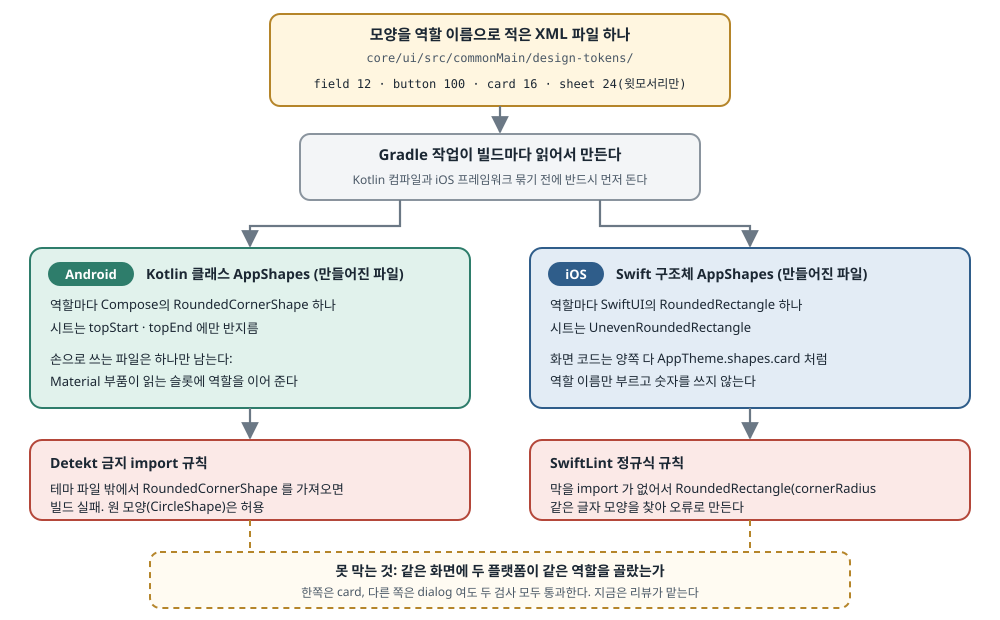

## 한 줄 요약

Android는 Compose, iOS는 SwiftUI로 화면을 따로 그리는 Kotlin Multiplatform 앱에서, 두 앱의 모서리 둥글기가 어느새 제각각이 된 것을 고친 이야기다. 원인은 값이 틀려서가 아니라 **토큰 이름이 `small`·`medium`·`large` 처럼 크기를 말할 뿐 무엇에 쓰는지를 말하지 않았기 때문**이다. 저자는 모서리 모양을 `card`·`sheet`·`field` 처럼 **쓰임새(역할)로 이름 붙여 XML 파일 하나에 적고**, Gradle 작업이 그 파일로 Kotlin 클래스와 Swift 구조체를 둘 다 만들게 했다. 마지막으로 Detekt와 SwiftLint 규칙으로 모양을 손으로 만드는 코드를 빌드 실패로 막는다. 공유한 것은 화면 코드가 아니라 **결정 하나**다.

> 원문(저자 사이트 [kmpbits.com](https://www.kmpbits.com/posts/design-tokens-native-ui-kmp)에 먼저 실림)은 "All Rights Reserved"(모든 권리 보유)로 표시되어 있고, 같은 코드를 담은 공개 라이선스 저장소도 찾지 못했다(저자의 GitHub 저장소 가운데 이 템플릿 프로젝트는 공개되어 있지 않다). 그래서 **이 글의 코드는 원문 코드를 옮긴 것이 아니라, 원문이 설명하는 구조를 따라 이름과 예시를 바꿔 직접 쓴 스케치다.** 예시는 "할 일 앱"의 역할(`taskCard`·`chip` 등)로 바꿨다. 원문 표지 그림은 원문 서버 주소를 걸어 보여 주고, 본문 구조는 그림으로 새로 그렸다.

## 먼저 알아 둘 말

- **디자인 토큰(design token)**: 색·간격·글자 크기·모서리 둥글기처럼 디자인에서 정한 값에 이름을 붙여 한곳에 둔 것. 화면 코드는 숫자 대신 이 이름을 부른다. 값을 바꿀 때 한 줄만 고치면 앱 전체가 따라 바뀐다.
- **모양 토큰(shape token)**: 디자인 토큰 가운데 모서리 모양을 정한 것. 이 글에서는 거의 "모서리 반지름(radius)"과 같은 뜻이다.
- **Material 모양 단계(shape scale)**: Material 3가 정해 둔 모양 칸 다섯 개 — `extraSmall`·`small`·`medium`·`large`·`extraLarge`. 버튼·카드·대화상자 같은 Material 부품이 이 칸 중 하나를 골라 읽는다. 칸 이름은 크기를 말한다.
- **Kotlin Multiplatform(KMP)**: Kotlin 코드 하나를 Android와 iOS 등 여러 플랫폼에서 함께 쓰게 하는 기술. 공용 코드는 `commonMain` 폴더에 둔다.
- **네이티브 UI(native UI)**: 화면을 각 플랫폼의 기본 도구로 그리는 방식. 이 글의 프로젝트는 Android를 Compose로, iOS를 SwiftUI로 따로 그린다. 반대편은 **Compose Multiplatform**(Compose로 iOS 화면까지 그리는 방식)이다.
- **SwiftUI**: Apple 플랫폼의 선언형 UI 도구. Android의 Compose와 같은 역할이다.
- **`RoundedCornerShape` / `RoundedRectangle`**: 모서리가 둥근 사각형 모양. 앞은 Compose, 뒤는 SwiftUI의 것이다. 윗모서리만 둥글게 하려면 Compose는 `topStart`·`topEnd` 에만 값을 주고, SwiftUI는 모서리마다 값을 따로 받는 `UnevenRoundedRectangle`(iOS 16부터)을 쓴다.
- **Gradle 작업(task)**: Gradle 빌드 안에서 도는 작업 하나. 여기서는 XML을 읽어 코드 파일을 써 내는 **코드 생성기**로 쓴다. `inputs`·`outputs` 를 적어 두면 입력이 안 바뀐 빌드에서는 건너뛴다.
- **`embedAndSignAppleFrameworkForXcode`**: KMP 공용 코드를 iOS 프레임워크로 묶어 Xcode 빌드에 넣어 주는 Gradle 작업. iOS 앱이 빌드될 때 Xcode가 부른다.
- **Detekt**: Kotlin 코드 검사 도구(lint). 정해진 규칙을 어기면 빌드를 실패시킨다. 그중 **`ForbiddenImport`** 규칙은 적어 둔 import 를 쓰지 못하게 한다.
- **SwiftLint**: Swift 코드 검사 도구. **`custom_rules`** 에 정규식(글자 모양 찾기 규칙)을 적으면, 그 모양의 코드를 오류로 표시한다.
- **드리프트(drift)**: 아무도 정하지 않았는데 값이 조금씩 갈라져 버린 상태. 이 글에서는 같은 카드가 Android에서 4, iOS에서 16이 된 것을 말한다.
- **Konsist**: Kotlin 코드 구조를 단위 테스트로 검사하는 라이브러리. Aide는 `coding-convention` 모듈에서 이것으로 구조 규칙을 지킨다(뒤의 Aide 절).

## 서론 — 규정집에 "작은 날개"는 없다

<figure class="media"><figcaption>원문 표지 그림. 탄소섬유 앞날개 끝판(endplate)의 둥근 모서리와, 같은 모서리에 "RADIUS"(반지름)를 표시한 설계도가 놓여 있다. 뒤 모니터에는 화면 속 둥근 카드가 보인다. 원문 이미지, 원문 서버에서 불러옴 (<a href="https://medium.com/@kmpbits/front-wing-not-small-wing-design-tokens-for-native-ui-in-kmp-kmp-bits-3595b281d1b4">원문</a>)</figcaption></figure>

- **저자는 F1 기술 규정에서 이야기를 시작한다.**
  - 규정집에는 "작은 날개"라는 부품이 없다. 앞날개·뒷날개·바닥판·디퓨저가 있을 뿐이다. 모든 부품이 **하는 일과 놓인 자리**로 이름 붙어 있다.
  - 모든 팀이 같은 문서를 읽는다. 규정은 앞날개의 치수를 한 번만 정하고, 그 안에서 탄소섬유를 어떻게 빚을지는 팀이 정한다.
  - 아무도 "날개 크기 A·B·C"를 적어 놓고 어느 것을 코에 달지 팀더러 맞혀 보라고 하지 않는다.
  - 저자의 말로는, **자기 모서리 반지름이 바로 그런 모양**이었다.
- **사건의 시작 — 색과 간격은 지켰는데 모서리는 아무도 안 봤다.**
  - 저자는 전에 [Detekt로 디자인 시스템 규칙을 지키는 글](https://www.kmpbits.com/posts/detekt-custom-rules-kmp)을 썼고, 색·간격을 모두 규칙으로 묶어 두었다.
  - 템플릿 프로젝트의 iOS 쪽을 같은 토큰으로 옮기다가, 두 앱의 둥근 모서리를 전부 찾아보았다.
- **Android에는 모양 토큰이 셋 있었다 — `small`·`medium`·`large`.**
  - Material 모양 단계를 그대로 쓴 것이고, 값은 4·4·0이었다. 깊이 생각하고 정한 값이 아니었다.
  - 그래서 부품들이 **조용히 이 토큰을 안 쓰게 되었다.**
    - 텍스트 입력칸은 반지름 자리에 간격 토큰 `itemPadding` 을 썼다.
    - 스낵바(화면 아래에 잠깐 뜨는 알림 막대)는 간격 토큰 `Space.XS` 를 썼다.
    - 알림 대화상자는 화면 여백 토큰 `screenPadding` 을 썼다.
    - 개발자용 앱 카드는 `Custom(DimensionConstants.TEN)` 이라는 직접 쓴 숫자를 썼다.
  - 셋 중 맞는 크기가 없으니, **간격 토큰이 모양 토큰 일을 대신하고 있었다.**
- **두 플랫폼을 나란히 놓자 차이가 드러났다.**
  - 카드는 Android에서 4, iOS에서 16이었다.
  - 아래에서 올라오는 시트(bottom sheet)는 한 부품에서 16, 다른 부품에서 24였다.
  - Android에서 알약 모양(양끝이 반원)인 버튼은 iOS에서 반지름 25였다.
  - 어느 것도 누군가 **정한 값**이 아니었다. 그냥 흘러간(드리프트) 값이었다. 그동안 직접 쓴 색을 잡는 lint 규칙은 계속 켜져 있었는데도 그랬다.
- **저자의 진단: 값이 틀린 것이 문제가 아니다.**
  - `medium` 은 **무엇에 쓰는지** 말하지 않는다. 그래서 부품마다 숫자를 하나씩 고르고, 플랫폼마다 또 다른 숫자를 고른다.

## 1. 크기가 아니라 부품에 이름을 붙인다

- **고치는 방법은 말(어휘) 하나를 바꾸는 것이다 — 모양 토큰은 그것이 맡은 역할로 이름 짓는다.**
  - 저자는 공용 모듈 `core/ui` 의 `commonMain/design-tokens/` 폴더에 `shapes.xml` 을 두고, 한 줄에 역할 하나씩 이름과 반지름을 적는다.
  - 원문 예시에는 입력칸·버튼·카드·대화상자·시트·스낵바·썸네일·아바타 항목·스켈레톤(불러오는 동안 보여 주는 회색 자리 표시) 아홉 역할이 있다. 실제 파일에는 열두 개가 있다고 한다.
  - 원문 값은 입력칸 12, 버튼 100(사실상 알약 모양), 카드 16, 대화상자 16, 시트 24(윗모서리만), 스낵바 4, 썸네일 12, 아바타 항목 8, 스켈레톤 12다.

아래는 같은 생각을 할 일 앱의 역할로 바꿔 **직접 쓴 스케치**다.

```xml
<!-- core/ui/src/commonMain/design-tokens/shapes.xml (직접 쓴 스케치) -->
<shapes>
    <!-- 한 줄 = 역할 하나. 이름은 "어디에 쓰나"이고, 숫자는 그 역할의 현재 값일 뿐이다 -->
    <shape name="taskCard"  radius="16"/>
    <shape name="chip"      radius="999"/>          <!-- 양끝이 반원인 알약 모양 -->
    <shape name="input"     radius="12"/>
    <shape name="dialog"    radius="28"/>
    <shape name="sheet"     radius="24" edges="top"/> <!-- 윗모서리만 둥글다 -->
    <shape name="toast"     radius="8"/>
    <shape name="placeholder" radius="12"/>
</shapes>
```

- **같은 값을 가진 역할이 여럿이어도 괜찮다.**
  - 원문에서는 입력칸·썸네일·스켈레톤이 모두 12다. 위 스케치에서도 `input` 과 `placeholder` 가 둘 다 12다.
  - **토큰은 숫자가 아니라 역할이다.** 내일 "썸네일은 입력칸보다 덜 둥글게" 하기로 정하면 한 줄만 고치고 다른 것은 움직이지 않는다. 숫자로 묶어 두었다면 입력칸까지 같이 바뀌었을 것이다.
- **새 역할을 더할 때의 규칙 — 같은 일을 하는 역할이 이미 있는지부터 묻는다.**
  - 두 번째 카드는 새 토큰을 만들지 않고 `card` 를 다시 쓴다.
  - 툴팁·배지처럼 **정말 새로운 쓰임새**는 반지름이 다른 것과 같더라도 자기 줄을 하나 갖는다.
  - 하면 안 되는 것은 **크기로 이름 짓기**다. 저자의 표현으로 `cardLarge` 는 "단계 하나 더 거친 `medium`"일 뿐이다. 이름에 크기가 들어가는 순간 다시 처음 문제로 돌아간다.
- **속성 하나는 따로 짚는다 — `edges="top"`.**
  - 아래에서 올라오는 시트는 **윗모서리만** 둥글다. 이 사실이 부품 코드 안의 예외 처리가 아니라 **토큰 파일에 적혀 있어야** 두 플랫폼이 같은 모양을 만든다.

## 2. 파일 하나, 언어 둘

- **이 프로젝트는 네이티브 UI다 — 그래서 "공유"는 공용 화면 코드가 아니라 공용 원본 하나를 뜻한다.**
  - Android 앱은 Compose, iOS 앱은 SwiftUI이고, 둘이 함께 쓰는 UI 층이 없다.
  - 공유하는 것은 **값의 원본(source of truth) 하나**이고, 각 플랫폼은 그것을 자기 말투의 코드로 컴파일한다.
- **루트 `build.gradle.kts` 에 Gradle 작업 `generateAppShapes` 를 둔다.**
  - 입력은 `shapes.xml` 하나, 출력은 두 개다. Android 쪽은 `androidApp/ui/build/generated/shapes/...` 아래의 Kotlin 파일(빌드 폴더라 저장소에 올리지 않는다), iOS 쪽은 `iosApp/iosApp/Theme/GeneratedShapes.swift` 다.
  - 작업은 정규식으로 `<shape name=… radius=… edges="top"?/>` 줄을 찾아 (이름, 반지름, 윗모서리만인가) 세 값을 뽑고, 그것으로 Kotlin 글자와 Swift 글자를 만들어 두 파일에 쓴다.

```kotlin
// build.gradle.kts (루트) — 직접 쓴 스케치
tasks.register("generateShapeTokens") {
    val source = file("core/ui/src/commonMain/design-tokens/shapes.xml")
    val kotlinOut = layout.buildDirectory.dir("generated/shapeTokens/kotlin")
    val swiftOut = file("iosApp/iosApp/Theme/ShapeTokens.swift")

    inputs.file(source)      // 이 파일이 바뀌었을 때만 다시 돈다
    outputs.dir(kotlinOut)
    outputs.file(swiftOut)

    doLast {
        val line = Regex("""<shape name="(\w+)"\s+radius="([\d.]+)"(\s+edges="top")?/>""")
        // 이름 · 반지름 · 윗모서리만 여부. 여기서 data class 를 새로 만들지 않는다(4장 참고)
        val tokens = line.findAll(source.readText())
            .map { Triple(it.groupValues[1], it.groupValues[2], it.groupValues[3].isNotBlank()) }
            .toList()

        // tokens 로 Kotlin 글자와 Swift 글자를 각각 이어 붙여 두 파일에 쓴다 (생략)
    }
}
```

- 줄 단위로 보면:
  - `inputs` · `outputs` 는 Gradle에게 "이 파일이 그대로면 다시 만들 필요 없다"고 알려 준다. 빌드가 매번 느려지지 않는다.
  - 정규식의 세 번째 묶음 `(\s+edges="top")?` 은 있을 수도 없을 수도 있다. 있으면 그 역할은 윗모서리만 둥글다.
  - 결과를 `Triple`(값 세 개 묶음)로 담는다. 원문 저자가 실제로 겪은 컴파일러 문제 때문인데, 4장에서 다룬다.

- **만들어진 Kotlin은 역할마다 속성 하나를 가진 클래스다.**
  - 원문에서는 생성자를 `internal`(같은 모듈 안에서만 부를 수 있음)로 막아 두어, 다른 곳에서 값을 멋대로 바꾼 묶음을 만들지 못하게 한다. 기본값 묶음 `DefaultAppShapes` 도 생성 파일 안에 함께 있다.
  - 윗모서리만 둥근 시트는 `RoundedCornerShape(topStart = 24.dp, topEnd = 24.dp)` 가 된다.

```kotlin
// ShapeTokens.kt — 생성되는 파일의 모양 (직접 쓴 스케치, 저장소에 올리지 않는다)
class ShapeTokens internal constructor(
    val taskCard: RoundedCornerShape,
    val chip: RoundedCornerShape,
    val input: RoundedCornerShape,
    val sheet: RoundedCornerShape,
    // … 역할마다 한 줄
)

internal val DefaultShapeTokens = ShapeTokens(
    taskCard = RoundedCornerShape(16.dp),
    chip = RoundedCornerShape(999.dp),
    input = RoundedCornerShape(12.dp),
    sheet = RoundedCornerShape(topStart = 24.dp, topEnd = 24.dp),
)
```

- **만들어진 Swift는 같은 목록을 SwiftUI의 말로 적은 구조체다.**
  - 시트는 모서리마다 값을 따로 받는 `UnevenRoundedRectangle` 이 된다. 위쪽 두 모서리만 24, 아래쪽은 0이다.

```swift
// ShapeTokens.swift — 생성되는 파일의 모양 (직접 쓴 스케치, 저장소에 올리지 않는다)
struct ShapeTokens {
    let taskCard = RoundedRectangle(cornerRadius: 16)
    let chip = RoundedRectangle(cornerRadius: 999)
    let input = RoundedRectangle(cornerRadius: 12)
    let sheet = UnevenRoundedRectangle(
        topLeadingRadius: 24, bottomLeadingRadius: 0,
        bottomTrailingRadius: 0, topTrailingRadius: 24
    )
    // … 역할마다 한 줄
}
```

- **`edges="top"` 하나가 양쪽에서 각자의 타입이 된다.**
  - 한쪽은 `topStart`·`topEnd`, 다른 쪽은 `UnevenRoundedRectangle`. 뜻은 같고 타입은 각 플랫폼의 것이다.
  - 역할을 더하려면 **XML만 고친다.** 다음 빌드에서 두 클래스가 함께 자라고, 손으로 쓴 Kotlin·Swift는 하나도 고칠 필요가 없다.
- **작업을 두 빌드의 앞에 걸어 둔다 — 오래된 토큰으로 빌드할 수 없게.**
  - 이 작업을 Kotlin 컴파일과 `embedAndSignAppleFrameworkForXcode` 의 **선행 작업(dependency)** 으로 묶는다. 어느 플랫폼도 XML보다 낡은 토큰으로 빌드되지 않는다.
- **Android 쪽에 손으로 쓴 파일이 하나 남는다 — 일부러 작게 둔다.**
  - Material 부품(버튼·카드·대화상자 등)은 안에서 `MaterialTheme.shapes` 의 칸을 읽는다. 그래서 "어느 칸을 어느 역할로 채울지"를 한 번 알려 줘야 한다.
  - 원문은 `extraSmall` ← 스낵바, `small` ← 입력칸, `medium` ← 카드, `large` ← 시트, `extraLarge` ← 대화상자로 잇는다.
  - 크기 이름은 **Material과 맞물리는 이 다섯 줄에만** 남는다. 앱 코드는 크기 이름을 보지 않는다.

```kotlin
// MaterialShapes.kt — 손으로 쓰는 유일한 파일 (직접 쓴 스케치)
internal fun ShapeTokens.toMaterialShapes() = Shapes(
    extraSmall = toast,      // Material 부품이 "가장 작은 칸"을 읽으면 토스트 모양을 받는다
    small = input,
    medium = taskCard,
    large = sheet,
    extraLarge = dialog,
)
```

<figure><a class="figure-scroll" href="../assets/750-shape-token-pipeline.svg"></a><figcaption>XML 하나에서 두 플랫폼 코드와 두 검사 규칙까지. 원문 본문을 바탕으로 새로 그림 (<a href="https://medium.com/@kmpbits/front-wing-not-small-wing-design-tokens-for-native-ui-in-kmp-kmp-bits-3595b281d1b4">원문</a>)</figcaption></figure>

## 3. 부품 쪽은 어떻게 보이는가

- **두 플랫폼이 토큰을 같은 이름으로 내놓는다 — Android도 `AppTheme.shapes.card`, iOS도 `AppTheme.shapes.card`.**
  - 원문은 카드 부품 하나를 두 언어로 보여 준다. Android는 `Box` 에 배경을 칠할 때와 자를 때(`clip`) 모두 카드 모양을 쓰고, iOS는 `VStack` 에 배경을 깔고 `clipShape` 로 같은 카드 모양을 쓴다.

```kotlin
// TaskCard.kt (직접 쓴 스케치)
Column(
    modifier = modifier
        .clip(AppTheme.shapes.taskCard)                       // 모서리 모양: 역할 이름만
        .background(AppTheme.colors.surface)
        .padding(AppTheme.spacing.card)
) { content() }
```

```swift
// TaskCard.swift (직접 쓴 스케치)
VStack(alignment: .leading) { content() }
    .padding(AppTheme.spacing.card)
    .background(AppTheme.colors.surface)
    .clipShape(AppTheme.shapes.taskCard)                      // 같은 역할 이름
```

- **부품은 역할을 부르고, 반지름은 XML에 산다. 두 파일 어디에도 숫자가 없다.**
- **일어나지 않은 일에 주목하라는 것이 저자의 요점이다.**
  - Compose Multiplatform도, 공용 UI 층도 필요 없었다. SwiftUI는 여전히 SwiftUI로, Compose는 Compose로 그린다.
  - 두 플랫폼의 경계를 넘은 것은 **결정 하나**뿐이었다.

## 4. 발목을 잡은 세 가지

- **① Gradle 스크립트 컴파일러가 지역 data class에서 죽었다.**
  - 무엇이: 첫 판은 `doLast` 안에 `data class Shape(val name: String, …)` 를 선언하고, 출력 글자를 만드는 중첩 람다 안에서 그것을 썼다.
  - 결과: 빌드가 `Exception while generating code for:` 와 함께 IR(컴파일러 중간 표현)을 한 화면 가득 쏟아 내며 실패했다.
  - 해결: data class를 `Triple` 로 바꾸니 컴파일됐다. 저자는 원인을 파고들지 않았다.
  - 교훈: 생성기 작업이 이 메시지로 죽으면 **다른 것보다 먼저 지역 클래스를 의심하라.**
- **② lint 규칙의 첫 시험은 아무것도 증명하지 못했다.**
  - 무엇이: Detekt `ForbiddenImport` 목록에 `androidx.compose.material3.MaterialTheme` 을 넣고, 규칙이 걸리는지 보려고 금지 import 를 일부러 심었다. 빌드는 통과했고, 저자는 규칙이 잘 동작한다고 받아들였다.
  - 실제로는: import 가 **애초에 들어가지 않았다.** 심을 때 쓴 `sed` 한 줄이 GNU sed(리눅스판)에만 있는 주소 문법을 썼는데, macOS의 sed(BSD판)는 그것을 모른 채 **아무 말 없이 실패**했다.
  - 해결: Python으로 import 를 넣어 다시 했고, 이번에는 빌드가 실패했다. 그것이 맞는 결과다.
  - 교훈: **위반을 심은 뒤 빌드가 초록이면, 위반이 정말 들어갔는지부터 확인해야 그 초록이 의미가 있다.**
- **③ Detekt 1.x는 평범한 목록을 원한다.**
  - 무엇이: `ForbiddenImport` 항목을 새 문서에 나오는 맵(이름–값 짝) 형식으로 적었다.
  - 실제로는: 저자가 쓰는 Detekt **1.23.8** 에서는 설정이 **글자 목록**이어야 한다.
  - 원문 설정은 `MaterialTheme`·`RoundedCornerShape`·`CutCornerShape` 세 import 를 막고, 테마 패키지의 `Theme.kt`·`Shapes.kt` 두 파일만 예외로 둔다.

```yaml
# detekt.yml — Detekt 1.23.x 형식 (직접 쓴 스케치)
style:
  ForbiddenImport:
    active: true
    imports:                       # 맵이 아니라 글자 목록
      - 'androidx.compose.material3.MaterialTheme'
      - 'androidx.compose.foundation.shape.RoundedCornerShape'
      - 'androidx.compose.foundation.shape.CutCornerShape'
    excludes:                      # 토큰을 만드는 테마 파일만 예외
      - '**/ui/theme/AppTheme.kt'
      - '**/ui/theme/MaterialShapes.kt'
```

## 5. 지키게 만들기

- **아무도 쓸 필요가 없는 토큰은 제안일 뿐이다.**
  - 생성기는 어휘를 준다. 옛 방식을 빌드 실패로 만드는 것은 **lint 규칙 두 개**다.
- **Android — 테마 패키지 밖에서는 `RoundedCornerShape` 를 import 할 수 없다.**
  - 위 Detekt 설정이 그 일을 한다.
  - `CircleShape` 는 막지 않는다. 원은 "반지름을 고른 모양"이 아니라 그냥 원이기 때문이다.
- **iOS — 막을 import 가 없으니 글자 모양으로 막는다.**
  - `RoundedRectangle` 은 SwiftUI에 기본으로 있어서 import 를 막을 방법이 없다.
  - 그래서 SwiftLint `custom_rules` 에 정규식을 적는다. `RoundedRectangle(cornerRadius`·`UnevenRoundedRectangle(`·`.cornerRadius(` 셋을 찾고, 심각도를 `error` 로 두어 빌드를 멈춘다.

```yaml
# .swiftlint.yml (직접 쓴 스케치)
custom_rules:
  shape_from_tokens_only:
    name: "Shape tokens only"
    regex: '(RoundedRectangle\(cornerRadius|UnevenRoundedRectangle\(|\.cornerRadius\()'
    excluded: 'iosApp/Theme/ShapeTokens\.swift'   # 생성 파일만 예외
    message: "모서리는 AppTheme.shapes.<역할> 로 고르세요."
    severity: error
```

- **두 규칙이 함께 켜지면 옛 실패 방식이 사라진다.**
  - 숫자를 집어 들 수 없으니, **이 모서리는 어떤 역할인가**를 물을 수밖에 없다.
- **한계도 분명히 적는다 — 토큰을 "쓰는지"는 막아도, 두 플랫폼이 "같은 토큰을 쓰는지"는 못 막는다.**
  - 누군가 한쪽 화면에 `card`, 다른 쪽에 `dialog` 를 쓰면 두 규칙 모두 만족하고, 앱은 다시 어긋난다.
  - 저자에게는 이를 빌드 시점에 잡는 장치가 없다. 지금은 **리뷰**와 "화면(view) 하나에 파일 하나" 관례로 버틴다. 그 관례 덕에 적어도 두 파일을 나란히 비교하기는 쉽다.

## 6. 저자가 지키는 선

- **디자인 토큰은 그것이 하는 일로 이름 짓는다.**
  - 이름이 크기가 되는 순간, 부품마다 다르게 해석하고 플랫폼마다 또 다르게 해석한다. 그리고 두 화면을 나란히 놓기 전까지는 아무도 모른다.
- **모양만의 이야기가 아니다.**
  - 저자의 프로젝트에서는 색·치수·글자도 같은 길을 지난다. XML 파일 → Gradle 작업 → 생성된 Kotlin 클래스와 생성된 Swift 구조체.
  - 모양을 예로 든 것은 드리프트가 가장 눈에 잘 띄었기 때문이다. 한 폰에서 4, 다른 폰에서 16인 모서리. 장치 자체는 토큰이 무엇을 담든 상관하지 않는다.
- **네이티브 UI는 디자인 시스템이 둘이라는 뜻이 아니다.**
  - 한 번 적어 둔 **결정 한 벌**과, 그것을 읽어야만 하는 **그리는 쪽 둘**이다. 저자의 마무리 말로는 "같은 규정, 차 두 대"다.

## 코드로 보기 — Aide 구조로 옮긴 스케치

Aide는 Android 앱 하나뿐이라 XML 생성기와 Swift 쪽은 필요 없다. 원문에서 가져올 것은 **역할 이름으로 된 모양 묶음**과 **그것을 지키게 하는 검사**다. 아래는 모두 직접 쓴 스케치이고, Aide 코드는 고치지 않았다.

**① `core:designsystem` 의 역할 이름 모양 묶음**

```kotlin
// core/designsystem/.../theme/Shape.kt (직접 쓴 스케치)
@Immutable
class AideShapes internal constructor(
    val card: Shape,          // 할 일·일정 카드
    val chip: Shape,          // AI가 꺼낸 답 버튼(예/아니요/나중에)
    val input: Shape,         // 입력칸
    val sheet: Shape,         // 아래에서 올라오는 시트 — 윗모서리만
    val dialog: Shape,        // 대화상자
)

internal val DefaultAideShapes = AideShapes(
    card = RoundedCornerShape(16.dp),
    chip = RoundedCornerShape(percent = 50),
    input = RoundedCornerShape(12.dp),
    sheet = RoundedCornerShape(topStart = 24.dp, topEnd = 24.dp),
    dialog = RoundedCornerShape(28.dp),
)

// Material 부품이 읽는 칸에 역할을 잇는다. 크기 이름은 여기에만 남는다
internal fun AideShapes.toMaterialShapes() = Shapes(
    small = input,
    medium = card,
    large = sheet,
    extraLarge = dialog,
)

internal val LocalAideShapes = staticCompositionLocalOf { DefaultAideShapes }

object AideTheme {
    val shapes: AideShapes
        @Composable @ReadOnlyComposable
        get() = LocalAideShapes.current
}
```

- `AideShapes` 의 생성자를 `internal` 로 두면, `core:designsystem` 밖의 기능 모듈은 새 묶음을 만들 수 없고 **고르기만** 할 수 있다. Aide는 디자인 시스템이 따로 떨어진 Gradle 모듈이라 이 한 단어가 컴파일 단계에서 막아 준다(#749 [디자인 시스템 계약 글](749-design-system-contract.html)의 2번과 같은 생각).
- `@Immutable` 은 Compose에게 "이 묶음은 안 바뀐다"고 알려, 모양을 받는 Composable이 쓸데없이 다시 그려지지 않게 한다.
- `staticCompositionLocalOf` 를 쓴 것은 모양 묶음이 앱이 도는 동안 거의 바뀌지 않기 때문이다. 바뀌지 않는 값은 읽는 곳을 추적하지 않는 쪽이 싸다.
- `extraSmall` 칸은 채우지 않았다. 지금 Aide에 그 칸을 쓸 역할이 없으니 Material 기본값을 둔다. 역할이 생기면 그때 잇는다.

지금 `AideAndroidTheme` 은 `MaterialTheme(colorScheme, typography, content)` 만 부른다. 여기에 모양 묶음을 더하면 이렇다.

```kotlin
// core/designsystem/.../theme/Theme.kt 의 끝부분 (직접 쓴 스케치)
CompositionLocalProvider(LocalAideShapes provides DefaultAideShapes) {
    MaterialTheme(
        colorScheme = colorScheme,
        typography = Typography,
        shapes = DefaultAideShapes.toMaterialShapes(),   // Material 부품도 같은 역할을 읽는다
        content = content,
    )
}
```

**② `coding-convention` 의 Konsist 검사 — Detekt 대신**

```kotlin
// coding-convention/src/test/kotlin/com/giwon/aide/konsist/ShapeTokenTest.kt (직접 쓴 스케치)
class ShapeTokenTest {

    @Test
    fun `디자인 시스템 밖에서는 RoundedCornerShape 로 모서리를 직접 만들지 않는다`() {
        Konsist.scopeFromProject()
            .files
            .filterNot { it.path.contains("/core/designsystem/") }
            .assertFalse(
                additionalMessage = "모서리는 AideTheme.shapes.<역할> 로 고른다. " +
                    "맞는 역할이 없으면 core:designsystem 의 AideShapes 에 역할을 하나 더한다.",
            ) { file ->
                file.imports.any { it.name == "androidx.compose.foundation.shape.RoundedCornerShape" }
            }
    }
}
```

- 원문의 Detekt `ForbiddenImport` 와 같은 일을, Aide가 이미 CI에서 돌리는 Konsist 테스트로 한다. 새 도구가 늘지 않는다.
- `additionalMessage` 에 "무엇 대신 무엇을"을 적는다. #749 디자인 시스템 계약 글의 Aide 적용안 8번("오류 문구에 무엇을 · 왜 · 대신 무엇을")과 맞춘 것이다.
- **이 검사의 빈틈**: `androidx.compose.foundation.shape.*` 처럼 별표로 한꺼번에 가져오거나, import 없이 전체 이름으로 쓰면 빠져나간다. 혼자 쓰는 repo라 지금은 이 정도로 충분하고, 우회가 실제로 보이면 그때 좁힌다.

## 배운 점

- **이름이 크기를 말하면, 숫자 고르기를 쓰는 사람에게 떠넘긴다.**
  - `medium` 을 받은 사람은 "이게 내 부품에 맞나?"를 스스로 판단해야 하고, 맞지 않으면 아무 숫자나 쓴다. `card` 를 받은 사람은 판단할 것이 없다. 원문의 드리프트는 이 판단이 사람과 플랫폼마다 달랐던 결과다.
- **같은 값이라도 역할이 다르면 다른 토큰이다.**
  - 처음에는 중복처럼 보이지만, 나중에 한쪽만 바꾸고 싶을 때 이 구분이 값을 한다. 반대로 같은 역할의 두 번째 부품은 새 토큰을 만들지 않는다.
- **크기 이름은 Material과 맞물리는 다섯 줄에만 가둔다.**
  - Material 부품은 크기 칸을 읽으니 그 이름을 없앨 수는 없다. 대신 그 칸을 역할로 채우는 한 곳에만 두면, 앱 코드는 크기 이름을 볼 일이 없다.
- **검사는 "통과"보다 "제대로 실패하는지"를 먼저 본다.**
  - 원문 ②번이 그대로 내 환경의 이야기다. macOS의 sed는 BSD판이라 GNU판 문법이 조용히 안 먹는다. 위반을 심었다면 **심은 것이 정말 들어갔는지** 파일을 열거나 `git diff` 로 확인한 뒤 빌드 결과를 믿는다.
- **검사가 못 보는 것을 적어 두는 것도 설계다.**
  - 저자는 "두 플랫폼이 같은 역할을 골랐는가"를 잡지 못한다고 솔직하게 적고, 대신 파일 배치 관례로 리뷰를 쉽게 만들었다. 막지 못하는 것을 숨기지 않으면, 리뷰어가 어디를 봐야 할지 안다.

## Aide에 적용하면

Aide는 Android 앱 하나뿐이고, `core:designsystem` 의 테마는 아직 Android Studio가 만들어 준 그대로다(`Purple80` 같은 색과 `bodyLarge` 하나짜리 글자). **모양 토큰도, 모서리 코드도 아직 없다.** 대신 1-a 계획의 Task 6이 Note-Android의 캘린더와 그것이 쓰는 디자인 시스템 일부를 가져온다. 그 Note-Android `designsystem` 모듈에는 원문이 말한 드리프트가 이미 있다. **`RoundedCornerShape` 를 쓰는 파일이 22개이고, 반지름은 0·4·5·8·12·16·20·24dp 여덟 가지에 `cornerSize`·`radiusCornersSize`·`cornerRadius` 같은 이름 다른 변수까지 섞여 있다**(읽기만 해서 확인). Aide는 이 가운데 실제 쓰는 것만 가져오므로, 실제로 들어올 파일 수는 Task 6을 해 봐야 안다.

1. **모양을 역할 이름으로 `core:designsystem` 에 모은다 — 바꿔서 가져온다. 시점은 Task 8(첫 화면) 직전이다.**
   - 원문의 XML + Gradle 생성기 대신, 위 스케치 ①처럼 **Kotlin 클래스 `AideShapes` 를 손으로 쓴다.** 생성기는 두 플랫폼에 같은 결정을 나눠 주려고 있는 것인데 Aide에는 받을 쪽이 하나뿐이다.
   - 역할은 **처음 쓰는 화면이 생길 때 하나씩** 더한다(2026-10-14 결정 "쓰지 않는 것을 미리 넣지 않는다"와 같은 원칙). 첫 화면 대시보드가 쓰는 카드·답 버튼부터 시작하면 된다.
   - `AideAndroidTheme` 에 `shapes = …toMaterialShapes()` 를 넘겨, Material 부품도 같은 역할을 읽게 한다.
2. **기능 코드의 `RoundedCornerShape` 를 막는다 — 바꿔서 가져온다. Detekt 대신 이미 있는 Konsist로.**
   - Aide는 Detekt를 쓰지 않고, `coding-convention` 의 Konsist 테스트가 CI(`./gradlew assembleDebug test lint`)에서 이미 돈다. 위 스케치 ②를 더하면 새 도구도 CI 수정도 필요 없다.
   - #749 디자인 시스템 계약 글의 적용안 3번("기능 코드의 `Color(0x…)` 금지")과 **같은 때, 같은 방식**으로 넣는 것을 추천한다. 둘 다 "디자인 시스템 밖에서 값을 직접 만들지 않는다"는 한 규칙의 두 얼굴이다.
   - `CircleShape` 는 원문처럼 막지 않는다. 아바타·상태 점은 원이 맞다.
   - 확인은 계획서의 TDD 방식대로 "위반 심기 → 빨간불 → 지우기 → 초록불"로 한다. 이때 **원문 ②번 교훈을 그대로 지킨다** — 위반 파일은 손으로(Android Studio에서) 만들고, 빨간불을 보기 전에 `git status` 로 정말 들어갔는지 확인한다. 위반 커밋은 2026-10-20 결정대로 따로 PR을 열고 머지 없이 닫는다.
3. **Task 6에서 가져오는 Note-Android 코드와 부딪힌다 — 결정이 필요하다.**
   - 계획서 Task 6은 "캘린더 **UI 코드는 고치지 않는다**"고 정했고, 디자인 시스템도 "실제 쓰는 것만, 이름 그대로" 가져온다. 그런데 가져오는 Compose 코드에 `RoundedCornerShape(20.dp)` 같은 줄이 있으면 2번 검사에 걸린다.
   - 이식한 캘린더 본체는 XML 레이아웃과 커스텀 View라서 Compose import 가 거의 없을 것이다. 걸리는 것은 함께 가져오는 Compose 디자인 시스템 부품 쪽이다. 그것이 `core:designsystem` 안으로 들어오면 검사 예외 구역 안이라 걸리지 않는다.
   - 그래서 **Task 6 이식이 끝난 뒤 실제로 걸리는 파일 수를 보고** "그 패키지만 예외로 두고 이유를 주석으로 남긴다" 또는 "그 숫자만 역할로 바꾼다" 중에 고르기를 추천한다. #749 글의 3번과 같은 결론이다.
4. **색·글자도 역할 이름으로 — 새로 만드는 것부터 가져온다.**
   - 지금 `Color.kt` 의 `Purple80`·`Pink40` 은 템플릿 이름이고, 실제로는 `colorScheme` 의 `primary`·`secondary` 같은 **역할 칸**을 채우는 데만 쓰인다. 템플릿을 Aide 색으로 바꿀 때 화면 코드는 `MaterialTheme.colorScheme.primary` 처럼 역할로만 부르게 한다.
   - Task 6에서 오는 `Gray`·`Orange`·`White` 는 계획대로 **이름을 그대로** 둔다. 이름을 바꾸면 "UI 코드는 고치지 않는다"를 넘는다. 새로 만드는 토큰부터 역할 이름을 쓴다.
5. **XML 원본 + Gradle 생성기 — 지금은 안 한다.**
   - 이유: 값을 나눠 받을 두 번째 플랫폼이 없다. 생성기는 Gradle 스크립트 유지보수(원문 ①번 같은 컴파일러 문제 포함)만 늘린다.
   - 다시 꺼낼 때: Aide에 iOS나 위젯·Wear처럼 **같은 결정을 다른 언어·다른 도구로 읽는 쪽**이 생기면, 그때 손으로 쓴 `AideShapes` 를 XML로 옮긴다.
6. **"두 화면이 같은 역할을 골랐는가" 검사 — 해당 없음.**
   - 원문 저자가 못 막은 빈틈은 플랫폼이 둘일 때 생긴다. Aide는 화면이 한 벌이라 이 빈틈이 없다. 다만 같은 생각을 줄여 적용하면, "같은 종류의 카드인데 화면마다 다른 역할을 골랐는가"는 여전히 리뷰가 볼 일이다.

## 출처

- [Front Wing, Not Small Wing: Design Tokens for Native UI in KMP — KMP Bits (Medium)](https://medium.com/@kmpbits/front-wing-not-small-wing-design-tokens-for-native-ui-in-kmp-kmp-bits-3595b281d1b4)
- [같은 글 — KMP Bits 사이트(원 게재처)](https://www.kmpbits.com/posts/design-tokens-native-ui-kmp)
- [Material 3 — Shape](https://m3.material.io/styles/shape/overview)
- [Detekt — ForbiddenImport 규칙](https://detekt.dev/docs/rules/style/#forbiddenimport)
- [SwiftLint — Custom Rules](https://github.com/realm/SwiftLint#defining-custom-rules)
- [Apple 개발자 문서: UnevenRoundedRectangle](https://developer.apple.com/documentation/swiftui/unevenroundedrectangle)
- [Android Weekly #750](https://androidweekly.net/issues/issue-750)
