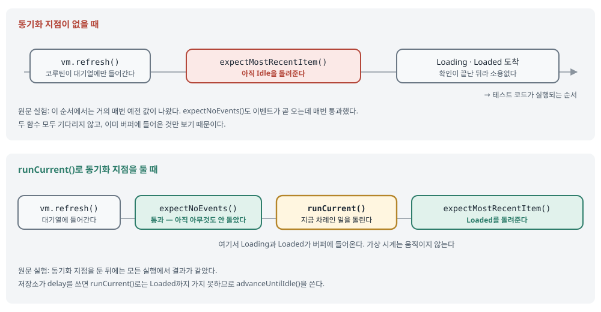

## 한 줄 요약

Turbine으로 Flow를 테스트할 때 가끔 깨지는 원인은 대개 **Flow 종류에 맞지 않는 확인 방법**에 있다. 원문의 기준은 이렇다. 상태를 들고 있는 Flow(StateFlow 등)는 중간 과정이 아니라 **최종 값**을 확인하고, 이벤트 Flow는 **하나씩 순서대로** 확인한다. 기다리지 않는 확인 함수 앞에는 **동기화 지점**(`runCurrent()`)을 두고, 끝나지 않는 Flow는 **명시적으로 닫는다**. 1편([코루틴 테스트](750-flake-free-coroutine-tests.html))에 이어지는 글로, 저자는 Turbine 1.2.0과 kotlinx-coroutines 1.10.1에서 일부러 불안정하게 만든 테스트를 수백 번씩 돌려 확인했다.

> 원문 블로그는 "©2011-2026 All Rights Reserved"(모든 권리 보유)다. 그래서 원문 코드는 그대로 옮기지 않고, **하는 일을 글로 풀어 쓴 뒤 직접 쓴 스케치**를 붙였다. 표지 사진은 원문 서버 주소를 걸어 보여 주고, 원문에 없는 그림 한 장(동기화 지점)은 이해를 돕기 위해 새로 그렸다. 스케치는 컴파일하지 않았다.

## 먼저 알아 둘 말

- **Turbine**: Cash App이 만든 Flow 테스트 라이브러리다. `flow.test { ... }` 안에서 Flow가 내보낸 값을 하나씩 꺼내 확인한다.
- **`awaitItem()`**: 다음 값이 올 때까지 기다렸다가 그 값을 돌려준다. 기다리는 시간에는 한도(timeout)가 있다.
- **`awaitComplete()` / `awaitError()`**: Flow가 정상으로 끝났는지, 오류로 끝났는지 확인한다.
- **`expectNoEvents()`**: 지금 버퍼(받아 두었지만 아직 꺼내지 않은 값의 보관 칸)가 비어 있는지 확인한다. **기다리지 않는다.**
- **`expectMostRecentItem()`**: 버퍼에 있는 값 중 가장 최근 값만 돌려주고 나머지는 버린다. 이것도 **기다리지 않는다.**
- **`cancelAndIgnoreRemainingEvents()`**: 수집을 멈추고, 남은 값은 무시한다. `cancelAndConsumeRemainingEvents()`는 남은 값을 돌려줘서 로그로 찍어 볼 수 있다.
- **`testIn(scope)` / `turbineScope { }`**: 여러 Flow를 동시에 받을 때 쓴다. `testIn`이 Flow마다 Turbine 하나를 만들고, `turbineScope`가 그것들을 묶어 정리한다.
- **cold Flow**(차가운 흐름): 누군가 수집을 시작해야 값을 만들기 시작한다. 두 번 수집하면 처음부터 두 번 돈다. 일반 `flow { }`가 여기에 속한다.
- **hot Flow**(뜨거운 흐름): 수집하는 사람이 있든 없든 값을 만든다. `SharedFlow`·`StateFlow`가 여기에 속한다.
- **SharedFlow**: 여러 수집자에게 같은 값을 나눠 주는 hot Flow다. `replay = 0`(기본값)이면 수집을 시작하기 전에 나온 값은 받지 못한다.
- **StateFlow**: "현재 값"이 항상 하나 있는 hot Flow다. 상태를 들고 있는 그릇(state holder)이라서, 화면 상태에 주로 쓴다.
- **conflation**(합쳐짐): 값이 빠르게 여러 번 바뀌면 중간 값을 건너뛰고 마지막 값만 전달되는 현상이다. StateFlow는 원래 이렇게 동작한다.
- **`stateIn` / `shareIn`**: 일반 Flow를 StateFlow·SharedFlow로 바꿔, 위쪽 흐름(upstream) 하나를 여러 수집자가 나눠 쓰게 한다.
- **`SharingStarted.WhileSubscribed`**: 수집자가 있을 때만 위쪽 흐름을 돌리는 공유 방식이다. 수집자가 없으면 멈추지만 마지막 값은 남겨 둔다.
- **동기화 지점**(sync point): 테스트 디스패처에 쌓인 일을 먼저 돌려서, 버퍼가 "알려진 상태"가 된 뒤에 확인하게 하는 호출이다. 원문에서는 주로 `runCurrent()`가 이 역할을 한다.
- **`runCurrent()` / `advanceUntilIdle()` / `advanceTimeBy()`**: 1편에서 다룬 가상 시계 조작 함수다. 지금 차례인 일만 돌리기 / 대기열이 빌 때까지 다 돌리기 / 시계를 정해진 만큼 밀기.
- **`UnconfinedTestDispatcher` / `StandardTestDispatcher`**: 테스트용 디스패처다. Unconfined는 일을 바로 그 자리에서 돌리고, Standard는 대기열에 넣었다가 테스트가 밀 때 돌린다.
- **`postValue`**: LiveData에 다른 스레드에서 값을 넣는 함수다. 메인 스레드가 처리하기 전에 여러 번 부르면 마지막 값만 남는다.

## 서론 — 연재 2편, Turbine 쪽 이야기

<figure class="media"><figcaption>원문 표지. 흑백으로 찍은 여객기 터빈 엔진 사진이고, 본문 내용과 직접 관련은 없다(Unsplash 사진). 원문 서버의 이미지를 그대로 걸었다.</figcaption></figure>

- **여러 곳에서 값이 들어오는 Flow는 테스트하기가 헷갈린다.** 이 글은 Flow 종류마다 Turbine이 어떻게 동작하는지 깊이 들여다본다. 독자가 Turbine을 기본적으로 안다고 가정한다.
- **근거는 1편과 같은 방식이다.** 저자가 실제 Kotlin 프로젝트를 테스트하며 얻은 경험을, 일부러 불안정하게 만든 테스트를 수백 번(일부는 CPU 부하를 걸고) 돌려 확인했다. 버전은 Turbine 1.2.0, kotlinx-coroutines 1.10.1이다.
- **이 글에서 쓰는 함수는 두 묶음이다.**
  - 코루틴 테스트 라이브러리 쪽: `advanceUntilIdle()`, `advanceTimeBy()`, `runCurrent()`.
  - Turbine 쪽: `awaitItem()`(값 하나 확인), `awaitComplete()`(정상 종료 확인), `awaitError()`(실패 확인).

## 1. Flow의 종류부터 다시 보기

- **Flow는 세 가지로 나눠 생각한다.**
  - 기본 `Flow`는 cold 비동기 데이터 흐름이고, 시간에 따라 값을 내보낸다.
  - `SharedFlow`는 hot Flow이고, 수집하는 모두에게 값을 보낸다.
  - `StateFlow`는 hot 상태 그릇이고, 수집자에게 현재 상태와 이후 변화를 보낸다. ViewModel의 화면 상태에 흔히 쓰므로 테스트 방법을 꼭 알아야 한다.
- **덤으로 LiveData도 본다.** LiveData는 Flow가 아니지만 hot 상태 그릇이다. `asFlow()`는 그것을 cold Flow로 보여 준다. StateFlow와 달리 **비어 있는 LiveData는 내보낼 값이 없다.**
- **cold와 hot의 차이가 테스트 방법을 바꾼다.** cold는 수집을 시작해야 값을 만들고, hot은 누가 보든 말든 값을 만든다. 그래서 hot Flow는 "언제부터 듣기 시작했나"가 결과에 영향을 준다.

### 상태 그릇이냐 이벤트 흐름이냐

- **이벤트 흐름은 값을 하나하나 확인하고, 상태 그릇은 결과만 확인한다.**
  - 이벤트 흐름은 `awaitItem()`과 `awaitComplete()`로 내보낸 값을 모두 확인할 수 있다.
  - 상태 그릇은 중간 상태를 하나하나 확인하기보다 **결과(`state.value`)를 확인하는 편이 낫다.** 중간 상태가 합쳐져 사라질 수 있기 때문이다.
  - Android 공식 문서도 같은 말을 한다. StateFlow는 값이 빠르게 바뀌면 중간 값을 받는다는 보장이 없으니, 데이터 그릇으로 보고 `value`를 확인하라고 권한다.
- **상태 그릇에서는 값이 사라지는 길이 세 가지다.** 중간 값이 합쳐지고, 같은 값은 무시되고, `postValue`는 여러 번의 변경을 하나로 묶는다. 그래서 Loading 같은 중간 상태가 아예 나오지 않고 마지막 상태로 건너뛸 수 있다.
- **Turbine 자체는 거의 모든 값을 본다.** Turbine은 Unconfined 디스패처로 수집하기 때문이다.
  - 저자의 실험에서는 테스트 스레드, Standard 디스패처, `Dispatchers.Default` 중 어디서 연달아 값을 넣어도 Turbine이 모두 보았다.
  - 값이 사라진 것은 **위쪽 흐름에서**였다. `stateIn`이나 `flowOn`이 StandardTestDispatcher에서 돌 때, Unconfined 디스패처의 생산자가 값을 연달아 넣을 때, LiveData가 `postValue`를 묶을 때가 그랬다.
  - 저자의 정리: 대부분의 테스트는 어차피 최종 결과만 궁금하다. **필요한 것을 테스트하고, 가진 것을 다 테스트하지 마라.**

원문 예제는 검색 ViewModel이다. 검색을 시작하면 Loading을 넣고, 저장소 결과에 따라 Success나 Error를 넣는다. 이 ViewModel을 `UnconfinedTestDispatcher`로 만들고 Turbine으로 보면, 처음 Idle 다음에 **바로 Success가 온다.** 생산자가 Loading을 지나 Success까지 한 번에 달려서 Turbine이 중간 상태를 볼 틈이 없기 때문이다.

같은 구조를 Aide 첫 화면으로 옮기면 이렇다.

```kotlin
// 직접 쓴 스케치 — 원문 예제와 같은 구조. 컴파일하지 않았다
val vm = HomeViewModel(fakeTasks, UnconfinedTestDispatcher(testScheduler))

vm.uiState.test {
    awaitItem()            // 처음 상태
    vm.onEvent(HomeContract.Event.Refresh)
    awaitItem()            // 불러오는 중 상태는 오지 않고, 다 불러온 상태가 바로 온다
}
```

- **Unconfined는 순서를 보장하지 않는다.** kotlinx 문서에 따르면 `UnconfinedTestDispatcher`도 `Dispatchers.Unconfined`처럼, 코루틴 여러 개가 줄을 서 있을 때 실행 순서를 보장하지 않는다. 그래서 Turbine이 보는 것이 예상과 다를 수 있다.
- **같은 변경을 다른 곳에서 하면 모두 전달된다.** 테스트 본문에서 바꾸거나, StandardTestDispatcher나 `Dispatchers.Default` 위의 코루틴에서 바꾸면 그랬다.
- **특정 상태를 기다려야 하면, 그 상태가 나올 때까지 계속 꺼낸다.** 원문은 `awaitItem()`을 반복해서 원하는 상태가 될 때까지 도는 짧은 루프를 보여 준다.
  - 이 루프는 **원하는 최종 상태**를 조건으로 삼아야 한다. 오지 않을 수도 있는 Loading 같은 중간 상태를 조건으로 삼으면 안 된다.
  - Turbine에 이런 기다림을 공식으로 넣자는 `awaitUntil` PR(#438)이 올라와 있지만 아직 열려 있다.
- **중간 상태 자체가 중요하면, 먼저 타이밍을 고정한 뒤에 확인한다.** StandardTestDispatcher를 쓰거나 동기화 지점을 둔다. 판단 기준은 **"이 순서가 계약의 일부인가?"**다. 그렇다면 순서를 확인하고 타이밍을 통제한다. 아니라면 결과만 확인한다.
- **일부러 값을 버리는 연산자가 있으면, 그 연산자가 통과시켜야 할 값을 정확히 확인한다.** `debounce`(잠시 조용해질 때까지 기다림), `sample`(일정 간격으로 하나만), `mapLatest`(새 값이 오면 이전 계산 취소)가 그런 연산자다.

| Flow 종류 | 무엇을 확인하나 |
|---|---|
| 상태 그릇 — StateFlow, LiveData, `stateIn`으로 만든 모든 것 | 결과(`.value`)를 확인한다. 중간 값은 합쳐질 수 있고, 같은 값은 무시되고, `postValue`는 여러 번을 하나로 묶기 때문이다. |
| 이벤트 흐름 — cold Flow, 한 번만 일어나는 이벤트(화면 이동·토스트)용 SharedFlow, Channel, `callbackFlow`, Rx의 `PublishSubject` | 내보낸 값을 하나씩 순서대로 확인한다(`awaitItem()`들, 그리고 `awaitComplete()`). |
| 일부러 값을 버리는 연산자 — `debounce`, `sample`, `mapLatest` | 그 연산자가 통과시켜야 할 값을 정확히 확인한다. |
| 중간 과정 자체가 동작인 경우 — 사용자가 꼭 봐야 하는 Loading, 두 번 일어나면 안 되는 이벤트 | 확인하되, 먼저 타이밍을 고정한다. StandardTestDispatcher, 풀어 줄 때까지 멈춰 있는 가짜 저장소, `runCurrent()` 같은 도구를 쓴다. |

- **대부분의 Flow는 Turbine과 잘 맞는다.** Channel, `callbackFlow`, `asFlow()`로 바꾼 RxJava subject, `conflate()`·`distinctUntilChanged()` 같은 연산자도 저자의 실험에서 값을 하나도 잃지 않았다.
- **cold Flow는 수집할 때마다 처음부터 다시 돈다.** 두 번 수집하면 그 안의 부수 효과(네트워크 호출, 로그 등)도 두 번 일어난다.

## 2. 동기화 지점

- **기다리지 않는 Turbine 함수는 비동기 작업이 끝나기 전에 실행될 수 있다.** 동기화 지점은 테스트 디스패처에 쌓인 일을 먼저 돌리게 한다. 그러면 버퍼가 알려진 상태가 되고, 그 뒤의 확인이 의미를 갖는다.
- **저자의 실험 결과가 분명하다.**
  - `expectNoEvents()`는 이벤트가 바로 뒤에 도착하는데도 **매번 통과했다.**
  - `expectMostRecentItem()`은 거의 모든 실행에서 **예전 값**을 돌려줬다.
  - `runCurrent()`로 동기화 지점을 두자 모든 실행의 결과가 같았다.

<figure><a class="figure-scroll" href="../assets/751-turbine-sync-point.svg"></a><figcaption>동기화 지점이 있을 때와 없을 때. 원문에 없는 그림으로, 원문 2장의 설명을 그림으로 옮겼다.</figcaption></figure>

원문 예제는 피드 ViewModel이다. `refresh()`가 코루틴을 띄워 Loading을 넣고, 저장소에서 피드를 받은 뒤 Loaded를 넣는다. 테스트는 이 ViewModel을 `StandardTestDispatcher(testScheduler)`로 만들고 다음 순서로 확인한다.

- **`refresh()`를 부른다.** 코루틴이 대기열에 들어갈 뿐, 테스트 안에서는 아직 아무것도 돌지 않았다.
- **`expectNoEvents()`가 통과한다.** 코루틴이 아직 대기열에 있고 가상 시간도 흐르지 않았으니, 이미 받아 둔 이벤트가 없다.
- **`runCurrent()`가 대기 중인 코루틴을 지금 돌린다.** 이것이 동기화 지점이다.
- **`expectMostRecentItem()`이 Loaded를 돌려준다.**
  - 버퍼에 있는 가장 최근 값만 바로 돌려주고 그 앞의 값은 건너뛴다.
  - 상태 같은 Flow용이다. 아직 아무것도 내보내지 않은 SharedFlow나 비어 있는 LiveData에서는 예외를 던진다.
  - 특정 다음 값을 기다리려면 `awaitItem()`을 쓴다.
- **마지막에 `cancelAndIgnoreRemainingEvents()`로 닫는다.**

```kotlin
// 직접 쓴 스케치 — 원문 예제와 같은 순서를 Aide로 옮겼다. 컴파일하지 않았다
@Test
fun `새로고침하면 다 불러온 상태가 된다`() = runTest {
    val vm = HomeViewModel(fakeTasks, StandardTestDispatcher(testScheduler))

    vm.uiState.test {
        awaitItem()                         // 처음 상태
        vm.onEvent(HomeContract.Event.Refresh)
        expectNoEvents()                    // 코루틴은 아직 줄만 서 있다
        runCurrent()                        // 동기화 지점
        assertThat(expectMostRecentItem().isLoading).isFalse()
        cancelAndIgnoreRemainingEvents()
    }
}
```

- **여기서는 `advanceUntilIdle()`이 아니라 `runCurrent()`를 쓴다.** 지금 줄 선 일(새로고침)만 돌리면 되기 때문이다. 다만 이것은 저장소가 `delay`를 쓰지 않을 때의 이야기다. `delay`가 있으면 Loaded까지 가려면 `advanceUntilIdle()`이 필요하다.

| 함수 | 하는 일 | 쓸 때 |
|---|---|---|
| `runCurrent()` | 지금 차례인 일(`backgroundScope` 작업 포함)을 돌리고 멈춘다. 가상 시계는 움직이지 않는다. | 시간을 밀지 않고 동기화 지점이 필요할 때 쓴다. 띄운 코루틴이 시작해 자리를 잡게 하거나, Loading 상태를 보이게 두거나, `backgroundScope`의 `stateIn`을 자리 잡게 하거나, `expectNoEvents()`·`expectMostRecentItem()` 앞에 둔다. |
| `advanceUntilIdle()` | 남은 일이 없을 때까지 돌리고, 그 사이의 모든 `delay`를 건너뛰어 시계를 민다. 원문은 `backgroundScope` 작업을 건너뛴다고 적었다(아래 "원문을 읽을 때 주의할 점" 참고). | 최종 상태만 확인하고, 그 사이의 `delay`(debounce, timeout, retry)가 실행되어도 괜찮을 때 쓴다. "끝까지 다 돌려라"라는 뜻이다. |
| `advanceTimeBy(n)` | 시계를 n만큼 밀고, 그 시점 **이전**에 잡힌 일을 돌린다. 정확히 n에 잡힌 일은 돌리지 않는다. | 시간 경계를 테스트할 때 쓴다. 정확히 n에 잡힌 일까지 돌리려면 이어서 `runCurrent()`를 부른다. |

- **원문의 경험칙은 네 가지다.**
  - 중간 상태를 보고 싶으면 `runCurrent()`를 쓴다. `advanceUntilIdle()`은 중간을 지나쳐 버려서 보여 줄 수 없다.
  - 최종 상태만 확인하면 `advanceUntilIdle()`을 쓴다. 다만 debounce와 timeout도 함께 실행된다는 점을 알고 쓴다.
  - 정확한 시간 경계에는 `advanceTimeBy()`와 `runCurrent()`를 함께 쓴다.
  - `backgroundScope` 작업이나 끝나지 않는 주기 반복에는 `advanceUntilIdle()`을 쓰지 않는다. 앞의 것은 기다려 주지 않고, 뒤의 것은 영원히 돌아오지 않는다.
- **세 함수 모두 진짜 디스패처는 기다리지 않는다.** `Dispatchers.IO`나 `Default`에서 도는 일은 1편의 "진짜 스레드" 규칙(Turbine 제한 시간을 넉넉히)으로 다룬다.

## 3. 모범 사례

### 상태를 어떻게 바꾸는지 조심한다

- **같은 상태를 두 번 넣으면 두 번째는 전달되지 않는다.** 저자의 실험에서 같은 결과를 두 번째로 넣었을 때 이벤트가 0개였다. 그 두 번째 상태를 `awaitItem()`으로 기다리고 있었다면 테스트가 멈추거나 이상하게 실패한다.
- **MutableStateFlow가 들고 있는 객체를 그 자리에서 고쳐도 전달되지 않는다.** 예를 들어 리스트에 항목을 추가하고 같은 인스턴스를 다시 넣으면, 같은 객체라서 변화가 없다고 본다.
- **해결은 두 가지다.** 새 인스턴스를 만들어 넣고, 전달 여부에 기대지 않도록 `.value`를 확인한다.

### `shareIn`·`stateIn`과 replay를 이해한다

- **`shareIn`은 위쪽 흐름 하나를 여러 수집자가 나눠야 할 때 쓴다.** 예를 들어 비싼 WebSocket 연결 하나를 여러 곳에서 봐야 할 때가 그렇다.
- **StandardTestDispatcher에서 `replay = 0`이면 값이 버려질 수 있다.**
  - 공유를 맡은 코루틴이 대기열에만 들어가 있고 아직 수집을 시작하지 않았다.
  - 그 틈에 hot 위쪽 흐름이 내보낸 값은 버려지고, Turbine은 아무것도 보지 못한다.
  - 해결은 `runCurrent()`로 수집을 먼저 시작하게 하거나, 공유를 Unconfined 디스패처에서 돌려 수집이 바로 시작되게 하는 것이다.
- **StandardTestDispatcher 위의 `stateIn`도 같은 문제가 있다.**
  - 원문 예제는 위쪽 StateFlow에 Loading과 Success를 연달아 넣고 `advanceUntilIdle()`을 부른다. 그러면 Success만 도착한다.
  - 저자가 시도한 `Eagerly`, `Lazily`, `WhileSubscribed` 세 방식 모두 마지막 값만 통과했다. 그래서 Loading을 기다리면 테스트가 멈춘다.
- **이 문제는 hot 위쪽 흐름에서만 생긴다.** cold Flow는 수집을 시작하기 전까지 아무것도 내보내지 않기 때문이다. 다만 `replay = 0`이면, 값이 나온 뒤에 붙은 구독자는 그 값을 여전히 놓친다.

```kotlin
// 직접 쓴 스케치 — 원문 예제와 같은 현상. 컴파일하지 않았다
val source = MutableStateFlow<Load>(Load.Idle)
val shared = source.map { it }
    .stateIn(CoroutineScope(StandardTestDispatcher(testScheduler)), SharingStarted.Eagerly, Load.Idle)

shared.test {
    awaitItem()                 // Idle
    source.value = Load.Loading
    source.value = Load.Done
    advanceUntilIdle()
    assertThat(awaitItem()).isEqualTo(Load.Done)   // Loading은 오지 않는다
}
```

### Turbine 범위를 제대로 쓴다

- **여러 Flow를 함께 볼 때는 `test {}`를 중첩하지 말고 `turbineScope`와 `testIn`을 쓴다.**
  - `testIn`은 같은 Flow를 여러 번 수집해서 다른 부분을 따로 볼 때도 쓸 수 있다.
  - 중첩이 경쟁 상태(타이밍에 따라 결과가 달라지는 상태)를 만드는 것은 아니다. 다만 안쪽 블록의 `awaitItem()`이 어느 Turbine의 것인지 읽기 어려워진다.
- **한 동작이 두 흐름을 바꾸면, 수집자 둘을 먼저 열고 그다음에 동작한다.**
- 원문의 "하지 말 것" 예시는 `flowA.test {}` 안에 `flowB.test {}`를 넣고, 그 안에서 부른 `awaitItem()`이 어느 쪽인지 알 수 없게 되는 모양이다.

```kotlin
// 직접 쓴 스케치 — 원문의 "이렇게 하라"와 같은 구조. 컴파일하지 않았다
runTest {
    turbineScope {
        val ui = vm.uiState.testIn(backgroundScope)
        val effects = vm.effect.testIn(backgroundScope)

        vm.onEvent(HomeContract.Event.Complete(taskId = 1))

        assertThat(ui.expectMostRecentItem().openTasks).isEmpty()
        assertThat(effects.awaitItem()).isEqualTo(HomeContract.Effect.ShowUndo(taskId = 1))
        ui.cancelAndIgnoreRemainingEvents()
        effects.cancelAndIgnoreRemainingEvents()
    }
}
```

### 동작하기 전에 Turbine을 연다

- **상태를 바꾸는 일을 하기 전에 `.test`를 먼저 부른다.**
  - 이것이 특히 중요한 것은 SharedFlow다. Turbine이 수집을 시작하기 전에 나온 이벤트는 버려진다.
  - StateFlow는 꼭 그럴 필요는 없지만, 그렇게 해서 손해 볼 것도 없다.
  - 저자의 실험에서 Turbine을 열기 전에 내보낸 이벤트는 매번 사라졌다.
- **원문의 "하지 말 것"**: 화면 이동 이벤트를 먼저 보내고 그다음에 `events.test {}`를 열어 `expectNoEvents()`로 확인하는 모양. 이벤트는 이미 지나갔다.
- **원문의 "이렇게 하라"**: `events.test {}`를 먼저 열고, 그 안에서 이벤트를 보낸 뒤 `awaitItem()`으로 받는다.
- **`turbineScope`에서 여러 흐름을 볼 때도 마찬가지다.** 두 Turbine을 먼저 다 열고, 동작 → 확인 → 다음 동작 → 확인 순서로 간다. 첫 흐름의 `test {}`를 닫은 뒤에 두 번째 동작을 하고 두 번째 흐름을 여는 모양은 피한다. 두 번째 흐름이 SharedFlow라면 그 사이에 나온 값을 놓친다.

### 첫 값이 무엇인지 안다

- **StateFlow는 만들 때부터 초기값이 있다.** `stateIn`으로 만들든 `MutableStateFlow`로 만들든 그렇다. 그래서 첫 `awaitItem()`은 그 초기값이다.
- **hot Flow라서 Turbine을 언제 열었느냐에 따라 첫 값이 달라질 수 있다.** 예를 들어 ViewModel의 `init`에서 상태를 바꾼다면, Turbine을 열 무렵에는 이미 바뀌어 있을 수 있다.
- **`WhileSubscribed`의 `stateIn`도 마찬가지다.** 새 수집자의 첫 값이 예전에 저장된 값일 수 있다. 위쪽 흐름이 곧바로 다시 시작하는 것은 멈춤 대기 시간(stop timeout)이 0일 때뿐이기 때문이다.
- **`expectMostRecentItem()`은 빈 흐름에서 예외를 던진다.** 아직 아무것도 내보내지 않은 SharedFlow나 LiveData에서는 `AssertionError`가 난다. StateFlow는 초기값이 이미 버퍼에 있어서 던지지 않는다.

### 흐름을 끝내야 한다

- **테스트를 어떻게 끝내는지 신경 쓴다.** 관심 없는 값이 테스트 뒤에 더 나올 수 있으면 `cancelAndIgnoreRemainingEvents()`로 닫는다. 남은 값을 로그로 보고 싶으면 `cancelAndConsumeRemainingEvents()`를 쓴다.
- **저자의 실험 결과가 이 규칙의 근거다.**
  - `test {}`가 끝날 때 버퍼에 값이 남아 있으면 **매번** 실패했다.
  - 늦게 도착한 이벤트는 **가끔** 실패했다. 한 설정에서는 300번 중 3번이었다. 이것이 바로 "가끔 깨지는" 종류다.
  - `cancelAndIgnoreRemainingEvents()`로 끝내자 실패가 0번이었다.
- **더 이상 아무것도 없다는 것을 확인하고 싶으면 `expectNoEvents()`를 쓴다.** 다만 이미 버퍼에 있는 것만 보므로 앞에 동기화 지점(`runCurrent()`)을 둔다.
- **한 번 쓰고 끝나는 흐름이면 `awaitComplete()`나 `awaitError()`로 끝난 것을 확인한다.**

| 흐름 종류 | 보통 끝내는 방법 |
|---|---|
| StateFlow, `LiveData.asFlow()` | `cancelAndIgnoreRemainingEvents()`로 닫는다. |
| SharedFlow | `cancelAndIgnoreRemainingEvents()`로 닫는다. |
| 끝이 있는 cold Flow | `awaitComplete()`나 `awaitError()`로 끝난 것을 확인한다. |
| 계속 이어지는 cold Flow, Room 같은 관찰 Flow | `cancelAndIgnoreRemainingEvents()`로 닫는다. |

### 제한 시간을 활용한다

- **진짜 스레드를 쓰는 테스트에서는 Turbine의 제한 시간을 쓴다.** 1편에서도 말한 내용이다. 테스트가 오래 걸려도 괜찮다면, 특히 CI에서는 더 큰 값을 준다.
- **Turbine의 제한 시간은 실제 시계로 잰다.** 저자의 실험에서 가상 `delay(10.seconds)`는 500ms 제한을 통과했지만, 진짜 800ms 지연은 실패했다.
- **기본값은 3초이고, `test(timeout = ...)`로 바꿀 수 있다.** 원문 예시는 `Dispatchers.Default`에서 800ms를 진짜로 기다린 뒤 값을 내보내는 Flow를 `test(timeout = 10.seconds)`로 받는다. 가상 지연에는 필요 없고, 진짜 지연에만 필요하다.

## 4. 맺음

- **이 글은 Turbine으로 불안정한 테스트를 피하는 요령을 다뤘다.** Flow 종류마다 Turbine을 어떻게 쓸지, 그리고 Turbine 테스트의 모범 사례다.
- **다음 글은 AI 스킬이다.** 모범 사례에 따라 테스트를 쓰고 기존 테스트를 점검하는 AI 스킬을 만든다고 예고한다.

## 원문을 읽을 때 주의할 점

- **연재 편수가 원문 안에서 맞지 않는다.** 머리의 연재 상자는 "2편짜리 연재"라고 적고, 서론은 "다음 편에서 KMP의 코루틴 테스트, 마지막에 AI 스킬"을 예고하며, 맺음은 "다음 글에서 AI 스킬"이라고 적는다. 3편이 나오면 그때 확인한다.
- **`advanceUntilIdle()`이 `backgroundScope` 작업을 "건너뛴다"는 표현은 조금 거칠다.** kotlinx-coroutines-test 1.10.1 소스를 보면 이 함수는 **포그라운드 작업이 하나도 남지 않을 때까지** 다음 일을 차례로 돌린다. 그래서 차례가 앞선 백그라운드 작업은 함께 돌고, 남은 것이 백그라운드 작업뿐이면 거기서 멈춘다. "백그라운드 작업이 끝나기를 기다려 주지 않는다"로 읽으면 정확하다.
- **"같은 객체라서 전달되지 않는다"는 동일성만의 문제가 아니다.** StateFlow는 `equals`로 같은지 비교한다. 그래서 새 인스턴스라도 내용이 같은 data class라면 역시 전달되지 않는다. "같은 상태를 두 번 넣으면 무시된다"와 같은 규칙이다.
- **실험 버전과 Aide 버전이 조금 다르다.** 원문은 Turbine 1.2.0과 coroutines 1.10.1이고, Aide는 Turbine 1.2.1과 coroutines 1.11.0이다. 함수 이름과 위 동작은 그대로일 것으로 보지만, 원문의 실험 횟수(300번 중 3번 등)를 Aide 버전에서 다시 재지는 않았다.
- **원문 한 문장은 끊겨 있다.** 2장의 "`expectMostRecentItem()` returned the stale value in nearly every." 뒤에 단어가 빠져 있다. "거의 모든 실행에서"로 읽었다.

## 코드로 보기 — Aide 구조로 옮긴 스케치

Task 8 `HomeViewModelTest`가 이 글을 바로 쓸 곳이다. 계획의 케이스 표는 "[완료] → 목록에서 빠지고 Effect '되돌리기' 1회"처럼 **상태 하나와 이벤트 하나**를 함께 확인한다. 아래는 그 확인을 이 글의 규칙으로 나눈 모양이다.

```kotlin
// 직접 쓴 스케치 — Task 8 케이스 1을 원문 규칙대로 쓴 한 가지 모양. 컴파일하지 않았다
@Test
fun `완료하면 목록에서 빠지고 되돌리기를 한 번 띄운다`() = runTest {
    val vm = homeViewModel(tasks = listOf(task(id = 1)))

    vm.effect.test {                                       // ① 이벤트는 동작 전에 연다
        vm.onEvent(HomeContract.Event.Complete(taskId = 1))
        assertThat(awaitItem()).isEqualTo(HomeContract.Effect.ShowUndo(taskId = 1))
        cancelAndIgnoreRemainingEvents()                   // ② 끝나지 않는 흐름은 닫는다
    }
    runCurrent()
    assertThat(vm.uiState.value.openTasks).isEmpty()       // ③ 상태는 결과만 본다
}
```

- ① **`effect`는 이벤트 흐름이다.** 동작하기 전에 Turbine을 열고, 받은 값을 하나씩 확인한다. 케이스의 "1회"는 "두 번 일어나면 안 되는 이벤트"라서 원문 표의 네 번째 줄에 해당한다.
- ② **`effect`는 끝나지 않는 흐름이다.** 그래서 `awaitComplete()`가 아니라 `cancelAndIgnoreRemainingEvents()`로 닫는다.
- ③ **`uiState`는 상태 그릇이다.** 목록이 비었는지만 `.value`로 확인한다. "목록에서 빠지는 중" 같은 중간 상태는 계약이 아니다.

조심할 점이 두 가지 있다.

- **`uiState`를 `stateIn(…, WhileSubscribed(…))`로 만들면 `.value` 확인 전에 수집자가 있어야 한다.** 수집자가 없으면 위쪽 흐름이 돌지 않아 `.value`는 초기값에 머문다. 이때는 `backgroundScope.launch { vm.uiState.collect {} }`를 먼저 띄우거나, 위 `turbineScope` 스케치처럼 `testIn(backgroundScope)`로 열어 둔 채 `expectMostRecentItem()`으로 본다.
- **`effect`를 무엇으로 만드는지에 따라 ①이 필수냐가 갈린다.** `MutableSharedFlow()`(replay 0)라면 Turbine을 열기 전의 효과는 사라진다. 이것은 테스트만의 문제가 아니라 화면이 잠시 수집하지 않을 때의 앱 동작이기도 하다. `Channel(Channel.BUFFERED).receiveAsFlow()`라면 수집자가 올 때까지 보관된다. 계획서는 `HomeContract.Effect`의 그릇을 정하지 않았다.

## 배운 점

- **확인 방법은 Flow 종류가 정한다.** 상태 그릇은 결과를, 이벤트 흐름은 하나씩을, 값을 버리는 연산자는 통과해야 할 값을 확인한다.
- **"이 순서가 계약인가?"를 먼저 묻는다.** 계약이 아니면 중간 상태를 테스트하지 않는다. 계약이면 타이밍부터 고정한다.
- **`expectNoEvents()`와 `expectMostRecentItem()`은 기다리지 않는다.** 앞에 `runCurrent()`를 두지 않으면, 통과해도 아무것도 증명하지 못한다.
- **"가끔 깨지는" 테스트의 대표적인 원인은 닫지 않은 흐름이다.** 늦게 온 값 하나가 300번 중 3번 실패를 만든다.
- **SharedFlow는 듣기 전에 지나간 값을 돌려주지 않는다.** 테스트에서는 Turbine을 먼저 열고, 앱에서는 효과를 담을 그릇을 신중하게 고른다.
- **같은 값과 고친 객체는 전달되지 않는다.** StateFlow에는 새 인스턴스를 넣고, 확인은 `.value`로 한다.

## Aide에 적용하면

Aide는 지금 Task 6(캘린더 이식)까지 커밋돼 있다. Turbine을 쓰는 테스트는 `DefaultEventRepositoryTest` 하나이고, 다음으로 Turbine을 많이 쓸 곳은 Task 8 `HomeViewModelTest`다. 1편의 적용안 1번(Main에 `StandardTestDispatcher`를 넣는다)과 함께 읽는다.

1. **Task 8 `HomeViewModelTest`의 확인 방법을 나눈다 — 바꿔서 가져온다.**
   - `uiState`는 `.value`로 결과만 확인한다. 케이스 1·3·4의 "목록에서 빠짐", "입력 글 비워짐", "아무것도 추가 안 됨"이 여기에 해당한다.
   - `effect`는 Turbine을 먼저 열고 `awaitItem()`으로 하나씩 확인한다. 케이스 1의 "되돌리기 1회", 케이스 5의 "일정 추가 화면 열기"가 여기에 해당한다.
   - "1회"를 확인하려면 `awaitItem()` 뒤에 `runCurrent()`와 `expectNoEvents()`를 붙인다. 동기화 지점 없이 `expectNoEvents()`만 쓰면 원문 실험처럼 늘 통과해 버린다.
2. **`effect` 그릇을 정한다 — 사용자 결정이 필요하다.**
   - 계획서의 `HomeContract.Effect`는 내용(되돌리기 스낵바, 일정 추가 화면 열기, 캘린더 앱 열기)만 있고, SharedFlow로 할지 Channel로 할지는 비어 있다.
   - 나는 `Channel(Channel.BUFFERED).receiveAsFlow()`를 추천한다. 화면이 회전 등으로 잠시 수집하지 않을 때 "일정 추가 화면 열기"가 사라지지 않고, 테스트에서도 Turbine을 늦게 열어 생기는 실패가 줄어든다. 대신 수집자가 여럿이면 값이 한 곳에만 가는데, Aide 화면 규칙상 수집자는 `HomeRoute` 하나다.
   - SharedFlow(replay 0)를 고르면 위 1번의 "Turbine을 먼저 연다"가 필수가 된다.
3. **`uiState`가 `WhileSubscribed`면 수집자를 띄운 뒤 `.value`를 본다 — 가져온다.** 화면 규칙("`XxxUiState` 하나를 `StateFlow`로")을 `stateIn(viewModelScope, WhileSubscribed(5_000), …)`로 구현하면, 테스트에서 수집자 없이 `.value`만 읽을 때 초기값에 머문다. `backgroundScope.launch { vm.uiState.collect {} }` 한 줄을 헬퍼로 둔다. `MutableStateFlow`를 직접 갱신하는 방식이면 필요 없다.
4. **기존 `DefaultEventRepositoryTest`의 변경 감지 테스트 끝에 `cancelAndIgnoreRemainingEvents()`를 붙인다 — 가져온다. 사용자 판단이 필요하다.**
   - `폰 캘린더가 바뀌었다는 신호가 오면 일정을 다시 읽어 내보낸다` 테스트는 끝나지 않는 `observeEvents()`를 `test {}`로 받고, 두 번째 `awaitItem()` 뒤에 그냥 블록을 닫는다.
   - 지금은 통과한다. 하지만 원문 표의 "계속 이어지는 cold Flow" 줄에 정확히 해당한다. 변경 신호 하나가 일정과 캘린더를 둘 다 다시 읽게 만들어 값이 하나 더 나오면, 원문 실험처럼 가끔 실패할 수 있다. 실제로 값이 하나 더 나오는지는 돌려 보지 않았다.
   - Task 5 코드는 AI가 짠 부분이라 고치려면 Aide 작업으로 따로 진행한다(이 블로그 작업에서는 Aide 코드를 건드리지 않았다).
5. **StateFlow에는 새 인스턴스를 넣는다 — 이미 계획과 같다.** `HomeUiState`는 data class이고 `copy()`로 바꾸게 된다. 목록은 `List`(읽기 전용)로 두고 `MutableList`를 그 자리에서 고치지 않는다. `copy()`로 만든 결과가 이전과 같으면 전달되지 않는다는 점만 기억해 둔다. 확인을 `.value`로 하면 문제가 되지 않는다.
6. **특정 상태를 기다리는 루프와 `awaitUntil` — 지금은 안 한다.** Aide의 Fake 저장소는 값을 바로 내보내서, `runCurrent()` 한 번으로 최종 상태에 닿는다. 기다려야 할 비동기 단계가 생기면 그때 쓴다.
7. **Turbine 제한 시간 — 지금은 안 한다.** Aide의 단위 테스트는 모두 가상 시계 위에서 돈다. Task 7 `TaskDaoTest`(Room, Robolectric)처럼 진짜 스레드를 쓰는 테스트에서 Turbine을 쓰게 되면 그때 `test(timeout = …)`을 넉넉히 준다. 1편 적용안 5번과 같은 이야기다.
8. **이 글의 규칙을 AI 리뷰 기준으로 쓴다 — 가져온다.** 각 Task 끝의 "AI 리뷰 요청"에서 Turbine 테스트를 볼 때 이렇게 확인한다: 상태를 하나씩 `awaitItem()`으로 확인하고 있지 않은가, 이벤트 Turbine을 동작 뒤에 열지 않았는가, `expectNoEvents()` 앞에 동기화 지점이 있는가, 끝나지 않는 흐름을 닫았는가. 원문이 예고한 3편(AI 스킬)이 나오면 그것과 비교한다.

## 출처

- 원문: [Part 2: Hardening Turbine Tests](https://touchlab.co/flake-free-flow-tests-pt2-turbine) — Kevin Schildhorn (Touchlab), 2026-10-30, Android Weekly [#751](https://androidweekly.net/issues/issue-751)
- 1편 정리: [코루틴 테스트가 가끔 깨지는 이유와, 디스패처·스케줄러로 막는 습관](750-flake-free-coroutine-tests.html)
- 원문이 인용한 자료: [Android 공식 문서 — StateFlow 테스트](https://developer.android.com/kotlin/flow/test#stateflows), [UnconfinedTestDispatcher 문서](https://kotlinlang.org/api/kotlinx.coroutines/kotlinx-coroutines-test/kotlinx.coroutines.test/-unconfined-test-dispatcher.html), [Turbine](https://github.com/cashapp/turbine), [Turbine PR #438 (awaitUntil)](https://github.com/cashapp/turbine/pull/438)
- 직접 대조한 소스: [kotlinx-coroutines-test 1.10.1 `TestCoroutineScheduler.kt`](https://github.com/Kotlin/kotlinx.coroutines/blob/1.10.1/kotlinx-coroutines-test/common/src/TestCoroutineScheduler.kt)
- 원문 저작권: "©2011-2026 All Rights Reserved", 코드는 옮기지 않았다
