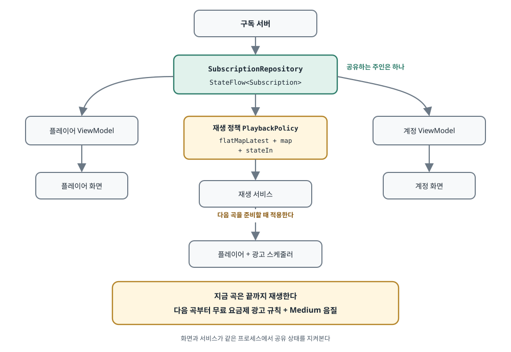
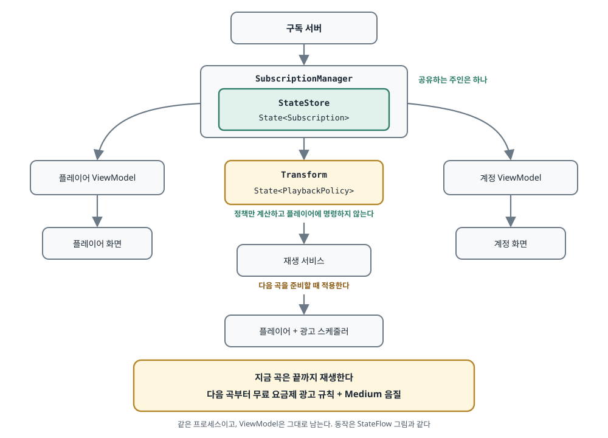

## 한 줄 요약

Jetpack AppState는 화면 밖에서도 Compose 상태를 공유하고(StateStore) 계산하게(Transform) 해 주는 새 라이브러리다. 원문은 "음악 재생 중 구독이 끝나는" 상황으로 기존 StateFlow 설계와 나란히 비교한 뒤, **상태의 주인과 새 규칙이 적용되는 시점을 정하는 일이 라이브러리 선택보다 중요하다**고 결론 내린다. 두 라이브러리 모두 2026년 10월 28일에 나온 `1.0.0-alpha01`이다.

> 원문 블로그는 "© 2026 Arda Kazancı"만 표시하고, 저장소(`ardakazanci/blog`)에서도 라이선스를 확인하지 못했다(GitHub API 404). 그래서 원문 코드는 옮기지 않고 **하는 일을 글로 풀어 쓴 뒤, 음악 앱이 아닌 Aide 알림 예시로 직접 쓴 스케치**를 붙였다. 원문 그림 두 장은 내용을 한국어로 다시 그렸다. 스케치는 컴파일하지 않았다.

## 먼저 알아 둘 말

- **AppState**: Jetpack의 새 라이브러리 묶음이다. Compose의 `State`를 화면 밖 계층까지 넓혀 쓰게 해 준다. StateStore와 Transform으로 이루어지며 둘은 따로 쓸 수 있다.
- **Compose `State<T>`**: 값을 담은 상자다. Compose 코드가 `.value`를 읽으면 "이 값을 읽었다"는 기록이 남고, 값이 바뀌면 읽었던 코드가 다시 돈다.
- **StateFlow**: 코루틴 쪽에서 "현재 값이 항상 하나 있는" 흐름이다. 지금까지 Android에서 공유 상태를 내보낼 때 가장 흔히 쓴 도구다.
- **StateStore**: 공유 상태를 키로 찾아 쓰는 보관함이다. 값이 메모리에만 있고, 앱 프로세스가 죽으면 사라진다.
- **타입 안전 키**(`StateStoreKey<T>`): 키가 어떤 타입의 값을 가리키는지까지 정해져 있는 객체다. `Map<String, Any>`처럼 꺼낸 뒤 형 변환을 할 필요가 없다.
- **Transform**(`transform` 함수): `@Composable` 블록을 화면 없이 돌려 그 결과를 `State<T>`로 내보낸다.
- **재구성(recomposition)**: Compose 블록이 읽은 상태가 바뀌어 블록을 다시 실행하는 일이다.
- **`flatMapLatest`**: 새 값이 올 때마다 이전 내부 흐름을 취소하고 새 내부 흐름으로 갈아타는 Flow 연산자다.
- **`stateIn`**: 일반 Flow를 StateFlow로 바꾼다. 이때 `SharingStarted.Eagerly`를 주면 구독자가 없어도 바로 돌기 시작한다.
- **`collectAsState`**: Flow를 Compose 안에서 수집해 `State`로 바꾼다. 그 코드가 컴포지션에서 빠지면 수집도 취소된다.
- **`derivedStateOf`**: 다른 `State`에서 값을 동기적으로 계산하는 Compose 도구다. 코루틴이나 Flow 수집이 필요 없을 때 쓴다.
- **`snapshotFlow`**: Compose `State`를 다시 Flow로 바꾸는 다리다.
- **권한(entitlement)**: 사용자가 지금 실제로 Premium을 쓸 수 있는지에 대한 판정이다. "자동 갱신을 껐는지"와는 다른 값이다.
- **ViewModelStoreOwner**: ViewModel들을 담아 두고 수명을 관리하는 주인이다. 보통 Activity나 내비게이션 화면이 이 역할을 한다.
- **MediaSessionService / MediaController**: Media3에서 백그라운드 재생을 맡는 서비스와, 화면에서 그 서비스를 조종하는 객체다.
- **IPC**: 프로세스 간 통신이다. 프로세스가 다르면 메모리를 나눠 쓸 수 없어서 필요하다.
- **DI**: 객체를 직접 만들지 않고 밖에서 넣어 주는 방식이다. Hilt가 대표적이다.

## 서론 — 곡 재생 중에 구독이 끝난다

- **예시 상황은 이렇다.**
  - 노래가 나오고 있고 앱은 백그라운드에 있는데, 서버가 구독이 만료됐다고 알려 온다.
  - 계정 화면에서 Premium 표시를 지우는 일은 쉽다. 하지만 재생 서비스도 이 사실을 알아야 한다.
  - 이후 재생은 무료 요금제의 광고 규칙을 따르고, 음질은 Medium이 된다. 사용자가 플레이어를 다시 열면 같은 구독 상태가 보여야 한다.
- **이 예시 앱의 제품 규칙도 먼저 정해 둔다.**
  - 지금 곡은 끊지 않고 끝까지 튼다. 광고와 음질 변화는 다음 곡을 준비할 때 적용한다.
  - 광고가 곡마다 나오는 것은 아니고, 빈도는 광고 스케줄러가 정한다.
  - 저자는 이것이 예시 앱의 규칙일 뿐, 특정 음악 서비스의 실제 동작을 말하는 것이 아니라고 밝힌다.
- **이 상황으로 두 가지를 묻는다.** 공유 상태는 어디에 두어야 하는가, 그리고 거기서 나오는 결정은 어떻게 계산해야 하는가.

## AppState가 더하는 것

- **라이브러리는 둘이고 따로 쓸 수 있다.**
  - StateStore는 공유 Compose 상태를 타입 안전 키 뒤에 보관한다.
  - Transform은 화면을 그리지 않고 Composable 계산을 돌려 결과를 `State<T>`로 내보낸다.
- **기존 구조를 버리라는 라이브러리가 아니다.** ViewModel을 없애거나, 잘 돌아가는 Flow 흐름을 바꿀 필요는 없다. 기능 하나에서만 시험해 보고 나머지는 그대로 둘 수 있다.
- **버전은 아직 초기다.** 원문 기준일인 2026년 10월 30일에 둘 다 `1.0.0-alpha01`이고, 첫 알파는 10월 28일에 나왔다. API는 바뀔 수 있다.

## 오늘이라면 어떻게 만드나 — StateFlow 설계

- **구독의 주인은 저장소 하나다.** 저장소가 구독을 StateFlow로 내보내고, 플레이어·계정 ViewModel과 재생 서비스가 모두 이 값을 본다. 화면마다 구독 사본을 따로 들고 있을 필요가 없다.

<figure><a class="figure-scroll" href="../assets/751-appstate-stateflow.svg"></a><figcaption>StateFlow 설계. 지금 곡은 끝까지 틀고 다음 곡부터 새 규칙을 적용한다. <a href="https://ardakazanci.com/posts/jetpack-appstate-explained/">원문 그림</a>을 바탕으로 다시 그림.</figcaption></figure>

- **그림은 구독 공유만 보여 주지만, 코드에는 음질 선호도 들어간다.**
  - Premium 사용자는 Medium과 High 중에서 고를 수 있고, 무료 사용자는 Medium으로 고정된다.
  - 구독이 아직 확인되지 않았으면 `UNKNOWN`을 쓴다. 확인되지 않은 구독을 슬쩍 무료로 취급하지 않기 위해서다.
  - 재생 정책은 광고 여부와 음질을 묶은 값이다. 이 값이 `null`이면 "아직 결정이 준비되지 않았다"는 뜻이다.
- **원문의 Flow 코드는 구독 상태에 따라 지켜볼 대상을 고른다.**
  - `UNKNOWN`이면 `null` 하나만 내보낸다.
  - `FREE`이면 "광고 있음, Medium"이라는 고정 정책을 내보낸다.
  - `PREMIUM`이면 음질 선호 Flow를 지켜보며 "광고 없음, 고른 음질" 정책을 만든다. 선호를 읽기 전에는 `onStart`로 `null`을 먼저 내보낸다.
  - 무료로 바뀌면 `flatMapLatest`가 음질 선호 수집을 취소하고 고정 정책으로 갈아탄다.
- **`stateIn`에 `Eagerly`를 준 것은 일부러다.** 서비스가 쓸 정책이 화면의 구독 여부에 좌우되면 안 되기 때문이다. 이 작업은 넘겨받은 스코프가 끝날 때 멈춘다.

같은 구조를 Aide의 리마인더 설정으로 옮기면 이렇다. 권한이 확인되기 전에는 결정을 내리지 않고, 권한이 있을 때만 설정을 지켜본다.

```kotlin
// 직접 쓴 스케치 — 원문과 같은 구조를 Aide 예시로 옮겼다. 컴파일하지 않았다
enum class NotifyAccess { UNKNOWN, DENIED, GRANTED }
data class ReminderPolicy(val notify: Boolean, val offsets: List<Duration>)

@OptIn(ExperimentalCoroutinesApi::class)
fun flowReminderPolicy(
    access: StateFlow<NotifyAccess>,
    settings: Flow<ReminderSettings>,
    scope: CoroutineScope,
): StateFlow<ReminderPolicy?> = access
    .flatMapLatest<NotifyAccess, ReminderPolicy?> { current ->
        when (current) {
            NotifyAccess.UNKNOWN -> flowOf(null)
            NotifyAccess.DENIED -> flowOf(ReminderPolicy(false, emptyList()))
            NotifyAccess.GRANTED -> settings
                .map<ReminderSettings, ReminderPolicy?> { ReminderPolicy(true, it.offsets) }
                .onStart { emit(null) }
        }
    }
    .stateIn(scope, SharingStarted.Eagerly, null)
```

- **저자는 이 설계로도 요구를 다 채운다고 인정한다.** 그래서 AppState와 비교할 때의 질문은 "무엇이 더 강력한가"가 아니라 "같은 동작을 어느 쪽이 읽고 고치기 쉬운가"다.

## SharedViewModel이면 충분하지 않을까

- **같은 Activity나 내비게이션 그래프 안의 화면끼리는 충분하다.** 공유 ViewModel로 구독을 함께 보면 된다.
- **같은 프로세스의 Activity와 Service가 ViewModel을 나누는 것도 기술적으로는 가능하다.** 둘이 같은 `ViewModelStoreOwner`를 쓰고 같은 키로 요청하면 된다. 다만 그 보관함의 수명과 정리는 직접 책임져야 한다. Activity 소유 ViewModel의 참조를 서비스에 넘긴다고 수명이 늘어나지도 않는다.
- **저자는 이 예시에서 그렇게 하지 않는다.** 화면이 모두 사라져도 재생은 계속될 수 있기 때문이다.
- **그래서 화면과 독립된 상태 주인이 필요하다.** 기존 설계에서는 저장소가, AppState 설계에서는 매니저가 그 역할을 맡는다. 화면 상태와 사용자 동작은 여전히 ViewModel의 몫이고, **AppState가 ViewModel을 대체하지는 않는다.**

## StateStore로 구독 공유하기

- **DI로 StateStore를 하나 만들어 화면과 서비스가 함께 쓴다.** `SubscriptionManager`는 키를 숨기고 읽기 전용 `State`만 내보낸다. 값을 쓰는 일은 검증된 구독 정보를 받는 계층만 한다.

```kotlin
// 직접 쓴 스케치 — 원문의 SubscriptionManager와 같은 구조. 컴파일하지 않았다
@Serializable
private data object NotifyAccessKey :
    StateStoreKey<NotifyAccess>(NotifyAccess.UNKNOWN)

class NotifyAccessManager(private val store: StateStore) {
    val access: State<NotifyAccess> = store.getState(NotifyAccessKey)

    internal fun onChecked(value: NotifyAccess) {
        store.setState(NotifyAccessKey, value)
    }
}
```

- **이 쓰기 함수가 만료를 스스로 알아내지는 않는다.** 앱의 구독 동기화 부품이 서버에서 현재 권한을 받아 매니저에 넘겨 준다. 새로고침이나 앱 자체 업데이트 알림이 이 조회를 일으킬 수 있다. AppState는 통신도 결제 연동도 제공하지 않는다.
- **`PREMIUM`은 "지금 Premium을 쓸 수 있다"는 뜻이다.**
  - 갱신을 꺼도 권한이 바로 사라지지는 않는다. Play 구독은 취소해도 결제 기간이 끝날 때까지 쓸 수 있고, 유예 기간은 따로 처리해야 한다.
  - 이런 결제 상태는 서버가 앱의 권한 값으로 정리해 준다. 앱의 enum은 결제 생애 전체를 표현하지 않는다.
- **StateStore는 저절로 싱글턴이 되지 않는다.** ViewModel마다 매니저와 보관함을 새로 만들지 않도록 DI 설정이 책임져야 한다. 다른 프로세스에서 도는 서비스는 이 메모리를 나눠 쓸 수 없으므로 IPC가 필요하다.

<figure><a class="figure-scroll" href="../assets/751-appstate-appstate.svg"></a><figcaption>AppState 설계. StateStore가 구독을 들고, Transform이 정책을 계산하고, 서비스가 적용한다. 음질 선호 같은 추가 입력은 그림에서 생략했다. <a href="https://ardakazanci.com/posts/jetpack-appstate-explained/">원문 그림</a>을 바탕으로 다시 그림.</figcaption></figure>

## Transform이 여기서 하는 일

- **같은 정책을 Compose 상태로 계산한다.** 음질 선호는 기존 DataStore나 저장소의 Flow 그대로 두어도 된다.
- **원문 코드는 `when` 하나로 읽힌다.**
  - 구독 값을 읽어 `UNKNOWN`이면 `null`, `FREE`이면 고정 정책을 돌려준다.
  - `PREMIUM` 분기에서만 음질 선호를 `collectAsState(initial = null)`로 수집한다. 값이 아직 없으면 `null`을 돌려준다.

```kotlin
// 직접 쓴 스케치 — 원문의 Transform 코드와 같은 구조. 컴파일하지 않았다
fun composeReminderPolicy(
    manager: NotifyAccessManager,
    settings: Flow<ReminderSettings>,
    scope: CoroutineScope,
): State<ReminderPolicy?> = transform<ReminderPolicy?>(
    initialValue = null,
    scope = scope,
) {
    when (manager.access.value) {
        NotifyAccess.UNKNOWN -> null
        NotifyAccess.DENIED -> ReminderPolicy(false, emptyList())
        NotifyAccess.GRANTED -> {
            val current = settings.collectAsState(initial = null).value
            current?.let { ReminderPolicy(true, it.offsets) }
        }
    }
}
```

- **분기에서 빠지면 수집도 멈춘다.** 무료로 바뀌면 Premium 분기가 컴포지션에서 빠지면서 수집이 취소된다. 음질 선호는 더 이상 이 계산의 입력이 아니다.
- **장점은 "어떤 조건에서 어떤 상태가 중요한가"를 평범한 Kotlin 제어문으로 쓸 수 있다는 점이다.** Flow는 같은 관계를 연산자로 쓴다. 저자는 둘 다 맞는 방법이라고 말한다.
- **Transform이 꼭 필요한 경계도 짚는다.**
  - Premium이면 광고 없음, 무료면 광고 있음처럼 동기 계산만 필요하면 `derivedStateOf`로 충분할 수 있다.
  - Premium 분기 안에서 비동기 음질 선호를 수집하는 부분이 Transform을 쓸 이유가 된다.
  - `combine`과의 차이가 "Flow는 조건부 작업을 못 한다"는 것은 아니다. 첫 번째 버전의 `flatMapLatest`가 이미 그 일을 한다.
- **정책은 주인 하나당 한 번만 만든다.** 값이 필요할 때마다 이 함수를 부르면 계산이 또 하나 시작된다. 이 설계에서 정책 계산은 서비스가 소유하고, 두 ViewModel은 공유 매니저만 읽는다.

## 이미 나오고 있는 곡은 어떻게 되나

- **Transform 블록 안에는 `player.stop()`도 광고 재생 명령도 없다.** 결과물은 "광고를 켤지, 어떤 음질을 쓸지"라는 정책뿐이다.
- **무료로 바뀌면 각자 자기 일을 한다.**
  - 화면은 새 상태를 보여 준다.
  - 서비스는 지금 곡을 끝까지 틀고, 다음 재생을 준비할 때 현재 규칙으로 광고 일정과 음질을 정한다.
  - 미리 준비해 둔 다음 곡이 있으면 그것도 다시 판단해야 한다.
  - 무료 요금제에서 Medium을 쓴다고 해서 저장해 둔 Premium 음질 선호가 지워지지는 않는다.
- **AppState는 재생 연결을 대신하지 않는다.** 그림은 의존 관계만 보여 준다. Media3로 구현하면 플레이어와 `MediaSession`은 `MediaSessionService`에 있고, 화면은 `MediaController`로 조종한다. `AudioQuality.MEDIUM`도 앱의 정책 값일 뿐이어서, 재생 계층이 실제 스트림이나 트랙 선택으로 바꿔야 한다.
- **목표 정책과 실제 재생 상태는 다른 값이다.** 지금 곡이 High로 끝나 가는 중이면 화면이 "이미 Medium으로 재생 중"이라고 말하면 안 된다. 실제 재생 정보는 플레이어에서 읽는다.
- **Transform은 비동기로 갱신된다.**
  - 구독을 바꾼 바로 다음 줄에서 계산 결과가 새 값이라고 믿으면 안 된다. Flow 쪽도 마찬가지다.
  - 실용적인 구현은 권한 변경과 다음 곡 준비를 재생 조정자(coordinator) 하나로 순서대로 처리한다.
  - 준비된 곡을 시작하기 직전에 현재 권한을 확인하고, 필요하면 정책을 다시 평가한다.
  - Flow 버전과 Transform 버전을 함께 쓴다면 같은 정책 규칙을 써야 하며, 규칙의 사본을 따로 유지하면 안 된다.
- **`null`의 뜻을 분명히 한다.** 새 재생 결정이 아직 준비되지 않았다는 뜻이지, "무료"나 "Premium 재사용"이 아니다. 지금 곡은 끝까지 틀되 새 재생 준비는 정책이 나올 때까지 기다린다.

## 순조롭지 않을 때의 질문들

- **화면 없이 서비스가 Compose 상태를 어떻게 지켜보나.**
  - `.value`를 한 번 읽는 것은 그 순간의 값을 읽을 뿐 구독이 아니다.
  - 서비스는 자기 코루틴 스코프에서 `snapshotFlow { policy.value }`를 수집해 조정자의 대기 정책을 갱신할 수 있다.
  - 플레이어 명령을 snapshot 블록 안에 넣으면 안 된다. 이 다리는 상태를 일반 Flow로 돌려줄 뿐, 빠짐없이 전달되는 이벤트 대기열로 만들어 주지 않는다.
- **오프라인이거나 프로세스가 죽으면 어떻게 되나.**
  - 네트워크 실패만으로 Premium이 끝났다고 볼 수는 없다. 오프라인에서 권한을 얼마나 인정할지는 제품 정책으로 명시해야 한다.
  - 이 최소 예시는 프로세스가 다시 만들어지면 `UNKNOWN`에서 시작해, 검증을 받을 때까지 새 재생을 기다린다.
  - 애플리케이션 스코프는 프로세스가 사는 동안만 살아 있다. 그것도 StateStore도 서비스를 살려 두지 않는다.
- **계정을 바꾸면 어떻게 되나.** 이전 계정의 동기화를 취소하고, 공유 구독을 `UNKNOWN`으로 되돌리고, 이전 계정의 늦은 응답을 버린다. 싱글턴 매니저는 공유 저장소일 뿐 계정을 분리해 주지 않으므로, 동기화 설계가 책임진다.
- **재구성 때문에 광고가 두 번 나올 수 있나.** 이 계산은 광고를 틀지 않는다. 최신 정책만 만들고, 실제 광고 일정은 조정자가 곡이 넘어갈 때 정한다. 결제 기록, 광고 노출, 잃으면 안 되는 재생 명령은 Compose 상태 변화에서 유추하지 말고 명시적인 이벤트 처리 경로에 둔다.

## 소스 코드가 말해 주는 것

저자는 AndroidX 커밋 `2b885e1`을 직접 읽었고, 개발 브랜치의 세부 사항이라 영구적인 보장은 아니라고 덧붙인다. 나도 같은 커밋의 `StateStore.kt`·`Transform.kt`·`TransformScope.kt`를 열어 대조했다.

- **StateStore의 안쪽은 단순하다.** `SnapshotStateMap`에 키별 `MutableState`를 담아 둔다. 같은 보관함 인스턴스를 쓰기 때문에 공유가 된다.
- **Transform은 진짜 Composition을 만든다.** `Composition`과 `Recomposer`를 만들고, UI 트리를 만들지 않는 applier를 붙인다. 스코프가 끝나면 정리된다. 일반 getter보다 많은 장치가 돌아가며, 자동으로 성능이 좋아진다는 약속은 없다.
- **스코프 선택이 곧 수명 선택이다.**
  - 원본 테스트는 상태를 바꾼 뒤 테스트 시간을 밀고, 스코프를 취소하면 갱신이 멈추는지 확인한다.
  - 서비스가 소유한 계산에는 서비스 스코프가, 앱 전체 계산에는 애플리케이션 스코프가 필요하다.
  - `viewModelScope`를 쓰면 서비스 수명을 얻을 수 없다.
- **StateStore는 메모리에 산다.** 디스크 복원은 별도의 DataStore 연동이 맡는다. 예시에서 구독을 저장하지 않는 이유는, 예전 Premium 값을 복원해도 현재 권한이 검증되는 것은 아니기 때문이다.

## 기존 앱에 넣을까

- **저자가 시험해 볼 곳.** Compose 기반 앱에서 공유 상태와 조건부 비동기 소스가 얽혀 따라가기 어려워진 작은 부분이다. 도메인 모듈이 Compose와 독립적이라면 그 경계를 지키고, 매니저와 Transform은 프레임워크를 알아도 되는 계층에 둔다.
- **저자가 하지 않을 일.** 잘 돌아가는 StateFlow 구조를 새 라이브러리가 나왔다는 이유로 바꾸지 않는다. 공유 값이 구독 하나라면 `mutableStateOf`를 든 매니저로 충분할 수 있다. 키 기반 저장이나 영속 연동이 필요 없으면 StateStore는 선택 사항이다.
- **시험에 필요한 것.**
  - `androidx.appstate.transform:transform:1.0.0-alpha01`을 넣고, 보관함을 쓰면 `androidx.appstate.statestore:statestore:1.0.0-alpha01`도 넣는다.
  - Transform 블록이 있는 모듈에는 Compose 컴파일러 플러그인과 Android Compose 설정이 필요하다.
  - 예시의 `@Serializable` 선언에는 Kotlin 직렬화 설정도 필요하다.
- **예시 코드는 줄인 것이다.**
  - import, DI 연결, 구독 동기화, 오류 처리, 플레이어 연동이 빠져 있다.
  - 음질 Flow는 쓸 수 있는 대체값이나 명시적인 오류 상태를 내보내야 한다. 잡히지 않은 예외는 로딩 전략이 아니다.
  - 실제 앱에는 `UNKNOWN`과 `null`만으로 부족할 수 있고, 로딩·오프라인·실패 상태를 나눠야 할 수 있다.
- **출시 전에 시험할 네 가지.** 재생 중 만료, 다음 곡 전 갱신, 계정 전환 뒤 늦은 응답, 서비스가 멈출 때의 취소다. 전환 테스트는 지금 곡을 건드리지 않았고 다음 준비가 무료 규칙을 썼는지 확인해야 한다.
- **저자의 결론.** 이 앱에서 중요한 설계 결정은 공유 구독의 주인을 정하고 새 규칙이 언제 적용될지 정하는 일이다. StateStore와 Transform은 그 결정을 Compose 상태 모델로 표현하게 해 줄 뿐, 재생이나 ViewModel의 역할, 서버의 구독 판정 권한을 가져가지 않는다. 작은 기능 하나에서 평가해 보고, 코드가 더 분명해지면 쓰고, 기존 StateFlow가 충분히 분명하면 그대로 두면 된다.

## 원문을 읽을 때 주의할 점

- **원문 코드는 컴파일되지 않았다.** 저자가 API와 원본 테스트를 살펴봤지만 Kotlin 예제를 실제 Android 프로젝트에서 돌려 보지는 않았다고 직접 밝힌다.
- **Transform 공식 문서가 원문의 경고를 더 분명히 말한다.** 같은 값이 연속으로 오면 건너뛰고, 재구성 전에 여러 번 바뀌면 최신 값만 남는다. 그래서 공식 문서도 사운드 재생·로그·명령 대기열 같은 이벤트에는 Flow를 쓰라고 안내한다.
- **원문에 없는 스레드 기본값이 있다.** 소스에서 `transform`의 `dispatcher` 기본값은 `Dispatchers.Default`다. 메인 스레드에서 돈다고 가정하면 안 된다.
- **Compose 설정이 어디까지 필요한지는 원문보다 공식 문서가 자세하다.** `transform`·`listener`를 쓰는 모듈은 화면이 없어도 Compose 빌드 기능과 컴파일러 플러그인이 필요하다. `StateStore`와 `State`만 쓰는 모듈은 필요 없다.
- **직렬화 설명은 자료마다 강도가 다르다.** 공식 설치 안내는 직렬화 플러그인을 `statestore-datastore`로 영속할 때 필요하다고 적고, 소스의 키 설명은 키와 값이 `@Serializable`이어야 한다고 적는다. 알파 단계라 실제로 쓸 때 다시 확인해야 한다.
- **최소 요구 버전은 확인하지 못했다.** 내가 본 공식 문서에는 minSdk, compileSdk, Kotlin, Compose의 최소 버전이 없고, 설치 예시에 Kotlin 2.4.10이 적혀 있을 뿐이다.

## 코드로 보기 — Aide 구조로 옮긴 스케치

위 스케치들은 구조를 설명하려고 옮긴 것이고, **Aide에 넣자는 제안이 아니다.** Aide에 실제로 쓸 만한 부분은 AppState 코드가 아니라 "모름과 없음을 구분한다"는 원칙이다.

- **지금 코드의 사실.** `ContentResolverCalendarDataSource.query()`는 읽기 권한이 없거나 커서가 `null`이면 빈 목록을 돌려준다. 호출하는 쪽에서는 이것을 "일정이 없다"와 구분할 수 없다.
- **이것이 왜 Task 12에서 중요한가.** 계획의 `AlarmScheduler.schedule()`은 "기존 것을 모두 지우고 이것만 건다"이다. 그래서 일정을 읽지 못한 재예약이 빈 목록을 받으면, 걸려 있던 알람을 전부 지운다. 다음 재예약 신호까지 알림이 오지 않는다.
- **원문과 같은 구조다.** "네트워크 실패만으로 Premium이 끝났다고 볼 수는 없다"를 Aide로 옮기면 "읽지 못했다고 일정이 없는 것은 아니다"가 된다.

```kotlin
// 직접 쓴 스케치 — ReminderSync에서 "못 읽음"과 "없음"을 나누는 한 가지 모양. 컴파일하지 않았다
sealed interface EventRead {
    data class Loaded(val events: List<Event>) : EventRead
    data object Unavailable : EventRead
}

suspend fun resync(now: Instant) {
    when (val read = readReminderEvents(now)) {
        EventRead.Unavailable -> Timber.w("일정을 읽지 못해 기존 알람을 유지한다")
        is EventRead.Loaded -> {
            val settings = settingsRepository.observeReminderSettings().first()
            alarmScheduler.schedule(planAlarms(now, read.events, settings.offsets))
        }
    }
}
```

- `observeReminderSettings().first()`는 DataStore에서 실제 값이 올 때까지 기다린다. `stateIn`의 초기값을 읽는 것과 달리, 아직 로드되지 않은 값을 기본값으로 오해하지 않는다.
- 다만 권한이 영구히 사라진 경우까지 알람을 유지할지는 별개의 제품 결정이다. 알람이 울려도 일정을 읽지 못하면 알림은 나가지 않으므로(계획 Task 12 케이스 4), 잘못된 알림이 나갈 위험은 작다.

| # | 상황 | 기대 |
|---|---|---|
| A | 재예약 — 일정이 정말 0건이다 | `schedule(빈 목록)`이 불려서 기존 알람이 지워진다. |
| B | 재예약 — 일정을 읽지 못했다 | `schedule`이 불리지 않아 기존 알람이 그대로 남고, 경고 로그가 남는다. |

## 배운 점

- **라이브러리를 고르기 전에 상태의 주인과 적용 시점을 정한다.** 이 둘이 정해지면 StateFlow로 쓰든 AppState로 쓰든 동작은 같다.
- **정책을 계산하는 코드와 실행하는 코드를 나눈다.** 계산 블록에 재생 명령이 없으니 재구성이 몇 번 일어나도 광고가 두 번 나올 수 없다.
- **목표 상태와 실제 상태는 다른 값이다.** 화면에 보여 줄 "실제"는 그 일을 실제로 하는 쪽에서 읽어야 한다.
- **"모름"을 값으로 둔다.** `UNKNOWN`과 `null` 덕분에 확인되지 않은 상태를 무료나 Premium으로 착각하지 않는다.
- **상태는 이벤트 대기열이 아니다.** 상태는 중간값을 건너뛸 수 있으므로, 잃으면 안 되는 일은 명시적인 경로로 처리한다.
- **스코프를 고르는 일이 수명을 고르는 일이다.** `viewModelScope`에 건 계산은 서비스 수명을 얻지 못한다.

## Aide에 적용하면

1. **AppState 도입: 지금은 안 한다.**
   - 이유 하나, 라이브러리가 `1.0.0-alpha01`이고 API가 바뀔 수 있다. 1-a의 목표는 실사용 가능한 기본 기능이다.
   - 이유 둘, Aide는 Kotlin 2.2.10·compileSdk 36이다. 공식 설치 예시는 Kotlin 2.4.10이고 최소 요구 버전은 확인하지 못했다. 이전에 Navigation 3 등에서 버전 때문에 낮춰 쓴 전례가 있다(`decisions.md`). 실제로 호환되는지는 시험하지 않았다.
   - 이유 셋, 화면 규칙이 `XxxUiState` 하나를 `StateFlow`로 내보내는 것이다. Transform을 쓰면 이 규칙과 어긋나고, 화면 없는 모듈에도 Compose 설정이 들어간다.
   - 이유 넷, Aide에는 긴 시간 떠 있는 재생 서비스 같은 것이 없다. `ReminderSync.resync`는 불릴 때마다 한 번 읽고 끝나서 지속 공유 상태가 필요 없다.
   - 다시 보는 조건: 안정판이 나왔고, 1-b 이후 조건부 비동기 소스가 StateFlow로 읽기 어려워졌을 때 기능 하나에서 시험한다.
2. **상태의 주인을 화면 밖에 둔다: 계획대로 가져온다(바꿀 것 없음).** Task 9 `SettingsRepository`와 `EventRepository`가 이미 그 주인이다. `HomeViewModel`과 `ReminderSync`, 수신기·Worker가 같은 저장소를 쓰고, Worker나 수신기가 ViewModel을 건드리지 않는다.
3. **계산과 실행을 나눈다: 계획대로 가져온다(바꿀 것 없음).** Task 11 `planAlarms`(순수 함수)가 원문의 정책, Task 12 `AlarmScheduler`가 원문의 플레이어다. 원문이 이 분리가 맞다는 근거를 하나 더 보태 준다.
4. **실행 직전에 다시 확인한다: 계획대로 가져온다(바꿀 것 없음).** 원문의 "준비된 곡을 시작하기 전에 현재 권한을 확인한다"는 Task 12 케이스 4·5(울릴 때 일정이 지워졌거나 시작 시각이 바뀌면 알림을 내지 않는다)와 같은 구조다.
5. **"못 읽음"과 "없음"을 구분한다: 바꿔서 가져온다. 사용자 결정이 필요하다.**
   - 계획을 그대로 짜면 일정을 읽지 못한 재예약이 빈 목록으로 `schedule`을 불러 기존 알람을 지운다. 위 "코드로 보기"의 케이스 A·B를 Task 12 테스트 표에 넣을지 정해야 한다.
   - 구현은 `CalendarDataSource`의 반환 모양을 바꾸는 방법과, `resync` 앞에서 권한을 확인하는 방법이 있다. 뒤쪽은 권한만 잡아 내고 커서 `null`은 잡지 못한다.
   - 지금 이식 캘린더 화면이 빈 달력을 보여 주는 동작(`decisions.md` Task 6-6)은 화면 표시라 그대로 둔다.
6. **설정 값은 실제로 읽힌 뒤 판단한다: 가져온다.** `ReminderSync`는 `observeReminderSettings().first()`로 읽는다. `stateIn`의 초기값 `ReminderSettings()`를 읽으면 사용자가 바꾼 설정 대신 기본값(30·10·5분)으로 알람이 걸릴 수 있다. Task 8 UiState도 첫 값이 오기 전에 "일정 없음"을 보여 주지 않도록 로딩을 구분한다.
7. **잃으면 안 되는 일은 상태로 처리하지 않는다: 계획대로 가져온다(바꿀 것 없음).** 되돌리기 스낵바 같은 일회성 동작은 `XxxContract.Effect`로, 알림은 AlarmManager로 처리한다. 상태 변화에서 유추하지 않는다.
8. **계정 전환·늦은 응답 처리: 지금은 안 한다.** Aide 1-a에는 로그인도 서버도 없다. 폰 계정의 캘린더가 사라지는 경우는 Task 10 케이스 4와 Task 12 케이스 4가 이미 다룬다. 1-b에서 서버나 계정이 생기면 그때 다시 본다.

## 출처

- 원문: [Jetpack AppState: When Premium Ends While Music Is Playing](https://ardakazanci.com/posts/jetpack-appstate-explained/) — Arda Kazancı, Android Weekly [#751](https://androidweekly.net/issues/issue-751)
- 공식 문서: [AppState 안내](https://developer.android.com/topic/libraries/architecture/appstate), [Transform 안내](https://developer.android.com/topic/libraries/architecture/appstate/transform), [Transform 릴리스](https://developer.android.com/jetpack/androidx/releases/appstate-transform)
- AndroidX 소스(Apache-2.0, 커밋 `2b885e1`): [StateStore.kt](https://github.com/androidx/androidx/blob/2b885e14442e559fa812d4b693328bb7256c3fdc/appstate/statestore/statestore/src/commonMain/kotlin/androidx/appstate/statestore/StateStore.kt), [TransformScope.kt](https://github.com/androidx/androidx/blob/2b885e14442e559fa812d4b693328bb7256c3fdc/appstate/transform/transform/src/commonMain/kotlin/androidx/appstate/transform/TransformScope.kt), [TransformTest.kt](https://github.com/androidx/androidx/blob/2b885e14442e559fa812d4b693328bb7256c3fdc/appstate/transform/transform/src/commonTest/kotlin/androidx/appstate/transform/TransformTest.kt)
- 원문 저장소 라이선스: GitHub API 조회 결과 없음(404), 코드와 그림은 옮기지 않았다
