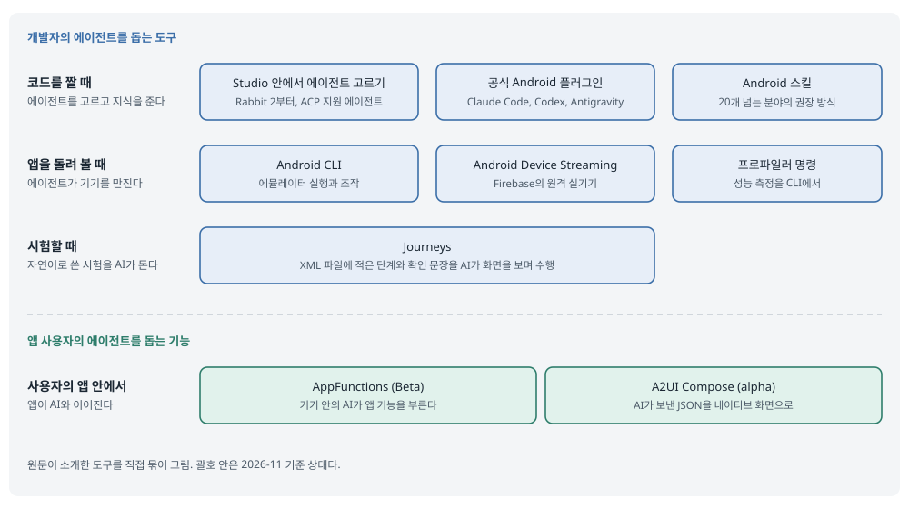

## 한 줄 요약

AI 에이전트(사람 대신 코드를 짜고, 앱을 돌리고, 결과를 확인하는 AI)가 Android 개발에 들어오면서, 기능을 얼마나 빨리 만드느냐보다 **"에이전트가 짠 코드를 어떻게 검토하고, 어떻게 시험하고, 우리가 아끼던 도구 안에서 어떻게 같이 일하느냐"** 가 새 문제가 됐다. Touchlab의 Nacho Carrión이 지난주 Android Dev Summit에서 Google이 내놓은 답을 정리했다. 개발자 쪽은 Android Studio 안에서 고르는 에이전트, Claude Code와 Codex용 공식 플러그인, 에뮬레이터를 에이전트에게 맡기는 Android CLI, 자연어 시험 Journeys다. 앱 사용자 쪽은 AppFunctions와 A2UI Compose다.

<figure class="media"><figcaption>원문 머리 그림. 원문에 "AI로 만든 그림"이라고 적혀 있고 글 내용을 설명하는 그림은 아니다. 원문 서버에서 불러옴 (<a href="https://touchlab.co/agentic-development-android">원문</a>)</figcaption></figure>

## 먼저 알아 둘 말

- **에이전트(agent), 에이전트 개발(agentic development)**
  - 질문에 답만 하는 챗봇이 아니라, **스스로 도구를 써서 일을 끝까지 하는 AI**를 말한다. 파일을 읽고, 코드를 고치고, 빌드를 돌리고, 결과를 보고 다시 고친다.
  - 에이전트 개발은 이런 AI와 나눠서 앱을 만드는 방식이다. Claude Code, OpenAI Codex, Google Antigravity가 대표적이다.
- **ACP(Agent Client Protocol)**
  - 편집기(IDE)와 코딩 에이전트가 서로 말하는 방식을 정한 공개 규약이다. 이 규약을 따르는 에이전트라면 어떤 것이든 같은 편집기에 꽂아 쓸 수 있다.
  - USB 규격과 비슷하다. 규격만 맞으면 어느 회사 기기든 꽂힌다.
- **Android CLI**
  - Google이 만든 명령줄 도구(터미널에서 글자로 명령을 내리는 프로그램)다. 에이전트가 이 도구로 프로젝트를 만들고, 에뮬레이터를 켜고, 화면 구조를 들여다보고, 시험을 돌린다.
  - 사람이 Android Studio 버튼으로 하던 일을 **에이전트가 명령으로 할 수 있게** 해 주는 다리다.
- **스킬(skill)**
  - 에이전트에게 주는 **작업 설명서 폴더**다. `SKILL.md` 파일 하나에 "언제 쓰는지"와 "어떻게 하는지"를 적고, 필요하면 스크립트와 참고 문서를 함께 넣는다.
  - 에이전트는 평소에는 이름과 설명만 알고 있다가, 관련된 일을 받으면 그때 내용을 꺼내 읽는다. 공개 표준이라 스킬을 지원하는 에이전트라면 어디서나 쓸 수 있다.
- **플러그인(plugin)**
  - 에이전트에 기능을 덧붙이는 묶음이다. Android CLI 플러그인을 Claude Code에 설치하면 위의 Android CLI를 쓰는 스킬이 함께 들어온다.
- **E2E 시험(End-to-End test)**
  - 앱을 실제로 켜고 사용자처럼 눌러 가며 처음부터 끝까지 확인하는 시험이다. Android에서는 Espresso나 UI Automator(버튼을 찾아 누르는 코드를 짜는 시험 도구)로 짜 왔다.
- **결정적(deterministic) 시험과 비결정적 시험**
  - 결정적 시험은 같은 입력이면 늘 같은 결과가 나오는 시험이다. 지금까지의 단위 시험과 Espresso 시험이 여기에 든다.
  - 비결정적 시험은 실행할 때마다 경로나 답이 조금씩 다를 수 있는 시험이다. AI가 화면을 보고 판단하는 시험이나, AI 기능 자체를 시험하는 경우가 그렇다.
- **MCP(Model Context Protocol)**
  - AI가 바깥 도구와 데이터를 부르는 방식을 정한 공개 규약이다. 원문은 AppFunctions를 "Android의 MCP"라고 부른다. 앱이 기기 안의 AI에게 "내가 이런 기능을 할 수 있다"고 알려 주기 때문이다(#750 [AppFunctions 글](750-android-appfunctions.html)에서 자세히 다뤘다).
- **A2UI(Agent to UI)**
  - AI가 "이런 화면을 보여 달라"는 내용을 **JSON(정해진 모양의 글자 데이터)** 으로 보내면, 앱이 그것을 진짜 화면 부품으로 그려 주는 공개 규약이다. AI가 코드를 보내는 것이 아니라 "정해진 부품 목록 중 무엇을 어떤 값으로" 보내는 것이다.
- **Gemini Nano, ML Kit**
  - Gemini Nano는 서버가 아니라 **폰 안에서 도는** Google의 작은 AI 모델이다. ML Kit는 Google이 기기 안 AI 기능을 앱에서 쓰게 해 주는 라이브러리 묶음이다.

## 서론 — 기능은 빨라졌는데, 새 고민이 생겼다

- **AI 덕분에 기능 하나를 만드는 시간은 크게 줄었다.**
  - 그런데 워크플로(일하는 순서와 방식)가 바뀌는 속도가 도구가 따라오는 속도보다 빨라서, 모든 것이 한꺼번에 흔들리는 느낌이 든다고 저자는 말한다.
- **Google이 이 문제를 정면으로 다뤘다.**
  - 원문이 나오기 한 주 전에 열린 [Android Dev Summit](https://developer.android.com/events/dev-summit)에서 Google은 에이전트와 함께 개발하는 시대에 맞춰 도구를 어떻게 고치고 있는지 보여 줬다. 이 글은 그 발표를 Touchlab의 경험과 함께 정리한 것이다.

## 지금의 고민

예전 고민은 "이 기능 만드는 데 얼마나 걸리나", "시험이 코드의 몇 %를 덮나", "운영 중 버그를 얼마나 빨리 고치나"였다. 저자는 에이전트 시대에는 다음 네 가지가 새로 생겼다고 꼽는다.

- **에이전트를 최대한 쓰면서도, 우리가 좋아하는 도구를 계속 쓸 수 있는가.**
  - 에이전트를 쓰려고 Android Studio를 떠나야 한다면 손해가 크다.
- **AI가 만든 코드를 어떻게 검토하고, 그 기능을 진짜 "내 것"으로 만드는가.**
  - 코드를 읽지 않고 받아들이면, 문제가 생겼을 때 고칠 사람이 없다.
- **시험을 어떻게 바꿔야 새 기능이 운영 중인 기능을 깨지 않는다고 믿을 수 있는가.**
  - 그리고 그 시험이 AI 기능처럼 답이 매번 다른 기능도 다룰 수 있어야 한다.
- **AI 에이전트에 기대어 생활하는 사용자에게 앱을 어떻게 맞추는가.**
  - 사용자가 앱을 직접 열지 않고 AI에게 "이거 해 줘"라고 시키는 일이 늘어난다.

<figure><a class="figure-scroll" href="../assets/752-agentic-map.svg"></a><figcaption>원문이 소개한 도구를 개발 단계별로 묶은 지도. 원문에는 그림이 없어 원문 내용을 바탕으로 직접 그림</figcaption></figure>

## 도구 — 에이전트 이전의 도구는 새 방식에 딱 맞지 않는다

### 에이전트를 위한 더 나은 도구

- **Android Studio 안에서 원하는 코딩 에이전트를 고를 수 있게 됐다.**
  - 무엇을: [Android Studio Rabbit 2](https://developer.android.com/blog/posts/ai-agents-android-studio-integration)부터 Claude, Codex, Antigravity, 그리고 ACP를 따르는 긴 목록의 에이전트 가운데 하나를 골라 **Studio 안에서** 쓸 수 있다.
  - 왜: 지금까지는 좋아하는 에이전트를 쓰려면 다른 IDE로 가거나, Studio 옆에 터미널을 열고 CLI로 써야 했다. 그래도 에이전트는 Studio의 기능을 쓰지 못했다.
  - 결과: 에이전트가 Studio 안에서 돌면 **Studio의 기능을 에이전트도 쓸 수 있고**, 개발자는 오래 써서 익숙한 IDE를 떠나지 않아도 된다.
- **Studio 밖에서 쓰는 사람을 위한 공식 플러그인도 나왔다.**
  - Antigravity용 [Android 플러그인](https://developer.android.com/tools/agents/android-cli/agent-plugins)이 좋아졌고, Claude Code와 Codex용 공식 플러그인도 새로 나왔다.
  - 공식 문서에 따르면 플러그인은 `android-cli` 스킬을 넣어 준다. 이 스킬로 에이전트가 프로젝트를 만들고, 가상 기기를 다루고, 실행 중인 화면의 구조를 들여다보고, Journeys를 돌리고, 공식 Android 지식 문서를 검색한다(아래 "코드로 보기"에 설치 명령을 옮겼다).

### 에이전트가 앱을 돌리고 디버깅하기

- **에이전트가 에뮬레이터에서 앱을 직접 돌려 보는 일은 한동안 많이 막혀 있었다.**
  - Android CLI가 나오면서 에이전트가 에뮬레이터를 **처음부터 끝까지 다룰 수 있게** 됐다.
- **Android Device Streaming을 CLI로 쓸 수 있게 됐다.**
  - 무엇을: [Android Device Streaming](https://developer.android.com/studio/run/android-device-streaming)은 Firebase가 운영하는 원격 실기기를 빌려 쓰는 기능이다. 이번 발표의 큰 소식 하나는, 이것을 **Android CLI만으로** 쓸 수 있다는 것이다.
  - 결과: 손에 없는 기종에서도 에이전트가 앱을 돌려 볼 수 있다.
- **프로파일링도 Android CLI에 들어갔다.**
  - [프로파일러 명령](https://developer.android.com/tools/agents/android-cli/commands/profiler)으로 에이전트가 앱의 성능을 재고, 그 결과를 보고 고칠 수 있다.
- **저자의 평가는 좋다.**
  - Google이 모바일 개발자에게 이런 도구가 중요하다는 것을 알고 계속 고치겠다는 뜻으로 읽힌다고 한다. Touchlab은 Android CLI가 나온 뒤로 계속 써 왔고 경험이 좋았다며, 에이전트 워크플로에 넣을 만하다고 권한다.

### 에이전트와 코드 품질

- **모델은 모바일 개발 지식을 쌓는 데 시간이 걸렸다.**
  - 그래서 모바일에서는 에이전트 워크플로를 받아들이기가 더 어려웠다.
- **Google은 Android CLI에 [Android 스킬](https://developer.android.com/tools/agents/android-skills)을 넣어 이 틈을 메운다.**
  - 무엇을: 요즘 Android 개발의 주요 주제를 다루는 작업 설명서다. 예를 들면 Navigation 3 붙이기, XML 화면을 Compose로 옮기기, AGP 9로 올리기, edge-to-edge(화면을 상태 바와 내비게이션 바 뒤까지 꽉 채우기) 적용하기, R8 설정 점검 등이다.
  - 왜: 스킬은 모델이 학습한 시점 이후의 최신 권장 방식과 권장 라이브러리를 에이전트에게 알려 준다.
  - 결과: 이번 발표에서 기존 스킬이 여럿 갱신됐고, **20개가 넘는 주요 분야**를 다루는 새 스킬이 더해졌다. 저자는 이것으로 에이전트가 시킨 일을 더 좋은 품질로 해낸다고 본다.
- **공식 문서로 확인한 사용법**
  - `android skills list` 로 목록을 보고, `android skills add <스킬 이름>` 으로 설치한다. 이미 있으면 같은 명령이 최신판으로 덮어쓴다. 그래서 내 입맛대로 고친 스킬은 이름을 바꿔 두라고 문서가 권한다.

## 에이전트 경험 — 앱 안에 에이전트를 들이기

예전에는 앱에 에이전트를 넣거나 바깥 에이전트와 잇는 일이 기존 라이브러리와 API로는 아주 번거로웠다. 저자는 Google의 새 API 몇 개가 이 일을 훨씬 쉽게 만든다고 본다.

### Android MCP — AppFunctions

- **[AppFunctions](https://developer.android.com/ai/appfunctions) Jetpack 라이브러리로 앱 기능을 기기 안의 AI에게 내놓을 수 있다.**
  - 무엇을: Gemini 같은 에이전트가 사용자의 부탁을 처리하려고 우리 앱의 기능을 부른다.
  - 결과: AI에 기대어 생활하는 사용자를 더 잘 도울 길이 열린다.
  - 상태: 글을 쓴 시점에 Beta다. 저자는 Google이 이 방향에 힘을 크게 싣고 있어 곧 안정판이 될 것으로 본다. 구현 방법은 #750 [AppFunctions 글](750-android-appfunctions.html)에서 정리했다.

### 에이전트를 위한 네이티브 화면 — A2UI Compose

- **[A2UI Jetpack Compose](https://developer.android.com/develop/ui/compose/agentic) 라이브러리는 공개 규약 A2UI를 Compose로 구현한다.**
  - 무엇을: AI 에이전트가 JSON을 보내면, 라이브러리가 그것을 **Compose로 만든 진짜 화면**으로 바꿔 그린다.
  - 왜: 에이전트의 답이 글 덩어리에 머물지 않고, 보기 좋고 빠른 네이티브 화면이 될 수 있다.
  - 결과: 저자는 이것을 "AI 시대에도 네이티브 사용 경험이 여전히 중요하다"는 증거로 읽는다.
- **공식 문서로 확인한 내용**
  - 핵심은 **부품 목록(catalog)** 이다. 에이전트는 아무 화면이나 지어내지 못하고, 앱이 목록에 등록한 부품과 속성만 쓸 수 있다. 문서는 이 목록을 "계약"이라고 부른다.
  - 모양이 틀린 JSON은 화면 상태에 닿기 전에 걸러지고, 부품은 오류 상태를 보이며, 오류는 에이전트에게 다시 알려 스스로 고치게 한다. 즉 AI가 엉뚱한 값을 지어내는 경우를 처음부터 다룬다.
  - Material 3 부품으로 만든 기본 목록이 함께 있다. 2026-11 기준 버전은 `1.0.0-alpha02` 이고, A2UI 규약 0.9.1을 따른다.

## 에이전트 시대의 시험 — Journeys

- **Espresso와 UI Automator는 스스로 움직이는 에이전트를 시험하기에 맞지 않는다.**
  - 이 도구들은 "이 버튼을 누르면 이 글자가 보인다"처럼 정해진 결과를 확인한다. 답이 매번 다른 AI 기능은 이런 방식으로 확인하기 어렵다. 그래서 비결정적인 새 시험 방식이 필요하다.
- **Android CLI에 들어 있는 답 하나가 [Journeys](https://developer.android.com/tools/agents/android-cli/journeys)다.**
  - 무엇을: XML 파일에 **사람 말로** 단계를 적는다. "무엇을 누르고, 화면에서 무엇을 확인하라"를 적으면 AI 에이전트가 화면을 보면서 그대로 해 보고 판정한다.
  - 왜: 버튼의 ID나 화면 구조가 아니라 "기능이 되는가"를 본다. 그래서 어떻게 구현했는지와 상관없이 **기능 자체**를 시험할 수 있다.
  - 결과: Touchlab은 이 방식이 언젠가 Espresso나 UI Automator로 짠 기존 E2E 시험을 대신할 수 있다고 본다. 다만 앱 안의 에이전트를 시험하는 데에는 아직 한계가 있어, 다른 도구도 나올 것으로 예상한다.
- **공식 문서로 확인한 조건과 한계**
  - 앱을 빌드해 돌리려면 **AGP 9.0.0 이상**이 필요하다. 처음 만들면 모듈 빌드 파일에 AGP Test Suites 설정(`testSuites { create("journeysTest") }`)이 함께 들어간다.
  - 누르기, 글 입력, 한 방향으로 밀기는 된다. **여러 손가락 동작, 길게 누르기, 두 번 누르기, 화면 회전과 접기, 앞 단계의 값을 기억하기, 개수 세기, 조건에 따라 다르게 하기**는 아직 제대로 되지 않는다.
  - 단계를 쓸 때는 "앱은 이미 켜져 있다고 보고 시작한다", "모호하지 않게 쓴다", "성공 기준을 단계 안에 적는다"를 권한다. 예를 들어 "보내기를 누른다"보다 "보내기 버튼을 눌러 메일을 보낸다. 메일이 닫히고 받은 편지함으로 돌아와야 한다"가 낫다.
  - 에이전트가 시험 중에 화면을 보고 판단하므로, 시험을 돌릴 때마다 연결한 AI 에이전트를 쓴다.

## 그 밖의 에이전트 개발 소식

- **Android Intelligence System**
  - Android 기기 전반에서 사용자가 먼저 묻기 전에 알아서 도움을 받는 새 시스템이다. 개발자는 Connected Apps Platform에 가입해 앱의 서비스를 Gemini 에이전트를 통해 사용자에게 내놓을 수 있다.
- **Gemini Nano 4로 기기 안 에이전트**
  - ML Kit의 프롬프트 API가 넓어졌다. Gemini Nano 4를 지원하고, 함수 자동 실행(모델이 고른 함수를 라이브러리가 바로 불러 줌), 대화 기록 유지, 자동 안전 장치 같은 기능이 들어갔다.
- **AppState**
  - Compose의 반응형 상태 방식을 화면 밖에서도 쓰게 해 준다. 저자는 아직 지켜보는 중이라며, Compose를 도메인 계층이나 데이터 계층까지 끌고 들어가는 데 조금 꺼려진다고 솔직히 적었다. 새로운 쓰임새는 흥미롭다고 한다(#751 [AppState 글](751-jetpack-appstate.html)에서 다뤘다).
- **Navigation 3 1.2**
  - 딥 링크 지원과 더 나은 예측형 뒤로 가기(뒤로 가기 동작을 하는 동안 이전 화면을 미리 보여 주기)가 들어갔다.
- **XR**
  - 첫 유선 XR 안경인 XREAL AURA가 발표됐고, 주요 XR 라이브러리와 도구 몇 개가 안정판이 됐다.

## 맺음말

- **Touchlab도 같은 고민을 직접 겪었다.**
  - AI를 기본으로 쓰는 모바일 개발자로 일하면서 위의 문제에 부딪혔고, Google의 새 도구로 일하는 방식이 이미 크게 나아졌다고 한다.
- **다음 글에서 하나씩 깊게 다룬다고 예고했다.**
  - 이번 글은 지도이고, 실제로 매일 어떻게 쓰는지 손으로 해 보는 예제는 이어지는 글에서 보여 줄 예정이다.

## 코드로 보기 — Aide 구조로 옮긴 스케치

원문에는 코드가 없다. 여기서는 두 가지를 옮긴다. 하나는 공식 문서의 플러그인 설치 명령이고, 하나는 A2UI의 "부품 목록이 계약"이라는 생각을 Aide의 1-b AI 카드에 옮긴 직접 쓴 스케치다.

**1. Claude Code에 Android CLI 플러그인 설치하기**

```text
/plugin marketplace add android/android-cli-plugin
/plugin install android-cli@android-cli-plugin
```

> 출처: Android 개발자 문서 [Android CLI agent plugins](https://developer.android.com/tools/agents/android-cli/agent-plugins) (코드 샘플은 Apache-2.0)

- 첫 줄은 Claude Code 세션 안에서 `android/android-cli-plugin` 저장소를 **플러그인 장터(marketplace)** 로 등록한다. 장터는 설치할 수 있는 플러그인 목록이다.
- 둘째 줄은 그 장터에서 `android-cli` 플러그인을 설치한다. 이것이 위에서 말한 `android-cli` 스킬을 넣어 준다.
- 터미널에서 하려면 같은 내용을 `claude plugin marketplace add android/android-cli-plugin` 과 `claude plugin install android-cli@android-cli-plugin` 으로 친다.

**2. AI가 고를 수 있는 카드는 Aide가 정한다 (직접 쓴 스케치)**

A2UI API를 쓴 코드가 **아니다.** A2UI가 "에이전트는 등록된 부품만 쓴다"로 안전을 지키는 생각만 가져와, Aide 결정 기록에 이미 있는 AI 함수(`propose_event`, `propose_task`, `ask_completion`)에 맞춰 짰다. 컴파일해 보지 않았다.

```kotlin
// 직접 쓴 스케치. core:model (Android 의존 없음)
// AI가 화면에 띄울 수 있는 카드는 이 목록에 있는 것뿐이다
sealed interface AideCard {
    data class ProposeEvent(val title: String, val start: Instant, val end: Instant) : AideCard
    data class ProposeTask(val title: String) : AideCard
    data class AskCompletion(val taskId: Long, val question: String) : AideCard
}

// 직접 쓴 스케치. 1-b의 AI 모듈(이름 미정)
// AI가 보낸 JSON을 카드로 바꾼다. 모르는 종류, 빠진 칸, 틀린 시각이면 null
fun parseCard(json: JsonObject): AideCard? {
    fun text(key: String) = json[key]?.jsonPrimitive?.contentOrNull?.takeIf { it.isNotBlank() }
    fun time(key: String) = text(key)?.let { runCatching { Instant.parse(it) }.getOrNull() }

    return when (text("type")) {
        "propose_event" -> {
            val title = text("title") ?: return null
            val start = time("start") ?: return null
            val end = time("end")?.takeIf { it > start } ?: return null
            AideCard.ProposeEvent(title, start, end)
        }
        "propose_task" -> text("title")?.let(AideCard::ProposeTask)
        "ask_completion" -> {
            val id = json["taskId"]?.jsonPrimitive?.longOrNull ?: return null
            AideCard.AskCompletion(id, text("question") ?: return null)
        }
        else -> null
    }
}

// 직접 쓴 스케치. feature:home
@Composable
fun AideCardView(card: AideCard, onEvent: (HomeContract.Event) -> Unit) {
    when (card) {
        is AideCard.ProposeEvent -> ProposeEventCard(card, onAccept = { onEvent(HomeContract.Event.AcceptCard(card)) })
        is AideCard.ProposeTask -> ProposeTaskCard(card, onAccept = { onEvent(HomeContract.Event.AcceptCard(card)) })
        is AideCard.AskCompletion -> AskCompletionCard(card, onAnswer = { done -> onEvent(HomeContract.Event.AnswerCompletion(card.taskId, done)) })
    }
}
```

- **`sealed interface AideCard`** 가 A2UI의 부품 목록 자리다. AI가 아무리 그럴듯한 JSON을 보내도, 이 세 종류가 아니면 화면에 나오지 않는다.
- **`parseCard` 는 의심부터 한다.** 종류(`type`)를 모르면 `null`, 제목이 비었으면 `null`, 시각이 ISO 형식이 아니거나 끝이 시작보다 앞이면 `null`이다. AI가 값을 지어내는 경우를 화면에 닿기 전에 막는다. A2UI가 모양이 틀린 JSON을 상태에 닿기 전에 거르는 것과 같은 자리다.
  - `null` 이 나왔을 때 그냥 버릴지, A2UI처럼 AI에게 "틀렸다"고 돌려줘 다시 만들게 할지는 1-b에서 정할 일이다.
- **`AideCardView` 의 `when` 에는 `else` 가 없다.** `sealed` 라서 컴파일러가 모든 종류를 다뤘는지 확인한다. 나중에 카드 종류를 하나 늘리면, 화면 쪽에서 그 카드를 그리지 않은 곳이 **컴파일 오류**로 드러난다.
- 카드를 받아들이는 일(`AcceptCard`)은 화면이 하지 않고 `HomeContract.Event` 로 ViewModel에 넘긴다. Aide 화면 규칙(`XxxContract { Event, Effect }`)을 따른 것이다.

## 배운 점

- **에이전트 시대의 도구는 "에이전트가 손댈 수 있는 범위"를 넓히는 방향으로 간다.** 코드 편집에서 시작해 에뮬레이터, 원격 실기기, 프로파일러, 시험까지 에이전트가 명령으로 다루게 됐다. 사람은 그만큼 "무엇이 맞는지"를 판단하는 쪽으로 옮겨 간다.
- **AI가 짠 코드를 "내 것"으로 만드는 고민은 도구로 다 풀리지 않는다.** 원문이 꼽은 네 고민 가운데 이 하나에는 원문도 도구를 내놓지 않았다. 검토는 여전히 사람의 일이다.
- **Journeys는 "어떻게 만들었나"가 아니라 "되는가"를 본다.** 화면 구조가 바뀌어도 시험을 고칠 일이 적다. 대신 같은 시험이 매번 같은 길로 가지는 않고, 돌릴 때마다 AI를 쓴다. 길게 누르기나 개수 세기처럼 아직 안 되는 동작도 있다.
- **AI가 화면을 만드는 기술의 안전은 "고를 수 있는 것을 정해 두는 것"에서 나온다.** A2UI는 AI에게 코드가 아니라 부품 목록을 준다. AI 기능을 설계할 때 자유를 어디까지 줄지 먼저 정해야 한다.
- **스킬은 모델의 학습 시점 문제를 메우는 장치다.** 모델이 모르는 최신 권장 방식을 그때그때 읽게 한다. 반대로 말하면, 스킬은 "최신"을 권하므로 일부러 옛 버전에 머무는 프로젝트에서는 그 사실을 따로 알려 줘야 한다.

## Aide에 적용하면

Aide는 AI 비서 앱이고, 1-a(AI 없이 캘린더, 리마인더, 할 일, 대시보드)는 대부분 **사용자가 직접 짠다.** Task 5와 6만 AI 담당이었다. 그래서 이 글의 개발 도구는 "AI에게 코드를 더 맡긴다"가 아니라 **"사용자가 짠 것을 확인하는 데 쓴다"** 쪽으로 읽었다. 「최신화는 Task 4 뒤 별도 PR」(2026-10-20), 「Room DAO 테스트는 Robolectric」(2026-10-30), 「LLM은 사용자 키로 앱에서 직접」(2026-10-08), 「시킨 일은 바로 하고 되돌릴 수 있게, 시키지 않은 일은 묻는다」(2026-10-08)와 맞춰 썼다.

1. **Task 8과 Task 10의 화면 흐름을 Journeys 문장으로 적어 두고, Task 18 실사용 점검 때 돌려 본다 — 바꿔서 가져온다. 사용자 결정이 필요하다.**
   - 먼저 분명히 할 점: spec 9절 완료 기준 6개는 대부분 **Journeys로 확인할 수 없다.** 내부 테스트 트랙 설치(1번), 재부팅 뒤에도 30, 10, 5분 전에 울리는 알림(2번), 구글 캘린더 웹과 삼성 캘린더에 보이는지(3번), CI 초록(5번), 일주일 실사용(6번)은 시간, 다른 앱, 다른 기기가 얽혀 있다. 4번(이식 캘린더가 Note-Android와 똑같이 움직인다)만 일부 걸치는데, 두 앱을 나란히 비교하는 일이라 앞 단계 값을 기억하지 못하는 Journeys에는 맞지 않는다.
   - 그래서 무엇을: 완료 기준 대신 **사용자가 매일 누르는 화면 흐름**을 단계 문장으로 적는다. 예를 들면 "첫 화면 아래 입력 막대에 '우유 사기'를 쓰고 추가를 누른다. 할 일 목록에 '우유 사기'가 보여야 한다", "입력 막대에 공백만 쓰고 추가를 누른다. 할 일 목록에 새 항목이 생기지 않아야 한다"(계획 Review Focus 5번)다. Task 10 일정 추가 화면의 저장 흐름도 같은 식으로 적을 수 있다.
   - 왜 되나: Aide는 AGP 9.2.1이라 "AGP 9.0.0 이상" 조건을 이미 채운다. 문장으로 적은 흐름은 화면 구조를 바꿔도 다시 돌릴 수 있어, 1주 실사용 중 고친 뒤에 되돌아가 확인하기 좋다.
   - 바꾸는 점: **CI에는 넣지 않는다.** CI는 ubuntu에서 `./gradlew assembleDebug test lint` 만 돌고(2026-10-15 결정) 기기가 없다. Journeys는 기기와 AI 에이전트가 필요하고 결과도 매번 같지 않다. 손으로 하던 점검을 돕는 용도로만 쓴다. 빈 글이 추가되지 않는 규칙 자체는 지금처럼 단위 시험이 지킨다.
   - 걸리는 점: Journeys 템플릿이 모듈 빌드 파일에 Test Suites 설정을 넣으므로 `app` 의 빌드 파일이 바뀐다. 이식 캘린더에 길게 누르기 동작이 있다면 그것도 아직 안 된다.
2. **최신화 PR(Kotlin 2.4, compileSdk 37)에서 Android 스킬을 쓴다 — 바꿔서 가져온다. 시점은 최신화 PR이다.**
   - 무엇을: AGP 9 올리기, Navigation 3 설정 같은 공식 스킬은 Aide가 미뤄 둔 최신화 PR의 내용과 그대로 겹친다. 그 PR을 할 때 스킬을 참고 자료로 쓴다.
   - 바꾸는 점: **지금 Task에는 쓰지 않는다.** 스킬은 최신판을 권한다. Navigation 3 최신 1.2는 compileSdk 37을 요구해, Aide는 2026-10-20 결정으로 1.1.7에 일부러 머물러 있다. 지금 스킬을 따르면 이 결정과 부딪힌다.
   - 스킬을 Aide repo의 `.skills/` 에 넣지는 않는다. Aide는 공개 repo이고, repo에 무엇을 둘지는 사용자가 정할 일이다.
3. **Android CLI 플러그인을 AI 검증 도구로 쓴다 — 바꿔서 가져온다. 사용자 결정이 필요하다.**
   - 무엇을: 사용자가 짠 화면을 AI가 확인할 때, 에뮬레이터를 켜고 실제 화면 구조를 들여다보는 데 쓴다. 2026-10-30에 Preview가 안 그려진 원인을 찾으려고 screenshot 도구를 스크래치에만 붙였던 것과 같은 자리다.
   - 바꾸는 점: Aide 코드를 AI가 고치는 데 쓰지 않는다. 플러그인 설치는 사용자 컴퓨터의 Claude Code 설정을 바꾸는 일이라 사용자가 정한다. 이 블로그를 쓰면서 플러그인을 실제로 설치해 돌려 보지는 않았다.
4. **1-b AI 카드는 A2UI 대신 "정해진 카드 목록"으로 만든다 — 바꿔서 가져온다. 시점은 1-b다.**
   - 무엇을: 위 스케치처럼 AI가 고를 수 있는 카드를 `sealed interface` 로 못 박고, AI의 JSON은 의심하며 읽는다.
   - 왜 A2UI가 아닌가: A2UI는 `1.0.0-alpha02` 다. 그리고 Aide의 AI 카드는 종류가 적고 정해져 있다(결정 기록의 AI 함수 넷). 화면을 AI가 짜 맞추는 기능은 「관습적인 todo 앱 UI를 만들지 않는다: AI가 묻고, 사용자는 답하며 완료한다」(2026-10-08)에 필요하지 않다. 카드 몇 개를 위해 규약 전체를 들이는 것보다, 생각만 가져오는 편이 싸다.
   - 다시 볼 때: 1-b에서 카드 종류가 많아지거나, AI가 표나 목록처럼 모양이 자유로운 답을 보여 줘야 할 때다.
5. **AppFunctions — 바꿀 것 없음.** #750 [AppFunctions 글](750-android-appfunctions.html)의 적용안 그대로다. compileSdk 37이 필요해 최신화 PR 뒤에 다시 본다.
6. **Gemini Nano 4 (ML Kit 프롬프트 API) — 지금은 안 한다.**
   - 2026-10-08 결정은 Gemini Nano를 "지원 기기가 적어 단독으로는 기각, 나중에 보조로 추가할 수 있다"로 남겼다. 이번에 함수 자동 실행과 대화 기록이 들어가 보조 경로로서 쓸모가 커졌다.
   - 1-a에는 AI가 없으므로 1-b spec을 쓸 때 "키가 없을 때의 보조 경로" 후보로 다시 본다. 어느 기기에서 도는지는 확인하지 않았다.
7. **Navigation 3 1.2, AppState — 지금은 안 한다.** Navigation 3 1.2는 최신화 PR의 일이다(2026-10-20 결정). AppState는 #751 [AppState 글](751-jetpack-appstate.html)에서 정한 대로 alpha라 넣지 않는다. 원문 저자도 Compose를 데이터 계층까지 끌고 가는 데 꺼려진다고 적었는데, Aide가 넣지 않기로 한 이유 하나와 같다.

## 출처

- 원문: [Agentic Development on Android](https://touchlab.co/agentic-development-android) — Nacho Carrión (Touchlab), 2026-11-04, Android Weekly [#752](https://androidweekly.net/issues/issue-752)
- 확인한 공식 문서: [Android CLI agent plugins](https://developer.android.com/tools/agents/android-cli/agent-plugins), [Android skills](https://developer.android.com/tools/agents/android-skills), [Journeys (Android CLI)](https://developer.android.com/tools/agents/android-cli/journeys), [Journeys for Android Studio](https://developer.android.com/studio/gemini/journeys), [Compose A2UI](https://developer.android.com/develop/ui/compose/agentic), [A2UI 릴리스 노트](https://developer.android.com/jetpack/androidx/releases/a2ui). Android 개발자 문서의 코드 샘플은 Apache-2.0이다
- 원문 블로그는 "All Rights Reserved"라 머리 그림은 원문 서버 주소를 걸었다. 도구 지도는 원문 내용을 바탕으로 직접 그렸다
- 이어 읽기: [#750 Android AppFunctions](750-android-appfunctions.html), [#751 Jetpack AppState](751-jetpack-appstate.html), [#749 AI 에이전트는 계획부터 보여줘야 한다](749-ai-plan-first.html)
