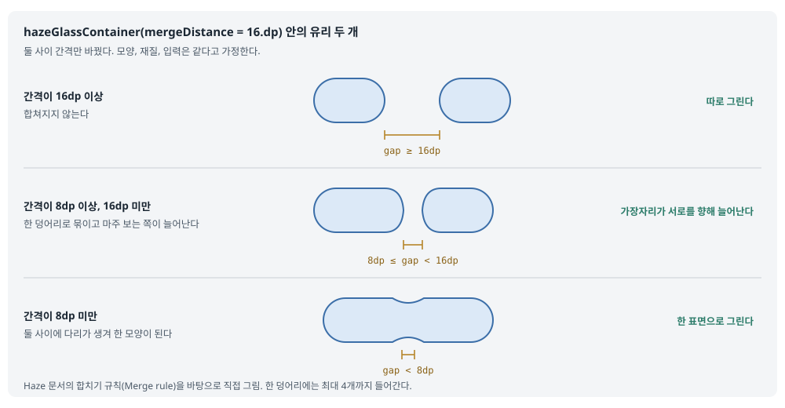
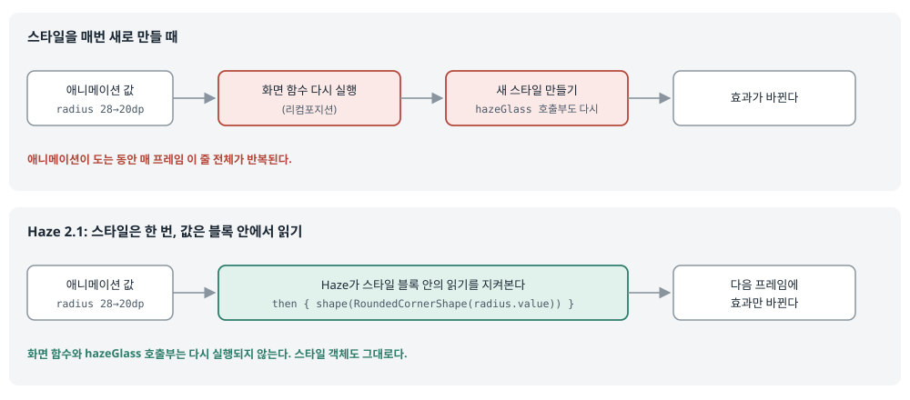

## 한 줄 요약

Compose에 배경 흐림(블러)과 유리 효과를 입혀 주는 라이브러리 **Haze**가 2.1을 냈다. 가장 큰 변화는 두 가지다. 첫째, 유리 표면들이 **서로 가까워지면 하나로 합쳐지고, 멀어지면 다시 갈라지는** 컨테이너(`hazeGlassContainer`)가 생겼다. iOS의 Liquid Glass가 버튼들을 한 덩어리로 녹여 붙이는 것과 같은 모습을 Compose에서도 만들 수 있게 된 것이다. 둘째, 2.0에서 실험 단계였던 **Glass가 정식판(stable)** 이 되어 더는 실험 API 동의 표시(opt-in)가 필요 없다. 이 밖에 스타일이 **애니메이션 값을 직접 읽어** 다시 만들지 않고도 매 프레임 바뀌게 됐고, Pixel 8a에서 GPU 메모리 사용량이 Glass는 약 7%, Blur Quality는 9% 이상 줄었다.

> 원문은 저자 Chris Banes의 개인 블로그에 실렸고 글 자체에는 공개 라이선스 표시가 없다. 그래서 원문의 표지 그림과 영상은 **이 블로그에 복사하지 않고 원문 서버 주소를 걸어** 보여 준다. 원문 쪽에서 파일을 지우면 이 글에서도 보이지 않으므로, 무엇이 보이는지 글로도 적었다. 원문의 코드 세 조각은 Haze 저장소의 공식 문서(`docs/`)에 거의 같은 모양으로 들어 있고, 그 저장소는 **Apache-2.0** 라이선스라서 문서 쪽 코드를 인용하고 출처를 붙였다(2.1.0 태그 커밋 `ca21ff2`). 합치기 규칙과 스타일 동작은 원문에 그림이 없어서, 이해를 돕도록 **Haze 문서를 바탕으로 한국어 그림을 새로 그렸다.**

<figure class="media"><figcaption>원문 표지 그림, 원문 서버에서 불러옴 (<a href="https://chrisbanes.me/posts/haze-2.1.0/">원문</a>)</figcaption></figure>

## 먼저 알아 둘 말

- **Haze**
  - Chris Banes가 만든 Compose 라이브러리다. 화면 일부분의 **뒤에 있는 내용을 흐리게** 보여 주는 효과(블러)와, 그보다 한 단계 나아간 **유리 효과(Glass)** 를 붙여 준다.
  - Jetpack Compose(Android)와 Compose Multiplatform(Android, iOS, 데스크톱, 웹)에서 모두 돈다. #749 Heron 글에서 "머리글 블러가 Android에서만도 왜 어려운지"를 설명한 글의 저자가 바로 이 사람이다.
- **Blur와 Glass**
  - **Blur**는 뒤 내용을 흐리게만 한다. 반투명 머리글 같은 곳에 쓴다.
  - **Glass**는 흐림에 더해 **굴절**(유리 너머 내용이 휘어 보임), **틴트**(유리에 옅은 색을 입힘), **가장자리 반사**, **하이라이트**(빛이 맺히는 부분)까지 그려서 실제 유리 조각처럼 보이게 한다. iOS 26의 Liquid Glass와 비슷한 모습이다.
- **`hazeSource` 와 `hazeState`**
  - Haze는 "무엇을 흐릴지"를 미리 알아야 한다. 흐릴 대상이 되는 내용(예: 사진, 목록)에 `Modifier.hazeSource(hazeState)` 를 붙여 등록한다.
  - `hazeState` 는 그 등록 정보를 들고 있는 상태 객체다. 효과 쪽에서 같은 `hazeState` 를 넘기면 "저 내용을 흐려서 내 뒤에 깔아 달라"는 뜻이 된다.
- **`hazeGlass` 와 `HazeInput.Sources`**
  - `Modifier.hazeGlass(...)` 는 그 자리에 유리 표면을 그리는 수정자(modifier, Compose에서 부품에 꾸밈이나 동작을 덧붙이는 함수)다.
  - `HazeInput.Sources(hazeState)` 는 "유리 뒤에 비칠 내용은 이 `hazeState` 에 등록된 것들"이라고 알려 주는 입력 값이다.
- **`hazeGlassContainer` 와 `mergeDistance`**
  - 2.1에서 새로 생긴 수정자다. 부모 부품에 붙이면 그 안의 유리 표면들을 **한꺼번에 조율해서**, 가까운 것끼리 한 모양으로 합쳐 그린다.
  - `mergeDistance` 는 "이 간격보다 가까우면 합친다"는 기준 거리다. 기본값은 16dp다.
- **안정판(stable)과 opt-in**
  - Kotlin 라이브러리는 아직 바뀔 수 있는 API에 `@ExperimentalHazeApi` 같은 표시를 붙인다. 그 API를 쓰려면 코드에 `@OptIn(...)` 을 적어 "바뀔 수 있음을 알고 쓴다"고 동의해야 한다. 이것이 opt-in이다.
  - 정식판이 되면 이 표시가 사라지고, 이후 판에서 API가 함부로 바뀌지 않는다는 약속이 생긴다.
- **리컴포지션(recomposition)**
  - Compose가 상태 변화에 맞춰 화면 함수(`@Composable` 함수)를 **다시 실행**하는 일이다. 애니메이션처럼 매 프레임 바뀌는 값을 화면 함수 안에서 읽으면 매 프레임 리컴포지션이 일어나 비용이 커진다.
  - Compose는 화면을 "구성(composition) → 배치(layout) → 그리기(draw)" 세 단계로 만든다. 값을 **그리기 단계에서만 읽으면** 앞의 두 단계를 건너뛰고 다시 그리기만 한다.
- **스냅샷 상태(snapshot state)**
  - `mutableStateOf`, `animateDpAsState` 처럼 Compose가 "누가 이 값을 읽었는지" 지켜보는 상태다. 값이 바뀌면 읽은 쪽만 다시 돈다. Haze 2.1의 스타일 블록이 이 원리를 쓴다.
- **GPU 메모리**
  - 그래픽 칩이 화면을 그리려고 쓰는 메모리다. 블러와 유리는 뒤 내용을 따로 한 번 더 그려 두고 가공하기 때문에 이 메모리를 많이 쓴다.
- **폴백(fallback, 안 되면 대신 쓰는 예비 그리기)**
  - 기기가 고급 그리기 기능을 지원하지 않을 때 Haze가 대신 쓰는 간단한 그리기 방식이다. 유리는 Android 13(API 33)의 `RuntimeShader`(GPU에서 도는 작은 그리기 프로그램)가 있어야 제대로 그려지고, 없으면 폴백으로 그린다.
- **투명도 줄이기(reduced transparency)**
  - 반투명한 화면이 읽기 힘든 사용자를 위한 접근성 설정이다. iOS에는 시스템 설정이 있고, Haze는 앱이 이 값을 넘겨주면 유리를 더 불투명하게 그린다.

## 서론 — Glass가 정식판이 되고, 서로 합쳐진다

- **Haze 2.1이 나왔고, Glass는 이제 안정판이다.**
  - Haze는 Jetpack Compose와 Compose Multiplatform에 배경 블러와 유리 효과를 가져다주는 라이브러리다.
  - 2.0에서 처음 선보인 Glass는 실험 단계였는데, 2.1에서 정식판이 됐다.
- **이번 판의 새 기능은 유리 표면끼리 합쳐지고 갈라지는 것이다.**
  - 지금까지는 유리 조각 하나하나가 따로 그려졌다. 이제는 가까이 있는 조각들이 하나의 모양으로 녹아 붙고, 떨어지면 다시 둘로 갈라진다.

## 서로 합쳐지는 유리

- **원문 영상은 그림판 도구 막대가 자라고, 갈라지고, 다시 붙는 모습을 보여 준다.**
  - 붓(Brush) 버튼을 누르면 기존 유리 막대에서 **선 굵기 조절**과 **색 조절** 버튼이 자라 나온다.
  - 색 조절 버튼을 끌어 멀리 떼면 막대에서 갈라져 나갔다가, 놓으면 다시 막대로 돌아와 붙는다.
  - 그림판을 닫으면 자라 나왔던 버튼들이 막대 속으로 다시 빨려 들어간다.

<figure class="media"><video src="https://chrisbanes.me/posts/haze-2.1.0/glass-container.mp4" controls playsinline preload="metadata"></video><figcaption>붓 버튼을 누르자 선 굵기와 색 버튼이 유리 막대에서 자라 나오고, 색 버튼을 떼었다 놓자 다시 붙는 모습. 원문 영상(약 190KB), 원문 서버에서 불러옴 (<a href="https://chrisbanes.me/posts/haze-2.1.0/#glass-that-joins-together">원문</a>)</figcaption></figure>

- **원문에는 직접 만져 볼 수 있는 데모도 있다.**
  - 원문은 Haze 샘플 앱의 웹(Wasm) 판을 글 안에 넣어 두었다. 붓 버튼을 눌러 버튼을 꺼내고, 색 버튼을 끌어 떼었다가 놓아 보면 된다.
  - 이 블로그에는 넣지 않았다. [인터랙티브 데모를 새 창에서 열기](https://chrisbanes.github.io/haze/2.1.0/sample/wasm/index.html?embed=true&sample=glass-container-showcase&effect=glass&theme=light)
- **이 모든 것을 새 수정자 `hazeGlassContainer` 하나가 맡는다.**
  - 부모 부품에 `hazeGlassContainer` 를 붙이고, 자식들에는 평소처럼 `hazeGlass` 를 붙이면 된다. 자식 쪽 코드는 바꿀 필요가 없다.

```kotlin
// Styles compare by identity, so remember the style.
val style = remember { GlassStyle.regular.then { shape(CircleShape) } }

Row(
  modifier = Modifier.hazeGlassContainer(mergeDistance = 16.dp),
  horizontalArrangement = Arrangement.spacedBy(4.dp),
) {
  repeat(3) {
    Box(
      Modifier
        .size(48.dp)
        .hazeGlass(input = HazeInput.Sources(hazeState), style = style),
    )
  }
}
```

> 출처: [`docs/effects/glass/containers.md`](https://github.com/chrisbanes/haze/blob/ca21ff2060e52e1882afdb94f9b055f7fc834bd9/docs/effects/glass/containers.md#container-and-members) (chrisbanes/haze 2.1.0, Apache-2.0). 원문 글의 코드는 이 예제에서 `style` 과 간격 설정을 뺀 짧은 판이다.

- **첫 줄 `val style = remember { ... }`**
  - 동그란(`CircleShape`) 기본 유리(`GlassStyle.regular`) 스타일을 **한 번만** 만들어 기억해 둔다.
  - 주석이 말하듯 2.1부터 스타일은 **같은 객체인지**로 비교한다. 화면 함수가 다시 돌 때마다 새 스타일을 만들면 Haze는 "스타일이 바뀌었다"고 보고 모든 유리를 새로 그린다. 그래서 `remember` 로 붙잡아 둔다.
- **`Row(modifier = Modifier.hazeGlassContainer(mergeDistance = 16.dp), ...)`**
  - 가로 줄 부품 `Row` 를 컨테이너로 만든다. 그 안에 있는 유리끼리 16dp보다 가까우면 합쳐진다.
  - `horizontalArrangement = Arrangement.spacedBy(4.dp)` 는 자식들을 4dp 간격으로 늘어놓는다. 4dp는 16dp보다 작으므로 세 원은 합쳐져 하나의 모양이 된다.
  - 주의할 점이 있다. `mergeDistance` 는 **합칠지 말지와 합쳐지는 모양**만 정한다. 자식들을 띄우는 간격은 정하지 않는다. 간격은 평소처럼 `Arrangement` 나 `padding` 으로 정한다.
- **`repeat(3) { Box(Modifier.size(48.dp).hazeGlass(...)) }`**
  - 48dp짜리 상자 세 개를 만들고 각각에 유리를 입힌다.
  - `input = HazeInput.Sources(hazeState)` 는 "유리 뒤에 비칠 내용은 `hazeSource(hazeState)` 로 등록해 둔 내용"이라는 뜻이다.
- **Haze가 알아서 하는 일은 세 가지다.**
  - 기준 거리 안에 들어온 표면들은 **하나의 모양으로 합쳐진다.**
  - 새로 나타난 표면은 이웃에게서 **자라 나온다.**
  - 사라지는 표면은 이웃 속으로 **빨려 들어간다.** 이 애니메이션은 Haze가 직접 그려 준다.
- **어떤 표면끼리 합쳐질 수 있는지는 공식 컨테이너 안내서에 규칙이 있다.**
  - 원문은 "묶기(grouping), 전환 애니메이션, 합쳐질 수 있는 조건은 컨테이너 안내서에 있다"고만 말한다. 아래는 그 안내서에서 꼭 알아야 할 부분을 내가 정리한 것이다.

<figure><a class="figure-scroll" href="../assets/752-haze-merge.svg"></a><figcaption>간격에 따라 달라지는 유리 두 개의 모습. Haze 문서의 <a href="https://chrisbanes.github.io/haze/2.1.0/effects/glass/containers/#merge-rule">합치기 규칙</a>을 바탕으로 직접 그림</figcaption></figure>

- **간격에 따라 세 단계로 보인다.** (안내서의 "Merge rule")
  - 간격이 `mergeDistance` 이상이면 서로 따로 그린다.
  - 간격이 `mergeDistance` 보다 작아지면 한 덩어리(클러스터)로 묶인다. 간격이 기준 거리에서 그 절반까지 줄어드는 동안, 마주 보는 가장자리가 서로를 향해 **조금씩 늘어난다.** 굴절과 빛도 "혼자일 때"에서 "합쳐졌을 때" 모습으로 부드럽게 바뀐다.
  - 간격이 절반보다 작아지면 둘 사이에 **다리**가 생겨 한 모양이 된다.
  - `mergeDistance` 를 0으로 주면 가까워져도 합치지 않는다.
- **합쳐지려면 몇 가지 조건을 모두 지켜야 한다.**
  - **입력과 그리기 옵션이 같아야 한다.** 같은 `hazeState` 를 써야 하고, 성능 모드도 같아야 한다.
  - **재질이 같아야 한다.** 굴절, 하이라이트, 가장자리, 투명도(`alpha`) 같은 값이 같아야 한다. 그래서 Regular 유리와 Clear 유리는 절대 합쳐지지 않는다. 대신 모양, 틴트 색, 배경색, 누를 때 반응은 달라도 되고, 색은 다리 위에서 섞여 보인다.
  - **회전이나 크기 변경이 없어야 한다.** `graphicsLayer` 로 돌리거나 키운 표면은 따로 그려진다. 위치 이동이나 `AnimatedVisibility` 의 서서히 나타나기는 괜찮다.
  - **화면 구조상 순서가 이웃해야 한다.** `Row` 나 `Column` 에서는 코드에 적은 순서다. 조건이 맞지 않는 표면이 사이에 끼면, 멀리 떨어져 있어도 양쪽을 갈라 놓는다. 그리는 순서를 바꾸지 않기 위해서다.
  - **한 덩어리에는 최대 네 개까지만 들어간다.** 다섯 번째부터는 다리 없이 따로 그린다. 모양 정보를 GPU 프로그램에 고정된 크기의 배열로 넘기기 때문이다.
- **멀리 떨어진 표면을 일부러 하나로 묶을 수도 있다.**
  - 같은 `groupKey` 를 준 표면들은 거리와 상관없이 그 둘을 감싸는 한 모양(예: 양 끝의 원 두 개가 하나의 긴 알약 모양)으로 그려진다. iOS SwiftUI의 `glassEffectUnion` 과 같은 기능이다.
- **스크롤되는 목록 안에 쓸 때는 따로 챙길 것이 있다.**
  - 목록의 스크롤 상태를 `hazeGlassContainer(scrollState = listState)` 로 넘겨야, 스크롤 중에 들어오고 나가는 항목이 자라고 빨려 들어가는 애니메이션을 하지 않는다. 넘기지 않으면 스크롤로 빠져나간 항목의 유리가 잠깐 유령처럼 남는다.
  - 컨테이너가 유리를 직접 그리기 때문에, 목록 영역 밖으로 유리가 새지 않게 `clipToBounds()` 를 컨테이너 **앞에** 붙여야 한다.

## Glass가 안정판이 되다

- **2.0 발표 때 한 약속을 지켰다.**
  - 저자는 [Haze 2.0 발표 글](https://chrisbanes.me/posts/haze-2.0.0/)에서 "2.1에서 Glass를 안정판으로 만드는 것이 목표"라고 했다.
  - 이제 `haze-glass` 와 `haze-glass-material3` 두 라이브러리는 `ExperimentalHazeApi` 동의 표시 없이 쓸 수 있다.
- **처음 고를 기본 스타일은 여전히 Regular와 Clear 두 가지다.**
  - **Regular**는 뒤 배경을 더 많이 흐린다. 글자가 많이 올라가는 표면에 맞다. 뒤 내용이 글자를 방해하지 않기 때문이다.
  - **Clear**는 뒤 내용을 더 많이 보여 준다. 사진이나 영상 위에 놓는 버튼처럼, 뒤가 잘 보여야 하는 곳에 맞다.
  - 둘 다 모양 바꾸기, 틴트, 조명, 누를 때의 반응을 지원한다.
- **아직 실험 단계로 남은 것도 있다.**
  - Android 기본 창 배경(backdrop)을 쓰는 그리기 방식과, 이번에 새로 생긴 **입력 공유(input sharing)** 기능은 여전히 따로 동의 표시가 필요하다. 입력 공유는 아래 "데모 밖의 다듬기"에서 설명한다.

## 상태에 반응하는 스타일

- **Blur와 Glass 스타일이 이제 애니메이션 값을 직접 읽을 수 있다.**
  - 스타일을 한 번만 만들어 기억해 두고, 그 안의 값이 애니메이션을 따라 바뀌게 할 수 있다.

```kotlin
val radius = animateDpAsState(if (expanded) 20.dp else 28.dp)
val style = remember {
  GlassStyle.regular.then { shape(RoundedCornerShape(radius.value)) }
}
```

> 출처: [`docs/effects/glass/index.md`](https://github.com/chrisbanes/haze/blob/ca21ff2060e52e1882afdb94f9b055f7fc834bd9/docs/effects/glass/index.md) (chrisbanes/haze 2.1.0, Apache-2.0). 원문 글은 여기에 아래처럼 `hazeGlass` 에 스타일을 넘기는 부분을 덧붙였다.

```kotlin
Modifier.hazeGlass(
    input = HazeInput.Sources(hazeState),
    style = style,
)
```

- **첫 줄 `val radius = animateDpAsState(if (expanded) 20.dp else 28.dp)`**
  - 펼쳐졌으면(`expanded`) 모서리 둥글기를 20dp로, 접혀 있으면 28dp로 **부드럽게 움직이는** 값을 만든다.
  - 여기서 `by` 를 쓰지 않고 `=` 로 받았다는 점이 중요하다. `radius` 는 값이 아니라 **값을 담은 상자**(`State<Dp>`)다. 이 줄에서는 아직 값을 읽지 않는다.
- **`remember { GlassStyle.regular.then { shape(RoundedCornerShape(radius.value)) } }`**
  - 기본 Regular 스타일에 "모양은 `radius` 만큼 둥근 사각형"이라는 설정을 덧붙인 스타일을 **한 번만** 만든다.
  - `radius.value` 는 `then { }` 블록 **안에서** 읽는다. 이 블록은 스타일을 만들 때가 아니라 **Haze가 유리를 그리려고 스타일을 풀어 볼 때마다** 실행된다.
- **`Modifier.hazeGlass(input = ..., style = style)`**
  - 그 스타일을 유리 표면에 넘긴다. 이 호출은 한 번 실행되고 나면 애니메이션 중에도 다시 실행되지 않는다.
- **무엇이 좋아졌나: 화면 함수가 다시 돌지 않는다.**
  - 애니메이션 값을 읽는 곳이 스타일 블록 안이므로, Haze가 그 읽기를 지켜보다가 값이 바뀌면 **다음 프레임에 효과만** 새로 그린다.
  - 스타일을 다시 만들 필요도 없고, `hazeGlass` 를 부르는 화면 함수를 다시 실행(리컴포지션)할 필요도 없다.
  - 블록 안에는 다른 일을 일으키는 코드(부수 효과)를 넣지 말라고 문서는 당부한다. 블록이 매 프레임 여러 번 돌 수 있기 때문이다.

<figure><a class="figure-scroll" href="../assets/752-haze-style.svg"></a><figcaption>애니메이션 값을 어디서 읽느냐에 따른 차이. Haze 문서와 <a href="https://github.com/chrisbanes/haze/blob/ca21ff2060e52e1882afdb94f9b055f7fc834bd9/docs/adr/0011-evaluate-glass-styles-under-state-observation.md">결정 기록 0011</a>을 바탕으로 직접 그림</figcaption></figure>

- **Blur 스타일(`HazeBlurStyle`)도 같은 방식으로 움직일 수 있다.**
  - 블러 세기(반지름)를 애니메이션으로 바꾸는 것도 된다. Blur 쪽 지원은 기여자 [Mohammad Jaber](https://github.com/moyaver)가 만들었다고 저자가 감사를 전한다.

## 데모 밖의 다듬기

영상에 보이지 않는 개선도 많다. 원문은 짧게 나열했지만 하나씩 풀어 쓴다.

- **투명도 줄이기 설정을 더 잘 따른다.**
  - 앱이 "투명도 줄이기" 값을 넘겨주면, 제대로 그릴 수 있는 기기에서는 **더 강한 블러**로 뒤 내용을 가린다.
  - 폴백으로 그리는 기기에서는 **불투명한 바탕**을 먼저 깔고 그 위에 배경색과 틴트를 올린다. 이 바탕색은 앱이 정할 수 있다(`reducedTransparencyFallbackColor`).
- **Blur의 버그를 여럿 고쳤다.**
  - Android API 31(Android 12)에서 스크롤할 때 블러 뒤 내용이 **늦게 갱신되어 옛 화면이 보이던** 문제를 고쳤다.
  - 마스크(효과를 일부 영역에만 적용하는 틀), 점진적 투명도(progressive opacity, 위에서 아래로 갈수록 흐림이 옅어지는 효과), 틴트, 색 필터가 잘못 그려지던 문제도 고쳤다.
- **여러 `ComposeView` 가 나란히 있을 때도 맞는 내용을 흐린다.**
  - 한 창 안에 기존 View 화면과 Compose 화면이 섞여 있어 `ComposeView` 가 여러 개일 때, 이전에는 엉뚱한 쪽 내용을 흐릴 수 있었다. 이제 올바른 원본 내용을 가져온다.
- **같은 그리기를 덜 반복하고, 이미 그려 둔 결과를 더 많이 다시 쓴다.**
  - 저자가 Pixel 8a에서 Android 샘플 화면들을 재 보니, Glass는 2.0.1보다 **최대 GPU 메모리를 약 7% 덜** 썼다.
  - Blur의 Quality 모드는 GPU 메모리를 기록한 경우에 **최소 9% 덜** 썼다.
  - 어떻게 쟀고 어디까지 믿을 수 있는지는 [벤치마크 갱신 PR #1725](https://github.com/chrisbanes/haze/pull/1725)에 적혀 있다(2026-11-01 반영).
- **실험 기능 "입력 공유"는 같은 내용을 여러 번 그리는 일을 줄인다.**
  - 한 화면에 같은 원본 위로 효과가 여러 개 있으면, 효과마다 원본을 따로 한 번씩 다시 그린다. 입력 공유를 켜면 원본을 한 번만 그려 함께 쓴다.
  - 저자 팀의 Android "중첩 피드" 벤치마크에서는 피드를 한 프레임에 **일곱 번 다시 그리던 것이 한 번으로** 줄었다.
  - 대가가 있다. GPU 메모리를 더 쓰고, 원본 영역(과 따로 설정한 여유 폭) 바깥은 잘린다. 그래서 **기본값은 꺼짐**이다. 자세한 수치는 [입력 공유 측정 결과](https://chrisbanes.github.io/haze/2.1.0/benchmark-results/#input-sharing)에 있다.
- **컨테이너는 공짜가 아니다.**
  - 합쳐진 표면은 멤버들과 **그 사이 빈 공간까지** 덮는다. 그만큼 그릴 면적이 넓다.
  - 스크롤되는 촘촘한 목록에 컨테이너를 쓰면, 따로 그릴 때보다 **훨씬 비쌀 수 있다.** 안내서에 따르면 Pixel 8a에서 한 화면에 40~45개가 보이는 5열 격자를 컨테이너로 감쌌더니, CPU 프레임 시간 상위 10%(P90)가 25.3ms에서 32.6ms로 약 7ms 늘었고 최대 GPU 메모리는 약 13% 늘었다. 두 경우 모두 60Hz(한 프레임 약 16.7ms)를 맞추지 못했다. 일부러 아주 촘촘하게 만든 장면이라 예산으로 삼을 수치는 아니다.
  - 저자의 권고는 이렇다. **디자인이 합치기를 요구하는 곳에만 쓰고, 자기 화면에서 직접 재 보라.** [성능 안내서](https://chrisbanes.github.io/haze/2.1.0/performance/)에 장단점과 측정 링크가 있다.

## Haze 2.1 써 보기

- **핵심 라이브러리와 Glass 라이브러리는 같은 버전을 쓴다.**

```kotlin
implementation("dev.chrisbanes.haze:haze:2.1.0")
implementation("dev.chrisbanes.haze:haze-glass:2.1.0")
```

> 출처: 원문 글. Haze [`docs/effects/glass/index.md`](https://github.com/chrisbanes/haze/blob/ca21ff2060e52e1882afdb94f9b055f7fc834bd9/docs/effects/glass/index.md#download)의 설치 안내(Apache-2.0)와 같은 두 줄이고, 버전 자리에 `2.1.0` 을 넣은 것이다.

- `haze` 는 블러와 공통 기반이고, `haze-glass` 는 유리 효과다. 둘의 버전이 다르면 내부 API가 맞지 않을 수 있어 같은 번호를 쓰라고 한다.
- Material 3 테마 색을 유리 바탕색으로 쓰고 싶으면 `haze-glass-material3` 를 더한다.
- **2.0.x에서 실험판 Glass를 썼다면 다시 컴파일해야 한다.**
  - 안정판이 되기 전에 이름이 바뀐 API가 몇 개 있다. 예를 들어 `GlassDefaults.positionAnimationSpec` 은 `GlassDefaults.interactionPositionAnimationSpec` 이 됐고, `GlassDefaults.optics` 는 없어지고 `GlassOptics.regular` 를 쓴다.
  - 전체 목록은 [2.1.0 릴리스 노트](https://github.com/chrisbanes/haze/releases/tag/2.1.0)(실제 내용은 `CHANGELOG.md` 에 있다)에 있다.
- **릴리스 노트에 적힌, 원문에는 없는 중요한 변화도 있다.**
  - 이번 판은 **Kotlin 2.4.21과 Compose Multiplatform 1.12.2**로 올라갔다. Android 쪽은 Jetpack Compose 1.12.1을 쓴다. 쓰는 앱도 이 버전 근처여야 한다는 뜻이다(아래 "Aide에 적용하면" 1번).
  - `HazeBlurStyle { }` 도 이제 같은 객체인지로 비교하므로 `remember` 하거나 바깥으로 꺼내 두어야 한다.
- **저자의 추천 순서: Glass 안내서부터 읽고, 서로 관련된 작은 버튼 묶음 하나에 컨테이너를 씌워 본다.**
  - [Glass 안내서](https://chrisbanes.github.io/haze/2.1.0/effects/glass/)

## 코드로 보기 — Aide 구조로 옮긴 스케치

Aide에 Haze를 지금 넣지는 않는다(아래 1번). 대신 이 글에서 가장 쓸모 있는 생각, **"스타일은 한 번 만들고, 움직이는 값은 그리기 단계에서 읽는다"** 는 Haze 없이도 Compose 기본 기능으로 똑같이 할 수 있다. 아래는 Task 8 첫 화면의 질문 카드가 펼쳐질 때 모서리가 바뀌는 상황을 가정한 **직접 쓴 스케치**다. 이름과 값은 예시이고, 실제 코드는 사용자가 쓴다. 컴파일해 보지 않았다.

```kotlin
// 직접 쓴 스케치 — 모서리 값을 구성 단계에서 읽는 판(매 프레임 리컴포지션)
@Composable
fun QuestionCardEager(expanded: Boolean, content: @Composable () -> Unit) {
    val radius by animateDpAsState(if (expanded) 20.dp else 28.dp, label = "cardRadius")
    Box(
        Modifier
            .clip(RoundedCornerShape(radius))          // 여기서 radius 를 읽는다 → 값이 바뀔 때마다 이 함수가 다시 돈다
            .background(MaterialTheme.colorScheme.surfaceContainer),
    ) { content() }
}

// 직접 쓴 스케치 — 모서리 값을 그리기 단계에서 읽는 판(Haze 2.1 스타일 블록과 같은 생각)
@Composable
fun QuestionCard(expanded: Boolean, content: @Composable () -> Unit) {
    val radius = animateDpAsState(if (expanded) 20.dp else 28.dp, label = "cardRadius")
    Box(
        Modifier
            .graphicsLayer {
                shape = RoundedCornerShape(radius.value) // 읽기가 이 블록 안 → 그리기만 다시 한다
                clip = true
            }
            .background(MaterialTheme.colorScheme.surfaceContainer),
    ) { content() }
}
```

- **두 함수는 화면에 똑같이 보인다. 다른 것은 `radius` 를 읽는 자리뿐이다.**
  - 위 판은 `val radius by ...` 로 받고 `clip(RoundedCornerShape(radius))` 에서 바로 읽는다. 이 읽기는 **구성 단계**에서 일어나므로, 애니메이션이 도는 약 0.3초 동안 매 프레임 `QuestionCardEager` 가 다시 실행되고 `content()` 도 다시 살펴봐야 한다.
  - 아래 판은 `=` 로 상자째 받고, `graphicsLayer { }` 람다 **안에서** `radius.value` 를 읽는다. 이 람다는 그리기 단계에서 돌기 때문에 Compose는 **그리기만** 다시 한다. Haze가 `then { }` 블록에서 값을 읽게 한 것과 같은 원리다.
- **`graphicsLayer { shape = ...; clip = true }`**
  - 이 부품을 자기만의 그리기 층(layer)에 올리고, 그 층의 모양을 둥근 사각형으로 잘라 낸다. 뒤에 붙은 `background` 는 이 층 안에서 그려지므로 함께 잘린다.
- **이 차이가 실제로 문제가 되는지는 재 봐야 안다.**
  - 카드 한 장이면 차이가 거의 없다. 카드 안에 아바타나 긴 목록처럼 무거운 내용이 있을 때 차이가 커진다. #750 리컴포지션 측정 글의 방법으로 다시 그려지는 횟수를 세어 보고 고른다.

## 배운 점

- **"합쳐지는 유리"는 모양 문제이기 전에 순서와 규칙의 문제다.**
  - 그리는 순서를 바꾸지 않으려고 "이웃한 것끼리만 합친다", GPU에 넘길 배열 크기 때문에 "최대 네 개"처럼, 보기 좋은 효과 뒤에 분명한 제약이 있다. 라이브러리가 이 규칙을 문서로 다 적어 둔 덕분에 쓰는 쪽이 예측할 수 있다.
- **움직이는 값은 늦게 읽을수록 싸다.**
  - Haze 2.1의 스타일 블록은 "값을 구성 단계가 아니라 그리기 단계에서 읽는다"는 Compose의 오래된 원칙을 라이브러리 API로 만든 것이다. 같은 원칙을 `graphicsLayer { }`, `offset { }`, `drawBehind { }` 같은 람다 수정자로 어디서나 쓸 수 있다.
- **같은 객체인지로 비교하는 API는 `remember` 를 강제한다.**
  - 2.1에서 스타일 비교가 "값이 같은가"에서 "같은 객체인가"로 바뀌었다. 블록 안의 람다는 값으로 비교할 수 없기 때문이다. 대신 `remember` 를 빼먹으면 매번 새 스타일로 보고 다시 그린다. 이런 API를 만들 때는 문서와 주석에 그 사실을 크게 적어야 한다는 것도 배운다(Haze 예제마다 같은 주석이 붙어 있다).
- **효과는 빠질 수 있다고 가정하고 디자인한다.**
  - 유리의 굴절과 색 번짐은 폴백에서 아예 빠진다. Haze 문서는 "중요한 뜻을 굴절이나 색 번짐에만 맡기지 말라"고 한다. 효과는 꾸밈이고, 뜻은 모양과 글자와 색이 전해야 한다.
- **성능 수치는 조건과 함께 읽는다.**
  - 저자는 "약 7% 줄었다"와 함께 기기(Pixel 8a), 비교 대상(2.0.1), 측정 한계를 같이 적고, 컨테이너가 비싸다는 불리한 수치(+7ms, +13%)도 감추지 않았다. 측정한 화면이 "일부러 촘촘한 장면이라 예산이 아니다"라는 단서까지 붙였다.

## Aide에 적용하면

Aide는 Android 전용이고, 1-a 단계에서는 화면이 첫 화면 대시보드(Task 8), 캘린더, 설정 정도다. #749 Heron 글에서 이미 「머리글 블러는 지금은 안 한다」, 「층마다 역할 이름을 붙이고(`AideLayers`), 하단 탭은 Material 3 기본 부품」으로 정리했다. 이번 글은 그 결정을 바꾸지 않고, 블러를 미룬 이유에 버전 문제를 하나 더한다. 결정 기록의 「첫 화면은 AI이고 캘린더가 아니다」, 「아바타는 AI 이미지 + Rive 상태 머신」, 「관습적인 todo 앱 UI를 만들지 않는다」와 맞춰 썼다.

1. **Haze 2.1을 Aide에 넣기 — 지금은 안 한다.**
   - Haze 2.1.0은 **Kotlin 2.4.21과 Jetpack Compose 1.12.1**로 만들어졌다. Aide는 Kotlin 2.2.10과 Compose BOM `2026.02.01`(Compose UI 1.10.4)에 머물기로 했고, 최신화는 Task 4 뒤 별도 PR로 하기로 했다(2026-10-20 결정).
   - Haze를 넣으면 Gradle이 Compose 라이브러리를 1.12 쪽으로 끌어올려 BOM이 정한 버전이 깨진다. 또 Kotlin 컴파일러는 보통 자기보다 한 단계 위 버전(2.2라면 2.3)으로 만든 라이브러리까지만 읽을 수 있어서, 2.4로 만든 Haze는 컴파일 단계에서 막힐 가능성이 높다. **직접 빌드해 보지는 않았다.**
   - 기기 쪽 사정도 있다. Aide의 minSdk는 26이다. Haze 문서에 따르면 Android 11(API 30) 이하에서 블러는 기본으로 꺼지고 반투명 막(scrim)만 그린다. 유리를 제대로 그리려면 Android 13(API 33)의 `RuntimeShader` 가 필요하고, 그 아래는 폴백이다. 어차피 효과 없는 모습을 따로 디자인해야 한다는 #749의 판단이 그대로다.
   - 다시 볼 때: Compose 최신화 PR이 끝나고, 첫 화면에 실제로 유리가 필요한 자리가 생겼을 때. 그때 Haze 버전과 Aide 버전을 다시 맞춰 본다.
2. **"스타일은 한 번, 움직이는 값은 그리기 단계에서" — 바꿔서 가져온다. 시점은 Task 8이다.**
   - Haze 없이 Compose 기본 `graphicsLayer { }` 같은 람다 수정자로 같은 일을 한다(위 스케치).
   - Task 8의 질문 카드가 펼쳐지거나, 입력 막대가 커지거나, 아바타 주변이 움직이는 애니메이션을 넣을 때 적용한다. 매 프레임 바뀌는 값(크기, 모서리, 투명도, 위치)은 람다 안에서 읽는다.
   - 무조건 바꾸지 않고, #750의 리컴포지션 측정 방법으로 다시 그려지는 횟수를 재서 차이가 있을 때 고른다.
3. **효과가 빠져도 뜻이 전해지게 디자인한다 — 가져온다. 시점은 Task 4(`AideTheme`)와 Task 8이다.**
   - #749에서 머리글은 "블러 없이 약간 비치는 단색"으로 시작하기로 했다. 여기에 원칙을 하나 더한다. **반투명이나 흐림에만 뜻을 맡기지 않는다.** 예를 들어 "AI가 답을 기다리는 카드"를 반투명으로만 구분하지 않고, 글자나 아이콘으로도 구분한다.
   - 투명도 줄이기와 같은 접근성 설정을 대비해, `AideLayers` 의 반투명 색마다 **불투명한 대체 색**을 함께 정해 둔다. 값은 Material 3 `colorScheme` 역할을 그대로 쓴다.
4. **합쳐지는 유리 컨테이너(입력 막대나 빠른 동작 버튼 묶음) — 지금은 안 한다.**
   - 1-a의 입력 막대는 한 개짜리 막대다. 버튼이 자라 나오거나 붙었다 떨어지는 화면이 계획에 없다.
   - 나중에 "입력 막대에서 빠른 동작 버튼이 자라 나오는" 화면을 만든다면, 저자의 권고대로 **합치기가 꼭 필요한 곳에만** 쓰고, 스크롤되는 목록에는 쓰지 않고, 기기에서 직접 잰다. Haze를 못 쓰는 동안에는 Compose의 `AnimatedVisibility` 와 공유 요소 전환으로 비슷한 모습을 낼 수 있다.

## 출처

- 원문: [Haze 2.1: Shatterproof Glass](https://chrisbanes.me/posts/haze-2.1.0/) — Chris Banes, 2026-11-02, Android Weekly [#752](https://androidweekly.net/issues/issue-752)
- 인용한 코드와 정리한 규칙: Haze 저장소 [`chrisbanes/haze`](https://github.com/chrisbanes/haze) 2.1.0 태그(커밋 `ca21ff2`, Apache-2.0)의 [`docs/effects/glass/containers.md`](https://github.com/chrisbanes/haze/blob/ca21ff2060e52e1882afdb94f9b055f7fc834bd9/docs/effects/glass/containers.md), [`docs/effects/glass/index.md`](https://github.com/chrisbanes/haze/blob/ca21ff2060e52e1882afdb94f9b055f7fc834bd9/docs/effects/glass/index.md), [`docs/blur/platforms.md`](https://github.com/chrisbanes/haze/blob/ca21ff2060e52e1882afdb94f9b055f7fc834bd9/docs/blur/platforms.md), [`CHANGELOG.md`](https://github.com/chrisbanes/haze/blob/ca21ff2060e52e1882afdb94f9b055f7fc834bd9/CHANGELOG.md)
- 원문이 링크한 자료: [Glass 컨테이너 안내서](https://chrisbanes.github.io/haze/2.1.0/effects/glass/containers/), [성능 안내서](https://chrisbanes.github.io/haze/2.1.0/performance/), [벤치마크 갱신 PR #1725](https://github.com/chrisbanes/haze/pull/1725), [2.1.0 릴리스 노트](https://github.com/chrisbanes/haze/releases/tag/2.1.0), [인터랙티브 데모](https://chrisbanes.github.io/haze/2.1.0/sample/wasm/index.html?embed=true&sample=glass-container-showcase&effect=glass&theme=light)
- 원문 블로그는 공개 라이선스 표시가 없어 표지 그림과 영상은 원문 서버 주소를 걸었다. 그림 두 장은 Haze 문서를 바탕으로 직접 그렸다
- 이어 읽기: [#749 Heron의 유리 디자인](749-material-glass-heron.html), [#752 Compose Multiplatform 웹 앱의 멀티스레딩](752-multithreading-cmp-web.html)
