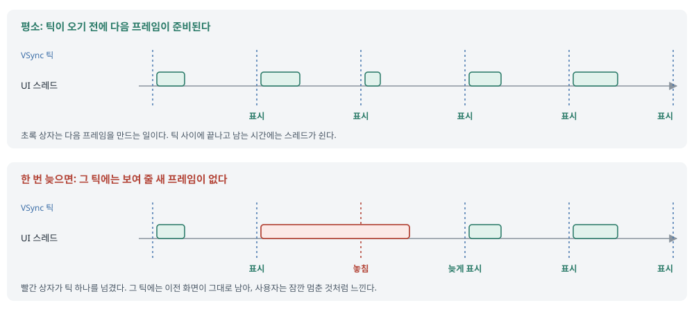
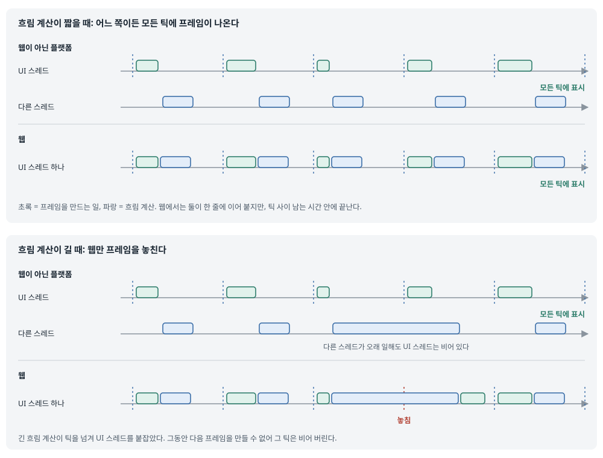
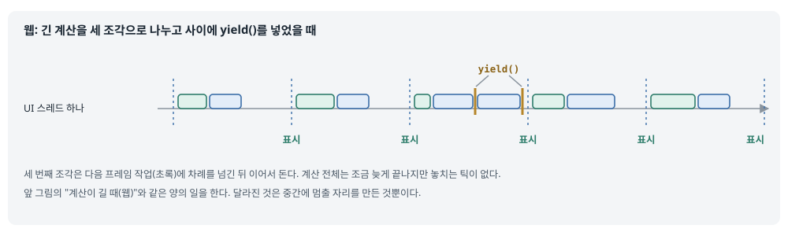
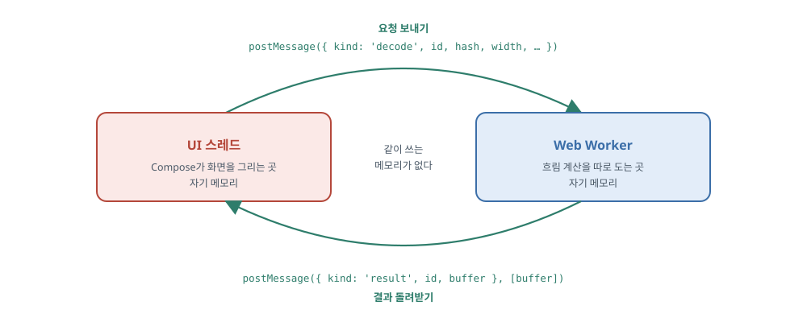

## 한 줄 요약

Kotlin 코루틴의 `Dispatchers.Default`(계산용 작업 배정기)는 Android와 데스크톱에서는 진짜 다른 스레드에서 돌지만, **웹에서는 화면을 그리는 UI 스레드 하나에서 함께 돈다.** 그래서 웹에서는 계산을 `Default`로 옮겨도 계산이 길면 프레임을 놓친다. 원문은 이를 피하는 두 방법을 보여 준다. 첫째, 계산을 조각내고 사이에 `yield()`(다른 일에 차례 넘기기)를 넣는다. 둘째, 조각낼 수 없는 계산은 **Web Worker**(브라우저가 주는 별도 실행 공간)로 보내고 메시지로 결과를 받는다. 예제는 이미지가 오기 전에 보여 주는 흐린 미리보기(BlurHash)를 만드는 계산이고, 저자는 같은 방법을 이미지 라이브러리 Coil에도 넣었다.

> 원문 블로그에는 공개 라이선스 표시가 없다. 그래서 원문 그림은 한국어로 다시 그렸고, 실제 화면 캡처 3장은 원문 서버 주소를 걸어 보여 준다. 원문 코드는 원래 나온 오픈소스 저장소에서 인용했다. 흐림 계산 코드는 Pixelix(GPL-3.0), Web Worker 코드는 저자가 같은 구조로 Coil에 넣은 코드(Apache-2.0)다. Aide 쪽 코드는 직접 쓴 스케치이고 컴파일하지 않았다.

## 먼저 알아 둘 말

- **디스패처(Dispatcher)**: 코루틴을 **어느 스레드에서 돌릴지** 정하는 배정기. `withContext(Dispatchers.IO) { … }`처럼 쓴다.
  - `Dispatchers.Main`: 화면을 그리는 UI 스레드(Android의 메인 스레드).
  - `Dispatchers.Default`: 계산이 많은 일(데이터 가공, 정렬 등)용. 디스패처를 적지 않으면 이것이 쓰인다.
  - `Dispatchers.IO`: 파일 읽기, 막히는 네트워크 호출처럼 **기다리는 동안 스레드를 붙잡는 일**용.
  - `Dispatchers.Unconfined`: 지금 스레드에서 바로 시작하고, 처음 멈췄다 다시 시작할 때는 멈추게 한 쪽이 고른 스레드에서 이어 간다. 일반 앱 코드에서는 거의 쓰지 않는다.
- **UI 스레드(메인 스레드)**: 화면을 그리고 터치를 받는 스레드. 여기서 오래 걸리는 일을 하면 화면이 멈춘다. Android의 ANR(앱 응답 없음)과 버벅임이 같은 원인이다.
- **VSync 틱**: 화면이 새 프레임을 가져가는 일정한 순간. 60Hz 화면이면 약 16.7ms마다 온다. 그 전에 다음 프레임이 준비돼 있어야 한다.
- **프레임 놓침(dropped frame)**: 틱이 왔는데 새 프레임이 준비되지 않아 이전 화면이 한 번 더 보이는 것. 사용자는 "버벅인다"고 느낀다. Android에서는 jank라고도 부른다.
- **멀티스레딩과 단일 스레드 멀티태스킹**: 멀티스레딩은 여러 스레드가 **동시에** 일하는 것이다. 단일 스레드 멀티태스킹은 스레드 하나가 여러 일을 **번갈아** 하는 것이다. 원문은 웹의 코루틴이 후자라는 점을 강조한다.
- **공유 메모리**: 여러 스레드가 같은 변수와 객체를 함께 읽고 쓰는 것. JVM과 iOS(네이티브)에서는 된다. 브라우저에서는 안 된다(아래 Web Worker 참고).
- **웹 타깃(Kotlin/JS, Kotlin/Wasm)**: Kotlin 코드를 브라우저에서 돌게 컴파일하는 대상. Compose Multiplatform은 Wasm(브라우저가 빠르게 실행하는 바이너리 형식)으로 웹 화면을 그린다.
- **BlurHash**: 이미지를 20~30글자짜리 문자열로 줄여 담는 방식. 이 문자열을 풀면(해독하면) 원본 색 분위기만 남은 흐린 그림이 나온다. 진짜 이미지가 오기 전에 회색 칸 대신 보여 준다.
- **`yield()`**: 코루틴이 "잠깐 멈출 테니 다른 일 먼저 하라"고 차례를 넘기는 함수. 같은 디스패처에서 기다리던 다른 일이 돌고 나서 이어서 실행된다.
- **일시 중단 지점(suspension point)**: 코루틴이 멈췄다 다시 이어질 수 있는 자리. `yield()`, `delay()`, `withContext()` 같은 suspend 함수 호출이 여기에 해당한다. 이런 자리가 없는 긴 반복문은 끝날 때까지 스레드를 놓지 않는다.
- **Web Worker**: 브라우저가 주는 **별도 실행 공간**. 메인 스레드와 동시에 돌지만 메모리를 같이 쓰지 않는다. 대화는 `postMessage()`로 메시지를 주고받는 것뿐이다.
- **액터 모델(actor model)**: 각자 자기 상태를 가진 독립된 실행 단위(액터)가 메시지로만 대화하는 구조. Web Worker가 이 모양이다.
- **structured clone(구조적 복제)**: `postMessage()`로 객체를 보낼 때 브라우저가 **복사본**을 만들어 보내는 방식. `Date`, `Map`, `Set`, `ArrayBuffer`, 배열 등이 이렇게 복사된다.
- **transferable(소유권 넘기기)**: 복사하지 않고 객체의 **소유권 자체를 넘기는** 방식. 넘긴 쪽은 그 객체를 더 쓸 수 없다. 큰 픽셀 버퍼(`ArrayBuffer`)를 보낼 때 복사 비용을 없앤다.
- **Blob과 object URL**: Blob은 브라우저 안의 "파일처럼 다룰 수 있는 데이터 덩어리"다. `URL.createObjectURL(blob)`은 그 덩어리에 임시 주소를 붙여 준다. 원문은 이 주소로 Web Worker 스크립트를 띄운다.
- **`suspendCancellableCoroutine`**: 콜백 방식 API를 suspend 함수로 바꿀 때 쓰는 함수. 블록 안에서 받은 **continuation**(멈춘 코루틴을 다시 깨우는 손잡이)에 `resume(값)`이나 `resumeWithException(에러)`를 부르면 코루틴이 이어진다.
- **`invokeOnCancellation`**: 위 코루틴이 취소될 때(화면을 벗어나는 등) 실행할 정리 코드를 등록하는 함수. 원문에서는 Web Worker에 "그 일 그만해"라는 메시지를 보낸다.

## 서론 — 코루틴의 기본 디스패처

<figure class="media"><figcaption>원문 표지. 흰 바탕에 알록달록한 추상 도형과 글 제목이 있다. 원문 서버의 이미지를 그대로 걸었다.</figcaption></figure>

**Kotlin에서 멀티스레딩과 비동기 코드는 kotlinx.coroutines로 다루는 것이 표준이다.**
- 라이브러리는 기본 디스패처 4개(Main, Default, IO, Unconfined)를 준다. 각각의 역할은 위 용어 풀이에 적었다.
- Compose Multiplatform 앱의 코드는 보통 `Dispatchers.Main`에서 시작한다. 그래서 막히는 일과 무거운 일은 다른 곳으로 옮겨야 UI가 멈추지 않는다.
- 표준 방식은 이렇다. 파일과 네트워크처럼 **막히는 호출은 `Dispatchers.IO`**로, **무거운 계산은 `Dispatchers.Default`**로 옮긴다. Android 개발자에게 익숙한 규칙과 같다.

**디스패처가 꼭 진짜 스레드를 따로 쓰는 것은 아니다.**
- 저자의 설명은 이렇다. UI를 그리는 스레드 하나도 충분히 빨라서, 한 프레임을 그리고 나면 다음 프레임까지 대개 쉬고 있다.
- 그 쉬는 시간에 다른 일을 끼워 넣는 것도 디스패처가 할 수 있는 일이다. 이럴 때는 "멀티스레딩"보다 **"스레드 하나에서의 멀티태스킹"**이라고 부르는 편이 정확하다.

## 프레임을 제때 내기

**UI는 추가 작업이 있어도 없을 때처럼 부드러워야 한다. 그러려면 프레임이 틱 전에 준비돼야 한다.**
- 화면 주사율(1초에 몇 번 새로 그리는지)은 보통 시스템이 정한다. 화면이 새 프레임을 가져가는 동기화 순간을 VSync 틱이라고 부른다.
- 이전 프레임이 다음 틱까지 준비되지 않으면 그 프레임은 놓친다. 사용자 눈에 꽤 잘 띈다.
- 저자는 Compose에서는 내부 최적화 덕분에 이런 일이 아주 드물다고 덧붙인다. 문제는 우리가 같은 스레드에 무거운 일을 올릴 때다.

<figure><a class="figure-scroll" href="../assets/752-mt-frames.svg"></a><figcaption>평소의 프레임과 놓친 프레임. 원문의 그림 두 장(<a href="https://terrablog.pages.dev/images/ww-img1.webp">추가 부담 없이 그리기</a>, <a href="https://terrablog.pages.dev/images/ww-img2.webp">프레임을 놓친 경우</a>)을 바탕으로 한 장에 다시 그림.</figcaption></figure>

## 웹만의 사정

**kotlinx.coroutines는 Android, 데스크톱 JVM, iOS, 브라우저에서 모두 돈다. 하지만 브라우저에는 같은 스레드 모델이 없다.**
- 다른 플랫폼은 여러 스레드가 **메모리를 함께 쓰며 동시에** 돌 수 있다. 브라우저에는 그런 방식이 없다.
- 그래서 웹 타깃이 있는 프로젝트에서는 두 가지가 달라진다.
  - **`Dispatchers.IO`를 공통 코드(commonMain)에서 쓸 수 없다.** 웹에는 IO용 스레드 묶음이 없기 때문이다.
  - **`Dispatchers.Default`가 UI와 같은 스레드에서 돈다.** 이름은 같지만, 웹에서는 "다른 스레드로 보내기"가 아니라 "같은 스레드에서 나중에 차례대로 하기"가 된다.

## 실제 예: 흐린 이미지 미리보기

**이미지가 느리게 올 때 회색 칸 대신 흐린 미리보기를 보여 주고 싶다.**
- 이미지 자체는 내려받는 데 시간이 꽤 걸린다. 그래서 서버 응답에 이미지 주소와 함께 **작은 문자열(BlurHash)**을 넣어 준다. 이 문자열을 풀면 흐린 미리보기가 된다.
- 결과적으로 사용자는 이미지가 오는 동안 그 이미지의 대략적인 색을 먼저 본다.

<figure class="media"><div class="media-row"></div><figcaption>왼쪽: 서버 응답 예. 이미지 항목의 맨 아래 <code>"blurhash"</code> 값을 화살표로 가리킨다. 오른쪽: 흐린 미리보기를 쓰는 앱(Pixelix 웹판). 아직 받지 못한 이미지 자리가 흐린 색 덩어리로 보인다. 둘 다 원문 서버의 이미지를 그대로 걸었다.</figcaption></figure>

**문자열을 풀어 흐린 그림을 만드는 데는 계산이 꽤 든다. 그래서 먼저 `Dispatchers.Default`로 옮긴다.**

```kotlin
private object BlurHashDecoder {
    suspend fun decode(
        blurHash: String?,
        width: Int? = 30,
        height: Int? = 60,
        punch: Float = 1f
    ): ImageBitmap? = withContext(Dispatchers.Default) {
        if (blurHash == null || width == null || height == null || blurHash.length < 6) {
            return@withContext null
        }
        require(width > 0) { "Width must be greater than zero" }
        require(height > 0) { "height must be greater than zero" }

        val numCompEnc = decode83(blurHash, 0, 1)
        val numCompX = (numCompEnc % 9) + 1
        val numCompY = (numCompEnc / 9) + 1
        if (blurHash.length != 4 + 2 * numCompX * numCompY) {
            return@withContext null
        }
        val maxAcEnc = decode83(blurHash, 1, 2)
        val maxAc = (maxAcEnc + 1) / 166f
        val colors = Array(numCompX * numCompY) { i ->
            if (i == 0) {
                val colorEnc = decode83(blurHash, 2, 6)
                decodeDc(colorEnc)
            } else {
                val from = 4 + i * 2
                val colorEnc = decode83(blurHash, from, from + 2)
                decodeAc(colorEnc, maxAc * punch)
            }
        }
        composeBitmap(width, height, numCompX, numCompY, colors)
    }
```

> 출처: Pixelix `BlurHashDecoder.kt` 39~71행 ([ghostbyte-dev/pixelix](https://github.com/ghostbyte-dev/pixelix/blob/4482cb660d49738e061981728a2455bcddd1b8ce/sharedUI/src/commonMain/kotlin/com/daniebeler/pfpixelix/utils/BlurHashDecoder.kt#L39-L71), GPL-3.0). 원문은 같은 코드를 `internal object`로 실었다. 아래의 `decode83`, `decodeDc`, `decodeAc`, `composeBitmap` 함수는 줄였다.

- `withContext(Dispatchers.Default)`: 함수 몸통 전체를 계산용 디스패처에서 돌린다. Android에서는 이 한 줄로 UI 스레드가 풀려난다.
- 첫 `if`: 문자열이 없거나 6글자보다 짧으면 그릴 수 없으니 `null`(미리보기 없음)을 돌려준다.
- `decode83(blurHash, 0, 1)`: BlurHash는 83진법 글자로 숫자를 담는다. 첫 글자에서 가로(`numCompX`), 세로(`numCompY`) 방향으로 색 성분이 몇 개인지 읽는다.
- 길이 검사: 성분 개수로 계산한 길이와 실제 길이가 다르면 깨진 문자열로 보고 `null`을 돌려준다.
- `maxAc`: 둘째 글자에서 색 변화의 최대 세기를 읽는다. `punch`는 그 세기를 키우거나 줄이는 값이다.
- `colors`: 첫 성분(`i == 0`)은 그림 전체의 평균 색(DC), 나머지는 위치에 따라 달라지는 색 변화(AC)다.
- `composeBitmap(…)`: 이 성분들로 가로 `width`, 세로 `height` 픽셀을 하나하나 계산해 그림을 만든다. 계산이 실제로 무거운 곳이 여기다.

**이상적인 경우에는 Android와 웹 모두 잘 돈다. 하지만 계산이 예상보다 길어지면 웹만 프레임을 놓친다.**

<figure><a class="figure-scroll" href="../assets/752-mt-threads.svg"></a><figcaption>같은 코드가 웹이 아닌 플랫폼과 웹에서 어떻게 도는지. 원문의 그림 두 장(<a href="https://terrablog.pages.dev/images/ww-img5.webp">짧은 계산</a>, <a href="https://terrablog.pages.dev/images/ww-img6.webp">긴 계산</a>)을 바탕으로 한 장에 다시 그림.</figcaption></figure>

## yield()로 일을 나누기

**웹 타깃에서 돌 Kotlin 코드는 중간에 쉬지 않고 오래 도는 구간이 있으면 안 된다.**
- 저자는 이것을 웹용 Kotlin 코드를 설계할 때의 **핵심**이라고 강조한다. 다른 일(특히 다음 프레임 만들기)에도 차례를 줘야 한다.
- 그 용도로 있는 것이 kotlinx.coroutines의 `yield()`다.
- 원문은 흐림 계산을 **차례로 이어지는 세 부분**으로 나눌 수 있다고 가정하고, 그 사이에 차례를 넘기는 그림을 보여 준다. 나누는 코드 자체는 싣지 않았다.

<figure><a class="figure-scroll" href="../assets/752-mt-yield.svg"></a><figcaption>긴 계산을 나누고 사이에 yield()를 넣은 모습. 원문 그림(<a href="https://terrablog.pages.dev/images/ww-img7.webp">긴 흐림 계산을 나눈 경우</a>)을 바탕으로 다시 그림.</figcaption></figure>

- **결과**: UI는 빠르고 반응도 좋게 유지하면서, 무거운 일은 자원이 날 때마다 조금씩 처리한다. 계산 전체가 끝나는 시점은 조금 늦어진다.
- **라이브러리 작성자에게 하는 말**: 웹 타깃을 지원하려면 이 제약을 **일부러 고려해서** 지원해야 한다. 공통 코드가 웹에서도 컴파일된다고 웹에서 잘 도는 것은 아니다.

## Web Worker

**그런데 흐림 계산을 남이 만든 라이브러리가 하고, 그 안에 멈출 자리를 넣을 수 없다면?**
- 앞에서 말했듯 브라우저에는 JVM이나 네이티브처럼 메모리를 함께 쓰는 스레드가 없다. 대신 **Web Worker**가 있다.
- Web Worker는 메인 스레드와 **동시에** 돌지만, 메모리는 **완전히 따로**다. 바로 이 점 때문에 kotlinx.coroutines의 디스패처를 Web Worker로 구현할 수는 없다. 디스패처는 코루틴이 같은 객체를 그대로 들고 스레드를 옮겨 다닐 수 있어야 하기 때문이다.
- 그래서 Web Worker는 **자기 상태를 가진 독립 부품**이다. 데이터를 담은 메시지를 보내면 결과를 담은 메시지가 돌아온다. 이 구조를 액터 모델이라고 부른다.

<figure><a class="figure-scroll" href="../assets/752-mt-actor.svg"></a><figcaption>UI 스레드와 Web Worker는 메시지만 주고받는다. 원문 그림(<a href="https://terrablog.pages.dev/images/ww-img8.webp">Actors</a>, 두 상자 사이를 편지 아이콘이 오가는 그림)을 바탕으로, 이 글의 실제 메시지 내용을 넣어 다시 그림.</figcaption></figure>

**`postMessage()`로 보낼 수 있는 것은 세 가지 방식으로 나뉜다.**
- **기본값**: 문자열, 숫자, 참거짓, `null`은 그대로 보낸다.
- **복사해서 보내기**: `Date`, `Map`, `Set`, `ArrayBuffer`, 배열 등은 [structured clone](https://developer.mozilla.org/en-US/docs/Web/API/Web_Workers_API/Structured_clone_algorithm) 방식으로 복사본이 간다.
- **소유권 넘기기**: 복사 대신 [transferable](https://developer.mozilla.org/en-US/docs/Web/API/Web_Workers_API/Transferable_objects) 방식으로 소유권을 넘길 수 있다. 넘긴 뒤에는 UI 스레드에서 그 객체를 쓸 수 없다. Web Worker가 일을 마치면 소유권을 다시 돌려받을 수 있다. 픽셀 버퍼처럼 큰 데이터에 쓴다.

## 흐림 해독을 Web Worker로 옮기기

원문은 이제 흐림 해독을 Web Worker로 옮긴다. 원문 코드는 BlurHash용으로 다듬은 것이고, 저자가 같은 구조를 이미지 디코딩용으로 [Coil에 넣은 코드](https://github.com/coil-kt/coil/pull/3305)가 Apache-2.0으로 공개돼 있다. 아래에서는 **Coil 코드를 인용**하고, 원문 BlurHash판과 다른 점을 함께 적는다.

### 1. Web Worker 만들기

**Web Worker 코드는 Kotlin으로 써서 JavaScript로 컴파일할 수도 있다. 저자는 작은 일이라 그냥 JavaScript로 쓴다.**
- Kotlin으로 쓰면 프로젝트 설정을 따로 해야 하고, 만들어진 스크립트를 불러오는 방법도 직접 짜야 한다.
- Web Worker 코드가 클 일이 없으니, 이런 작은 도우미에는 JavaScript가 간단하다는 것이 저자의 판단이다.
- **요령**: Web Worker 코드를 **Kotlin 문자열 상수에 넣는다.** 별도 파일을 배포하고 주소를 맞출 필요가 없어진다. 원문은 상수 위에 `//language=JavaScript` 주석을 달아, IDE가 문자열 안을 JavaScript로 색칠하고 검사하게 한다.

### 2. Web Worker 불러오기

**코드가 문자열에 있으니, 주소로 스크립트를 불러오는 대신 Blob으로 만들어 띄운다.**

```kotlin
private fun blob(code: String): Blob = js("new Blob([code], { type: 'application/javascript' })")

private fun startWorker(code: String): Worker {
    val url = URL.createObjectURL(blob(code))
    val worker = Worker(url)
    URL.revokeObjectURL(url)
    return worker
}
```

> 출처: Coil `WebWorker.kt` 100~107행 ([coil-kt/coil](https://github.com/coil-kt/coil/blob/6192abc88c96c25a8a6129f2f8c521e439b0e979/coil-core/src/jsCommonMain/kotlin/coil3/decode/WebWorker.kt#L100-L107), Apache-2.0)

- `blob(code)`: `js("…")`는 Kotlin/Wasm과 Kotlin/JS에서 JavaScript 식을 그대로 쓰는 방법이다. 문자열을 "JavaScript 파일"이라는 표시를 붙인 Blob으로 만든다.
- `URL.createObjectURL(…)`: 그 Blob에 임시 주소를 붙인다.
- `Worker(url)`: 그 주소의 스크립트로 Web Worker를 띄운다.
- `URL.revokeObjectURL(url)`: Worker를 띄웠으니 임시 주소는 바로 지운다. 주소를 남겨 두면 Blob이 메모리에 계속 남는다.

원문 BlurHash판은 여기에 몇 가지를 더 한다.
- **한 번만 만들고 다시 쓴다**: `worker?.let { return it }`으로 이미 만든 Worker가 있으면 그것을 돌려준다. Coil은 같은 일을 `by lazy`로 한다.
- **Worker 생성이 실패해도 주소를 지운다**: `Worker(url)`을 `try`로 감싸고 `finally`에서 `revokeObjectURL`을 부른다.
- **에러 신호를 둘 다 듣는다**: `"message"` 외에 `"error"`(스크립트 실행 오류)와 `"messageerror"`(받은 메시지를 풀 수 없음)에도 리스너를 달아 Worker를 실패 처리한다. Coil은 `"error"`만 듣는다.

### 3. 메시지 주고받기

**보내기: 요청마다 id를 붙인다. 이미지가 화면 밖으로 나가면 그 id로 일을 취소하기 위해서다.**

```kotlin
private fun WebWorkerRequest(
    id: String,
    buffer: ArrayBuffer,
    width: Int,
    height: Int,
): JsAny = js("({ kind: 'decode', id: id, data: buffer, w: width, h: height })")

private fun WebWorkerCancelRequest(id: String): JsAny = js("({ kind: 'cancel', id: id })")
```

> 출처: Coil `WebWorker.kt` 209~216행 ([coil-kt/coil](https://github.com/coil-kt/coil/blob/6192abc88c96c25a8a6129f2f8c521e439b0e979/coil-core/src/jsCommonMain/kotlin/coil3/decode/WebWorker.kt#L209-L216), Apache-2.0)

- 요청은 JavaScript 객체 하나다. `kind`로 종류(`'decode'` 해독, `'cancel'` 취소)를 나누고 `id`로 어떤 요청인지 구별한다.
- Coil은 이미지 바이트(`buffer`)와 크기를 보낸다. 원문 BlurHash판은 대신 `hash` 문자열, `width`, `height`, `punch`를 보낸다.

**Web Worker 쪽: 해독 중인 id와 취소된 id를 각각 집합으로 기억한다.**

```javascript
const active = new Set();
const cancelled = new Set();

self.onmessage = async (e) => {
    const { kind, id } = e.data;
    if (kind === "cancel") {
        if (active.has(id)) cancelled.add(id);
        return;
    }

    const { data, w, h } = e.data;
    active.add(id);
    try {
        var blob = new Blob([data]);
        var bmp = null;
        try {
            bmp = await createImageBitmap(blob, {
                resizeWidth: w,
                resizeHeight: h,
                resizeQuality: 'high'
            });
            if (cancelled.has(id)) return;

            const ctx = ensureCanvas(w, h);
            ctx.clearRect(0, 0, w, h);
            ctx.drawImage(bmp, 0, 0);
            if (cancelled.has(id)) return;

            const imgData = ctx.getImageData(0, 0, w, h);
            const rawBuffer = imgData.data.buffer;
            self.postMessage(
                { kind: "result", id: id, buffer: rawBuffer },
                [rawBuffer]
            );
        } finally {
            bmp?.close();
        }
    } catch (err) {
        if (!cancelled.has(id)) {
            self.postMessage(
                { kind: "error", id: id, message: err?.message ?? String(err), }
            );
        }
    } finally {
        active.delete(id);
        cancelled.delete(id);
    }
};
```

> 출처: Coil `WebWorker.kt`의 `WebWorkerJs` 문자열 40~97행 중 캔버스 준비 함수를 뺀 부분 ([coil-kt/coil](https://github.com/coil-kt/coil/blob/6192abc88c96c25a8a6129f2f8c521e439b0e979/coil-core/src/jsCommonMain/kotlin/coil3/decode/WebWorker.kt#L40-L97), Apache-2.0). Kotlin 파일 안에서는 `private const val WebWorkerJs = """ … """`로 감싸 있다.

- `active`, `cancelled`: 지금 처리 중인 id와 취소 요청이 온 id를 기억한다. Worker는 자기 메모리만 있으니 이런 상태를 Worker 안에 둔다.
- `kind === "cancel"`: 처리 중인 id에 대한 취소만 기록하고 끝낸다. 이미 끝난 일에 대한 취소는 무시된다.
- 해독 본체(`createImageBitmap`, 캔버스에 그리기, `getImageData`): Coil은 브라우저 내장 기능으로 이미지 바이트를 픽셀로 바꾼다. 원문 BlurHash판은 이 자리에 `decode(hash, width, height, punch, id)` 함수 하나를 부른다.
- 중간중간 `if (cancelled.has(id)) return;`: `await`로 기다린 뒤에는 그사이 취소됐을 수 있으니 확인하고 결과를 버린다.
- `self.postMessage({ kind: "result", … }, [rawBuffer])`: 둘째 인자에 버퍼를 넣어 **소유권을 넘긴다.** 큰 픽셀 버퍼를 복사하지 않는다.
- `catch`: 실패하면 취소된 일이 아닐 때만 `kind: "error"` 메시지를 보낸다.
- `finally`: 성공, 실패, 취소 어느 쪽이든 두 집합에서 id를 지운다.

**받기: 메시지의 모양을 Kotlin 인터페이스로 적고, id로 기다리던 코루틴을 찾아 깨운다.**

```kotlin
private val pendingRequests = mutableMapOf<String, CancellableContinuation<ArrayBuffer>>()

private val workerMessageListener: (Event) -> Unit = { event ->
    val data = (event as? MessageEvent)?.data?.unsafeCast<WebWorkerMessage>()
    if (data != null) {
        val continuation = pendingRequests.remove(data.id)
        if (continuation?.isActive == true) {
            when (data.kind) {
                "result" -> continuation.resume(data.unsafeCast<WebWorkerResponse>().buffer)
                "error" -> {
                    val message = data.unsafeCast<WebWorkerError>().message
                    continuation.resumeWithException(
                        IllegalStateException("WebWorker error: $message"),
                    )
                }
            }
        }
    }
}

internal external interface WebWorkerMessage : JsAny {
    val id: String
    val kind: String
}

internal external interface WebWorkerResponse : WebWorkerMessage {
    val buffer: ArrayBuffer
}

internal external interface WebWorkerError : WebWorkerMessage {
    val message: String
}
```

> 출처: Coil `WebWorker.kt` 109~127행, 218~229행 ([coil-kt/coil](https://github.com/coil-kt/coil/blob/6192abc88c96c25a8a6129f2f8c521e439b0e979/coil-core/src/jsCommonMain/kotlin/coil3/decode/WebWorker.kt#L109-L127), Apache-2.0)

- `pendingRequests`: id마다 "이 결과를 기다리는 코루틴의 손잡이(continuation)"를 담아 둔다.
- `external interface … : JsAny`: JavaScript 객체에 어떤 필드가 있는지 Kotlin에게 알려 주는 선언이다. 실제 변환은 하지 않는다. `unsafeCast`로 "이 모양이라고 믿고 읽겠다"고 말한다.
- `pendingRequests.remove(data.id)`: 꺼내면서 지운다. 같은 id로 두 번 깨우는 일이 없다.
- `continuation?.isActive == true`: 이미 취소된 코루틴이면 깨우지 않는다.
- `"result"`이면 버퍼로 `resume`, `"error"`이면 예외로 `resumeWithException`한다.

원문 BlurHash판은 `kind`가 `"result"`도 `"error"`도 아니면 "예상하지 못한 응답"이라는 예외로 깨우는 갈래를 하나 더 둔다. Coil은 그런 메시지를 조용히 버린다.

### 4. suspend 함수로 감싸기

**마지막으로 이 전부를 suspend 함수 하나로 감싼다. 부르는 쪽은 Web Worker가 있는지도 모르고 `decode(…)`만 기다린다.**

```kotlin
private suspend fun decodeBytesToBitmap(
    bytes: ByteArray,
    width: Int,
    height: Int,
): ArrayBuffer = suspendCancellableCoroutine { continuation ->
    val id = Uuid.random().toString()
    pendingRequests[id] = continuation
    continuation.invokeOnCancellation {
        if (pendingRequests.remove(id) != null) {
            worker.postMessage(WebWorkerCancelRequest(id))
        }
    }

    val buffer = bytes.toInt8Array().buffer
    val transfer = JsArray<JsAny>().apply { set(0, buffer) }
    try {
        worker.postMessage(WebWorkerRequest(id, buffer, width, height), transfer)
    } catch (throwable: Throwable) {
        pendingRequests.remove(id)
        if (continuation.isActive) {
            continuation.resumeWithException(throwable)
        }
    }
}
```

> 출처: Coil `WebWorker.kt` 183~207행 ([coil-kt/coil](https://github.com/coil-kt/coil/blob/6192abc88c96c25a8a6129f2f8c521e439b0e979/coil-core/src/jsCommonMain/kotlin/coil3/decode/WebWorker.kt#L183-L207), Apache-2.0)

- `suspendCancellableCoroutine { continuation -> … }`: 여기서 코루틴이 멈춘다. 위 리스너가 `resume`을 불러 줄 때까지 기다린다. 기다리는 동안 UI 스레드는 다른 일(프레임 그리기)을 한다.
- `pendingRequests[id] = continuation`: 리스너가 이 id의 결과를 받으면 이 손잡이로 깨운다.
- `invokeOnCancellation { … }`: 이미지가 화면 밖으로 나가 코루틴이 취소되면, 아직 기다리던 요청일 때만 Worker에 취소 메시지를 보낸다.
- `transfer`: 이미지 바이트 버퍼의 소유권을 Worker에 넘긴다. 복사하지 않는다.
- `try … catch`: 메시지 보내기 자체가 실패하면 기다리던 항목을 지우고 예외로 깨운다. 영원히 기다리는 코루틴이 남지 않게 한다.

원문 BlurHash판과의 차이는 세 가지다.
- id를 `Uuid.random()` 대신 `nextId++`로 만든다.
- 취소 메시지 보내기를 `runCatching`으로 감싼다. 원문 주석의 뜻은 "이미 실패했거나 종료된 Worker 때문에 **취소가 예외로 바뀌면 안 된다**"이다.
- 요청을 보내기 전에 `continuation.isActive`를 확인해, 이미 취소된 코루틴이면 보내지 않는다.

## 결론

**이제 무거운 계산은 UI 스레드 밖에서 돌고, UI를 막을 수 없다.**
- 저자는 같은 방법으로 Coil의 이미지 처리를 Web Worker로 옮긴 [PR #3305](https://github.com/coil-kt/coil/pull/3305)도 소개한다. 웹 타깃에서 성능이 눈에 띄게 좋아졌다고 한다. 이 PR은 2026년 2월 11일 병합됐다.
- 이 글은 같은 저자의 [브라우저에서 Compose Multiplatform 앱 프로파일링하기](https://terrablog.pages.dev/blog/profiling-compose-multiplatform-app-in-browser/)(Profiling a Compose Multiplatform app in the browser)에 이어지는 글이다.

## 코드로 보기 — Aide 구조로 옮긴 스케치

Aide는 Android 전용 앱이라 웹의 제약은 직접 해당하지 않는다. Android에서는 `Dispatchers.Default`가 진짜 다른 스레드이기 때문이다. 그래도 이 글의 두 요령, **긴 반복문에 멈출 자리 두기**와 **콜백을 취소 가능한 suspend 함수로 감싸기**는 Android에서도 그대로 쓸모가 있다. 의미만 조금 다르다.

### 긴 반복문의 멈출 자리 — Android에서는 "프레임"이 아니라 "취소" 때문

Aide의 `ContentResolverCalendarDataSource.query()`는 이미 `withContext(Dispatchers.IO)` 안에서 커서를 끝까지 읽는다. 다른 스레드라 화면은 멈추지 않는다. 다만 반복문 안에 멈출 자리가 없어서, 화면을 벗어나 코루틴이 취소돼도 **커서를 끝까지 다 읽은 뒤에야** 멈춘다. 일정이 많아지는 경우(예: 몇 년치 반복 일정 범위 조회)에 대비한 스케치다.

```kotlin
// 직접 쓴 스케치. Aide 실제 코드가 아니다.
private suspend fun <T> query(
    uri: Uri,
    projection: Array<String>,
    mapper: (Cursor) -> T,
): List<T> = withContext(Dispatchers.IO) {
    contentResolver.query(uri, projection, null, null, null)?.use { cursor ->
        buildList {
            while (cursor.moveToNext()) {
                if (cursor.position % 200 == 0) ensureActive() // 취소됐으면 여기서 멈춘다
                add(mapper(cursor))
            }
        }
    }.orEmpty()
}
```

- `ensureActive()`: 코루틴이 취소됐으면 그 자리에서 `CancellationException`을 던진다. `yield()`와 달리 차례를 넘기지는 않는다. 다른 스레드에서 돌고 있으니 차례를 넘길 이유가 없고, 취소 확인만 있으면 된다.
- `% 200`: 매 줄마다 확인하지 않고 200줄마다 확인한다. 숫자는 예시다.
- 만약 이 반복문이 `Dispatchers.Main`에서 돈다면 그때는 원문처럼 `yield()`가 프레임에 차례를 넘겨 준다. 하지만 Aide 규칙상 이런 일은 Main에 두지 않는다.

### 콜백 SDK를 suspend 함수로 — 1-b AI 제공자 호출

1-b에서 AI 제공자 1곳에 요청을 보낼 때, 그 SDK가 콜백 방식이면 원문 4단계와 같은 모양으로 감싼다. 아래 `LlmClient`는 **가상의 API**다. 실제 제공자는 아직 정하지 않았다.

```kotlin
// 직접 쓴 스케치. LlmClient, Call, Callback은 가상의 API다.
suspend fun LlmClient.complete(prompt: String): String =
    suspendCancellableCoroutine { continuation ->
        val call: Call = send(prompt, object : Callback {
            override fun onSuccess(text: String) {
                if (continuation.isActive) continuation.resume(text)
            }
            override fun onError(error: Throwable) {
                if (continuation.isActive) continuation.resumeWithException(error)
            }
        })
        continuation.invokeOnCancellation {
            runCatching { call.cancel() } // 취소 자체가 새 예외를 만들지 않게
        }
    }
```

- 화면을 벗어나 코루틴이 취소되면 `call.cancel()`로 **서버 요청도 끊는다.** 끊지 않으면 결과는 버려지는데 요청 비용(토큰)은 나간다.
- `runCatching`은 원문 BlurHash판의 주석과 같은 이유다. 이미 끝난 요청을 취소하다 예외가 나도 취소 흐름을 깨지 않는다.
- SDK가 이미 suspend 함수를 주면 이 감싸기는 필요 없다. 그 경우에도 "취소되면 요청이 실제로 끊기는가"는 SDK 문서에서 확인한다.

## 배운 점

- **같은 `Dispatchers.Default`라도 플랫폼마다 뜻이 다르다.** Android에서는 "다른 스레드로 보내기", 웹에서는 "같은 스레드에서 나중에 하기"다. 공통 코드가 컴파일된다고 모든 플랫폼에서 같은 성능을 내는 것은 아니다.
- **화면을 멈추는 것은 "무거운 일"이 아니라 "쉬지 않고 오래 도는 일"이다.** 같은 양의 일도 나눠서 사이에 차례를 넘기면 프레임을 놓치지 않는다. 대신 전체 완료 시간은 조금 늘어난다.
- **메모리를 같이 쓰지 못하면 메시지와 id로 대화한다.** 요청마다 id를 붙이고, 기다리는 쪽 목록(`pendingRequests`)과 처리하는 쪽 목록(`active`, `cancelled`)을 각자 둔다. 취소도 메시지 하나다.
- **콜백을 suspend 함수로 감쌀 때 빠뜨리기 쉬운 세 가지**: 취소되면 상대에게도 알린다(`invokeOnCancellation`), 보내기가 실패하면 기다리는 항목을 지우고 예외로 깨운다, 이미 끝난 코루틴은 두 번 깨우지 않는다(`isActive`, `remove`).
- **큰 데이터는 복사하지 말고 소유권을 넘긴다.** 브라우저의 transferable이 그 장치다. Android에는 같은 개념이 없지만, "큰 버퍼를 스레드 사이에 오가며 복사하지 않는다"는 생각은 같다.

## Aide에 적용하면

Aide는 Android 전용(`minSdk 26`)이고 웹 타깃이 없다. 현재 커밋은 Task 6(캘린더 이식)까지다. 코드에서 디스패처를 직접 쓰는 곳은 `ContentResolverCalendarDataSource.query()`의 `withContext(Dispatchers.IO)` 하나다. 그래서 이 글의 웹 전용 내용(Web Worker, 웹의 `Default`)은 쓸 곳이 없고, 일반 원칙만 가져온다.

1. **"막히는 일은 IO, 계산은 Default, Main에는 둘 다 두지 않는다"를 AI 리뷰 기준으로 쓴다 — 가져온다.**
   - 지금 캘린더 조회는 이미 `Dispatchers.IO`에서 돈다. 이 규칙과 맞다.
   - 앞으로 Task 7(할 일, Room)과 Task 9(설정, DataStore)는 라이브러리가 알아서 스레드를 옮겨 주므로 따로 `withContext`를 두지 않는다. Task 12의 알람 다시 걸기, 1-b의 AI 응답 처리처럼 직접 짠 반복과 가공이 생기면 이 기준으로 본다.
   - 각 Task 끝의 "AI 리뷰 요청"에서 "Main에서 커서, 파일, 네트워크를 다루거나 긴 반복문을 도는 곳이 있는가"를 확인 항목으로 넣는다.
2. **긴 반복문에 `ensureActive()`를 둔다 — 바꿔서 가져온다. 지금은 필요 없다.**
   - 원문의 `yield()`는 웹에서 프레임에 차례를 넘기려는 것이다. Aide는 다른 스레드에서 도니 그 이유는 없고, 남는 이유는 **취소가 빨리 먹히게** 하는 것이다. 그래서 `yield()` 대신 `ensureActive()`가 맞다.
   - 지금의 캘린더 조회는 화면에 보이는 범위만 읽어서 짧다. 실제로 오래 걸리는 것을 보지 못했으니 지금은 넣지 않는다. 몇 달 이상 범위를 한 번에 읽는 기능이 생기면 위 스케치처럼 넣는다.
3. **1-b에서 콜백 방식 SDK를 감쌀 때 원문 4단계 모양을 따른다 — 가져온다.**
   - `suspendCancellableCoroutine`으로 감싸고, `invokeOnCancellation`에서 요청을 실제로 끊고, 끊기 자체는 `runCatching`으로 감싼다. 이유는 위 스케치에 적었다. 요청을 끊지 않으면 버려질 응답에도 토큰 비용이 나간다.
   - AI 제공자는 아직 1곳으로 시작한다는 것만 정해져 있다(decisions.md "1-b AI"). 그 SDK가 suspend 함수를 주면 이 항목은 "취소 시 요청이 끊기는지 문서로 확인한다"로 줄어든다.
   - 이미 같은 원칙이 들어간 곳이 있다. `observeChanges()`는 `callbackFlow`로 ContentObserver를 감싸고, `awaitClose`에서 등록을 푼다. 콜백을 코루틴으로 감쌀 때 "끝나면 정리한다"를 이미 지키고 있다.
4. **Web Worker와 BlurHash 미리보기 — 지금은 안 한다.**
   - Web Worker는 웹 타깃에만 있는 장치다. Aide는 Android 전용이고 멀티플랫폼 계획이 없다.
   - BlurHash는 서버에서 이미지를 받는 앱에 쓸모가 있다. Aide에는 원격 이미지가 없다. 아바타는 Rive 파일을 앱에 넣어 두므로 받는 동안 보여 줄 미리보기가 필요 없다(decisions.md 2026-10-08 아바타 결정).
5. **아바타 애니메이션의 프레임 놓침 확인 — 지금은 안 한다. 1-b 아바타 작업 때 본다.**
   - 이 글의 핵심인 "UI 스레드가 틱 전에 프레임을 내야 한다"는 Aide에서는 아바타 화면에서 가장 중요해진다. 홈 위쪽에서 Rive 애니메이션이 계속 돌기 때문이다.
   - 그때 Android Studio의 프로파일러나 매크로벤치마크로 프레임 놓침을 재 본다. 지금은 아바타 코드가 없어 잴 대상이 없다.

## 출처

- 원문: [Multithreading in Compose Multiplatform Web Apps](https://terrablog.pages.dev/blog/multithreading-compose-multiplatform-web-apps/) — Konstantin Tskhovrebov, 2026-11-02, Android Weekly [#752](https://androidweekly.net/issues/issue-752)
- 흐림 해독 코드: Pixelix [`BlurHashDecoder.kt`](https://github.com/ghostbyte-dev/pixelix/blob/4482cb660d49738e061981728a2455bcddd1b8ce/sharedUI/src/commonMain/kotlin/com/daniebeler/pfpixelix/utils/BlurHashDecoder.kt) (GPL-3.0)
- Web Worker 코드: Coil [`WebWorker.kt`](https://github.com/coil-kt/coil/blob/6192abc88c96c25a8a6129f2f8c521e439b0e979/coil-core/src/jsCommonMain/kotlin/coil3/decode/WebWorker.kt) (Apache-2.0), 원문이 소개한 [Coil PR #3305 "Use web worker to decode images on Web"](https://github.com/coil-kt/coil/pull/3305)
- 원문이 인용한 자료: [MDN structured clone](https://developer.mozilla.org/en-US/docs/Web/API/Web_Workers_API/Structured_clone_algorithm), [MDN transferable objects](https://developer.mozilla.org/en-US/docs/Web/API/Web_Workers_API/Transferable_objects)
- 원문 블로그는 공개 라이선스 표시가 없어 그림은 다시 그렸다. 표지, 서버 응답, 앱 화면 캡처는 원문 서버 주소를 걸었다
